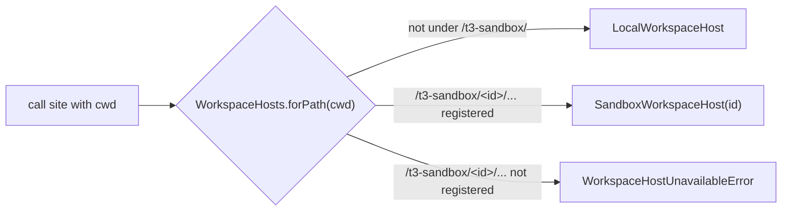

# 02 Workspace host: the seam

Status: M0 and M1 landed; the rest is a proposal, rewritten 2026-11-08 for local-first Pair Cloud.
Audience: the engineers working on the seam. Read the [plan](./README.md) first; this doc uses its
words and milestones.

The question: how does the server stop assuming a thread's files and processes are on its own
machine, without changing anything for local threads?

Two servers use the seam differently. A member's local server, in the Pair Mac app, runs every
thread on the Mac through `LocalWorkspaceHost`, exactly as today; no sandbox host ever registers
there, because only a cloud-only server offers Cloud. The Pair Cloud server is cloud-only: every
thread runs on a machine through `SandboxWorkspaceHost`, and `LocalWorkspaceHost` there serves only
server-scoped work (section 1) and the read-only project checkout. M0 and M1 built the seam on a
team server, and it carries over to Pair Cloud unchanged.

Short answer:

- `WorkspaceHost` is a value, not a layer. It carries Effect's own `ChildProcessSpawner` and
  `FileSystem` interfaces, the existing `PtyAdapter`, and a small extension for ports, process
  groups, host facts, disk checks and the coarse operations. It owns the base environment of
  every process it starts.
- A `WorkspaceHosts` service resolves the host **from the path** every call site already has. A
  sandbox's files live under a reserved root, `/t3-sandbox/<sandboxId>/`, at the same absolute
  path on the server's side and inside the sandbox. Unknown paths are local. Unregistered paths
  under the reserved root fail closed.
- The thin runner holds for provider stdio, terminals and file reads. It does not hold for the
  search index, port listing, the terminal process table or checkpoint capture. Those four run as
  coarse operations from M1 (README decision 2). They are cheap to build because the runner is a
  slim entry point of the server's own build, so it runs the same service code against its own
  `LocalWorkspaceHost`. Side chats and forks that share a sandbox resolve to the same host.

## 1. Inventory

Method: `git ls-files` over `apps/server/src`, `packages/provider-*`, `packages/effect-acp`,
`packages/effect-codex-app-server`, `packages/source-control-*`, `packages/shared`,
`packages/ssh`, `packages/tailscale` and `packages/secret-provider-*`, excluding tests, testkits
and fixtures (1,031 files). Grep patterns: `ChildProcessSpawner`, `node:child_process`,
`ProcessRunner`, `VcsProcess`, `PtyAdapter`, `node-pty`, `node:fs`, `FileSystem.FileSystem`,
`.watch(`, `node:net`, `HostProcess.*`.

### Counts

| Signal | Files | Note |
| --- | ---: | --- |
| Spawns a process or PTY (union of the spawn patterns) | 109 | 25 thread-scoped, 15 both, 2 transport-only, 67 server-scoped (25 of those are provider probes). A raw grep matches about 125; some matches only import VCS error types or wire layers. |
| Imports `node:child_process` directly | 10 | Only 2 are thread-scoped: [ClaudeAdapterV2.ts](../../../apps/server/src/orchestration-v2/Adapters/ClaudeAdapterV2.ts) and [shell.ts](../../../packages/shared/src/shell.ts). |
| Uses `ChildProcessSpawner` | 75 | Effect's injectable spawner. Most spawns already go through it. |
| Uses `FileSystem.FileSystem` | 206 | About 76 sit in thread-relevant folders (listed in the appendix). |
| Imports `node:fs` directly | 45 | 80 files opt out of Effect's `nodeBuiltinImport` diagnostic (an error in [tsconfig.effect.json](../../../tsconfig.effect.json)) with a file-level comment. |
| File watches | 4 | 3 are server settings files; 1 is the Git trace2 progress file in [GitVcsDriverCore.ts](../../../apps/server/src/vcs/GitVcsDriverCore.ts). |
| Imports `node:net` | 20 | Thread-relevant: the Codex token broker socket and preview channels. |
| Reads `HostProcess.HomeDirectory` / `Environment` | 48 / 60 | `HostProcess.Platform` appears 124 times (375 counting tests). |

### Thread-scoped: must move behind the seam (25 spawn files plus file-only modules)

| Category | File | What it does on the thread's machine |
| --- | --- | --- |
| Provider spawn | [ClaudeAdapterV2.ts](../../../apps/server/src/orchestration-v2/Adapters/ClaudeAdapterV2.ts) | Spawns `claude` through the Agent SDK's `spawnClaudeCodeProcess` hook with `node:child_process` (not Effect's spawner), as a detached process group with an fd 3 watch script (`spawnClaudeProcessGroup`), runs a history worker (`__claude-history` in [claudeHistory.ts](../../../apps/server/src/cli/claudeHistory.ts) when `HostProcess.IsExecutable`, otherwise `claude-history-worker.mjs`), reads Claude settings and skill files, calls the SDK's `resolveSettings`, `getSessionMessages`, `forkSession` and `getSubagentMessages` in process (these read settings files and `~/.claude/projects`). |
| Provider spawn | [CodexAdapterV2.ts](../../../apps/server/src/orchestration-v2/Adapters/CodexAdapterV2.ts) | Spawns `codex app-server` through `ChildProcessSpawner`, one per provider session. |
| Provider spawn | [AntigravityAcpSupport.ts](../../../apps/server/src/provider/acp/AntigravityAcpSupport.ts) and the `provider/acp/Antigravity*` files | Spawns the agent, then reads its profile, session and child-work files with `node:fs`. |
| Provider spawn | [AcpSessionRuntime.ts](../../../packages/provider-acp/src/server/AcpSessionRuntime.ts), [adapter.ts](../../../packages/provider-acp/src/server/adapter.ts), [clientTerminals.ts](../../../packages/provider-acp/src/server/clientTerminals.ts), [clientPolicy.ts](../../../packages/provider-acp/src/server/clientPolicy.ts) | Spawns ACP agents inside a cgroup v2 lease, serves the agent's `fs/read_text_file` and `terminal/create` requests from the server's disk and processes. |
| Provider spawn | ACP flavors: `acpSupport.ts` and `adapter.ts` in provider-fx, provider-grok, provider-kiro; `adapter.ts` and `AcpRegistrySupport.ts` in provider-acp-registry | Agent spawn arguments and per-flavor home reads (for example `~/.grok`). |
| Provider spawn | [OpenCodeRuntime.ts](../../../packages/provider-opencode/src/server/OpenCodeRuntime.ts) | Spawns `opencode serve --hostname --port`, then talks HTTP to that port. |
| Provider spawn | [rpc.ts](../../../packages/provider-pi/src/server/rpc.ts), [mcpInjection.ts](../../../packages/provider-pi/src/server/mcpInjection.ts) | Spawns `pi --mode rpc`; writes an MCP extension file and passes its path. |
| Provider spawn | [sdk.ts (Muse)](../../../packages/provider-muse/src/server/sdk.ts), [CursorAgentSdk.ts](../../../packages/provider-cursor/src/server/CursorAgentSdk.ts) | SDKs that spawn internally (Muse) or run the agent inside the server process (Cursor). |
| Git | [VcsProcess.ts](../../../apps/server/src/vcs/VcsProcess.ts), [GitVcsDriver.ts](../../../apps/server/src/vcs/GitVcsDriver.ts), [GitVcsDriverCore.ts](../../../apps/server/src/vcs/GitVcsDriverCore.ts), [VcsDriver.ts](../../../apps/server/src/vcs/VcsDriver.ts) | Every `git` call, checkpoint capture and restore (temp index files, `copyFile`, `utimes`), trace2 progress watch. |
| Git | [VcsDriverRegistry.ts](../../../apps/server/src/vcs/VcsDriverRegistry.ts), [VcsStatusBroadcaster.ts](../../../apps/server/src/vcs/VcsStatusBroadcaster.ts), [GitManager.ts](../../../apps/server/src/git/GitManager.ts), [worktreeRemoval.ts](../../../apps/server/src/vcs/worktreeRemoval.ts) | Repository detection (`.git` stats), status, index lock checks, instruction files. |
| Checkpoints | [CheckpointStore.ts](../../../apps/server/src/checkpointing/CheckpointStore.ts), [CheckpointService.ts](../../../apps/server/src/orchestration-v2/CheckpointService.ts), [CheckpointRestoreSafety.ts](../../../apps/server/src/orchestration-v2/CheckpointRestoreSafety.ts) | Capture, diff, restore through the VCS driver; restore safety `realPath`s the target and every other thread's cwd. |
| Workspace files | [WorkspaceFileSystem.ts](../../../apps/server/src/workspace/WorkspaceFileSystem.ts), [WorkspaceEntries.ts](../../../apps/server/src/workspace/WorkspaceEntries.ts), [WorkspacePaths.ts](../../../apps/server/src/workspace/WorkspacePaths.ts), [KnownWorkspaces.ts](../../../apps/server/src/workspace/KnownWorkspaces.ts) | File read and write with `O_NOFOLLOW`, `realpath` containment, directory browse with `readdir`, `git check-ignore`. |
| Search index | [WorkspaceSearchIndex.ts](../../../apps/server/src/workspace/WorkspaceSearchIndex.ts) | Native `@ff-labs/fff-node` finder per cwd; scans the disk itself. |
| Terminals | [Manager.ts](../../../apps/server/src/terminal/Manager.ts), [NodePtyAdapter.ts](../../../apps/server/src/terminal/NodePtyAdapter.ts) | PTY spawn, cwd `stat`, a `ps -eo pid=,ppid=,comm=` table every second for subprocess detection. |
| Previews | [PortScanner.ts](../../../apps/server/src/preview/PortScanner.ts), [windowsTcpListeners.ts](../../../apps/server/src/process/windowsTcpListeners.ts) | Every 3 seconds: `lsof`, or `/proc/net/tcp`, `/proc/*/fd/*` and `/proc/<pid>/environ` reads to map listeners to threads; HTTP probes to localhost; process-group stop. |
| Session open | [ProviderSessionManager.ts](../../../apps/server/src/orchestration-v2/ProviderSessionManager.ts) | `stat(cwd)` before opening a session. |
| Provider home | [ClaudeTaskOutputTail.ts](../../../apps/server/src/orchestration-v2/Adapters/ClaudeTaskOutputTail.ts), [workflowFileRead.ts](../../../apps/server/src/orchestration-v2/workflowFileRead.ts), [claudeHistoryWorker.ts](../../../apps/server/src/claudeHistoryWorker.ts) | Polls `/tmp/claude-<uid>/.../tasks` every 250 ms; reads workflow files under the Claude home; history worker. |
| Disk checks | [CheckpointRollbackService.ts](../../../apps/server/src/orchestration-v2/CheckpointRollbackService.ts), [ThreadPullRequestService.ts](../../../apps/server/src/orchestration-v2/ThreadPullRequestService.ts) | Rollback checks `exists(worktreePath)`; PR discovery checks `exists(<worktree>/.git)`. Both are thread paths. (Found by [07](./07-access-and-data.md).) |
| Disk checks | [storageCleanup.ts](../../../apps/server/src/storageCleanup.ts) | Worktree cleanup `realPath`s, `stat`s and `readDirectory`s each thread's worktree and removes it through [worktreeRemoval.ts](../../../apps/server/src/vcs/worktreeRemoval.ts). For a cloud thread it resolves the host per worktree; removing a shared sandbox itself is [04](./04-sandbox-lifecycle.md)'s. |
| Setup | [ProjectSetupScriptRunner.ts](../../../apps/server/src/project/ProjectSetupScriptRunner.ts) | Runs the project setup script in a terminal. Follows the terminal manager. |

### Both: needs a decision

| File | Local half | Thread half | Decision |
| --- | --- | --- | --- |
| [processRunner.ts](../../../apps/server/src/processRunner.ts) | Self-update, `npm`, CLI helpers. | Git via `VcsProcess`, `ps` via the terminal manager. | Stays a local service. Thread callers move to `host.spawner` (see section 3). |
| [agentScope.ts](../../../apps/server/src/process/agentScope.ts), [AgentScope.ts](../../../packages/shared/src/AgentScope.ts) | systemd-run scopes on a Linux server. | Wraps every agent spawn. | Becomes a property of the host. A sandbox is its own scope, so the sandbox host uses the identity wrap. |
| [shell.ts](../../../packages/shared/src/shell.ts) | Login-shell env capture, Windows and macOS `git` resolution with sync `fs`. | `resolveSpawnCommand` runs before every spawn, keyed on the **server's** platform. | Resolution moves into `LocalWorkspaceHost.spawner`. The sandbox host resolves in the runner. |
| [AcpSessionRuntime.ts](../../../packages/provider-acp/src/server/AcpSessionRuntime.ts) cgroup leases | Containment on a Linux server. | Agent processes. | Containment is a local-host concern; the runner kills the sandbox's process tree instead. |
| [ClaudeTextGeneration.ts](../../../apps/server/src/textGeneration/ClaudeTextGeneration.ts), `CodexTextGeneration.ts`, grok and pi `textGeneration.ts` | Titles run in a temp dir. | "Investigate" modes run with read tools in the thread's cwd. | Titles stay local. Investigate runs on the thread's host (M1 for Claude and Codex). |
| [userInputAttachments.ts](../../../apps/server/src/provider/userInputAttachments.ts), [DocumentText.ts](../../../apps/server/src/provider/DocumentText.ts) | Attachments and extracted text live in the server's `attachmentsDir`. | The prompt names those **paths**, and Claude gets `attachmentsDir` in `additionalDirectories`. | Copy referenced attachments into `<sandbox root>/.t3/attachments` before the turn and rewrite paths. Images already go as base64 and need nothing. |
| [ClaudeHome.ts](../../../apps/server/src/provider/Drivers/ClaudeHome.ts) `makeClaudeEnvironment`, [codexLaunchArgs.ts](../../../apps/server/src/provider/codexLaunchArgs.ts), [instanceEnvironment.ts](../../../packages/provider-core/src/server/instanceEnvironment.ts) | Default the base env to the server's `process.env`. | That env reaches the agent process. | The base comes from `host.info.environment` (M0, PR 7). On a sandbox host it never contains the server's env (decision 3). |
| [CodexHomeLayout.ts](../../../apps/server/src/provider/Drivers/CodexHomeLayout.ts), [ClaudeHome.ts](../../../apps/server/src/provider/Drivers/ClaudeHome.ts) | Per-instance homes on the server (Codex shadow home with symlinks and a private `auth.json`). | The CLI reads `CODEX_HOME` or `CLAUDE_CONFIG_DIR` on its own machine. | The sandbox gets its own home per provider instance. Credential content is [06](./06-credentials-and-security.md)'s; the seam only needs host file writes. |
| [CodexManagedTokenBroker.ts](../../../apps/server/src/provider/CodexManagedTokenBroker.ts), [McpSessionRegistry.ts](../../../apps/server/src/mcp/McpSessionRegistry.ts) | A unix socket and `http://127.0.0.1:<port>/mcp` on the server. | Agent processes dial them. | `host.exposeServerEndpoint` returns an address that works on that host (runner forwards it over its socket). |
| [usageTranscriptReader.ts](../../../apps/server/src/usage/usageTranscriptReader.ts), [AgentSessionScanner.ts](../../../apps/server/src/project/AgentSessionScanner.ts) | Reads server-side transcripts for usage and import. | Cloud transcripts live in the sandbox. | Stays local. Cloud usage comes from turn events. Flag for [07](./07-access-and-data.md). |
| [RepositoryIdentityResolver.ts](../../../apps/server/src/project/RepositoryIdentityResolver.ts), [ServerSourceControlHost.ts](../../../apps/server/src/sourceControl/ServerSourceControlHost.ts), [SourceControlHost.ts](../../../packages/source-control-core/src/server/SourceControlHost.ts), [ForgejoCli.ts](../../../packages/source-control-forgejo/src/server/ForgejoCli.ts) | Forge CLIs and APIs with members' tokens. | Read the checkout's remotes and branch. | Forge calls stay on the server. Repository facts come from git on the thread's host. |
| [OpenCodeServerLedger.ts](../../../packages/provider-opencode/src/server/OpenCodeServerLedger.ts) | Tracks `opencode serve` PIDs through `/proc`. | Those processes. | One ledger per host, when OpenCode runs in cloud (Later). |

### Server-scoped: stays local (67 spawn files)

Self-update and services (`cloud/*`, `serviceLauncher.ts`, `serverOwnership.ts`, `cli/*`), devices
(`device/*`, which already has its own [DeviceHost](../../../apps/server/src/device/DeviceHost.ts)
abstraction), HTML render and the server browser (`htmlRender/*`, `preview/ServerBrowser.ts`,
`preview/PreviewBrowserHost.ts`), resource telemetry, `ssh`, `tailscale`, secret providers,
`relayClient.ts`, and 25 provider probe and install files (`*/status.ts`, `*/driver.ts`,
`provider/Drivers/*`, `providerMaintenanceRunner.ts`, `snapshotProbe.ts`). Probes report the
server's CLI install. A cloud thread uses the team image's CLI; keeping the two in step is
[05](./05-team-images.md)'s job. The server browser stays local and will reach sandbox ports
through `host.ports.connect` once previews land (Later). The terminal manager's history logs, the
database, settings and attachments stay local. On Pair Cloud, this list, the mirror and git in the
project checkout (PR views, the review guide, repository identity;
[07](./07-access-and-data.md)) are all that `LocalWorkspaceHost` serves.

## 2. Interface design

### What Effect already gives us

Effect's [`ChildProcessSpawner`](../../../.repos/effect/packages/effect/src/process/ChildProcessSpawner.ts)
returns a scoped `ChildProcessHandle`: `pid`, `exitCode`, `isRunning`, `kill`, a `stdin` sink,
`stdout`, `stderr`, `all`, extra fds, `unref`. Closing the scope kills the process with
`killSignal` and `forceKillAfter`. [`FileSystem`](../../../.repos/effect/packages/effect/src/FileSystem.ts)
has 32 methods, including `stream`, `sink`, `watch`, `realPath`, `open` with a `File` handle.
The repo already has [`PtyAdapter`](../../../packages/shared/src/PtyAdapter.ts) as a service and
[`HostProcess`](../../../packages/shared/src/HostProcess.ts) facts as `Context.Reference`s.

The protocol clients are already transport-agnostic: Codex's
[stdio.ts](../../../packages/effect-codex-app-server/src/_internal/stdio.ts) and ACP's
[stdio.ts](../../../packages/effect-acp/src/_internal/stdio.ts) take any `ChildProcessHandle`.
A handle whose streams come over a WebSocket works unchanged.

### Option A: provide a per-thread `ChildProcessSpawner` and `FileSystem` layer

Appealing because nothing changes at call sites. It does not work here:

1. **Services capture dependencies at construction.** That is the house rule in
   [Effect services](../../internals/effect-services.md). `VcsProcess.make` yields
   `ProcessRunner` and `HostProcess.Platform` once; `ProcessRunner.make` yields the spawner once;
   `makeGitVcsDriverCore` yields `FileSystem`, `ChildProcessSpawner` and `HostProcess.Platform`
   once; the Claude query runner and Codex client factory (`layerQueryRunner`,
   `layerAppServerClientFactory`) capture the spawner when the layer builds. An
   `Effect.provideService` around a call does not reach them.
2. **Adapters are per provider instance, not per thread.** `ProviderInstanceRegistry` builds one
   adapter per instance; threads share it. A per-thread layer means a per-thread adapter graph.
3. **One service mixes local and thread work.** The terminal manager writes history logs
   locally and spawns PTYs on the thread's machine through the same captured `FileSystem`. Git
   checkpoint capture writes a temp index under `.git` and runs `git` against it; both must land
   on the same host.
4. **Rebuilding graphs per host changes behavior.** `VcsProcess` holds global semaphores (8
   processes, at most 4 of them forge CLIs). Per-host copies would change concurrency limits on local threads. That breaks M0's "no
   behavior change".

`LayerMap` keyed by host id is right for a few genuinely machine-wide services (port discovery,
process table, search index, which already uses `LayerMap` keyed by cwd and variant). It is not right for the
whole graph.

### Option B (chosen): a host value that reuses Effect's interfaces

Call sites change from `spawner.spawn(cmd)` to `(yield* hosts.forPath(cwd)).spawner.spawn(cmd)`.
The interfaces stay Effect's, so the about 60 test files that build fakes with
`ChildProcessSpawner.make(...)` keep working: the local host is built from whatever spawner and
file system the test provides.

The sketch below is the design. The built interface is
[WorkspaceHost.ts](../../../apps/server/src/workspaceHost/WorkspaceHost.ts): there `info` is read
per use, the process group spawn is its own member (`spawnProcessGroup`), port listing is a coarse
operation, and `ports.connect` waits for previews.

```ts
// apps/server/src/workspaceHost/WorkspaceHost.ts (new folder, fork-friendly)
import type * as ChildProcessSpawner from "effect/process/ChildProcessSpawner";
import type * as FileSystem from "effect/FileSystem";
import type * as Socket from "effect/socket/Socket";
import type * as PtyAdapter from "@t3tools/shared/PtyAdapter";
import type { AgentScopeShape } from "@t3tools/shared/AgentScope";

export type WorkspaceHostId = string & Brand.Brand<"WorkspaceHostId">; // "local" or a sandbox id

export interface WorkspaceHostInfo {
  readonly platform: NodeJS.Platform;
  readonly architecture: NodeJS.Architecture;
  readonly homeDirectory: string;
  // The base env of every process this host starts. Local: `process.env`. Sandbox: the image's
  // env plus allowlisted credentials (doc 06). Never the server's `process.env`.
  readonly environment: NodeJS.ProcessEnv;
  readonly shell: string;
  readonly userId: number | undefined;
  readonly tmpDirectory: string;
  readonly executablePath: string; // the server build's entry point on this host, for history workers
}

export interface WorkspaceHost {
  readonly id: WorkspaceHostId;
  readonly kind: "local" | "sandbox";
  readonly info: WorkspaceHostInfo;
  readonly spawner: ChildProcessSpawner.ChildProcessSpawner["Service"];
  readonly fileSystem: FileSystem.FileSystem; // an interface plus a tag, not a Service class
  readonly pty: PtyAdapter.PtyAdapter["Service"];
  readonly agentScope: AgentScopeShape;
  // Gaps in Effect's FileSystem that WorkspaceFileSystem relies on for safety.
  readonly files: {
    readonly readNoFollow: (path: string, maxBytes: number) => Effect.Effect<Uint8Array, PlatformError>;
    readonly writeNoFollow: (path: string, bytes: Uint8Array) => Effect.Effect<void, PlatformError>;
    readonly realPathNative: (path: string) => Effect.Effect<string, PlatformError>;
  };
  // Disk checks (`exists`, `stat`, `realPath`, `readDirectory`) use `fileSystem`; none use local disk.
  readonly processes: {
    readonly signalGroup: (pid: number, signal: NodeJS.Signals) => Effect.Effect<void, WorkspaceHostError>;
    readonly table: Effect.Effect<ReadonlyArray<ProcessTableEntry>, WorkspaceHostError>; // coarse
  };
  readonly ports: {
    readonly listeners: Effect.Effect<ReadonlyArray<PortListener>, WorkspaceHostError>; // coarse, M1
    readonly connect: (port: number) => Effect.Effect<Socket.Socket, WorkspaceHostError, Scope.Scope>; // Later, previews
  };
  // A named forward (MCP, Codex token broker, git credential helper) reachable from this host.
  readonly exposeServerEndpoint: (
    endpoint: ServerEndpoint,
  ) => Effect.Effect<string, WorkspaceHostError, Scope.Scope>;
  readonly invoke: CoarseOperations; // M1, section 5
}

export class WorkspaceHosts extends Context.Service<
  WorkspaceHosts,
  {
    readonly local: WorkspaceHost;
    readonly forPath: (path: string) => Effect.Effect<WorkspaceHost, WorkspaceHostUnavailableError>;
    readonly forThread: (threadId: ThreadId) => Effect.Effect<WorkspaceHost, WorkspaceHostUnavailableError>;
    readonly register: (root: string, host: WorkspaceHost) => Effect.Effect<void, never, Scope.Scope>; // M1
  }
>()("t3/workspaceHost/WorkspaceHosts") {}
```

`WorkspaceHostUnavailableError` carries the sandbox id and the sandbox state from
[04](./04-sandbox-lifecycle.md) (`sleeping`, `failed`, ...), so a caller can surface "waking"
honestly. Wake-on-demand is 04's decision; the seam only reports. A Docker sandbox already stops
in M1; while it is stopped, 07 serves reads from the mirror instead of calling the host.

### Rules the host must follow

- **Cancellation is Effect's.** `spawner.spawn` is scoped. Scope close sends `kill` to the runner;
  `forceKillAfter` is honored on the runner side so a slow socket cannot delay escalation. An
  interrupted exec sends cancel. `watch` and `stream` finalizers unsubscribe. `ports.connect`
  returns a scoped socket.
- **Runner disconnect is a process exit.** Handles on a dropped channel fail `exitCode` with a
  `PlatformError` of a dedicated reason. The runner kills the processes of a channel that does
  not come back within a grace period ([03](./03-runner.md) owns the timer).
- **Process groups are explicit.** Local code signals `-pid` directly in 7 files
  (`signalProcessGroup`, `process.kill`). Thread-scoped ones move to `host.processes.signalGroup`,
  so a PID from a sandbox is never signalled on the server. Claude's
  `spawnClaudeProcessGroup` becomes a `processGroup: "kill-on-close"` spawn option that
  `LocalWorkspaceHost` implements with today's watch script, unchanged.
- **Host facts come from `host.info`, never `HostProcess`, in thread-scoped code.** This matters
  whenever the server's platform is not the machine's: a macOS development server running Linux
  Docker machines would otherwise apply macOS `git` resolution, `F_FULLFSYNC` retries and `/tmp`
  defaults (see
  [ClaudeTaskOutputTail.ts](../../../apps/server/src/orchestration-v2/Adapters/ClaudeTaskOutputTail.ts))
  to a Linux box. The lint rule's folders read `HostProcess` about 90 times, about 140 with
  `provider/` and `preview/`.
- **The host owns the base environment.** `spawner.spawn` with `extendEnv` extends
  `host.info.environment`, not the server's env, and adapters build provider env from
  `host.info.environment`. Today `makeClaudeEnvironment`, `codexLaunchArgs` and
  `instanceEnvironment` default to `process.env`; on a sandbox host that would leak the server's
  secrets and paths. Local behavior is unchanged because the local host's base is `process.env`.
- **Paths are POSIX inside sandboxes.** Pair Cloud runs on Linux, or on macOS for development. A
  Windows server can't host machines: server-side `path.resolve` would turn `/t3-sandbox/...` into
  `C:\t3-sandbox\...`, and supporting it means `path.posix` for sandbox paths everywhere, a
  separate refactor.

`LocalWorkspaceHost` is assembled from the context's `ChildProcessSpawner`, `FileSystem`,
`PtyAdapter`, `AgentScope` and `HostProcess` references. It adds no I/O and no state, so it is
today's behavior bit for bit.

## 3. How a thread finds its host

Every thread-scoped call site already has a **cwd string**, not a thread id. Clients send cwds to
git RPCs (`refreshStatus(input.cwd)` in `ws.ts`); `VcsProcess.run` takes `cwd`; each terminal
session carries its `cwd` (sessions are keyed by thread and terminal id); `RuntimePolicyV2.resolve` puts `cwd` on the policy every adapter
receives ([RuntimePolicy.ts](../../../apps/server/src/orchestration-v2/RuntimePolicy.ts));
[threadWorkspaceRoot.ts](../../../apps/server/src/project/threadWorkspaceRoot.ts) turns a thread
into a path. So route by path.



- A cloud thread is one with a `sandboxId` (decision 7). The seam never reads a thread mode, and
  run records still say `worktree`. A cloud thread's `worktreePath` is
  `/t3-sandbox/<sandboxId>/<checkout>`. The runner creates that
  exact path inside the sandbox, so the string means the same thing on both sides and nothing
  translates paths. `realpath` returns the same string because the image keeps it free of
  symlinks.
- `register` is per **sandbox**, not per thread: it runs when the runner's channel opens and
  unregisters by scope when it closes. Routing uses only the `<sandboxId>` segment.
- Side chats and forks share their owner's sandbox from M1 (decision 6). As today, both
  copy the source's `worktreePath`, so they share its checkout under
  `/t3-sandbox/<sandboxId>/`. Every path there resolves to the same host, so nothing in the seam knows about
  sharing. Per-host state (port discovery, the process table, the search index keyed by cwd) is
  shared across those threads; ports are still attributed to a thread through `T3CODE_THREAD_ID`.
  Restore safety's check of "other threads' cwds" already covers threads in one checkout.
- Fail closed. A path under the reserved root never falls back to local disk.
- `forThread` is `threadWorkspaceRoot` then `forPath`, for the few places with only a thread id.
  The path's sandbox id always matches the thread's `sandboxId`; a mismatch is a bug.
- [KnownWorkspaces.ts](../../../apps/server/src/workspace/KnownWorkspaces.ts) must accept
  registered sandbox roots, or client file reads in cloud threads are refused. It is also the
  place that stops a client from naming another sandbox's path it should not see. Today the check
  is environment-wide: any project root, managed worktree folder or thread worktree that `git
  worktree list` confirms passes for every caller. Member scoping is
  [06](./06-credentials-and-security.md)'s.

Where each subsystem resolves:

| Subsystem | Today's cwd source | Resolution point |
| --- | --- | --- |
| Provider sessions | `input.runtimePolicy.cwd` in `openSession` | Once per session, in the adapter's `open`. The host lives as long as the session. |
| Git and checkpoints | `cwd` on every `VcsProcess.run` and `CheckpointStore` call | Per call in `VcsProcess.run` and `GitVcsDriverCore.executeRaw`; the checkpoint's temp-index file ops use the same host. |
| Terminals | `session.cwd` | At PTY spawn and in `assertValidCwd`. Logs stay local. |
| Workspace files and search | `input.cwd` | Per call in `WorkspaceFileSystem` and `WorkspaceEntries`; per host in `WorkspaceSearchIndex`'s `LayerMap` key. |
| Port discovery | none; machine-wide | One `PortDiscovery` per host (`LayerMap` by host id), with previews (Later). M1 keeps discovery on the local host and ships the coarse listing. |
| Disk checks | `worktreePath` on rollback, PR discovery, restore safety, storage cleanup | Per call through `forPath`. |

The cost of a lookup is one prefix test and a `Map` get. No parameter is threaded through call
sites.

## 4. Provider adapters

| Adapter | Spawns | Reads or writes on the agent's machine | Verdict |
| --- | --- | --- | --- |
| Claude | `claude` via the SDK hook; the history worker (`__claude-history` or `claude-history-worker.mjs`) | Claude settings (`settings.json`, `.claude/settings*.json` up to the repo root, `.git` and `commondir`), skills dirs, `~/.claude/projects` and settings through in-process SDK calls, task output under `/tmp/claude-<uid>`, workflow files, `attachmentsDir` | **Medium, M1.** The SDK hook takes any object matching its `SpawnedProcess` interface (`stdin`, `stdout`, `killed`, `exitCode`, `kill`, `on`, `once`, `off`); tests already pass plain objects. Build it from a host handle. On a sandbox host, run history calls through the worker on that host. [claudeHistoryWorker.ts](../../../apps/server/src/claudeHistoryWorker.ts) supports `getSessionMessages` and `forkSession` but not `getSubagentMessages`; add it in M1. `resolveSettings` also reads disk in process and needs the same treatment. The runner bundle must include the worker and the Claude Agent SDK (decision 5; [03](./03-runner.md) owns the bundle table). Settings reads go through `host.fileSystem`. Replace the 250 ms task-output poll with `host.fileSystem.watch` on sandbox hosts. |
| Codex | `codex app-server` | `CODEX_HOME` shadow home with symlinks and `auth.json`; token broker socket | **Easy to medium, M1.** Spawn already uses `ChildProcessSpawner` and the client takes a handle. Home layout runs against `host.fileSystem`; the broker uses `exposeServerEndpoint`. Images already go as data URLs. |
| ACP runtime (Grok, Kiro, Fx, ACP registry agents) | Agent binaries, client terminals | cgroup v2 leases, agent `fs/read_text_file` via `realpathSync`, registry-managed binaries in the server cache | **Medium, Later.** One runtime covers all of them. Containment becomes the host's `agentScope`; client fs and terminals route through the host. Registry binaries must exist in the image. |
| Antigravity | ACP agent | Many `node:fs` reads of its profile, session meta and child-work files, `lstat` path checks, `node:sqlite` reads of its session log | **Hard. "Not supported in cloud yet."** Revisit after the ACP runtime runs in cloud. |
| OpenCode (v1, v2) | `opencode serve --hostname --port` | `/proc` ledger, usage auth file | **Medium, Later.** Needs `ports.connect` (Later, with previews) to reach its HTTP server, and a per-host ledger. |
| Pi | `pi --mode rpc` | Writes an MCP extension file and passes the path | **"Not supported in cloud."** Routable later: spawn is spawner-based and the extension file can be written with `host.fileSystem`. |
| Muse | Inside `@muse-code/sdk`'s `spawnMspConnection` (`createMuseSdkHost` accepts a replacement, which would have to reimplement the SDK's connection) | `node:fs` realpath | **"Not supported in cloud"** (decision 2). The SDK spawns inside the server process. |
| Cursor | None; `@cursor/sdk` runs the agent in the server process with a local cwd | Everything | **"Not supported in cloud"** (decision 2). It cannot move behind a server-side seam. |
| Replay (dev) | [dev-replay-agent.ts](../../../apps/server/scripts/dev-replay-agent.ts), an ACP agent run with the server's Node through the `acpRegistry` driver; seeded only on dev servers run from source ([ProviderInstanceRegistryHydration.ts](../../../apps/server/src/provider/ProviderInstanceRegistryHydration.ts)) | Nothing: it replays recorded ACP frames and asks only for permissions and answers. No file edits, no git. | **Easy, M1, and first.** It is the free way to test cloud threads, so route it before Claude. Routing it routes the ACP runtime's spawn early (not its client fs or terminals), and the sandbox needs Node and the script. |

Only the Claude and Codex adapters call `PortDiscovery.trackAgent` and inject `T3CODE_THREAD_ID`.
They keep working because discovery becomes per host. Other adapters need both added when they
run in a sandbox (Later).

## 5. Testing premise 2: a thin runner, adapters on the server

### What a typical turn does

Counted from the code for a warm Claude or Codex session in a git checkout. Counts are the
sequential round trips on the critical path; parallel calls count once. Every `CheckpointStore`
call re-runs VCS detection ([VcsDriverRegistry.ts](../../../apps/server/src/vcs/VcsDriverRegistry.ts)):
3 `exists` checks that validate the cached repository, plus, without a requested kind, one `exists`
per ancestor directory looking for `.t3code/vcs.json` (about 4). All of them run one after another.

| Phase | Operations | Spawns | File ops | Sequential trips |
| --- | --- | ---: | ---: | ---: |
| Turn start: `captureBaseline` ([CheckpointService.ts](../../../apps/server/src/orchestration-v2/CheckpointService.ts)) | detection twice (`isGitRepository`, then `hasCheckpointRef`), `rev-parse` for the ref | 1 | ~10 | ~11 |
| Provider stream | stdout events one way; approvals and hooks | 0 | 0 | 1 per approval |
| Turn end: capture ([GitVcsDriver.ts](../../../apps/server/src/vcs/GitVcsDriver.ts)) | detection twice; `rev-parse`, `config`, `stat`, `copyFile`, `read-tree`, `utimes`, `ls-files -v`, `check-ignore`, `add -A`, `write-tree`, `commit-tree`, `update-ref`, temp index cleanup x2 | ~9 (17 call sites) | ~15 | ~24 |
| Turn end: files changed | previous-ref `rev-parse`, then `diffCheckpoints` numstat and `listAuthoredPaths` (`log`) in parallel; detection before each | ~3 | ~21 | ~16 |
| Finalization ([RunFinalizationService.ts](../../../apps/server/src/orchestration-v2/RunFinalizationService.ts)) | `WorkspaceEntries.refresh` (search rescan) and local status: `rev-parse`, lock `exists`, repository paths, then `status`, `diff-index`, default branch, remote in parallel | ~6 | 1 | ~5 |
| PR status | Forge CLI or API | 1–3 | 0 | network-bound anyway |
| **Per turn** | | **~20–22** | **~47** | **~56** |

A cold session adds the provider spawn and roughly 6–10 settings and skill reads (inferred from
`resolveSettings` and `userInvocableSkills` in the Claude adapter). Background work adds, per
host: `ps` every second while terminals exist, the port scan every 3 seconds while a preview is
retained (`lsof` plus one `/proc/<pid>/environ` read per listener, or hundreds of `/proc` reads
without `lsof`), and Claude task-output polls every 250 ms while background tasks run.

### What that costs over a WebSocket

If every primitive is one round trip (an exec frame carries command, stdin and close; the runner
streams output and exit back), a turn costs:

| RTT | Added per turn | With coarse capture and status |
| ---: | ---: | ---: |
| 50 ms | ~2.8 s | ~0.65 s |
| 100 ms | ~5.6 s | ~1.3 s |

The last column assumes `checkpoint.capture` covers files changed too (see below); 11 of its 13
trips are the turn-start baseline check. Local git calls cost a few milliseconds each (inferred),
so today's turn end is a few hundred milliseconds. The baseline check runs before the provider
turn starts, so it delays the first token. Run finalization is separate
([overview](../../internals/overview.md)), but the diff and "files changed" arrive seconds late.
Users notice a lying spinner.

If a primitive takes more than one trip (spawn, then write stdin, then read), the numbers double.
So the exec frame shape is a hard requirement on [03](./03-runner.md).

These RTTs are for a machine across a network. On Pair Cloud, M2's machines are Docker containers
on the server's own VM (or a nearby `DOCKER_HOST`), and M5's are EC2 instances in the server's VPC,
so their RTT is a few milliseconds at most (inferred). The table matters most for a machine far
from its server, such as a hosted vendor's (Later).

### Verdict

Premise 2 holds for provider stdio, terminals, single file reads and writes, and approvals. Those
are streams or one-shot calls. It fails in two ways:

1. **Some subsystems cannot run over primitives at all**, whatever a measurement says:
   - the search index is a native library that scans its own disk;
   - port discovery reads `/proc` and maps PIDs, which are meaningless off the host;
   - the terminal process table is the same.
2. **Checkpoint capture is a long sequential chain**, about 24 trips, 40 with files changed. It
   is coarse from M1 by decision, not after a measurement. Local status (about 5 trips) and the
   turn-start baseline check (about 11, almost all detection) wait for one.

Coarse operations for M1 (README decision 2):

| Operation | Replaces | Why |
| --- | --- | --- |
| `search.entries`, `search.contents`, `entries.browse` | `WorkspaceSearchIndex`, `WorkspaceEntries.list/browse` | Native index; recursive `readdir`. Structural. |
| `processes.table` | `ps` polling in the terminal manager | PIDs are host-local. Structural. Better as a stream the runner pushes on change. |
| `ports.listeners` | `PortScanner` scan | `/proc` and PIDs. Structural. Built in M1; `PortScanner` still scans only the local host, and per-host discovery and previews use it later. |
| `checkpoint.capture` | ~24 trips, ~40 with files changed | Sequential chain. Run as `CheckpointServiceV2.capture`, it covers files changed and turn end drops to about 6 trips; the driver's capture alone leaves about 25. |

`vcs.localStatus` is the first candidate to join later: the loopback host with injected latency
(section 7) can measure it, and it joins if it adds more than 300 ms at 75 ms RTT.

These are cheap because the runner is the server's own build: a coarse operation is "run this
existing service method in the runner, against its own `LocalWorkspaceHost`." No git logic is
written twice. The operation schemas live in `packages/contracts` with the runner protocol.

## 6. Migration plan

M0 constraints: no behavior change, no performance change, and the smallest possible diff in upstream
files. New code goes in `apps/server/src/workspaceHost/` and a new lint rule file.

| PR | Content | Upstream files touched |
| --- | --- | --- |
| 1 | `workspaceHost/` folder: `WorkspaceHost.ts` types and errors, `WorkspaceHosts.ts` (local-only `forPath`), `LocalWorkspaceHost.ts` built from context services, `WorkspaceHostTesting.ts` (from-context and recording hosts). Wire `WorkspaceHosts.layer` in `server.ts`. Unit tests for routing. | `server.ts` (one line) |
| 2 | Lint rule `t3code/workspace-host-boundary` with file-level disables, each reasoned, on every current violation. Nothing new can creep in from here on. | `oxlint-plugin-t3code/index.ts` (registration), `vite.config.ts` (config entry) |
| 3 | Git: `VcsProcess.run` and `GitVcsDriverCore.executeRaw` resolve `forPath(cwd)`; checkpoint temp-index file ops and the trace2 watch use the same host; host facts from `host.info`. Add the op-count test. Remove the lint disables for `vcs/`. | `vcs/*` |
| 4 | Workspace files: `WorkspaceFileSystem` and `WorkspaceEntries` move from `node:fs/promises` to `host.files` and `host.fileSystem`; `KnownWorkspaces` asks `WorkspaceHosts`. | `workspace/*` |
| 5 | Terminals: PTY spawn, cwd check and process table through the host; logs stay on `FileSystem`. | `terminal/Manager.ts` |
| 6 | Replay, then Codex, then Claude adapters: resolve at session open from `runtimePolicy.cwd`; `spawnClaudeProcessGroup` moves into `LocalWorkspaceHost` verbatim; in-process history calls go through a host-aware helper; `exposeServerEndpoint` for MCP and the token broker (local host returns today's URL). | `Adapters/*`, `provider-testing` |
| 7 | Base env: `makeClaudeEnvironment`, `codexLaunchArgs` and `instanceEnvironment` take their base from `host.info.environment`; the local spawner's `extendEnv` reads it too. Session open `stat`, attachment path resolution, investigate-mode text generation, `ClaudeTaskOutputTail`, `workflowFileRead`. | small edits |
| 7b | Disk checks: restore safety `realPath`, rollback `exists`, PR discovery `.git` check, `storageCleanup` worktree walk, all through `forPath`. | `orchestration-v2/*`, `storageCleanup.ts` |
| 8 | `PortDiscovery` per host behind `LayerMap` (still one local host). Waits for previews (Later). | `preview/PortScanner.ts` |

Each PR is reviewable alone and leaves every other caller on the old path. PRs 3–7b are
independent after PR 2; land them in any order. ACP and OpenCode keep their lint disables until
they run in cloud (Later); Pi, Antigravity, Muse and Cursor keep theirs, and every one of these
adapters declares cloud unsupported until it is routed.

### M1: the sandbox host

Two PRs, once the runner's stream resume and coarse operations land ([03](./03-runner.md#11-work-breakdown)
#4, #6). [10](./10-delivery-plan.md) tracks them as 1.11 and 1.12.

| PR | Content | Upstream files touched |
| --- | --- | --- |
| 9 | `SandboxWorkspaceHost` on `RunnerHub.connection`: spawn, files, watch and the coarse operations, encoded with the runner schemas. `WorkspaceHosts.register` per sandbox, scoped to the runner's channel; `KnownWorkspaces` accepts registered roots. `layerLoopback` and the M1 tests in section 7. | None; `KnownWorkspaces` already asks `WorkspaceHosts` (PR 4) |
| 10 | Adapter bridges, Replay first, then Codex and Claude (section 4): resolve the sandbox host at session open, build the Claude SDK process from a host handle, run history calls through the worker on the host (adding `getSubagentMessages`), and tail task output with `host.fileSystem.watch`. | `Adapters/*`, `claudeHistoryWorker.ts` |

### The lint rule

A new file in [oxlint-plugin-t3code/rules](../../../oxlint-plugin-t3code/rules/), modeled on
[no-global-process-runtime.ts](../../../oxlint-plugin-t3code/rules/no-global-process-runtime.ts)
and configured in [vite.config.ts](../../../vite.config.ts) for `apps/server/src/{vcs,workspace,terminal,checkpointing,git,orchestration-v2}/**`
`packages/provider-*/src/server/**`, `storageCleanup.ts` and the provider env helpers:

- Error on imports of `node:child_process`, `node:fs`, `node:fs/promises` and `node-pty`.
- Error on `yield* ChildProcessSpawner.ChildProcessSpawner`, `yield* PtyAdapter.PtyAdapter`,
  `yield* HostProcess.{Platform,HomeDirectory,Environment}` and reads of `process.env`.
- `yield* FileSystem.FileSystem` is allowed only with a disable comment whose reason starts with
  `server-scoped:` (terminal logs, attachments, provider status caches). The existing
  `require-suppression-reason` rule already forces a reason.

Effect's `nodeBuiltinImport` diagnostic stays as the second net for the rest of the server.

### Proving no performance regression

1. **Op counts.** A recording host (from `WorkspaceHostTesting`) counts spawns and file ops. Add
   assertions to the existing checkpoint capture and status tests that the counts on `main` and
   after the refactor are equal. This is a correctness test, and it is the baseline the M1 latency
   model above needs. It follows the precedent of
   [SqlStatementCounter.integration.ts](../../../apps/server/integration/SqlStatementCounter.integration.ts).
2. **Overhead is structural, not measured.** The local path adds a prefix test, a `Map` get and one
   `flatMap` per operation. No allocation per byte, no new fiber.
3. **Real numbers once.** Before and after PR 3 and PR 6, run ten Replay turns on a dev server and
   compare `t3_git_command_duration` and `t3_git_commands_total` from
   [Metrics.ts](../../../apps/server/src/observability/Metrics.ts). Attach the comparison to the PR.
   Measured on the M1 integrated pass (Replay, a local and a worktree thread): every run made the
   same 41 git operations on `main`, before and after PR 3, and on `feat/pair`, so counts pass. PR 3
   stayed in the noise (count-weighted p50 19.7 to 21.3 ms). `feat/pair` is about 15% slower than
   `main` at p50 (27.5 against 23.9 ms over five paired runs), and a bisect found no single commit
   to blame. M2 closes or explains that gap before it ships
   ([progress](./implementation/progress.md)).
4. `vp run test:perf:v2-wire` is unaffected because nothing changes on the wire
   ([performance regressions](../../internals/performance-regressions.md)).

## 7. Testing

Follow [testing](../../internals/testing.md): test at the lowest layer that fails, no sleeps, no
polling.

Test hosts in `workspaceHost/WorkspaceHostTesting.ts`:

- `layerFromContext`: `LocalWorkspaceHost` built from whatever spawner and file system the test
  provides. Existing tests keep their fakes and need no edits.
- `layerRecording`: wraps a host and records each operation, for the op-count assertions.
- `layerLoopback` (M1): a sandbox host whose every call is encoded with the runner protocol
  schemas from `packages/contracts`, passed through an in-memory channel, and served by a
  `LocalWorkspaceHost` in the same process. It proves the encoding, streaming, backpressure and
  cancellation paths without a network or a container. An injectable per-frame delay uses
  `TestClock`, never wall time, so the latency model can be checked deterministically.

M0 tests:

| Test | Layer |
| --- | --- |
| `forPath` returns local for ordinary paths and fails closed for unregistered `/t3-sandbox/` paths | `WorkspaceHosts` unit |
| Lint rule cases (allowed, forbidden, reasoned disable) | rule test beside the rule |
| Op counts for checkpoint capture and local status are unchanged | extend the existing `GitVcsDriver` and `GitManager` test cases |

Nothing else is new in M0: if the refactor is correct, the existing suites pass unchanged, and that
is the proof.

M1 tests, all against `layerLoopback`:

- Run the existing checkpoint capture, diff and restore cases once more with the loopback host (one
  parameterized describe, not copies).
- Interrupting a running exec kills the process: await the runner-side exit `Deferred`.
- Closing a spawn scope applies `forceKillAfter` on the runner side.
- A dropped channel fails open handles with the disconnect reason.
- `forPath` on a registered root reaches the loopback host; after the registration scope closes it
  fails closed.
- The Claude SDK process bridge: stdout backpressure and exit ordering (stderr drained before exit
  is reported, as `spawnClaudeProcessGroup` guarantees today).

## 8. Upstreaming

The seam is a pure refactor with no contract changes, so it could go upstream. Arguments for:
upstream already abstracts device hosts ([DeviceHost.ts](../../../apps/server/src/device/DeviceHost.ts))
and remote environments; the same seam would let T3 Code run agents in a dev container or over
SSH; and the platform-mismatch fixes (`host.info` instead of `HostProcess`) are correct even
locally.

Arguments against: the maintainers ask for "the smallest model that makes the correct behavior
unsurprising," and a seam with one implementation looks like machinery.

What it would take:

1. Open an Ideas discussion first ([CONTRIBUTING.md](../../../CONTRIBUTING.md)) with a concrete
   upstream use, not Pair Cloud.
2. Offer PRs 1, 2, 3 and 5 only: they stand alone and fix the platform-fact bug class.
3. Keep names neutral (no "sandbox" in upstream code; the reserved root and registry `register`
   stay in Pair until upstream wants a second host).
4. Ship the op-count tests and the before/after metrics with each PR.

If upstream declines, nothing changes for Pair: the diffs in upstream files are mechanical
(`spawner` becomes `host.spawner`), so merges stay cheap.

## Appendix: thread-relevant `FileSystem` and `node:fs` users

`git/GitManager.ts`, `git/GitWorkflowService.ts`, `mcp/toolkits/attachment/tools.ts`,
`mcp/toolkits/project/handlers.ts`, `mcp/toolkits/project/tools.ts`,
`orchestration-v2/Adapters/{AntigravityAdapterV2,ClaudeAdapterV2,ClaudeTaskOutputTail,CodexAdapterV2}.ts`,
`orchestration-v2/{AttachmentClaims,CheckpointRestoreSafety,CheckpointRollbackService,ProviderSessionManager,ProviderTurnStartService,ResourceCleanupService,ThreadPullRequestService,ThreadSettlementService,ThreadTitleRegenerationService,workflowFileRead}.ts`,
`preview/PortScanner.ts`,
`project/{AgentSessionScanner,ManagedProjectFolders,ProjectFaviconResolver,RepositoryIdentityResolver,T3ProjectFileLoader}.ts`,
`provider/{DocumentText,userInputAttachments}.ts`,
`provider/Drivers/{ClaudeDriver,ClaudeExecutable,ClaudeHome,ClaudeMaintenance,ClaudeSkills,CodexDriver,CodexHomeLayout,CodexManagedProvider}.ts`,
`provider/acp/Antigravity{AcpSupport,ChildWork,ClientFiles,EditLocation,ProfilePaths,SessionFiles,TurnOutcome}.ts`,
`terminal/{Manager,NodePtyAdapter}.ts`,
`textGeneration/{Antigravity,Claude,Codex}TextGeneration.ts`, `usage/{UsageService,usageTranscriptReader}.ts`,
`vcs/{GitVcsDriver,GitVcsDriverCore,VcsDriverRegistry,VcsProjectConfig,VcsStatusBroadcaster,removeEmptyDirectory,worktreeRemoval}.ts`,
`workspace/{KnownWorkspaces,WorkspaceEntries,WorkspaceFileSystem,WorkspacePaths}.ts`, and in packages
`provider-acp/{AcpSessionRuntime,adapter,clientPolicy}.ts`, `provider-cursor/{adapter,skills,textGeneration}.ts`,
`provider-fx/{adapter,skills}.ts`, `provider-grok/adapter.ts`, `provider-kiro/adapter.ts`,
`provider-muse/{adapter,sdk,textGeneration}.ts`, `provider-opencode/v2/textGeneration.ts`,
`provider-pi/{adapter,mcpInjection}.ts`. About 76 files. Paths are under `apps/server/src/` unless
a package is named. Several (`ClaudeExecutable`, `ClaudeMaintenance`, the project files) only
touch the server's own install or the project's main checkout and stay local; PRs 3–7 decide each
one and record the decision as a `server-scoped:` lint reason.

## Open questions

1. **Does local status join the coarse list?** Recommended: measure it with the loopback host and
   add it only if it costs more than 300 ms at 75 ms RTT. Not measured yet. Pair Cloud's machines
   sit near their server (section 5), so it matters first for a machine far from it.

## Challenges to the plan

None. The README keeps the coarse list (decision 2), names Cursor and Muse "not supported in
cloud", makes the server-served build load-bearing for Claude history (decision 5), puts platform
reads, disk checks and the base environment behind the seam (decision 3), and settles shared
machines (decision 6). Cloud identity by `sandboxId` and Pi not supported match this doc. Pair
Cloud's cloud-only mode changes which threads use `LocalWorkspaceHost`, not the seam.

## Sources

No external sources. Every claim above is from code in this repository, cited inline. Round-trip
times (50–100 ms) are the plan's assumption, not a measurement. The git timings in section 6 are
from the M1 integrated pass.
