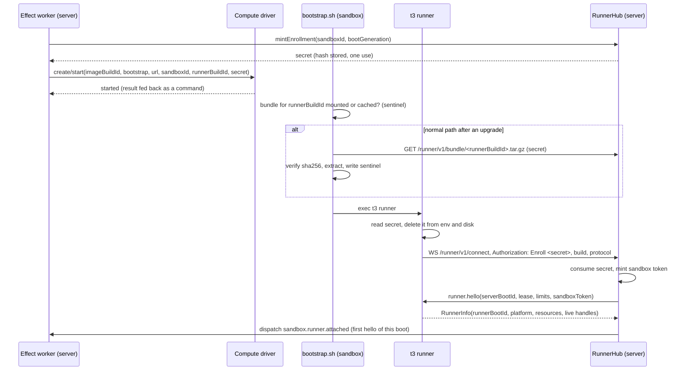

# 03 Runner: the runner and its protocol

Status: M0 and M1 landed; the rest is a proposal, rewritten 2026-11-08 for local-first Pair Cloud.
Audience: the engineers working on the runner. The server-side `WorkspaceHost` interface is in
[02 Workspace host](./02-workspace-host.md); this doc owns what crosses the wire between the Pair
Cloud server and `t3 runner`, and the runner itself. M1 built both on a team server, and they carry
over to Pair Cloud unchanged. It follows the decisions in the [plan](./README.md).

## Summary

- The runner is a slim entry of the server's own build, identified by a **`runnerBuildId`** (a hash of the
  runner bundle), served by the Pair Cloud server (decision 5), whose versioned release carries it
  from M2. Fetching it at boot is the normal path; an image cache or a Docker read-only mount skips
  the download.
- One outbound WebSocket to `/runner/v1/connect`, authenticated by a sandbox token. It carries
  Effect RPC with roles reversed: the server always asks; the runner answers or streams.
- Every output stream is binary, lossless, windowed and sequence-numbered. When a buffer fills, the
  runner stops reading the source pipe, so a runaway process slows down instead of flooding anyone.
- A socket blip keeps processes running for a lease and resumes each stream. A server or
  runner restart ends every process, and the existing restart recovery takes over.
- Agents reach MCP, Codex's token broker and the git credential helper through **named forwards**
  (doc 02's `exposeServerEndpoint`). Their credentials do not change.
- Coarse operations (decision 2) are RPCs in the same group whose handlers call existing server
  services inside the runner. Nothing assumes one thread per runner: side chats and forks share it.

## 1. What the runner does and does not do

The runner exposes the sandbox's processes, PTYs, files, watches and ports to one Pair Cloud server, and
runs the coarse operations of decision 2. It holds no thread or provider state and decides
nothing: it does what the server asks, reports what happened, and enforces resource bounds. It does
not keep terminal history, enforce workspace path rules, listen beyond loopback, talk to any host
but its Pair Cloud server, or keep credentials anywhere but memory and tmpfs.

One runner serves every thread that uses its sandbox: the owning cloud thread, its side chats and
its forks (decision 6). The protocol knows sandboxes, handles and forwards, never threads; the
server maps handles to threads, so nothing on the wire changes when a second thread arrives.

Cursor (through `@cursor/sdk`) and Muse run inside the server process, so there is no process for
the runner to host. They are "not supported in cloud" (decision 2) and hidden for cloud threads.

## 2. Packaging and boot

### 2.1 Same build, slim entry

The server's `vp pack` step ([vite.config.ts](../../../apps/server/vite.config.ts)) gains a second
output: `dist/runner/`, built from `src/sandbox/runner/bin.ts` with code splitting off, in the same build
run as `dist/bin.mjs`. Never npm (decision 5): the `t3` package there downloads upstream archives
([npm-launcher/t3.mjs](../../../scripts/npm-launcher/t3.mjs), [cliRelease.ts](../../../packages/shared/src/cliRelease.ts),
[release.yml](../../../.github/workflows/release.yml), [decisions](../decisions.md)). It contains:

| File                        | Purpose                                                                                                                                                                                                                                                                                                                                                                                                                                                                                                                      |
| --------------------------- | ---------------------------------------------------------------------------------------------------------------------------------------------------------------------------------------------------------------------------------------------------------------------------------------------------------------------------------------------------------------------------------------------------------------------------------------------------------------------------------------------------------------------------- |
| `runner.mjs`                | One file: the runner, plus the `acp-mcp-bridge`, `acp-mcp-call` and `__managed-chatgpt-token` fast paths that agents in the sandbox spawn as `t3 ...`                                                                                                                                                                                                                                                                                                                                                                        |
| `node_modules/node-pty/`    | The pinned node-pty with its `linux-x64` and `linux-arm64` prebuilds. The npm tarball for `1.2.0-beta.15` ships both ([source](#sources)); only the release archive prunes them                                                                                                                                                                                                                                                                                                                                              |
| `claude-history-worker.mjs` | The worker `runClaudeWorker` spawns for `forkSession` when the host is not a single executable ([ClaudeAdapterV2.ts](../../../apps/server/src/orchestration-v2/Adapters/ClaudeAdapterV2.ts)). It must run where `~/.claude` lives, in the sandbox. `__claude-history` is not a `bin.ts` fast path, so `runner.mjs` cannot stand in. Doc 02 points the spawn at this file. Built unsplit with `runner.mjs`: today's build splits chunks, so `dist/claude-history-worker.mjs` imports shared chunks and cannot be copied alone |
| Claude Agent SDK            | `@anthropic-ai/claude-agent-sdk`'s session functions, bundled into the worker as `vp pack` already does (not an external)                                                                                                                                                                                                                                                                                                                                                                                                    |
| `t3`                        | A POSIX shim: `exec node "$(dirname "$0")/runner.mjs" "$@"`                                                                                                                                                                                                                                                                                                                                                                                                                                                                  |
| `MANIFEST.json`             | `runnerBuildId` (sha256 of the tree), `protocolVersion`, Node range                                                                                                                                                                                                                                                                                                                                                                                                                                                          |

The full CLI also gets `t3 runner`, for tests, in the [bin.ts](../../../apps/server/src/bin.ts) fast
path that skips the [binCli.ts](../../../apps/server/src/binCli.ts) graph, as `acp-mcp-bridge` does.

The bundle also carries the services coarse operations call (section 4.6) and the
`@ff-labs/fff-node` linux binary beside node-pty. A lint fence keeps `src/sandbox/runner/` from
importing `orchestration-v2/`, `persistence/`, `auth/` or provider adapters, which keeps the bundle
small and keeps server secrets out of the sandbox. The build fails over 25 MiB
([cli.ts](../../../apps/server/scripts/cli.ts)); M1's bundle is 22.9 MB with native modules and the
worker's SDK.

The runner runs on the image's Node, which must satisfy the server's `engines.node`
(`^22.16 || ^23.11 || >=24.10`, from [package.json](../../../apps/server/package.json)). Team images
already need Node for most agent CLIs (inferred); [05 Team images](./05-team-images.md) owns that
requirement.

From M2 the versioned Pair Cloud server release (decision 15) carries a `runner/` tree beside the
`t3` executable, because teams install and upgrade Pair Cloud from that release, not from a
checkout. The server serves the tree beside itself (`dist/runner` for the npm layout) and calls a
build without one `not-bundled`
([RunnerBundle.ts](../../../apps/server/src/sandbox/runnerHub/RunnerBundle.ts)). Release CI serves
each archive's tree through the real route and hub, downloads it the way the bootstrap does and
attaches a runner from it
([runner-release-smoke.ts](../../../apps/server/scripts/runner-release-smoke.ts)), so a release
whose runner can't be served or can't enroll never ships.

Pair Cloud serves the bundle for its own build only:

```
GET /runner/v1/bundle/<runnerBuildId>.tar.gz     Authorization: Bearer <enrollment secret or sandbox token>
GET /runner/v1/bundle/<runnerBuildId>.sha256
```

A server running from source builds the bundle once per source hash into `<stateDir>/runner/`. The
bootstrap is a 40-line POSIX script (`curl`, `sha256sum`, `tar`) that mirrors
[pinnedRuntime.ts](../../../apps/server/src/cloud/pinnedRuntime.ts): staging-directory install,
SHA-256 check, `.install-complete` sentinel, stall timeout. That module cannot run before Node code
exists in the sandbox, so it is mirrored, not imported. [selfUpdate.ts](../../../apps/server/src/cloud/selfUpdate.ts)
and [npmRelease.ts](../../../apps/server/src/cloud/npmRelease.ts) resolve upstream releases and have
nothing to reuse.

### 2.2 Boot sequence

The compute driver ([04 Sandbox lifecycle](./04-sandbox-lifecycle.md)) starts the sandbox with the
bootstrap script as its command and four values: `PAIR_RUNNER_URL`, `PAIR_SANDBOX_ID`,
`PAIR_RUNNER_BUILD` (the `runnerBuildId`) and `PAIR_RUNNER_ENROLL` (the enrollment secret). Where a driver can
write a file into the machine instead of setting an environment variable, it does, since cloud APIs
and `docker inspect` show environment variables: Docker writes `/etc/pair-runner/bootstrap.env`
(mode 0600), which the bootstrap deletes. The bootstrap hands the secret to the runner as the
file `<stateDir>/enroll`, never through the runner's environment, which `/proc/<pid>/environ` keeps
readable for the life of the process.



The runner stores the sandbox token in `/run/pair-runner/token` (tmpfs, mode 0600) so a crashed runner
can redial without re-enrolling. Every later connect uses `Authorization: Bearer <sandbox token>`. A
build mismatch answers `426` with the server's `runnerBuildId`; the runner exits with code 75 and the
bootstrap fetches the right bundle once before giving up. This is the only version check there is.

**Fetching at boot is the normal path.** A team image build freezes whatever runner it cached, so
after every server upgrade every sandbox from an older build fetches at boot (doc 05). The download
is a few MB from Pair Cloud and is budgeted, not treated as a failure. Two optimizations skip
it: the Docker driver on the server's own machine bind-mounts the server's `dist/runner/` read only
at `/opt/pair-runner/<runnerBuildId>`, which matches by construction; and image builds cache it with
`t3 runner prefetch` (PR 5). A remote `DOCKER_HOST` cannot see the server's disk, so its machines
fetch, as EC2 machines do (M5).

### 2.3 Startup budget

Budget with the bundle present (mounted or cached), from the driver's "started" to
`sandbox.runner.attached`: **500 ms** for Docker on the server's machine and **500 ms + 4 RTT** for a
machine across a network (EC2 in M5). Node start and `runner.mjs` evaluation take 150–300 ms of it;
TLS, the upgrade and `runner.hello` take the RTTs. A fetch adds a few MB: under 200 ms on loopback,
seconds on a slow link (inferred). Container or VM start is the driver's budget. The benchmark
(section 9) fails when a Docker figure misses at p50: 500 ms mounted, 700 ms fetched. Both passed on
M1's integrated pass.

## 3. Transport

### 3.1 Route and socket

A new route, `GET /runner/v1/connect`, joins [server.ts](../../../apps/server/src/server.ts) beside
`Ws.layer`, sharing nothing with `/ws` but the HTTP server: its own auth and RPC group, no
`RpcAuthorization` scopes. It authenticates the header, then runs an RPC client over the socket with
the `acquireUseRelease` shape [ws.ts](../../../apps/server/src/ws.ts) uses.

The runner dials with `Socket.makeWebSocket` and `NodeWS.layerWebSocketConstructor` (the `ws`
package), not the `NodeSocket` one [DeviceHubProxy.ts](../../../apps/server/src/device/DeviceHubProxy.ts)
uses: in Effect 4.1.2 that wraps Node's global `WebSocket`, which cannot pause reads, does not
compress what it sends and has no `ws+unix:` URLs. It keeps DeviceHubProxy's no-op `error` listener,
and sends its token in an `Authorization` upgrade header, so it needs no WebSocket ticket.

- **Timers:** every runner timer is in the table below and stated nowhere else. The heartbeat sits
  well under the idle cut of any proxy or load balancer between a machine and Pair Cloud.
- **Frames:** at most 256 KiB; large file transfers stream in 64 KiB chunks.
- **Compression:** the member listener accepts `perMessageDeflate` on every WebSocket
  ([server.ts](../../../apps/server/src/server.ts)); the runner-only Unix socket doesn't. The runner
  offers it over a network, not on loopback or a Unix socket, where it is wasted CPU
  ([RunnerSocketServer.ts](../../../apps/server/src/sandbox/runner/RunnerSocketServer.ts)).
- **TLS and proxies:** `wss://` with the system trust store plus `NODE_EXTRA_CA_CERTS` (M5).
  `HTTPS_PROXY`/`NO_PROXY` reach the server's fetches only through Node's `NODE_USE_ENV_PROXY`,
  which [outboundHttp.ts](../../../apps/server/src/outboundHttp.ts) preserves. Whether `ws` follows
  it is unverified; if not, M5 adds an explicit agent.

| Timer                            | Value                                   | Owner                                                                                                    |
| -------------------------------- | --------------------------------------- | -------------------------------------------------------------------------------------------------------- |
| Heartbeat ping                   | 15 s                                    | RPC client on the server (`pingInterval`)                                                                |
| Dead socket                      | 45 s without any frame                  | Both ends: `pingTimeout` on the server; the runner keeps its own frame timer, since `RpcServer` has none |
| Redial backoff                   | 250 ms, doubling, cap 10 s, full jitter | Runner                                                                                                   |
| Lease (processes survive a drop) | 120 s, per-driver setting               | `RunnerHub`, mirrored by the runner                                                                      |
| Drain grace (SIGTERM to SIGKILL) | 10 s                                    | Runner                                                                                                   |
| Enrollment secret                | 15 min, one use                         | `RunnerGrants`                                                                                           |
| Token rotation                   | Every boot; periodic rotation is Later  | `RunnerGrants`                                                                                           |
| Watch coalescing                 | 50 ms                                   | Runner                                                                                                   |
| Status debounce to clients       | 2 s                                     | `RunnerHub`                                                                                              |

### 3.2 What URL the runner dials

Every machine must reach the Pair Cloud server. Machines run only where Pair Cloud puts them, never
on a member's Mac, so the runner always dials from Pair Cloud's own networks: the server's machine,
a Docker host beside it, or the customer's VPC. The server picks the URL and
passes it to the driver; the runner never guesses
([RunnerEndpoint.ts](../../../apps/server/src/sandbox/runnerHub/RunnerEndpoint.ts)). An admin can
override it per driver (`runnerUrl`) for reverse proxies and split DNS.

| Where the machines run                               | URL the runner dials                                                                                                                                                                                                                                                                                                                                                                                                               |
| ---------------------------------------------------- | ---------------------------------------------------------------------------------------------------------------------------------------------------------------------------------------------------------------------------------------------------------------------------------------------------------------------------------------------------------------------------------------------------------------------------------- |
| Docker on the Pair Cloud server's Linux machine (M2) | `unix:` path to a runner-only socket in the state directory. The driver mounts its directory read only at `/run/pair-host`. Its listener serves runner routes only, uncompressed, works whatever the server's bind host is, and exposes no port                                                                                                                                                                                    |
| Docker on another host (`DOCKER_HOST`)               | The server's address as that host's containers reach it, set by the admin as `runnerUrl`. Without one, the boot fails with `runner-url-required`                                                                                                                                                                                                                                                                                   |
| EC2 in the customer's VPC (M5)                       | `wss://<private address>/runner/v1/connect`, set by the deployment kit ([09](./09-byoc.md)), on an internal-only listener that serves `/runner/*` and no client routes. Never the optional public client listener                                                                                                                                                                                                                  |
| Docker Desktop on a macOS server (development only)  | `http://host.docker.internal:<port>`. Docker Desktop resolves the name. Laptops no longer offer Cloud, so this path only serves Pair Cloud run from source on a Mac. On Linux the name needs `--add-host host.docker.internal=host-gateway` ([source](#sources)), which fails for a server bound to loopback, as desktop mode is by default ([cli/config.ts](../../../apps/server/src/cli/config.ts)), hence the Unix socket above |
| A hosted vendor (Later)                              | A public origin, or the T3 Connect tunnel hostname from [ManagedEndpointRuntime.ts](../../../apps/server/src/cloud/ManagedEndpointRuntime.ts). A vendor's machine is on neither the customer's VPC nor a tailnet. Waits for the vendor driver                                                                                                                                                                                      |

A server on any other platform fails with `unsupported-platform` unless the driver sets a
`runnerUrl`.

How members reach Pair Cloud (VPN, Tailscale or the team's HTTPS domain) doesn't matter to
machines. The member listener also answers `/runner/*` today
([server.ts](../../../apps/server/src/server.ts)), but only while some configured driver dials it
over TCP: a `runnerUrl`, a remote `DOCKER_HOST`, or the macOS path. Otherwise those routes are 404
there, checked per request so a driver added at runtime takes effect. In BYOC (M5), `/runner/*` moves to the internal-only listener, so it is reachable only from
machine networks (see Challenges for M2).

## 4. Protocol

### 4.1 Effect RPC with reversed roles

The protocol is an Effect `RpcGroup` in `packages/contracts/src/runner.ts`, exported as the subpath
`@t3tools/contracts/runner` so web and mobile bundles never import it. The server runs
`RpcClient.makeProtocolSocket` over the upgraded socket with a `retryPolicy` that never retries (the
default reruns the socket forever; `retryTransientErrors` covers only open errors). The runner runs
the handlers through the exported `RpcServer.makeProtocolSocketServer` ([RpcServer.ts](../../../.repos/effect/packages/effect/src/rpc/RpcServer.ts)),
which takes any `SocketServer.SocketServer`. Its socket core (`makeSocketProtocol`) is internal, so
M1's first protocol PR adds a one-socket `SocketServer` whose `run` hands each dialed socket to the handler (about 20 lines).

Effect RPC rather than a custom multiplexer, because request ids, interrupts, typed errors, pings and
per-stream acks (`supportsAck`) already exist; [OutputProtocol.ts](../../../apps/server/src/terminal/OutputProtocol.ts)
already widens the acks into a window (`withTerminalOutputWindow`); `layerSchemaBinary` sends
`Uint8Array` as raw bytes (set `maxFrameSize`; the default is 16 MiB); and tests get `RpcTest.makeClient`, as in
[RpcAuthorization.test.ts](../../../apps/server/src/auth/RpcAuthorization.test.ts).

Effect RPC has no client-to-server streams and runs concurrent requests in separate fibers, so
input is a sequence of calls, each with a sequence number (section 4.5).

The runner never calls the server. What it originates (a forward accept, a port change, resource
pressure) is an element of a stream the server subscribed to: one RPC client, one handler set.

### 4.2 Catalog

| Channel  | Method                                                                                                                                                                                                | Kind                                | Notes                                                                                                                                                                                                                                       |
| -------- | ----------------------------------------------------------------------------------------------------------------------------------------------------------------------------------------------------- | ----------------------------------- | ------------------------------------------------------------------------------------------------------------------------------------------------------------------------------------------------------------------------------------------- |
| Control  | `runner.hello`                                                                                                                                                                                        | call                                | First call on every socket. Server sends `serverBootId`, lease, limits and (on enrollment) the sandbox token; runner answers `RunnerInfo` with `runnerBootId` and live handles                                                              |
|          | `runner.events`                                                                                                                                                                                       | stream                              | Forward accepts, listening-port changes, resource pressure, handle exits                                                                                                                                                                    |
|          | `runner.drain`                                                                                                                                                                                        | call                                | Before sleep or destroy: stop accepting work, kill groups after a grace, flush                                                                                                                                                              |
| Process  | `process.spawn`                                                                                                                                                                                       | call                                | Command, args, cwd, env, uid, stdio spec (extra fds allowed), process group, `forceKillAfterMs` (escalation runs on the runner, so a slow socket cannot delay it). Returns a handle                                                         |
|          | `process.output`                                                                                                                                                                                      | stream                              | One fd from `fromSeq`; bytes                                                                                                                                                                                                                |
|          | `process.write`                                                                                                                                                                                       | call                                | One fd, `seq`, bytes. One in flight per fd                                                                                                                                                                                                  |
|          | `process.closeInput`                                                                                                                                                                                  | call                                | EOF on one fd                                                                                                                                                                                                                               |
|          | `process.signal`                                                                                                                                                                                      | call                                | Signal the process or its group                                                                                                                                                                                                             |
|          | `process.wait`                                                                                                                                                                                        | call                                | Resolves with exit code or signal                                                                                                                                                                                                           |
|          | `process.run`                                                                                                                                                                                         | call, or stream with `stream: true` | Doc 02's exec frame: command, stdin and close in one request, output caps and timeout as in [ProcessRunner](../../../apps/server/src/processRunner.ts). One round trip per git call                                                         |
| PTY      | `pty.open`                                                                                                                                                                                            | call                                | Shell, args, cwd, env, cols, rows: [PtyAdapter](../../../packages/shared/src/PtyAdapter.ts)'s `PtySpawnInput`                                                                                                                               |
|          | `pty.output`                                                                                                                                                                                          | stream                              | UTF-8 text from `fromSeq`; decoded on the runner so chunks never split a code point                                                                                                                                                         |
|          | `pty.input`, `pty.resize`, `pty.signal`                                                                                                                                                               | call                                | Sequence-numbered per handle                                                                                                                                                                                                                |
|          | `pty.wait`                                                                                                                                                                                            | call                                | `PtyExitEvent`                                                                                                                                                                                                                              |
| Files    | `fs.stat`, `fs.readDirectory`, `fs.readFile`, `fs.writeFile`, `fs.makeDirectory`, `fs.remove`, `fs.rename`, `fs.copy`, `fs.realPath`, `fs.readLink`, `fs.symlink`, `fs.chmod`, `fs.makeTempDirectory` | call                                | The subset of Effect's `FileSystem` ([FileSystem.ts](../../../.repos/effect/packages/effect/src/FileSystem.ts)) that doc 02 needs. `readFile` takes an offset and a byte cap; `writeFile` is atomic (temp file and rename) when asked       |
|          | `fs.readStream`, `fs.writeStream`                                                                                                                                                                     | stream, calls                       | Files over 1 MiB in 64 KiB chunks                                                                                                                                                                                                           |
| Watch    | `fs.watch`                                                                                                                                                                                            | stream                              | Path, recursive. Events coalesced on the runner                                                                                                                                                                                             |
| TCP      | `tcp.connect`                                                                                                                                                                                         | call                                | Doc 02's `ports.connect`. Loopback ports inside the sandbox only (Later, with previews)                                                                                                                                                     |
|          | `tcp.read`, `tcp.write`, `tcp.close`                                                                                                                                                                  | stream, calls                       | Same seq and window rules as process fds                                                                                                                                                                                                    |
| Forwards | `forward.open`                                                                                                                                                                                        | call, scoped                        | Name and an opaque `ownerKey`; returns the in-sandbox address. Closing the scope closes the listener. Accepts arrive in `runner.events` as `forward.accepted { forwardId, connectionId }`; the server then uses `tcp.read`/`tcp.write` (M1) |
| Coarse   | `ops.<name>`                                                                                                                                                                                          | call or stream                      | The fixed list in section 4.6. Doc 02 owns the schemas                                                                                                                                                                                      |

`process.spawn` mirrors Effect's `ChildProcessSpawner` handle, extra fds included
([ChildProcessSpawner.ts](../../../.repos/effect/packages/effect/src/process/ChildProcessSpawner.ts)):
`spawnClaudeProcessGroup` passes a fourth pipe (fd 3) to its watcher, via `node:child_process`.

### 4.3 Schema sketch

```ts
// packages/contracts/src/runner.ts (sketch)
import * as Schema from "effect/Schema";
import { Rpc, RpcGroup } from "effect/rpc";

export const RUNNER_PROTOCOL_VERSION = 1;
export const RunnerHandleId = Schema.String.pipe(Schema.brand("RunnerHandleId"));
/** Offset within one stream: bytes for fds, UTF-16 units for PTY text. */
export const StreamSeq = Schema.Int.check(Schema.isGreaterThanOrEqualTo(0));

export const RunnerHelloInput = Schema.Struct({
  protocolVersion: Schema.Literal(RUNNER_PROTOCOL_VERSION),
  serverBootId: Schema.String,
  leaseMs: Schema.Int,
  limits: Schema.Struct({
    windowBytes: Schema.Int,
    handleBufferBytes: Schema.Int,
    sandboxBufferBytes: Schema.Int,
  }),
  sandboxToken: Schema.optional(Schema.Redacted(Schema.String)), // only on enrollment
});

export const RunnerInfo = Schema.Struct({
  runnerBootId: Schema.String,
  runnerBuildId: Schema.String,
  arch: Schema.Literals(["x64", "arm64"]),
  cpus: Schema.Int,
  memoryBytes: Schema.Int,
  /** Handles and forwards alive from this server boot, with each stream's next seq. */
  handles: Schema.Array(
    Schema.Struct({ handle: RunnerHandleId, next: Schema.Record(Schema.String, StreamSeq) }),
  ),
});

export class RunnerLostError extends Schema.TaggedError<RunnerLostError>()("RunnerLostError", {
  reason: Schema.Literals(["lease-expired", "runner-restarted", "server-restarted", "drained"]),
}) {}

export const RunnerProcessOutputRpc = Rpc.make("process.output", {
  payload: Schema.Struct({ handle: RunnerHandleId, fd: Schema.Int, fromSeq: StreamSeq }),
  success: Schema.Struct({ seq: StreamSeq, data: Schema.Uint8Array }),
  error: RunnerLostError,
  stream: true,
});

export const RunnerProcessWriteRpc = Rpc.make("process.write", {
  payload: Schema.Struct({
    handle: RunnerHandleId,
    fd: Schema.Int,
    seq: StreamSeq,
    data: Schema.Uint8Array,
  }),
  success: Schema.Struct({ appliedThrough: StreamSeq }),
  error: RunnerLostError,
});

// process.spawn takes the whole environment as `env`; a child inherits nothing from the runner.
export class RunnerRpcGroup extends RpcGroup.make(
  /* hello, events, process.*, pty.*, fs.*, tcp.*, ops.* */
) {}
```

A spawned process inherits nothing from the runner, so the sandbox token stays out of agents and
credentials injected at spawn (decision 10) reach only their process.

### 4.4 Framing

One frame is one SchemaBinary message. Process output and file contents are bytes, as Effect's
`ChildProcessHandle.stdout` is; PTY output is UTF-8 text, as the terminal manager stores it. No
base64 anywhere.

### 4.5 Flow control and backpressure

Every byte the runner sends is lossless. The rules:

1. **Per-stream window.** At most 256 KiB or 16 chunks unacked per output stream (terminals use 64
   KiB or 8). The wrapper is `withTerminalOutputWindow` from [OutputProtocol.ts](../../../apps/server/src/terminal/OutputProtocol.ts),
   which wraps an `RpcServer.Protocol` (here the runner's), generalized to every `stream: true`
   method of the runner group and moved to `packages/shared`. That wrapper sizes a chunk with `JSON.stringify(response)`, which is wrong
   for binary frames; the runner's version counts the encoded SchemaBinary frame length.
2. **Batching.** A stream takes everything queued (up to 64 KiB) per chunk, as `terminalOutputStream`
   does, so a chatty process sends few large frames instead of many small ones.
3. **Pause at the source.** When a handle's unsent and unacked bytes reach its buffer (4 MiB for a
   process fd, 1 MiB for a PTY), the runner pauses that pipe or PTY. The child blocks on `write`,
   which is how a real terminal and a real pipe apply flow control. A `yes` loop runs at wire speed
   and no faster.
4. **Sandbox cap.** All handles together hold at most 64 MiB. Above it, every source pauses until
   acks drain it.
5. **Input.** On the server, each input fd and PTY has one writer fiber. It takes everything queued,
   sends one write with the next `seq`, and waits for the reply before sending more. Input stays
   ordered, a burst of keystrokes is one frame, and a slow sandbox pushes back on the adapter
   (queue capped at 1 MiB per fd).
6. **Terminal overflow stays a server concern.** The terminal manager still drops a slow client's
   queue and resyncs it from a snapshot. Between runner and server nothing is dropped.

Ordering: bytes of one output stream arrive in order, exactly once, across reconnects. Writes to one
input apply in `seq` order, exactly once; the runner ignores an applied `seq`, so resending after a
reconnect is safe. `process.wait` resolves only after every output stream delivered its last byte.
There is no order across handles, as with local pipes.

### 4.6 Coarse operations

Decision 2 fixes the M1 list. Each is an `ops.<name>` RPC merged into `RunnerRpcGroup`, with payload
and result schemas from doc 02 in `packages/contracts`:

| Operation                                             | Existing server code it runs                                                                                 | Kind                     |
| ----------------------------------------------------- | ------------------------------------------------------------------------------------------------------------ | ------------------------ |
| `search.entries`, `search.contents`, `entries.browse` | [WorkspaceSearchIndex.ts](../../../apps/server/src/workspace/WorkspaceSearchIndex.ts) and `WorkspaceEntries` | call                     |
| `processes.table`                                     | The terminal manager's process-table read ([Manager.ts](../../../apps/server/src/terminal/Manager.ts))       | stream, pushed on change |
| `ports.listeners`                                     | [PortScanner.ts](../../../apps/server/src/preview/PortScanner.ts)'s listener scan                            | stream, pushed on change |
| `checkpoint.capture`                                  | The capture path of [CheckpointStore.ts](../../../apps/server/src/checkpointing/CheckpointStore.ts)          | call                     |

The runner is the same build, so a coarse operation is never a second implementation. At start the
runner builds a small layer: doc 02's `LocalWorkspaceHost`, which is correct inside the sandbox
because there the sandbox is local, plus the services above built on it. Each handler decodes, calls
one service method, and encodes, as a `ws.ts` handler does. If a service's layer drags in a fenced
module, split the service; never copy it. A new operation needs doc 02's measurement rule, a schema,
one handler and a protocol-version bump. `vcs.localStatus` waits for that measurement.

Operations carry a cwd or a thread path, never a thread id, so threads sharing a sandbox each get
their own index per cwd, as they do today. The mirror pull of decision 11 needs no new channel: the
server runs `git bundle create` through `process.run` and streams its stdout (doc 07 owns it).

## 5. Disconnects and resume

Each handle belongs to one (`serverBootId`, `runnerBootId`) pair. The runner spawns every process
group behind a small watcher that holds a pipe from the runner, the same trick as
`CLAUDE_GROUP_WATCH_SCRIPT`: if the runner dies, the pipe closes and the watcher kills the group. So
nothing outlives the runner that owns it.

| Event                                   | Processes                                                                                                   | Server sees                                                | Recovery                                                                                                                                                                                                                                                                                                                                                                                     |
| --------------------------------------- | ----------------------------------------------------------------------------------------------------------- | ---------------------------------------------------------- | -------------------------------------------------------------------------------------------------------------------------------------------------------------------------------------------------------------------------------------------------------------------------------------------------------------------------------------------------------------------------------------------- |
| Socket drops, server and runner stay up | Keep running. Output fills the handle buffers, then pipes pause                                             | Streams stall; calls wait for the runner, up to the lease  | Runner redials with backoff. `runner.hello` returns live handles and their next seq; `RunnerHub` resubscribes each stream from the server's last received seq and resends unacknowledged writes                                                                                                                                                                                              |
| No reconnect within the lease           | Runner kills every group                                                                                    | Every handle fails with `RunnerLostError("lease-expired")` | Adapters take their existing crashed-process path. `RunnerHub` dispatches `sandbox.runner.lost`                                                                                                                                                                                                                                                                                              |
| Server restarts                         | Runner redials and sees a new `serverBootId`; it kills every group of the old boot before answering `hello` | No old handles exist                                       | Startup recovery runs as for local agents: [ProviderRuntimeRecoveryService.ts](../../../apps/server/src/orchestration-v2/ProviderRuntimeRecoveryService.ts) terminalizes runs and retires effects, and [RestartContinuation.ts](../../../apps/server/src/orchestration-v2/RestartContinuation.ts) continues interrupted turns. Terminals restart and restore history from the server's store |
| Runner restarts (crash, OOM)            | Watchers kill every group                                                                                   | `hello` with a new `runnerBootId` and no handles           | `RunnerHub` fails the old handles with `runner-restarted`                                                                                                                                                                                                                                                                                                                                    |
| `runner.drain` (sleep, destroy)         | SIGTERM, then SIGKILL after the drain grace                                                                 | Handles fail with `drained`                                | Doc 04 sleeps only an idle sandbox                                                                                                                                                                                                                                                                                                                                                           |

A stream can never be asked to resume behind its buffer, because the runner pauses sources instead
of evicting. If it happens anyway, that is a bug and the handle fails with `RunnerLostError`.

Doc 02 says "runner disconnect is a process exit". Precisely: a socket drop is not an exit. Handles
fail, and adapters see a process exit, only when the lease expires or a boot id changes. The lease
timer lives in `RunnerHub` and, mirrored, in the runner, which kills its groups at the same deadline.
The lease belongs to the sandbox, not a thread: expiry fails every thread's handles at once, and
`sandbox.runner.lost` goes to the owning thread's stream, which decision 6 makes the home of
lifecycle commands.

Killing on server restart is deliberate. Adapter state (the Claude SDK query, the Codex JSON-RPC
client) dies with the server, so a surviving CLI has nobody to talk to. Local agents behave the same:
[agentScope.ts](../../../apps/server/src/process/agentScope.ts) stops agents a previous server left
behind "so two copies of one session never work in the same worktree". On Pair Cloud every upgrade
is such a restart. M2 drains the server before an upgrade, and an agent still running when it
restarts is interrupted (open question 2).

During a blip an adapter's stdout pauses and its writes wait; no error reaches it. Adapter timeouts
are the risk; M1 replay tests run Claude and Codex turns through a 60 s drop (inferred: none fire).

## 6. Auth and token lifecycle

| Credential        | Who holds it                               | Lifetime                        | Reaches                                         | Stored on the server as                                                                                       |
| ----------------- | ------------------------------------------ | ------------------------------- | ----------------------------------------------- | ------------------------------------------------------------------------------------------------------------- |
| Enrollment secret | Driver, then bootstrap                     | One use, short TTL              | `/runner/v1/bundle`, first `/runner/v1/connect` | SHA-256 hash in `sandbox_runner_grants`                                                                       |
| Sandbox token     | Runner memory and `/run/pair-runner/token` | One boot of one sandbox         | `/runner/v1/*` for that sandbox only            | SHA-256 hash in `sandbox_runner_grants`                                                                       |
| Auth session      | Clients                                    | Days, renewable                 | `/api`, `/ws` by scope                          | `SessionStore` ([SessionStore.ts](../../../apps/server/src/auth/SessionStore.ts))                             |
| Member API token  | Outside agents                             | 30–365 days                     | `/mcp` only                                     | `SessionStore`, subject `mcp-client` ([EnvironmentAuth.ts](../../../apps/server/src/auth/EnvironmentAuth.ts)) |
| MCP thread token  | Agent processes                            | One provider session, in memory | `/mcp` as that thread                           | In memory ([McpSessionRegistry.ts](../../../apps/server/src/mcp/McpSessionRegistry.ts))                       |

Sandbox tokens never enter `SessionStore`, like guest tokens
([GuestShareService.ts](../../../apps/server/src/guest/GuestShareService.ts)), so no RPC, WebSocket
or MCP path can accept one and none must remember to reject a new subject. A grant row is
`(sandboxId, bootGeneration, enrollmentHash, enrollmentExpiresAt, enrollmentConsumedAt, tokenHash,
revokedAt)`. It is an auth record in persistence, not an orchestration event, so no secret or hash
enters the event log.

- **Enroll.** `Authorization: Enroll <secret>` consumes the secret in the transaction that stores the
  token hash. A second use fails.
- **Scope.** One sandbox, one boot generation: that sandbox's runner socket and this server's bundle.
- **One live socket per sandbox.** A new authenticated connect replaces the old one, since half-open
  sockets after a network change are common.
- **Rotation and revocation.** Every boot (create, wake, restart) gets a new enrollment and token.
  Sleep, destroy and a new boot revoke the generation, and `RunnerHub` closes its socket, as
  `awaitInvalidation` does for clients. A machine that sleeps when idle (M2) gets a new token on
  every wake; periodic rotation over the live socket waits for hosted vendors (Later).
- **No DPoP.** A proof key would sit beside the token in the same tmpfs and memory.

What a stolen sandbox token can do, at most, while that sandbox's current boot lives:

1. Act as that sandbox's runner and receive its next spawn requests, including injected provider
   credentials and MCP tokens for every thread sharing the sandbox. From inside the sandbox that
   gains little (those agents share a disk already); exfiltrated, it yields those threads' future
   credentials until the boot ends. That is the real risk, and why the token lives only in tmpfs and
   runner memory.
2. Feed fabricated output into those threads, which a misbehaving agent can do anyway.
3. Answer that sandbox's forwards, which still need an MCP thread token or doc 06's short-lived
   git credential ([06 Credentials and security](./06-credentials-and-security.md)).

It cannot open `/ws`, `/api` or `/mcp`, read another thread or sandbox, mint any session, or outlive
the boot. Agents run as `t3` with passwordless sudo (README D3), so they can read the token;
the boundaries are its narrow scope and the sandbox's own isolation, not a Unix user.

## 7. Server side: `RunnerHub`

New code lives in new `sandbox` folders (decision 14): `apps/server/src/sandbox/runner/` (dialer,
handlers, coarse-op layer, buffers, watchers, forwards) and `apps/server/src/sandbox/runnerHub/`
(`RunnerHub`, a thin `RunnerRoute`, `RunnerGrants`, `RunnerBundle`, `RunnerForwards`). Upstream edits
are one route in `server.ts`, one `bin.ts` fast-path branch and one `vp pack` entry.

```ts
export class RunnerHub extends Context.Service<
  RunnerHub,
  {
    readonly mintEnrollment: (
      sandboxId: SandboxId,
      bootGeneration: number,
    ) => Effect.Effect<Redacted.Redacted<string>, RunnerGrantError>;
    /** Waits up to the lease for a connected runner. */
    readonly connection: (
      sandboxId: SandboxId,
    ) => Effect.Effect<RunnerConnection, RunnerUnavailableError | RunnerLostError>;
    readonly status: (sandboxId: SandboxId) => Stream.Stream<RunnerConnectionStatus>;
    readonly revoke: (sandboxId: SandboxId) => Effect.Effect<void>;
  }
>()("t3/sandbox/RunnerHub") {}

/** The typed RPC client plus resumable wrappers; doc 02's SandboxWorkspaceHost builds on this. */
export interface RunnerConnection {
  readonly spawn: (
    input: ProcessSpawnInput,
  ) => Effect.Effect<RunnerProcess, RunnerCallError, Scope.Scope>;
  readonly openPty: (
    input: PtySpawnInput,
  ) => Effect.Effect<RunnerPty, RunnerCallError, Scope.Scope>;
  readonly fs: RunnerFileSystem; // maps onto Effect's FileSystem subset
  readonly watch: (path: string, recursive: boolean) => Stream.Stream<WatchEvent, RunnerCallError>;
  readonly connectTcp: (
    port: number,
  ) => Effect.Effect<RunnerTcpConnection, RunnerCallError, Scope.Scope>;
  readonly openForward: (
    name: ForwardName,
    ownerKey: string,
  ) => Effect.Effect<string, RunnerCallError, Scope.Scope>;
  readonly ops: CoarseOperations; // doc 02's typed list
}
```

Handles are scoped: closing the scope kills the process group, so a fiber that is interrupted
cannot leak a sandbox process. `RunnerProcess` exposes `ChildProcessHandle`'s shape;
`RunnerPty` exposes `PtyProcess`'s, with `write`, `resize` and `kill` enqueued on the writer fiber
because that interface is synchronous.

**Connection status lives in memory** (decision 6): `connected | reconnecting(since) | lost`,
published on change like [Presence.ts](../../../apps/server/src/team/Presence.ts). Only two facts
become commands:

- `sandbox.runner.attached` on the first `hello` of a boot generation (version, resources). Doc 04
  moves `provisioning` or `waking` to `ready` on it.
- `sandbox.runner.lost` when a lease expires or a runner restarts. Doc 04 decides whether that is
  `failed` or a retry.

Effects that need a runner call the workspace host, which calls `RunnerHub.connection` and waits
while the sandbox boots; no effect holds a socket across commands. Tests drain
`OrchestrationEffectWorkerV2` and use `RunnerHub.layerTest` over an in-process runner (section 10).

## 8. Agents calling back

What agents in a sandbox actually call on the server today:

| Callback                                                                                                                                               | How it works locally                                                                                                                                                                                                                                                                                                                         | Needs a route from the sandbox?                            |
| ------------------------------------------------------------------------------------------------------------------------------------------------------ | -------------------------------------------------------------------------------------------------------------------------------------------------------------------------------------------------------------------------------------------------------------------------------------------------------------------------------------------- | ---------------------------------------------------------- |
| Claude and Codex hooks                                                                                                                                 | Claude SDK callbacks over the CLI's stdio ([ClaudeAdapterV2.ts](../../../apps/server/src/orchestration-v2/Adapters/ClaudeAdapterV2.ts)); Codex `hook/completed` over app-server stdio ([CodexAdapterV2.ts](../../../apps/server/src/orchestration-v2/Adapters/CodexAdapterV2.ts))                                                            | No. They ride `process.output` and `process.write`         |
| MCP tools                                                                                                                                              | HTTP to `/mcp` at the server's listen address (`127.0.0.1` when it listens on all interfaces) with a per-provider-session bearer token ([McpSessionRegistry.ts](../../../apps/server/src/mcp/McpSessionRegistry.ts))                                                                                                                         | Yes                                                        |
| ACP agents' MCP                                                                                                                                        | The agent spawns `t3 acp-mcp-bridge`, which calls the same HTTP endpoint ([AcpMcpStdioBridge.ts](../../../apps/server/src/mcp/AcpMcpStdioBridge.ts))                                                                                                                                                                                         | Yes, plus `t3` on the sandbox's `PATH` (the bundle's shim) |
| Codex managed ChatGPT token                                                                                                                            | Codex's `auth.command` runs the server's own CLI as `__managed-chatgpt-token <socket> <instance> <environment> <profile key>`, which asks a local IPC socket ([managedChatGptToken.ts](../../../apps/server/src/cli/managedChatGptToken.ts), [CodexManagedTokenProtocol.ts](../../../apps/server/src/provider/CodexManagedTokenProtocol.ts)) | Yes, if doc 06 keeps this path                             |
| Git credential helper                                                                                                                                  | Doc 06                                                                                                                                                                                                                                                                                                                                       | Yes                                                        |
| [AgentAwarenessRelay.ts](../../../apps/server/src/relay/AgentAwarenessRelay.ts), [HeldHooksWaker.ts](../../../apps/server/src/relay/HeldHooksWaker.ts) | Server to T3 Connect relay                                                                                                                                                                                                                                                                                                                   | No; unchanged on the server                                |

So "hooks" need nothing; MCP, the Codex token broker and git credentials need **named forwards**.
Doc 02's `exposeServerEndpoint` calls `forward.open` within the provider session's scope; the runner
listens on a fresh loopback port or Unix socket and returns its address. `RunnerForwards` splices
each accepted connection to the target fixed for that name, and remembers the `ownerKey` (the
provider session) so a target can check who opened it. A sandbox shared by several threads simply
has several forwards; when a session ends, its forward closes:

| Forward          | In the sandbox                        | Server-side target                                                                                                                                                                                                                                                                                                                                                           |
| ---------------- | ------------------------------------- | ---------------------------------------------------------------------------------------------------------------------------------------------------------------------------------------------------------------------------------------------------------------------------------------------------------------------------------------------------------------------------- |
| `mcp`            | `127.0.0.1:<auto>`                    | The server's own HTTP listener, at the address `McpSessionRegistry` uses today. An HTTP proxy, not a splice: `/mcp` also accepts member API tokens and cannot tell a forwarded connection from a local one, so `RunnerForwards` passes only a bearer that `McpSessionRegistry.resolve` maps to a thread token whose `providerSessionId` is the forward's `ownerKey` (doc 06) |
| `codex-token`    | Unix socket under `/run/pair-runner/` | The Codex managed token broker's socket                                                                                                                                                                                                                                                                                                                                      |
| `git-credential` | Unix socket under `/run/pair-runner/` | The git credential service doc 06 defines (M1)                                                                                                                                                                                                                                                                                                                               |

The sandbox cannot name a target, so a forward is not a path into the server's network. Reaching
the loopback listener grants nothing by itself: the auth policy depends on the configured bind host,
not the peer ([EnvironmentAuthPolicy.ts](../../../apps/server/src/auth/EnvironmentAuthPolicy.ts)),
and MCP thread tokens resolve only on `/mcp`. M5 hardens this for BYOC with an in-process listener
that mounts only `/mcp` as the forwards' target, beside section 3.2's internal-only `/runner/*`
listener (inferred feasibility).

Credentials do not change: the workspace host gets the thread's token from `McpSessionRegistry.issue`
as today and swaps only the endpoint for the `mcp` forward address.

## 9. Performance

Budgets, measured from bytes leaving the child to bytes entering the adapter or terminal manager:

| Path                                           | Docker, same machine                          | Across a network, RTT r                    | Measured, Docker (M1)              | Measured, Docker (M2) |
| ---------------------------------------------- | --------------------------------------------- | ------------------------------------------ | ---------------------------------- | --------------------- |
| Provider stdout, added latency p50 / p99       | 1 ms / 5 ms                                   | r/2 + 2 ms / r/2 + 10 ms                   | Within budget                      | G2 step 12            |
| Keystroke to echo in the terminal manager      | 2 ms                                          | r + 3 ms                                   | Within budget                      | G2 step 12            |
| PTY throughput (`cat` of a large file)         | 50 MB/s, up to the per-sandbox ingress budget | Link speed, window permitting: 256 KiB / r | 41 MB/s                            | G2 step 12            |
| Server CPU per MB of runner output, over local | Under 5 ms (compression off)                  | Under 15 ms (compression on)               | 25 ms; the local baseline, 17.6 ms | G2 step 12            |
| Server memory per sandbox                      | Under 8 MiB steady                            | Same                                       | Within budget                      | G2 step 12            |

Measure with spans for `runner.hello`, spawn and first byte; metrics in
[Metrics.ts](../../../apps/server/src/observability/Metrics.ts) for bytes by channel and direction,
ping RTT, time paused at the source and buffer high-water marks; `T3CODE_STARTUP_PROFILE_DIR` marks
for runner startup; and `vp run bench:runner` (not in CI,
[runner-benchmark.ts](../../../apps/server/scripts/runner-benchmark.ts)), which runs a real runner
over loopback and in Docker and compares both with `LocalWorkspaceHost`
([performance regressions](../../internals/performance-regressions.md#runner)).

The M1 column is M1's integrated pass on an idle 8-CPU VM; G2 step 12 fills the M2 column on the
same VM, since a shared machine's numbers say little. CPU counts only what the hub adds over local
work: the local baseline spends 17.6 ms per MB on its own PTY, so an absolute 5 ms could never pass.
A machine's throughput stops at its ingress budget (below), so the PTY row reads 50 MB/s only when
the budget is above that; at the default, `cat` reaches about 16 MB/s. `vp run bench:runner
--ingress 0` measures the pipeline without the budget. Profiled that way, the hub's own per-frame
work is negligible: about a third of the event loop's time is garbage collection after the copies
in `ws`'s frame assembly and the binary decoder, then UTF-8 decoding of terminal text. The 256 KiB
window is not the limit on loopback.

**Capacity.** One Pair Cloud server carries the whole team's machines, so M2 states a target of 30
concurrent machines per server. The hub gives each sandbox an ingress budget, 16 MiB/s with a
1 MiB burst (`DEFAULT_INGRESS_BYTES_PER_SECOND` in
[RunnerHub.ts](../../../apps/server/src/sandbox/runnerHub/RunnerHub.ts)), shared by every output
stream of its connection. Past it the hub stops pulling that sandbox's output, so its window acks
wait and the runner pauses its sources at their buffer caps, where
`t3_runner_source_paused_ms_total` counts the time. It is a fixed per-sandbox rate, not a fair
share: the smallest model that stops one machine's output from taking the event loop from the rest.
`vp run bench:runner --load` proves the target: 30 loopback runners, one `cat`ing a large file in a
PTY and one downloading the runner bundle back to back, while 28 print a stamped line every 50 ms.
It passes when those 28 runners' p95 latency rises at most `max(1 ms, 10%)` over an all-quiet
baseline from the same run, and memory per sandbox stays under 8 MiB. The result is G2 step 12's.
Framing stays on the server's event loop and moves to worker threads only if the load test fails
with the budget in place.

Runner traffic stays off the client wire. Clients never subscribe to runner streams. Adapters
consume provider stdio and emit the same normalized events as today. Terminal output enters the
terminal manager once and fans out with the existing client caps. Connection status reaches clients
only on change, debounced. `@t3tools/contracts/runner` is a subpath export, so no client bundle
grows.

## 10. Testing

Follow [testing](../../internals/testing.md): no sleeps, no polling, no wall-clock deltas.

| Layer                      | How                                                                                                                                                                                           | What                                                                                                                 |
| -------------------------- | --------------------------------------------------------------------------------------------------------------------------------------------------------------------------------------------- | -------------------------------------------------------------------------------------------------------------------- |
| Codec                      | Plain `it`                                                                                                                                                                                    | Each schema round-trips through SchemaBinary; frame size cap                                                         |
| Runner handlers            | `it.effect` with `RpcTest.makeClient(RunnerRpcGroup)` against the real handlers in-process                                                                                                    | Spawn, fds, PTY, fs, watch, forwards; seq dedup; ordering; `wait` after last byte                                    |
| Hub with in-process runner | `it.effect`. Server `RpcClient` and runner `RpcServer` joined by an in-memory socket pair built with `Socket.make` ([Socket.ts](../../../.repos/effect/packages/effect/src/socket/Socket.ts)) | Resume, lease expiry on `TestClock.adjust`, boot-id handling, revocation closing the socket                          |
| Fault injection            | The socket pair takes a `Deferred` per fault: drop now, drop after N bytes, stall the reader                                                                                                  | Mid-chunk drop, drop during resend, drop during `hello`, stalled server, half-open socket replaced by a new connect  |
| Real subprocess            | `it.live` (allowed for subprocess fixtures): `node src/bin.ts runner` against a test HTTP server on an ephemeral port                                                                         | Enrollment, token, real pipes and PTY, watcher kills the group when the runner is killed by the PID the test spawned |
| Provider replay            | Claude and Codex replay fixtures through `SandboxWorkspaceHost` with a 60 s injected drop                                                                                                     | No adapter timeout inside the lease; turn completes                                                                  |

Tests wait on persisted events (`sandbox.runner.attached`), on `RunnerHub.status` elements, or on a
`Deferred` the fault socket completes. Flow-control tests assert counts: the source paused at the
buffer size, bytes delivered equal bytes written, no duplicates.

## 11. Work breakdown

| #   | Milestone | Pull request                                                                                                                                                                                                                          | Depends on                   |
| --- | --------- | ------------------------------------------------------------------------------------------------------------------------------------------------------------------------------------------------------------------------------------- | ---------------------------- |
| 1   | M1        | Contracts: `runner.ts` schemas, `RunnerRpcGroup`, errors, subpath export; codec tests                                                                                                                                                 | M0 seam merged               |
| 2   | M1        | Runner core: `runner/main.ts`, `bin.ts` fast path, one-socket RPC server protocol, process and PTY handlers with group watchers, fs and watch handlers; in-process tests                                                              | 1                            |
| 3   | M1        | Server route and `RunnerHub`: `/runner/v1/connect`, `RunnerGrants` and migration, enrollment, token, one-socket replacement, status stream, `attached` and `lost` commands                                                            | 1, doc 04's sandbox commands |
| 4   | M1        | Flow control and resume: generalized output window into `packages/shared`, seq buffers, pause at source, lease, writer fibers; fault-injection tests                                                                                  | 2, 3                         |
| 5   | M1        | Bundle: `vp pack` runner entry, node-pty linux prebuilds, manifest and `runnerBuildId`, `/runner/v1/bundle`, bootstrap script, dev-mode build, Docker read-only mount, `t3 runner prefetch <runnerBuildId>` for doc 05's image builds | 2                            |
| 6   | M1        | Coarse operations: runner-local layer, `ops.*` handlers for decision 2's list, lint fence                                                                                                                                             | 2, doc 02's schemas          |
| 7   | M1        | Forwards: `forward.open`, `mcp`, `codex-token` and `git-credential`, `RunnerForwards`, `t3` shim on `PATH` for ACP bridges                                                                                                            | 3, 4, doc 02                 |
| 8   | M1        | Docker routes: runner-only Unix socket listener, `host.docker.internal`, per-driver `runnerUrl` for `DOCKER_HOST`                                                                                                                     | 3, doc 04's Docker driver    |
| 9   | M1        | Benchmarks and metrics; startup budget check, mounted and fetched                                                                                                                                                                     | 4, 5                         |
| 14  | M2        | The runner tree in the versioned Pair Cloud release (section 2.1), with the archive smoke test that boots a machine with a fake driver                                                                                                | 5                            |
| 15  | M2        | Capacity: the 30-machine load test and per-sandbox byte budgets in the hub (section 9); the CPU and throughput budgets met or restated                                                                                                | 4, 9                         |
| 12  | M5        | Internal-only listener for `/runner/*` (section 3.2) and an `/mcp`-only in-process listener for forwards (section 8)                                                                                                                  | 3, 7, doc 09                 |
| 13  | M5        | Private CA and explicit proxy support, BYOC network checklist                                                                                                                                                                         | 3, doc 09                    |
| 10  | Later     | TCP tunnels (`tcp.connect`) for previews                                                                                                                                                                                              | 4, doc 07                    |
| 11  | Later     | Hosted vendor URLs (public origin, T3 Connect hostname) and periodic token rotation                                                                                                                                                   | 3                            |
| 16  | Later     | SSH over a TCP tunnel to the sandbox's sshd                                                                                                                                                                                           | 10, doc 07                   |

## Open questions

1. **Is the 256 KiB window right for a machine far from its server?** M2's and M5's machines sit
   near Pair Cloud (inferred), where the window is not the limit. Measure with a hosted vendor
   (Later), and raise it there if terminal throughput at 100 ms RTT disappoints.
2. **Every server upgrade interrupts running agents.** Adapters stay on the server (decision 2), so
   a restart ends every machine's processes (section 5). Draining first (M2) limits the damage but
   doesn't remove it. Running the agent loop inside the machine would, but it splits a thread
   across event stores; revisit only if a Pair-hosted control plane ever exists.

## Challenges to the plan

1. **`/runner/*` stays on the member listener until M5.** Decision 4 makes `/runner/*` reachable
   only from machine networks, but [server.ts](../../../apps/server/src/server.ts) mounts
   `RunnerRoute` on the listener members use, and the internal-only listener is M5 work. Every
   runner route needs an enrollment secret or a sandbox token before it does anything but name the
   server's runner build (section 6), so this is exposure, not a hole. M2's Docker machines dial
   the Unix socket, and only `DOCKER_HOST` drivers and the macOS development path need the TCP
   route. Recommended: in M2, the member listener mounts `/runner/*` only when a configured driver
   needs it.

## Sources

- [Docker `container run`: `--add-host` and `host-gateway`](https://docs.docker.com/reference/cli/docker/container/run/)
- [node-pty 1.2.0-beta.15 package files: `prebuilds/` for darwin, linux and win32](https://app.unpkg.com/node-pty@1.2.0-beta.15/files/prebuilds)
