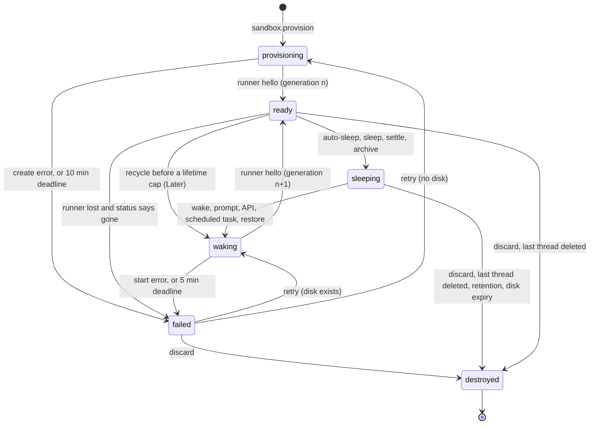

# Sandbox lifecycle and compute drivers

Status: M0 and M1 landed; the rest is a proposal, rewritten 2026-11-08 for local-first Pair Cloud.
Part of the [Pair Cloud plan](./README.md). Audience: the engineers building M2 on the Pair Cloud
server and M5's EC2 driver.

This doc covers how a sandbox is recorded, launched, shared, slept, woken, capped, metered and
reconciled on the Pair Cloud server, and how each compute driver maps onto a real backend. M1 built
the record, commands, admission, reconciler and Docker driver on a team server; that machinery runs
unchanged on Pair Cloud. The runner is in [03](./03-runner.md), team image builds in
[05](./05-team-images.md), egress, credentials and cloud-only mode in
[06](./06-credentials-and-security.md), mirrors, forks and retention in
[07](./07-access-and-data.md), and BYOC in [09](./09-byoc.md). Statements marked (inferred) are our
reading, not something the code or a vendor documents.

## 1. The sandbox record in orchestration

### What the existing machinery forces

| Fact in the code                                                                                                                                                                                                                                                                                                                                                                                                                                                                                                                                                                                                                                 | Consequence                                                                                                                                                                         |
| ------------------------------------------------------------------------------------------------------------------------------------------------------------------------------------------------------------------------------------------------------------------------------------------------------------------------------------------------------------------------------------------------------------------------------------------------------------------------------------------------------------------------------------------------------------------------------------------------------------------------------------------------ | ----------------------------------------------------------------------------------------------------------------------------------------------------------------------------------- |
| The [orchestrator](../../../apps/server/src/orchestration-v2/Orchestrator.ts) decides events and effects for one thread under its lock, without provider or filesystem I/O. It reads projections, other threads' included, under no other lock. [EventSink](../../../apps/server/src/orchestration-v2/EventSink.ts) commits events, projections, the receipt and outbox effects in one transaction.                                                                                                                                                                                                                                              | Sandbox decisions read the owning thread and the sandbox row. Rules across threads (caps, idle) need one more lock (section 4). A transition and its driver effect commit together. |
| The outbox is keyed by `thread_id` ([Foundation.ts](../../../apps/server/src/persistence/Migrations/OrchestrationV2/Foundation.ts)), and [EffectOutbox.ts](../../../apps/server/src/orchestration-v2/EffectOutbox.ts) runs one effect per thread at a time, in order (title generation has its own lane). A pending effect with a later `available_at` still blocks newer ones.                                                                                                                                                                                                                                                                  | Driver effects serialize per sandbox on the owner's queue. Timers must not be delayed effects.                                                                                      |
| The [effect worker](../../../apps/server/src/orchestration-v2/EffectWorker.ts) runs 4 effects at once and makes up to 5 attempts, with backoff from 100 ms doubling (capped at 30 s, but five attempts end within 2 s). `EFFECT_TIMEOUTS` bounds `delegated-tasks.stop` (30 s) and every sandbox effect (60 s), because a running effect's lease "is never reclaimed in-process". Runner-bound effects such as `checkpoint.capture` and `provider-turn.start` have no bound. After a crash, `reconcileAfterProcessLoss` requeues running effects of replay-safe types, cancels process-bound ones, and leaves any other type `running` for good. | Effects return on acceptance. Every sandbox effect is bounded, idempotent and on the replay-safe list. Runner-bound effects get lanes and bounds in M2 (section 4).                 |
| Worktree preparation parks a run in `preparing`; `prepared-run.release` moves it to `starting` ([ThreadLaunchService.ts](../../../apps/server/src/orchestration-v2/ThreadLaunchService.ts)). Forks copy the source's `worktreePath` ([ThreadForkService.ts](../../../apps/server/src/orchestration-v2/ThreadForkService.ts)). [ProjectionMaintenance](../../../apps/server/src/orchestration-v2/ProjectionMaintenance.ts) prunes events after a day.                                                                                                                                                                                             | Waiting reuses `preparing`. Side chats and forks share the sandbox. Sandbox time needs its own ledger.                                                                              |

### Record

In [orchestrationV2.ts](../../../packages/contracts/src/orchestrationV2.ts) (doc 08 owns the wire),
as landed in M1:

```ts
export const OrchestrationV2Sandbox = Schema.Struct({
  id: SandboxId,
  projectId: ProjectId,
  ownerThreadId: ThreadId, // stream and outbox key; changes only by sandbox.adopt
  ownerMemberId: Schema.NullOr(MemberId), // the owning thread's owner; null on solo servers
  driverId: ComputeDriverId, // a configured driver instance, e.g. "docker"
  size: SandboxSize, // "small" | "default" | "large"; each driver maps it
  state: SandboxState, // provisioning, ready, sleeping, waking, failed, destroyed
  generation: NonNegativeInt, // bumps on every create, start and replacement
  driverRef: Schema.NullOr(Schema.String),
  admission: Schema.NullOr(
    Schema.Struct({
      reason: SandboxAdmissionReason, // "team-cap" | "member-cap" | "rate-limit"
      since: Schema.DateTimeUtc,
    }),
  ),
  runnerLostAt: Schema.NullOr(Schema.DateTimeUtc),
  sleepReason: Schema.NullOr(SandboxSleepReason), // idle, manual, settled, archived, cap-pressure
  failure: Schema.NullOr(SandboxFailure), // { code, message, retryable }
  baseImage: Schema.optionalKey(SandboxBaseImageInfo), // set once the driver created from a base
  createdAt: Schema.DateTimeUtc,
  updatedAt: Schema.DateTimeUtc,
});
```

Failure codes are `create-failed`, `start-failed`, `boot-timeout`, `lost`, `missing`,
`driver-removed` and `workspace-failed`. Later fields are optional keys, so older clients still
decode the record: M2 adds `lastActiveAt` so idle time survives a restart, M4 adds `imageBuildId`
([05](./05-team-images.md#4-versions-activation-and-rollback)), and a hosted vendor's lifetime cap
(Later, section 3) would add `sessionStartedAt`.

Threads get `sandboxId`. The thread shell gets a `sandbox` summary (`state`, `admission`,
`failure.code`) so the sidebar is honest without opening threads. Rows live in
`orchestration_v2_projection_sandboxes`, indexed by owner thread, state and driver; the server
never deletes one. `generation` makes stale things harmless: the enrollment secret, the sandbox
token and the hello carry it, and a runner from an older generation is refused and reported to the
reconciler.

**Runner connection.** Doc 03's runner hub keeps it in memory, like
[Presence](../../../apps/server/src/team/Presence.ts). The first hello of a generation while
`provisioning` or `waking` dispatches `sandbox.runner.attached` to the owner's stream: `ready`. A
disconnect past the 120 s lease while `ready` dispatches `sandbox.runner.lost`, which sets
`runnerLostAt` and enqueues `sandbox.status` to decide between waiting, restarting or `failed`. A
later attach clears it. A separate **boot deadline** covers "no hello since boot" (section 5).

### Commands, events and effects

Clients send these through `dispatchCommand`, which needs `orchestration:operate` for any
`sandbox.*` command ([clientRpcPermissions.ts](../../../packages/contracts/src/clientRpcPermissions.ts)),
from any thread using the sandbox; the server routes them to the owner's stream. **Sleep now** and
**Discard** need the owning thread's owner or an admin, checked where `thread.delete` is
(`assertTeamPermission` in
[ThreadMessageIntake.ts](../../../apps/server/src/orchestration-v2/ThreadMessageIntake.ts)).

| Command           | Allowed from                                                                                   | Effect                                                                                |
| ----------------- | ---------------------------------------------------------------------------------------------- | ------------------------------------------------------------------------------------- |
| `sandbox.wake`    | `sleeping`; `failed` and retryable; `destroyed` (creates a new machine on the record's driver) | `sandbox.start` or `sandbox.create` (none while waiting for admission)                |
| `sandbox.sleep`   | `ready`, no active run in any attached thread; owner or admin                                  | `sandbox.stop`                                                                        |
| `sandbox.retry`   | `failed`                                                                                       | `sandbox.start` if `driverRef` exists, else `sandbox.create`                          |
| `sandbox.discard` | `failed`, `sleeping`, or `ready` with no active run; owner or admin                            | `sandbox.destroy`, which stops a running machine too; the next prompt provisions anew |

Internal commands live in `OrchestrationV2InternalCommand`, which `dispatchCommand` does not decode,
so no client can send them. They use deterministic ids (`sandbox-created:<id>:<generation>`), so a
replayed effect's report is dropped by its receipt, as
[UsageLimitRecoveryWorker.ts](../../../apps/server/src/orchestration-v2/UsageLimitRecoveryWorker.ts)
does with `limit-arm:<identity>`. A rejection keeps its receipt too, so a guarded command a worker
may resend takes a fresh id, as `thread.auto-settle` does.

| Command                                | Sent by                                                        | Result                                                           |
| -------------------------------------- | -------------------------------------------------------------- | ---------------------------------------------------------------- |
| `sandbox.provision`                    | a launch through the gate (below), or `delegated_task.request` | row created, `provisioning`, `sandbox.create`                    |
| `sandbox.admit`                        | lifecycle worker when a slot frees                             | `admission` cleared, `sandbox.create` or `sandbox.start`         |
| `sandbox.created`                      | `sandbox.create` effect                                        | `driverRef` set                                                  |
| `sandbox.runner.attached`              | runner hub                                                     | `ready`; owner's waiting run released; `sandbox.release-waiters` |
| `sandbox.runner.lost`                  | runner hub                                                     | `runnerLostAt`, `sandbox.status`                                 |
| `sandbox.stopped`, `sandbox.destroyed` | driver effects                                                 | `sleeping`, `destroyed`                                          |
| `sandbox.failed`                       | an effect's terminal error, or a deadline                      | `failed`; `sandbox.release-waiters` with the failure             |
| `sandbox.auto-sleep`                   | lifecycle worker                                               | rejected, like `thread.auto-settle`, if any idle input is live   |
| `sandbox.adopt`                        | `sandbox.hand-over` effect                                     | the receiving thread becomes owner                               |
| `sandbox.recycle` (Later)              | lifecycle worker, for a hosted vendor's session limit          | `waking`, new generation, `sandbox.stop` then `sandbox.start`    |

One event, `sandbox.updated`, carries the whole record, as `run.updated` does. Effects carry
`sandboxId` and `generation`, and the executor drops an older generation. `sandbox.create`,
`.start`, `.stop`, `.destroy` and `.status` call the driver. M2 adds a working-tree snapshot before
`sandbox.stop` ([07](./07-access-and-data.md) owns what it writes). `sandbox.request-wake`,
`.release-waiters` and `.hand-over` only dispatch commands to other streams.

### States

| State          | Meaning                                        | Counts toward caps | Clients show                                                                                     |
| -------------- | ---------------------------------------------- | ------------------ | ------------------------------------------------------------------------------------------------ |
| `provisioning` | Being created, or waiting for admission.       | Once admitted      | "Starting machine", or "Waiting for a machine: 3 of 3 running"                                   |
| `ready`        | Runner connected for this generation.          | Yes                | Nothing; a quiet dot, then "Reconnecting to machine" after a 2 s debounce                        |
| `sleeping`     | Stopped, disk kept.                            | No                 | "Asleep". Diffs read the mirror.                                                                 |
| `waking`       | Starting from the kept disk.                   | Once admitted      | "Waking machine"                                                                                 |
| `failed`       | Terminal driver error or a missed deadline.    | No                 | The failure, with Retry and Discard                                                              |
| `destroyed`    | Gone. History and mirrored checkpoints remain. | No                 | "Machine discarded" with **Start a new machine**, which focuses the composer; sending provisions |



### The launch gate (M2)

Pair Cloud is cloud-only ([06](./06-credentials-and-security.md) §10), and only a cloud-only server
offers Cloud (D12). Every launch path on it (the UI, MCP, `t3 thread`, scheduled tasks, webhooks,
`delegate_task`) is a cloud launch through one gate, so nothing starts a machine the gate didn't
place, and nothing starts an agent on the server's own machine.

**The server already picks.** `ThreadLaunchService.checkCloudLaunch` calls
`resolveCloudLaunch` in [CloudPreparation.ts](../../../apps/server/src/sandbox/lifecycle/CloudPreparation.ts).
It refuses with `CloudLaunchError` (`no-driver`, `project-disallowed`) or a provider error
(`ProviderCloudLocalOnlyError`, `ProviderCloudUnsupportedError`), and otherwise returns the
placement: the driver named by the server-wide `sandbox.defaultDriverId` (or the first configured
one) and that driver's `size`, else `default`. No client input reaches the choice. Choosing a size
at launch is Later.

**What M2 changes.**

- **Only a cloud-only server launches.** `resolveCloudLaunch` gains one check: the server is
  cloud-only. Every decision that would create a machine checks it too, because not all of them
  pass through a launch: a wake of a `destroyed` record or a retry with no disk creates a new
  machine on the record's driver ([SandboxDecisions.ts](../../../apps/server/src/sandbox/lifecycle/SandboxDecisions.ts)).
  On a desktop or other server that isn't cloud-only, those are refused with a message pointing at
  Pair Cloud. Existing cloud threads there keep their history readable, and their machines can
  still wake, sleep and be discarded until an admin removes the driver, which fails them with
  `driver-removed`. Clients show Cloud only where the server reports `capabilities.cloudLaunch`
  ([08](./08-clients-and-contracts.md)).
- **No client chooses a placement.** One client-dispatchable command still carries one:
  `delegated_task.request` has an optional `sandbox: { sandboxId, driverId, size }`, and the
  orchestrator provisions the child task's machine from it in the same commit. Its only sender is
  MCP `delegate_task` in [OrchestratorMcpService.ts](../../../apps/server/src/mcp/OrchestratorMcpService.ts),
  which fills it after `checkCloudLaunch`. But [ws.ts](../../../apps/server/src/ws.ts) passes any
  decoded `OrchestrationV2Command` to `ThreadMessageIntake.dispatchCommand`, so a client with operate
  scope can send its own and provision a machine past the gate's project and credential checks. M2
  moves `delegated_task.request` into `OrchestrationV2InternalCommand`, unchanged. No web, desktop
  or mobile client sends it, and remote delegation launches through `t3_thread_launch` instead, so
  nothing breaks.
- **The internal sandbox commands stay refused.** `sandbox.provision`, `sandbox.created`,
  `sandbox.runner.attached` and the rest already fail to decode at `dispatchCommand`.
  [rpc.test.ts](../../../packages/contracts/src/rpc.test.ts) checks that for
  `checkpoint.rollback.fail`; M2 adds rows for the sandbox commands and `delegated_task.request`, so
  a later schema move can't silently open them.

### Launch and prompts

1. `ThreadLaunchService.launch` takes `cloud` as a value in its launch input only, after the gate.
   It commits the thread with `sandboxId` (from `sandboxIdForLaunch(commandId)`, so a replayed
   launch provisions the same machine), then dispatches `sandbox.provision` (id
   `<commandId>:sandbox`), then the first message (id `<commandId>:initial-message`) with the run
   in `preparing` (`defer_start`). The run record keeps `{ type: "worktree" }`, so older clients
   still decode it (decision 7).
2. At a cap the row gets `admission` and no effect; otherwise `sandbox.create` is enqueued with a
   bootstrap (section 6).
3. `driver.create` returns once the backend accepts, and its result dispatches `sandbox.created`.
4. The runner boots, enrolls and says hello: `sandbox.runner.attached`, state `ready`.
5. The preparation fiber waits on the thread's stored `sandbox.updated` events with the
   `streamStoredEventsFrom` pattern it already uses for interruption. Then `checkoutInSandbox`
   clones the project's `origin` into `/t3-sandbox/<sandboxId>/repos/<host>/<owner>/<name>` (or
   fetches, if the clone exists) and adds a worktree from `origin/<branch>` when the branch is
   pushed, else from `origin/<baseRef>`, failing with `base-ref-missing` otherwise. The setup script
   runs through the workspace host (doc 02), and the fiber dispatches `prepared-run.release`.

`checkoutInSandbox` is the one place that decides where a machine's code comes from. In M2 that is
always a pushed GitHub branch from the Pair Cloud project's origin. M3 adds a second case, a seed
fetched from the mirror and named by an optional `seedRef` on the cloud launch
([07](./07-access-and-data.md)), with no breaking change to the launch contract.

`prepared-run.progress` has phases `worktree`, `setup`, `sandbox-admission`, `sandbox-start` and
`clone`, so clients show "Waiting for a machine", "Starting machine", "Cloning repository" and
"Running setup script" from persisted status. A later prompt to a cloud thread whose sandbox is not
`ready` also uses `defer_start`, and prompts after it queue as today. On the owning thread a
sleeping sandbox wakes in the same commit, and `sandbox.runner.attached` releases the waiting run (a
wake needs no clone). If the sandbox fails, the run fails with `workspace_preparation_failed`, and
`prepared-run.retry` retries both.

Trap: [ProviderRuntimeRecoveryService](../../../apps/server/src/orchestration-v2/ProviderRuntimeRecoveryService.ts)
cancels every `preparing` run at startup, since the preparation fiber lived in memory. A run waiting
on a sandbox still `provisioning` or `waking` is skipped there and re-armed with
`ThreadLaunchService.prepareRun`, as delegated tasks use it. The recovery test table has the row.

### Shared sandboxes: side chats and forks

A side chat or fork of a cloud thread keeps its source's `sandboxId` and checkout path, matching local
worktree semantics ([07](./07-access-and-data.md#2-restore-revert-and-fork)): ThreadForkService spreads
the source thread. "Fork to a new machine" (Later) would override it. Unrelated threads never join a
sandbox.

**Who uses a sandbox.** Membership is a projection of each thread's own events, not a counter on the
sandbox row: `orchestration_v2_projection_sandbox_threads (sandbox_id, thread_id, attached_at, archived)`
gains a row when a thread is created or forked with a `sandboxId`, updates on archive and unarchive,
and loses it on delete. The orchestrator reads the live set when deciding a deletion, archive or sleep.

**An attached thread's prompt.** Its decision runs on its own stream. If the sandbox is not `ready`,
the run parks in `preparing` and the commit enqueues `sandbox.request-wake` on that thread. Its
executor dispatches `sandbox.wake` to the owner's stream with id `sandbox-wake:<id>:<owner>:<generation>`
(a receipt matches only its own thread, so the id names the owner), and many prompts make one wake.
When the owner's stream records `ready` or `failed`, the same commit enqueues
`sandbox.release-waiters`, which dispatches `prepared-run.release` or `prepared-run.fail` to each
attached thread with a run waiting on that sandbox (id `sandbox-release:<runId>:<generation>`). Both
hops are outbox effects, so a restart loses nothing.

**When the owning thread goes away, ownership moves to the oldest remaining attached thread.**
Refusing the deletion would let a side chat stop owners deleting their own threads, and doc 07 says
delete destroys the sandbox "only when no thread uses it". Deleting a thread deletes its side chats
in the same commit (`liveSideChatIds` in the orchestrator), so only forks and theirs can adopt.
Oldest follows from projection data alone, so a replayed hand-over picks the same thread.

- **Delete.** If no other thread uses the sandbox, enqueue `sandbox.destroy`. Otherwise enqueue
  `sandbox.hand-over` on the old owner's queue, where FIFO order runs it after every sandbox effect
  already queued. It picks the oldest live attached thread and dispatches `sandbox.adopt` there (id
  `sandbox-adopt:<id>:<oldOwner>`), which writes `sandbox.updated` with the new owner on that
  thread's stream; its queue carries the sandbox's effects from then on. If that thread was deleted
  meanwhile, it picks the next, or destroys when none remain. Commands for the sandbox during the
  hand-over are refused without a receipt, as mode-limit refusals are, and resent. Both effects sit
  beside the cleanup effects [ThreadDeletion.ts](../../../apps/server/src/orchestration-v2/ThreadDeletion.ts)
  enqueues. A fork racing the last deletion sees `destroyed` and provisions anew.
- **Archive.** Ownership stays, since archive is reversible. An archived owner stops counting as an
  idle input, so the sandbox sleeps at once only when every attached thread is archived or idle, and
  the 7-day retention destroy waits until all are archived.
- **Reassign.** Reassigning the owning thread changes `ownerMemberId` in the same commit (doc 07).
  Reassigning an attached thread changes nothing on the sandbox.

**Counting once.** A shared sandbox counts once against caps. Machine time bills to the owner member
and owning thread (others show "Shares the machine of <thread>"); tokens, to whoever prompted.

## 2. Idle policy and wake triggers

Idle sleep and the wake triggers below are M2 (old 2.1 and 2.2). Idle inputs, evaluated across every
thread using the sandbox:

| Input                                                                       | Source                                                                                  | Keeps awake                                                              |
| --------------------------------------------------------------------------- | --------------------------------------------------------------------------------------- | ------------------------------------------------------------------------ |
| Active run, background tasks, delegated children                            | thread projection                                                                       | Always, the rule `thread.auto-settle` uses                               |
| Pending approval or user input                                              | `pendingRuntimeRequest`                                                                 | Up to 2 hours, then sleep and interrupt with a clear message             |
| Terminal input or output (a sleeping terminal can be viewed without waking) | [terminal manager](../../../apps/server/src/terminal/Manager.ts) via the workspace host | Within the window (a logging dev server keeps it awake, as on Conductor) |
| Viewer lease                                                                | new, in memory                                                                          | Within the window                                                        |
| Scheduled task due within the window                                        | scheduled task rows                                                                     | Yes                                                                      |
| Watched preview (Later, with previews)                                      | [preview manager](../../../apps/server/src/preview/Manager.ts)                          | While a client streams it                                                |

Viewers cannot come from Presence: clients report it only while another member is connected
([presenceReporting.ts](../../../packages/client-runtime/src/presenceReporting.ts)), so a solo user
reading a diff looks absent. The thread view renews a viewer lease every 5 minutes while visible and
focused, and leases expire after 6. That is one small message per open cloud thread per 5 minutes.

Defaults: sleep after 60 idle minutes on Docker, where idle costs only memory on a box the team
already pays for, and after 20 on drivers billed per hour (EC2 in M5, any hosted vendor later;
Conductor's number). It is a per-driver setting. Settled threads sleep at once on Docker; M2 makes
that rule a driver capability, so a per-hour driver can choose. Archived sandboxes are destroyed after
7 days, any sandbox asleep 30 days is destroyed (sooner if the driver's `diskRetentionDays` is
shorter), and the mirror keeps history usable afterwards. Retention applies the worktree cleanup rules
to sandbox disks (07).

`idleDecision(inputs, now) -> "busy" | { sleepAt }` is pure and table-tested. The
`SandboxLifecycleWorker` ([SandboxLifecycleWorker.ts](../../../apps/server/src/sandbox/lifecycle/SandboxLifecycleWorker.ts))
registers with [Scheduler](../../../apps/server/src/scheduling/Scheduler.ts) (a 5 s tick), keeps the
next deadline from the projection in a `DueHint` as `UsageLimitRecoveryWorker` does with
`getLimitRecoveryWakeAt`, and dispatches `sandbox.auto-sleep`, which the orchestrator rejects if an
input became live. Before `sandbox.stop`, M2 snapshots the working tree into the mirror, which backs
read-only browsing while asleep; a wake whose disk is gone rebuilds it from the mirror (07 owns both).

**What M1 shipped.** The worker runs only its settle rule: a Docker sandbox stops (through
`sandbox.sleep`) once every attached thread is settled or archived. While stopped, reads fall back to
the mirror's latest checkpoint and terminals show exited.

**Wake triggers.** In M1: a prompt from the owner or an attached thread. In M2: opening the thread
(one `sandbox.wake` when the view mounts visible and focused), typing in a sleeping terminal or
pressing its **Wake** (viewing it does not wake), MCP or `t3 thread` CLI calls that send messages,
run commands or read files, scheduled tasks, and checkpoint restore (decision 11). Opening a preview
wakes once previews land (Later). Never: the sidebar, the shell stream, search, push, mirror diffs,
`subscribeThread`, or MCP lists.

**Avoiding wake storms.** A wake is always an explicit command, never a side effect of a
subscription, so a sidebar of 40 threads sends nothing. Waking a `waking` or `ready` sandbox is an
accepted no-op (on dispatch's no-event allow list, like `thread.follow`) with a deterministic id.
Wakes pass through the admission queue, and a per-team token bucket (10 starts a minute,
`STARTS_PER_MINUTE` in [SandboxAdmission.ts](../../../apps/server/src/sandbox/lifecycle/SandboxAdmission.ts))
sets `admission.reason = "rate-limit"`. The bucket also keeps a team well under the EC2 API's
per-account request throttling (M5).

## 3. Lifetime caps

No driver on the M2 to M5 path has a session cap: Docker containers and EC2 instances run until
stopped. Vercel Sandbox and E2B Pro cap one machine session at 24 hours, reset by stop and resume
(E2B Hobby: 1 hour), so the recycle below is Later, with a hosted vendor. When
`capabilities.maxSessionMs` is set, the lifecycle worker:

1. From `maxSessionMs - 2h`, at the first moment no attached thread has an active run, dispatches
   `sandbox.recycle`: stop then start, disk kept, timer reset, a few seconds of "Waking machine".
2. From `maxSessionMs - 30m`, queues new prompts ("Restarting the machine before its time limit")
   and lets the running turn finish.
3. At `maxSessionMs - 5m`, interrupts a turn still running with an honest message, recycles, and
   continues through [RestartContinuation.ts](../../../apps/server/src/orchestration-v2/RestartContinuation.ts).

**Provider session continuity.** Sleep never keeps memory (decision 10), so drivers that could keep
it (E2B's default pause, EC2 hibernation) are configured not to, and every wake cold-starts
processes. Claude Code and Codex keep sessions under their config homes (`CLAUDE_CONFIG_DIR/projects`,
`CODEX_HOME/sessions`, which the usage readers scan), and Claude keys them by working directory
(inferred). A cloud thread puts those homes at `/t3-sandbox/<sandboxId>/homes/<instanceId>`
([SandboxProviderHome.ts](../../../apps/server/src/sandbox/providers/SandboxProviderHome.ts)) on the
kept disk, beside the checkout, so the adapter's normal `resume`
([ClaudeAdapterV2.ts](../../../apps/server/src/orchestration-v2/Adapters/ClaudeAdapterV2.ts)) works
after any sleep. When the disk is lost, M2 rebuilds the checkout from the mirror (07), and the
conversation falls back to
[ContextHandoffService](../../../apps/server/src/orchestration-v2/ContextHandoffService.ts), which
keeps a 240-character prefix of each item ([context handoffs](../../internals/context-handoffs.md)).
Mirroring provider session files would avoid that loss; it is Later.

## 4. Caps, quotas and usage

| Setting                                            | Default                                                                                            | Why                                                                        |
| -------------------------------------------------- | -------------------------------------------------------------------------------------------------- | -------------------------------------------------------------------------- |
| Team cap on running sandboxes, per driver instance | Docker: `max(1, floor(host vCPUs / 4))`, read once from the daemon; per-hour drivers (EC2, M5): 20 | Capacity on Docker, because the host is finite. Spend on per-hour drivers. |
| Member cap                                         | None (D5)                                                                                          | Conductor, Claude Code cloud and Codex cloud publish no per-user cap.      |
| Starts per minute per team                         | 10                                                                                                 | A guard against runaway agent fan-out, wake storms and API throttling.     |
| Size                                               | The driver instance's `size`, else `default` (4 vCPU, 8 GB on Docker)                              | The server picks (section 1); Docker shares one box.                       |

"Running" means `ready`, or `provisioning`/`waking` without `admission`. A create with an unknown
outcome counts until the reconciler resolves it (the EAS host counts one until a listing finds it or
`UNCERTAIN_CREATE_MS`, 5 minutes, passes: [EasDeviceHost.ts](../../../apps/server/src/device/EasDeviceHost.ts)).
Settings → Cloud shows the caps read-only
([SandboxOverview.ts](../../../apps/server/src/sandbox/lifecycle/SandboxOverview.ts)). Editing them,
an optional member cap and the sandbox-hours display are Later (old 2.17).

Thread locks do not serialize counts across threads: two threads deciding at once would both see a
free slot. So commands that take a slot (`provision`, `wake`, `retry`, `admit`) also take one
process-wide admission lock, chosen in the dispatch wrapper as forks and deletes add locks there.

At the cap the sandbox waits with `admission`, and the thread says why in [01](./01-product.md)'s
copy: "Waiting for a machine: 8 of 8 running". The lifecycle worker admits waiters in
`admission.since` order. From M2 it first applies cap pressure: a ready sandbox idle 5 minutes or more
sleeps early with `sleepReason: "cap-pressure"`. We queue rather than refuse because scheduled tasks
and agent fan-out have nobody to retry for them; the EAS host refuses because a device session is
interactive. A driver's `capacity` and `rate-limited` errors are retryable and fail the sandbox only
when the effect's attempts run out.

**Server capacity.** One Pair Cloud server drives the whole team's machines. M2 states a target of
30 concurrent machines per server (D18) and proves it before it ships with 03's load test: N runners
over loopback, one saturating a PTY and one streaming a bundle at the same time, with no rise in p95
event latency for other threads. The hub gets per-sandbox byte budgets, so one machine's output can't
starve the others, and framing moves to worker threads only if the test fails
([03 §9](./03-runner.md#9-performance)). M1's bench missed two of 03's budgets (41 MB/s of PTY
throughput against 50, and 25 ms of server CPU per MB against under 5, where local work alone spends
17.6), so the test decides, not the table. The team cap is a separate limit: at Docker's default size,
one host runs 30 machines only with 120 vCPUs (open question 3).

**Effect-worker lanes and bounds (M2).** The worker runs 4 effects at once for the whole server, and
runner-bound effects have no bound, so 4 slow machines (a large checkpoint capture, a turn start on a
struggling runner) stall every thread's effects, sandbox lifecycle included. M2 gives runner-bound
effects their own lane, as title generation has, and a bound per type in `EFFECT_TIMEOUTS`, with
values set from the load test. On timeout they take the normal retry path, as sandbox effects do.

**Metering.** Token usage comes from `memberUsageSince` in
[ProjectionStore.ts](../../../apps/server/src/orchestration-v2/ProjectionStore.ts) through
[TeamUsage](../../../apps/server/src/team/TeamUsage.ts), against whoever prompted. Sandbox time runs
whether or not anyone prompts, so it counts against `ownerMemberId` and the owning thread. Since M1
the projector opens a `sandbox_usage_intervals` row (sandbox, thread, member, driver, size, start,
end) when a sandbox enters a billed state and closes it on leaving; it is the durable record because
events are pruned. Showing it is Later, with cap editing: a separate `TeamUsageResult.sandboxRows`
(usage rows are keyed by provider instance), with an estimated cost from an admin-editable rate per
driver and size.

## 5. Crash and restart reconciliation

At startup, after `reconcileAfterProcessLoss` requeues sandbox effects, the
[SandboxReconciler](../../../apps/server/src/sandbox/lifecycle/SandboxReconciler.ts) lists each
driver's sandboxes tagged with this server's install id (its environment id) and plans with a pure
`planReconciliation(record, backend, now)`:

| Record                                           | Backend                      | Action                                                                                                                             |
| ------------------------------------------------ | ---------------------------- | ---------------------------------------------------------------------------------------------------------------------------------- |
| `ready`, `waking`, `provisioning`                | running                      | Keep. A runner that was attached gets the 120 s lease, then `sandbox.runner.lost`; one that never attached gets the boot deadline. |
| `ready`                                          | stopped                      | `sandbox.stopped`                                                                                                                  |
| `ready`, `waking`                                | missing                      | `sandbox.failed` with `lost`, retryable                                                                                            |
| `sleeping`                                       | running                      | Stop it                                                                                                                            |
| `sleeping`                                       | missing                      | `sandbox.failed` with `missing`, not retryable                                                                                     |
| `failed`, retryable                              | running                      | Stop it; the disk stays for Retry                                                                                                  |
| any, no `driverRef`                              | found by name                | `sandbox.created` with the found ref                                                                                               |
| `provisioning`, no `driverRef`                   | not found                    | Nothing; the requeued create is idempotent, and the boot deadline catches a dead backend                                           |
| `destroyed`, `failed` and not retryable, or none | exists, older than 5 minutes | Destroy, unless restore mode is on (below)                                                                                         |
| `destroyed`, `failed` and not retryable, or none | younger than 5 minutes       | Leave it; a create may be in flight                                                                                                |

This follows the EAS host: record before asking the backend, find leftovers by our name, never touch
anything we did not tag. It also runs every 10 minutes, because a leak costs money every hour.

| Effect                                         | Why running it twice is safe                                                                                                                                                                                                                           |
| ---------------------------------------------- | ------------------------------------------------------------------------------------------------------------------------------------------------------------------------------------------------------------------------------------------------------ |
| `sandbox.create`                               | Name `pair-<installId8>-<sandboxId>-g<generation>` plus the backend's feature (Docker `--name`, EC2 `ClientToken`; for a hosted vendor, boat's `Idempotency-Key` or Vercel's unique `name`). Without one (E2B, unverified), look up by metadata first. |
| `sandbox.start`, `sandbox.stop`                | Target state: already there is success.                                                                                                                                                                                                                |
| `sandbox.destroy`                              | Not found is success.                                                                                                                                                                                                                                  |
| Working-tree snapshot before sleep (M2)        | Overwrites one ref per thread in the mirror (07).                                                                                                                                                                                                      |
| `snapshot` for builds (M4)                     | Named `<sandboxId>-<purpose>-<generation>`; an existing one is success.                                                                                                                                                                                |
| `request-wake`, `release-waiters`, `hand-over` | Deterministic ids on the commands they send.                                                                                                                                                                                                           |

Inside an effect, transient errors retry 3 times, 2 s apart, like the EAS host's `TRANSIENT_RETRY`.
Across attempts the outbox's backoff applies (under 2 s in all), so backend hints travel as
`retryAfterMs`. Drivers have carried it since M1; from M2 the effect worker honors it by setting the
outbox row's `available_at`, capped (old 2.4). The EC2 driver (M5) needs it for
`InsufficientInstanceCapacity` and API throttling. On the last attempt (`willRetry: false`) the
executor dispatches `sandbox.failed`, `retryable` from the error, outside the bound, whose timeout
interrupts it. The boot deadline (no hello since boot) is 10 minutes from `provisioning` and 5 from
`waking`; missing it dispatches `sandbox.failed` and enqueues `sandbox.stop`.

### Restoring an older database: restore mode (M2)

Pair Cloud's data volume gets hourly snapshots (D11). Restoring one rolls the database back by up to
an hour while machines kept running. A machine created after the snapshot has no record, so the
plan above would destroy it after 5 minutes, with whatever work its disk holds that never reached
GitHub. A record restored as `sleeping` whose machine was woken since would be stopped, which is
harmless. Only destroys lose work.

Restore mode removes `DestroyBackend` from the plan:

- **On.** The install guide's restore steps turn it on before the restored server starts. The
  reconciler also turns it on by itself when it finds a machine tagged with this install that has
  no record, since the server never deletes a record and normal operation can't leave one behind.
- **While on.** Both the startup pass and the 10-minute pass destroy nothing. Records still follow
  their backends (`sandbox.stopped`, `lost`, `missing`, `sandbox.created`). A machine with no
  record, or with a record that says `destroyed`, is stopped, which frees CPU and keeps its disk;
  its runner can't attach anyway, because its grant was minted after the snapshot.
- **Shown.** Settings → Cloud lists those machines for admins with their sandbox id, driver and
  creation time, so an admin can copy work off with the backend's own tools and destroy each one.
- **Off.** An admin leaving restore mode is the confirmation; the normal plan, grace period included,
  then removes what is left.

### Planned restarts: drain first (M2)

Provider adapters run in the server process (decision 2), so a restart ends every machine's
processes: the new `serverBootId` tells each runner its old handles are gone (03 §5). Machines stay
up, and their runners redial the new server. Draining limits the damage, not the interruption. An
admin-only drain stops starting new turns and new machines (they wait, as at a cap, and start after
the restart), lets running turns finish up to a bound (proposed: 15 minutes), then restarts. A turn
still running at the bound is interrupted and continues after the restart through
[RestartContinuation.ts](../../../apps/server/src/orchestration-v2/RestartContinuation.ts) ("Continue
where you left off"). The install guide's upgrade steps and the M5 kit ([09](./09-byoc.md)) drain
first.

## 6. The ComputeDriver interface

Landed in [ComputeDriver.ts](../../../apps/server/src/sandbox/compute/ComputeDriver.ts). Every method
fails with one tagged `ComputeDriverError { driverId, operation, reason, retryable, retryAfterMs?,
backendStatus?, image? }`, where `reason` is `not-found`, `conflict`, `capacity`, `quota`,
`rate-limited`, `auth`, `invalid-request`, `unsupported` or `unavailable`. The error's message is
what a failed sandbox shows the user.

```ts
export interface ComputeCapabilities {
  readonly persistentDisk: boolean;
  readonly memoryOnStop: boolean; // can keep RAM; Pair leaves it off (decision 10)
  readonly snapshot: boolean;
  readonly imageBuild: "snapshot" | "buildImage"; // doc 05 section 3
  readonly maxSessionMs: number | null;
  readonly diskRetentionDays: number | null;
  readonly isolation: "container" | "rootless-container" | "gvisor" | "microvm" | "vm";
  readonly egressRules: "none" | "allowlist" | "allowlist-and-brokering";
  readonly regions: ReadonlyArray<string>;
  readonly nestedDocker: boolean;
  readonly sizes: ReadonlyArray<{
    readonly size: SandboxSize;
    readonly vcpus: number;
    readonly memoryGb: number;
  }>;
  readonly defaultRunningCap: number; // section 4's team cap for this instance
}

export interface SandboxBootstrap {
  readonly sandboxId: SandboxId;
  readonly generation: number;
  readonly runnerBuildId: string; // decision 5: the server serves this build's runner
  readonly serverUrl: string; // what the runner dials: http(s)://host or unix:/path
  readonly enrollmentSecret: Redacted.Redacted<string>; // one use, 15 minutes, this generation
}

export class ComputeDriver extends Context.Service<
  ComputeDriver,
  {
    readonly driverId: ComputeDriverId;
    readonly kind: ComputeDriverKind;
    readonly capabilities: ComputeCapabilities;
    readonly create: (input: {
      readonly name: string; // sandboxBackendName: same name, same sandbox
      readonly sandboxId: SandboxId;
      readonly generation: number;
      readonly image:
        | { readonly type: "build"; readonly imageRef: string }
        | { readonly type: "base" };
      readonly size: SandboxSize;
      readonly tags: Readonly<Record<string, string>>; // pair.install, .sandbox, .generation, .driver
      readonly bootstrap: SandboxBootstrap;
    }) => Effect.Effect<
      { readonly driverRef: string; readonly baseImage: BaseImageInfo | null },
      ComputeDriverError
    >;
    readonly start: (
      driverRef: string,
      bootstrap: SandboxBootstrap,
    ) => Effect.Effect<void, ComputeDriverError>;
    readonly stop: (driverRef: string) => Effect.Effect<void, ComputeDriverError>; // disk kept
    readonly destroy: (driverRef: string) => Effect.Effect<void, ComputeDriverError>;
    readonly status: (driverRef: string) => Effect.Effect<BackendSandbox, ComputeDriverError>;
    readonly list: (
      tags: Readonly<Record<string, string>>,
    ) => Effect.Effect<ReadonlyArray<BackendSandbox>, ComputeDriverError>;
    readonly deleteImage: (imageRef: string) => Effect.Effect<void, ComputeDriverError>;
    readonly health: Effect.Effect<ComputeDriverHealth, ComputeDriverError>; // Settings → Cloud's Test
    // M4: snapshot (team builds, doc 05). Later: buildImage, for backends that can't snapshot.
  }
>()("t3/sandbox/compute/ComputeDriver") {}
```

`BackendSandbox` is `{ driverRef, name, sandboxId | null, status, createdAt }`, with `status` one of
`starting`, `running`, `stopped`, `failed` or `missing` and `sandboxId` parsed from our tags.
`ComputeDriverHealth` reports the isolation in use, whether the private-network block applied, and
the base image's state. A `ComputeDriverRegistry` maps `driverId` to one of the server's configured
driver instances (`sandbox.drivers` in server settings, with one server-wide `defaultDriverId`; a
project can only turn Cloud off), as
[ProviderAdapterRegistry](../../../apps/server/src/orchestration-v2/ProviderAdapterRegistry.ts) maps
provider instances. Methods are `Effect.fn` with stable span names. The code lives in
`apps/server/src/sandbox/compute/` (decisions 7 and 14).

**Bootstrap hand-off.** `start` takes a bootstrap because each wake is a new generation with a fresh
enrollment secret. The driver hands it to the image's entrypoint,
[pair-bootstrap.sh](../../../infra/sandbox-image/pair-bootstrap.sh), which makes sure the runner
bundle for `runnerBuildId` is present (fetching it from the server if needed) and runs `t3 runner`
(doc 05 owns the image, doc 03 enrollment). Nothing in it goes where the backend shows it: Docker
writes it as a 0600 file into the container layer, never env, which `docker inspect` shows. A used or
expired secret is harmless if it leaks.

## 7. Driver designs

### Docker (M1)

Pair Cloud's driver from M2 (decision 8), and the only one until M5. Laptops no longer offer Cloud
(D12), so it never runs on a member's Mac. The driver talks to the Engine API at `DOCKER_HOST`, so the
daemon is the Pair Cloud server's own machine or another host beside it.
[DockerComputeDriver.ts](../../../apps/server/src/sandbox/compute/DockerComputeDriver.ts): `create`
makes a container named and labeled by us, with CPU, memory and PID limits, `NET_RAW` and `MKNOD`
dropped, no restart policy, and one named volume at `/t3-sandbox/<sandboxId>` for the checkouts and
provider homes, on a bridge network per install, then starts it. `start` writes the new generation's
bootstrap into the container layer and starts. `stop` frees CPU and memory and keeps the container
and its volume. `destroy` removes both. `list` filters by the `pair.install` label. `imageBuild` is
`snapshot`: an M4 team build is a `docker commit` of a build container.

**Reaching the server** follows [03 §3.2](./03-runner.md#32-what-url-the-runner-dials). On the local
Docker host, the server opens one runner-only Unix socket in its state directory, and the driver
bind-mounts its directory read only at `/run/pair-host`; the runner authenticates with its sandbox
token. That works whatever the server's bind host is and exposes no port. A remote `DOCKER_HOST`
cannot bind-mount a socket on the server's machine, so there the runner dials the admin's
`runnerUrl`, which must be reachable from that host (decision 4). `/runner/*` is for machine
networks only; until M5's internal listener, the member listener mounts it only when a configured
driver needs it (03). An egress helper inserts `DOCKER-USER` rules that block the host, private and
metadata addresses; doc 06 owns the policy.

**Isolation.** Plain runc is not a security boundary. The driver reads the daemon's info (security
options include `rootless`; runtimes include `runsc`) and reports `isolation`. Settings recommends
rootless Docker or gVisor and warns when neither is in use. On Pair Cloud the containers usually
share the server's machine, so cloud-only mode keeps agents off the server only if none escapes: the
install guide sets up gVisor or rootless Docker, or a separate Docker host (06 §9). Nested Docker
under gVisor is limited (unverified), so `nestedDocker` is false there. Disk quotas need overlay2 on
XFS project quotas, so on most hosts a volume can fill the disk; we document that rather than build
quota machinery.

### Plain VM on EC2 (M5), then GCE

Doc 09 owns deployment. The driver refuses to run on a server that is not cloud-only (06 §10): the
server holds AWS permissions to launch instances, which an agent on the server's own machine could
use. Each operation is one EC2 call: `create` is `RunInstances` with a `ClientToken`, tags and the
bootstrap in user data, from the active team build's AMI or, before any team build, the base AMI the
driver saves at setup ([05 §1](./05-team-images.md#1-the-base-image)); `stop` and `start` keep the EBS
volume; `snapshot` is `CreateImage` (`imageBuild: "snapshot"`); `destroy` is `TerminateInstances`;
`list` is `DescribeInstances` by tag. Hibernation would keep RAM, so `memoryOnStop` is true and left
off. A stopped instance restarts in its own zone, so a capacity error on wake falls back to
relaunching from a snapshot elsewhere. Instances bill per hour of running, so EC2 gets the 20-minute
idle default and a cap of 20. GCE follows with the same shape.

### Hosted vendors (Later)

No hosted vendor is scheduled. This analysis, retrieved 2026-11-06, stays as reference for the day a
customer asks; section 8 compares the options. A hosted driver would also bring lifetime recycling
(section 3), public runner URLs with token rotation (03), its own image builds (05) and the
settle-sleep choice above.

#### Vercel Sandbox

`create` is `Sandbox.create({ name, source, resources: { vcpus: 8 }, tags, networkPolicy,
keepLastSnapshots })`, persistent by default with 2 GB per vCPU, followed by a detached command that
starts the runner. `start` is `Sandbox.get({ name, resume: true })` plus the runner, with a fresh
24 h session. `stop` snapshots the filesystem automatically. `destroy` deletes the sandbox and its
snapshots, which otherwise keep billing. `list` filters by tags. `imageBuild` is `snapshot`. With no
entrypoint on resume, the driver starts the runner with one detached command.

Gaps: no memory kept (decision 10 wants that anyway); 24 h sessions (recycle); custom images live in
Vercel's registry; snapshots at $0.08 per GB-month, expiring 30 days after last use; an access token
outside Vercel. Strengths: Firecracker microVMs, 8 vCPU and 16 GB on Pro, Active CPU pricing that skips
model waits, 19 regions, a firewall that allowlists domains and injects credentials, and Docker inside.

#### E2B

`create` is `Sandbox.create(template, { metadata, envs, lifecycle: { onTimeout: "pause" } })` from a
template built from a Dockerfile (`imageBuild: "buildImage"`). `stop` is the filesystem-only pause,
which reboots on resume; decision 10 rules out the default pause, which keeps memory. `start` is
`Sandbox.connect`, about a second. Snapshot and fork exist; `destroy` is `kill`; `list` filters by
metadata.

Gaps: Pro allows 1 to 8 vCPU and 1 to 8 GiB, short of the 16 GB machine; billing is on allocated
vCPU and memory, so idle costs as much as busy; Pro is $150 a month. Strengths: paused sandboxes
never expire and do not count toward concurrency, pause resets the 24 h limit, and egress allow and
deny lists come with request secret injection. And BYOC: Enterprise BYOC run by E2B in the
customer's account, or **E2B Embed**, the Apache-2.0 single-node stack a customer installs
themselves ([09](./09-byoc.md)). If E2B is ever the vendor, the same driver pointed at an Embed node
gives small teams a cheap BYOC path with no new driver.

#### boat.dev

`POST /sandboxes` takes `type: "large"`, `name`, `labels`, `env`, `from` (a saved snapshot),
`ttlSeconds: null`, `noEnv: true` and an `Idempotency-Key`. Resume, stop (which snapshots), fork and
delete map one to one; `imageBuild` is `snapshot`. Machines are full VMs with Docker inside, and
`noEnv` keeps the boat account's own secrets out. It is by far the cheapest: `large` (8 vCPU, 16 GB)
is $0.072 an hour, billed per second while running. boat's $20 plan includes 12 starts a minute.
Gaps: EU only (Germany, Finland, France), so a US team pays a transatlantic round trip on every
runner message; firewall rules live inside the VM, where root can remove them; stopped disks are kept
at least 14 days only; SOC 2 is in progress; a young YC company. A good second hosted driver for EU
teams.

### Other backends

Kubernetes waits until a customer asks: a Pod plus a PersistentVolumeClaim (stop deletes the Pod,
keeps the claim) with a gVisor or Kata RuntimeClass, or the SIG Apps `agent-sandbox`. Of the rest:
Daytona moved its code to a private repository in June 2026 (secondary sources, unverified); Modal
sandboxes cap at 24 h and continue through filesystem snapshots; Fly Machines restart "well under a
second" with volumes but no egress brokering (unverified); Morph claims sub-250 ms branching with
unclear pricing (unverified). None beats the vendors above.

## 8. Choosing a hosted vendor, if one is added

A hosted vendor's machines sit on neither the customer's VPC nor a tailnet, so their runners need a
public `/runner/*` origin or the T3 Connect tunnel (03 §3.2). BYOC keeps `/runner/*` off public
listeners and T3 Connect off (D10), so a hosted vendor fits only a Pair Cloud on a VM the team runs
with a public origin. Within that:

|                         | Docker                        | Vercel Sandbox                   | E2B                                 | boat                |
| ----------------------- | ----------------------------- | -------------------------------- | ----------------------------------- | ------------------- |
| Isolation               | Container; rootless or gVisor | Firecracker microVM              | Firecracker microVM                 | Full VM             |
| Resume                  | Seconds                       | Seconds (inferred)               | About 1 s                           | A few seconds       |
| Persistence on stop     | Volume                        | Disk, auto snapshot              | Disk (memory possible, unused)      | Disk, kept 14+ days |
| Session lifetime        | None                          | 24 h, reset on resume            | 24 h, reset on pause                | None                |
| Largest self-serve size | The host                      | 8 vCPU, 16 GB                    | 8 vCPU, 8 GiB                       | 16 vCPU, 32 GB      |
| Per hour at 8 vCPU      | $0 marginal                   | $0.35 idle to $0.60 busy (16 GB) | $0.53 (8 GiB), idle or busy         | $0.072 (16 GB)      |
| BYOC path               | The customer's box            | None                             | Embed (one node) or Enterprise BYOC | None stated         |
| Regions                 | Local                         | 19                               | US; EU on request (unverified)      | EU only             |
| Company risk            | None                          | Low                              | Medium (inferred)                   | High (inferred)     |

Vercel Pro is $0.128 per Active CPU hour and $0.0212 per GB-hour of memory in `iad1`: 16 GB costs
$0.339 an hour while running, and CPU adds $0.01 at 1% use or $0.256 at 25%. E2B is $0.000014 per
vCPU-second and $0.0000045 per GiB-second: $0.403 plus $0.130 an hour for 8 vCPU and 8 GiB.

**Pick, if one is added: Vercel Sandbox.** It is proven on this workload (Conductor ran one 8 vCPU,
16 GB Vercel sandbox per workspace), sells that size self-serve, has persistent named sandboxes that
match our deterministic names, prices for the long model waits agents spend most time in, gives doc
06 credential brokering, and carries the lowest company risk. Recycling between turns hides its 24 h
cap.

**Runner-up: E2B.** It loses on the 8 GiB ceiling and on paying for idle allocation. It wins on BYOC:
one driver could serve a hosted vendor and, through Embed, a single-node BYOC tier beside the EC2
driver. If early, cheap BYOC outweighs machine size, E2B is the pick. boat is the cost leader and
worth a driver for EU teams once demand shows.

**Cost model.** A team of 10 starts 20 cloud threads a day across the team, 22 working days a month.
Each thread is busy 1.5 hours a day and sits through three 20-minute idle tails (1 hour). Busy CPU
averages 25%, idle 1%. Snapshot storage assumes 5 GB per sandbox and about 140 sandboxes alive.

| Option                         | Busy thread-hour | Idle thread-hour | Month (660 busy h, 440 idle h)                             |
| ------------------------------ | ---------------- | ---------------- | ---------------------------------------------------------- |
| Docker on one 48-core server   | $0 marginal      | $0 marginal      | The server, roughly $250 to $400 rented (inferred)         |
| Vercel Sandbox (8 vCPU, 16 GB) | $0.60            | $0.35            | $393 + $154 + about $56 storage + $20 Pro = **about $620** |
| E2B (8 vCPU, 8 GiB)            | $0.53            | $0.53            | $587 + $150 Pro = **about $740**                           |
| boat `large` (8 vCPU, 16 GB)   | $0.072           | $0.072           | $79, inside the $100 plan credit: **about $100**           |

If every member runs 20 threads a day, multiply usage by 10: Vercel about $5,500, E2B about $6,000,
boat about $800. The idle timeout (a quarter of the Vercel bill here) and the size (a 4 vCPU default
halves Vercel and E2B) matter more than the vendor, so a hosted driver needs both as settings.

## 9. Testing

`FakeComputeDriver` ([ComputeDriverTesting.ts](../../../apps/server/src/sandbox/compute/ComputeDriverTesting.ts))
offers every call to a `Queue` with a `Deferred` the test completes or fails, so the test is the
backend and decides when and how it answers.
[RunnerHubTesting.ts](../../../apps/server/src/sandbox/runnerHub/RunnerHubTesting.ts) stands in for
runners. Tests drain the effect worker or await a stored `sandbox.updated`; deadlines and idle timers
run under `it.effect` with `TestClock.adjust`. No sleeps or polling
([testing](../../internals/testing.md)). Cases, each at the lowest layer that fails without the
change:

- Launch: a hello releases the `preparing` run. A prompt to a sleeping sandbox wakes it.
- Two side-chat prompts make one wake on the owner's stream, and `release-waiters` releases both.
- Deleting the owner hands over to a fork after queued sandbox effects; deleting the last destroys.
- A shared sandbox counts once. Two threads provisioning at one free slot admit one. Cap pressure.
- A crash during `sandbox.create` yields the same `driverRef` and a deduplicated `sandbox.created`.
  Recovery re-arms a run waiting on a `waking` sandbox. Stale generations are dropped.
- `idleDecision` and `planReconciliation` as table tests; restore mode adds rows in which no plan
  destroys.
- The gate (M2): `dispatchCommand` refuses `delegated_task.request` and the internal sandbox commands
  (`rpc.test.ts`). A server that isn't cloud-only refuses a launch and a wake of a `destroyed`
  record, and still sleeps and discards.
- Drain (M2): a prompt during a drain waits and starts after the restart.

The 30-machine load test is 03's, run before M2 ships, not in CI.

**Driver contract tests.** `computeDriverContract(name, makeDriver)`
([computeDriverContract.ts](../../../apps/server/src/sandbox/compute/computeDriverContract.ts))
checks that every driver creates idempotently by name, keeps the disk across stop and start (write,
stop, start, read back), stops and destroys idempotently, lists only our tags, reports a destroyed
sandbox as `missing`, and delivers this generation's bootstrap. Readiness is a real signal: the
suite's image runs a stand-in runner that dials a test WebSocket, and the test awaits that
connection's `Deferred`. These are `it.live` network fixtures. Docker runs on Linux CI for changes to
sandbox code ([sandbox-docker.yml](../../../.github/workflows/sandbox-docker.yml)); EC2 runs cost
money, so from M5 they run nightly against a test account.

## 10. Work breakdown

| #   | Pull request                                                                                                                                                                                                                                             | Milestone   |
| --- | -------------------------------------------------------------------------------------------------------------------------------------------------------------------------------------------------------------------------------------------------------- | ----------- |
| 1   | Contracts: `SandboxId`, `OrchestrationV2Sandbox`, sandbox commands, `sandbox.updated`, thread `sandboxId` and shell summary, guarded scopes.                                                                                                             | M1 (landed) |
| 2   | Projection tables (`sandboxes`, `sandbox_threads`), reducers, migration; `sandbox_usage_intervals` ledger.                                                                                                                                               | M1 (landed) |
| 3   | Orchestrator decisions, outbox effect types and the replay-safe list, executors, generation checks; tests with `FakeComputeDriver`.                                                                                                                      | M1 (landed) |
| 4   | 60 s bound for every sandbox effect type in `EffectWorker`, so a stuck driver call fails into the normal retry path instead of blocking its thread's queue.                                                                                              | M1 (landed) |
| 5   | `ComputeDriver` service, registry, error model, fake driver, contract suite.                                                                                                                                                                             | M1 (landed) |
| 6   | Docker driver: Engine API at `DOCKER_HOST`, volumes, limits, network, runner Unix socket bind mount, isolation detection and the Settings warning.                                                                                                       | M1 (landed) |
| 7   | Cloud launch: `cloud` launch-input value (runs keep `worktree`), preparation gate on `ready`, progress items, recovery re-arm.                                                                                                                           | M1 (landed) |
| 8   | Shared sandboxes: forks and side chats attach; `request-wake`, `release-waiters`, `hand-over`, `adopt`.                                                                                                                                                  | M1 (landed) |
| 9   | Caps and admission queue: team cap per driver instance, start rate.                                                                                                                                                                                      | M1 (landed) |
| 10  | `SandboxReconciler` at startup and every 10 minutes; destroy or hand over on thread delete; the lifecycle worker's settle-and-archive stop, boot deadlines.                                                                                              | M1 (landed) |
| 11  | `SandboxLifecycleWorker` in full: idle policy, viewer lease, approval hold, cap pressure, retention destroys, settle-sleep as a driver capability (old 2.1). The pre-sleep snapshot, retention rules on disks and rebuild from the mirror are 07's rows. | M2          |
| 12  | Wake triggers on every surface: thread open, terminal, MCP, CLI, scheduled tasks, restore (old 2.2).                                                                                                                                                     | M2          |
| 13  | Lifetime recycle and the interrupt-and-continue path (old 2.3), with a hosted vendor.                                                                                                                                                                    | Later       |
| 14  | A hosted vendor driver (Vercel first) passing the contract suite, with nightly runs (old 2.5).                                                                                                                                                           | Later       |
| 15  | Editable caps, an optional member cap, and sandbox hours in Settings: `TeamUsageResult.sandboxRows`, per-driver rates (old 2.17).                                                                                                                        | Later       |
| 16  | `retryAfterMs` honored by the effect worker for driver errors (old 2.4).                                                                                                                                                                                 | M2          |
| 17  | `snapshot` on the driver interface and `docker commit` builds; `deleteImage` in use (doc 05 owns the flow).                                                                                                                                              | M4          |
| 18  | EC2 plain-VM driver, refusing a server that isn't cloud-only, then GCE, passing the contract suite (doc 09 owns deployment).                                                                                                                             | M5          |
| 19  | The E2B driver against an Embed node; Kubernetes, on demand.                                                                                                                                                                                             | Later       |
| 20  | The launch gate: the cloud-only check in `resolveCloudLaunch` and in decisions that create a machine; `delegated_task.request` into `OrchestrationV2InternalCommand`; `rpc.test.ts` rows.                                                                | M2          |
| 21  | Restore mode in `SandboxReconciler`: the restore-steps setting, the automatic trigger, stop instead of destroy, and the admin list in Settings → Cloud.                                                                                                  | M2          |
| 22  | Drain before a planned restart, used by the install guide's upgrade steps.                                                                                                                                                                               | M2          |
| 23  | Effect-worker lanes and time bounds for runner-bound effects, set from 03's load test.                                                                                                                                                                   | M2          |

## Open questions

1. **Should a pending approval hold a sandbox awake indefinitely?** Recommend 2 hours, then interrupt.
2. **Every server upgrade still interrupts running agents.** Adapters stay on the server, so a
   restart ends every machine's processes (section 5; [03](./03-runner.md) open question 2). Drain
   limits the damage. Recommend the install guide schedule upgrades outside working hours, and
   revisit only if a Pair-hosted control plane ever exists.
3. **Does one Docker host reach the 30-machine target?** The team cap is `floor(vCPUs / 4)` at a
   4 vCPU default size, so 30 machines need a 120 vCPU host, and nothing edits the cap until Later
   (D5, old 2.17). Agents mostly wait on models, so that default rarely oversubscribes (inferred).
   Settled for M2: an admin sets the cap in the driver's own settings, beside `size`. The member
   cap and the usage display stay Later.
4. **Fork workflows can hit `base-ref-missing`.** `checkoutInSandbox` clones the Pair Cloud
   project's origin and looks only for `origin/<branch>`. A member whose branch is pushed to a fork
   remote, on a local project that matched by origin key, gets "not on origin". Recommend M2's
   message names the remote it checked and says to push there; M3's seed carries the commits from
   any remote.

## Challenges to the plan

None.

## Sources

Retrieved 2026-11-06.

- Vercel Sandbox: [overview](https://vercel.com/docs/vercel-sandbox) (page dated 2026-09-22), [pricing and quotas](https://vercel.com/docs/sandbox/pricing) (2026-09-10), [persistence](https://vercel.com/docs/sandbox/concepts/persistent-sandboxes) (2026-09-15), [firewall](https://vercel.com/docs/sandbox/concepts/firewall) (2026-09-16)
- E2B: [pricing](https://e2b.dev/pricing), [billing and limits](https://docs.e2b.dev/billing.md), [persistence](https://docs.e2b.dev/sandbox/persistence), [paused sandboxes and concurrency](https://docs.e2b.dev/faq/paused-sandboxes-concurrency.md), [BYOC](https://docs.e2b.dev/byoc.md), [docs index](https://docs.e2b.dev/llms.txt)
- boat: [docs index](https://docs.boat.dev/llms.txt), [create sandbox API](https://docs.boat.dev/api/reference/sandboxes/create-sandbox.md), [resume and fork](https://docs.boat.dev/snapshots/resume-and-fork.md), [pricing](https://docs.boat.dev/pricing.md), [limits](https://docs.boat.dev/limits.md), [security](https://docs.boat.dev/security.md)
- [Fly Machines overview](https://docs.fly.io/machines/overview); [Running agents on Kubernetes with Agent Sandbox](https://kubernetes.io/blog/2026/03/20/running-agents-on-kubernetes-with-agent-sandbox) (2026-03-20)
- Secondary only: Daytona, [Nightona README](https://cdn.jsdelivr.net/gh/nightona-co/nightona@main/README.md); Modal, [sandboxes guide](https://www.modal.com/docs/guide/sandboxes); Morph, [developers page](https://cloud.morph.so/developers)
