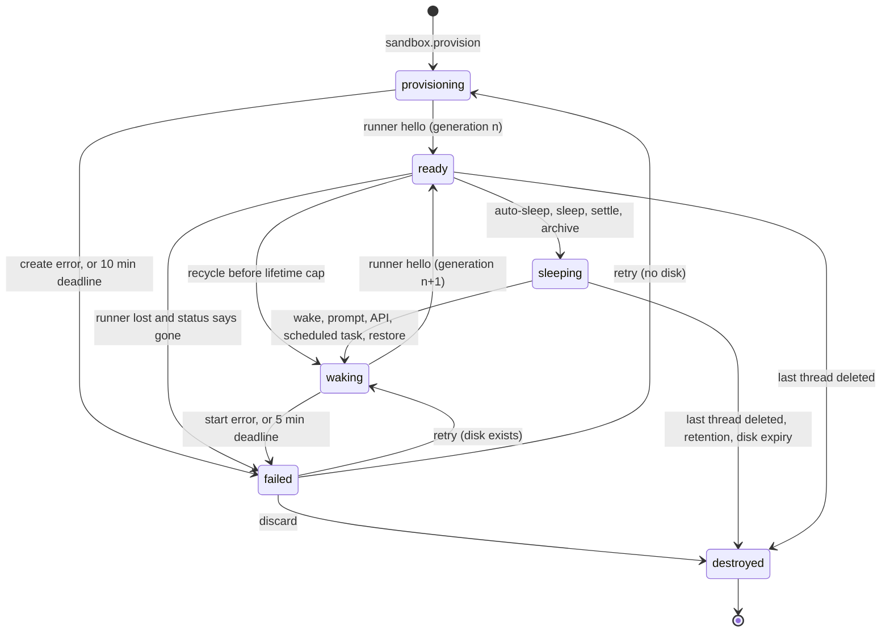

# Sandbox lifecycle and compute drivers

Status: proposal, 2026-11-06. Part of the [Pair Cloud plan](./README.md). Audience: the engineers
building M1 and M2, and the maintainers choosing the first hosted vendor.

This doc covers how a sandbox is recorded, created, shared, slept, woken, capped, metered and
reconciled, and how each compute driver maps onto a real backend. The runner is in [03](./03-runner.md),
team image builds in [05](./05-team-images.md), egress and credentials in [06](./06-credentials-and-security.md),
forks, mirrors and retention in [07](./07-access-and-data.md), and BYOC in [09](./09-byoc.md).
Statements marked (inferred) are our reading, not something the code or a vendor documents.

## 1. The sandbox record in orchestration

### What the existing machinery forces

| Fact in the code | Consequence |
| ---------------- | ----------- |
| The [orchestrator](../../../apps/server/src/orchestration-v2/Orchestrator.ts) decides events and effects for one thread under its lock, without provider or filesystem I/O. It reads projections, other threads' included, under no other lock. [EventSink](../../../apps/server/src/orchestration-v2/EventSink.ts) commits events, projections, the receipt and outbox effects in one transaction. | Sandbox decisions read the owning thread and the sandbox row. Rules across threads (caps, idle) need one more lock (section 4). A transition and its driver effect commit together. |
| The outbox is keyed by `thread_id` ([Foundation.ts](../../../apps/server/src/persistence/Migrations/OrchestrationV2/Foundation.ts)), and [EffectOutbox.ts](../../../apps/server/src/orchestration-v2/EffectOutbox.ts) runs one effect per thread at a time, in order (title generation has its own lane). A pending effect with a later `available_at` still blocks newer ones. | Driver effects serialize per sandbox on the owner's queue. Timers must not be delayed effects. |
| The [effect worker](../../../apps/server/src/orchestration-v2/EffectWorker.ts) runs 4 effects at once and makes up to 5 attempts, with backoff from 100 ms doubling (capped at 30 s, but five attempts end within 2 s); only `delegated-tasks.stop` has a timeout today (30 s), because a running effect's lease "is never reclaimed in-process". After a crash, `reconcileAfterProcessLoss` requeues running effects of replay-safe types, cancels process-bound ones, and leaves any other type `running` for good. | Effects return on acceptance. Each sandbox effect type gets a 60 s bound in `boundExecution`, or a stuck driver call blocks its thread's queue. Every sandbox effect is idempotent and on the replay-safe list. |
| Worktree preparation parks a run in `preparing`; `prepared-run.release` moves it to `starting` ([ThreadLaunchService.ts](../../../apps/server/src/orchestration-v2/ThreadLaunchService.ts)). Forks copy the source's `worktreePath` ([ThreadForkService.ts](../../../apps/server/src/orchestration-v2/ThreadForkService.ts)). [ProjectionMaintenance](../../../apps/server/src/orchestration-v2/ProjectionMaintenance.ts) prunes events after a day. | Waiting reuses `preparing`. Side chats and forks share the sandbox from M1. Sandbox minutes need their own ledger. |

### Record

New in [orchestrationV2.ts](../../../packages/contracts/src/orchestrationV2.ts) (doc 08 owns the wire):

```ts
export const OrchestrationV2Sandbox = Schema.Struct({
  id: SandboxId,
  projectId: ProjectId,
  ownerThreadId: ThreadId,            // stream and outbox key; changes only by sandbox.adopt
  ownerMemberId: MemberId,            // the owning thread's owner; caps and usage count here
  driverId: ComputeDriverId,          // a configured driver instance, e.g. "docker" or "vercel-us"
  imageBuildId: Schema.NullOr(TeamImageBuildId),
  size: SandboxSize,                  // "small" | "default" | "large"; each driver maps it
  state: Schema.Literals(["provisioning", "ready", "sleeping", "waking", "failed", "destroyed"]),
  generation: NonNegativeInt,         // bumps on every create, start and replacement
  driverRef: Schema.NullOr(Schema.String),
  admission: Schema.NullOr(Schema.Struct({
    reason: Schema.Literals(["team-cap", "member-cap", "rate-limit"]), since: Schema.DateTimeUtc,
  })),
  runnerLostAt: Schema.NullOr(Schema.DateTimeUtc),
  sleepReason: Schema.NullOr(Schema.Literals(["idle", "manual", "settled", "archived", "cap-pressure"])),
  failure: Schema.NullOr(Schema.Struct({ code: Schema.String, message: Schema.String, retryable: Schema.Boolean })),
  sessionStartedAt: Schema.NullOr(Schema.DateTimeUtc), // for lifetime caps
  lastActiveAt: Schema.DateTimeUtc, createdAt: Schema.DateTimeUtc, updatedAt: Schema.DateTimeUtc,
});
```

Threads get `sandboxId`. The thread shell gets a `sandbox` summary (`state`, `admission`,
`failure.code`) so the sidebar is honest without opening threads. Rows live in
`orchestration_v2_projection_sandboxes`, indexed by owner thread, state and driver. `generation`
makes stale things harmless: the enrollment secret, the sandbox token and the hello carry it, and a
runner from an older generation is refused and reported to the reconciler.

**Runner connection.** Doc 03's runner hub keeps it in memory, like
[Presence](../../../apps/server/src/team/Presence.ts). The first hello of a generation while
`provisioning` or `waking` dispatches `sandbox.runner.attached` to the owner's stream: `ready`. A
disconnect past the 120 s lease while `ready` dispatches `sandbox.runner.lost`, which sets
`runnerLostAt` and enqueues `sandbox.status` to decide between waiting, restarting or `failed`. A
later attach clears it. A separate **boot deadline** covers "no hello since boot" (section 5).

### Commands, events and effects

Clients send them through `dispatchCommand` (`orchestration:operate`), from any thread using the
sandbox; the server routes them to the owner's stream. **Sleep now** and **Discard** need the owning
thread's owner or an admin, checked where `thread.delete` is (`assertTeamPermission` in
[ThreadMessageIntake.ts](../../../apps/server/src/orchestration-v2/ThreadMessageIntake.ts)).

| Command | Allowed from | Effect |
| ------- | ------------ | ------ |
| `sandbox.wake` | `sleeping`; `failed` and retryable | `sandbox.start` (none while waiting for admission) |
| `sandbox.sleep` | `ready`, no active run in any attached thread; owner or admin | `sandbox.stop` |
| `sandbox.retry` | `failed` | `sandbox.start` if `driverRef` exists, else `sandbox.create` |
| `sandbox.discard` | `failed`, `sleeping`, or `ready` with no active run; owner or admin | `sandbox.destroy` (after `sandbox.stop` if `ready`); the next prompt provisions anew |

Internal commands join `OrchestrationV2InternalCommand` and use deterministic ids
(`sandbox-created:<id>:<generation>`), so a replayed effect's report is dropped by its receipt, as
[UsageLimitRecoveryWorker.ts](../../../apps/server/src/orchestration-v2/UsageLimitRecoveryWorker.ts)
does with `limit-arm:<identity>`. A rejection keeps its receipt too, so a guarded command a worker
may resend takes a fresh id, as `thread.auto-settle` does.

| Command | Sent by | Result |
| ------- | ------- | ------ |
| `sandbox.provision` | cloud thread launch | row created, `provisioning`, `sandbox.create` |
| `sandbox.admit` | lifecycle worker when a slot frees | `admission` cleared, `sandbox.create` or `sandbox.start` |
| `sandbox.created` | `sandbox.create` effect | `driverRef` set |
| `sandbox.runner.attached` | runner hub | `ready`; owner's waiting run released; `sandbox.release-waiters` |
| `sandbox.runner.lost` | runner hub | `runnerLostAt`, `sandbox.status` |
| `sandbox.stopped`, `sandbox.destroyed` | driver effects | `sleeping`, `destroyed` |
| `sandbox.failed` | an effect's terminal error, or a deadline | `failed`; `sandbox.release-waiters` with the failure |
| `sandbox.auto-sleep` | lifecycle worker | rejected, like `thread.auto-settle`, if any idle input is live |
| `sandbox.recycle` | lifecycle worker | `waking`, new generation, `sandbox.stop` then `sandbox.start` |
| `sandbox.adopt` | `sandbox.hand-over` effect | the receiving thread becomes owner |

One event, `sandbox.updated`, carries the whole record, as `run.updated` does. Effects carry
`sandboxId` and `generation`, and the executor drops an older generation: `sandbox.create`,
`.start`, `.stop`, `.snapshot`, `.destroy` and `.status` call the driver; `sandbox.request-wake`,
`.release-waiters` and `.hand-over` only dispatch commands to other streams.

### States

| State | Meaning | Counts toward caps | Clients show |
| ----- | ------- | ------------------ | ------------ |
| `provisioning` | Being created, or waiting for admission. | Once admitted | "Starting machine", or "Waiting for a machine: 3 of 3 running" |
| `ready` | Runner connected for this generation. | Yes | Nothing; a quiet dot, then "Reconnecting to machine" after a 2 s debounce |
| `sleeping` | Stopped, disk kept, billed for disk only. | No | "Asleep". Diffs read the mirror. |
| `waking` | Starting from the kept disk, or recycling. | Once admitted | "Waking machine" |
| `failed` | Terminal driver error or a missed deadline. | No | The failure, with Retry and Discard |
| `destroyed` | Gone. History and mirrored checkpoints remain. | No | "Machine discarded" with **Start a new machine**, which focuses the composer; sending provisions |



### Launch and prompts

1. `ThreadLaunchService.launch` takes `cloud` as a value in its launch input only. It commits the
   thread with `sandboxId` and the first message with the run in `preparing` (`defer_start`); the
   run record keeps `{ type: "worktree" }`, so older clients still decode it (decision 7).
2. The same commit runs `sandbox.provision`. At a cap the row gets `admission` and no effect;
   otherwise `sandbox.create` is enqueued with a bootstrap (section 6).
3. `driver.create` returns once the backend accepts, and its result dispatches `sandbox.created`.
4. The runner boots, enrolls and says hello: `sandbox.runner.attached`, state `ready`.
5. The preparation fiber, which waits on the thread's stored `sandbox.updated` events with the
   `streamStoredEventsFrom` pattern it already uses for interruption, clones and runs the setup
   script through the workspace host (doc 02), then dispatches `prepared-run.release`.

`prepared-run.progress` (today `worktree` and `setup`) gains phases for "Waiting for a machine",
"Starting machine", "Cloning repository" and "Running setup script", so clients show persisted status.
A later prompt to a cloud thread whose sandbox is not `ready` also uses `defer_start`, and prompts
after it queue as today. On the owning thread a sleeping sandbox wakes in the same commit, and
`sandbox.runner.attached` releases the waiting run (a wake needs no clone). If the sandbox fails,
the run fails with `workspace_preparation_failed`, and `prepared-run.retry` retries both.

Trap: [ProviderRuntimeRecoveryService](../../../apps/server/src/orchestration-v2/ProviderRuntimeRecoveryService.ts)
cancels every `preparing` run at startup, since the preparation fiber lived in memory. A run waiting
on a sandbox still `provisioning` or `waking` is skipped there and re-armed with
`ThreadLaunchService.prepareRun`, as delegated tasks use it. M1 adds a row to the recovery test table.

### Shared sandboxes: side chats and forks

A side chat or fork of a cloud thread keeps its source's `sandboxId` and checkout path, matching local
worktree semantics ([07](./07-access-and-data.md#2-restore-revert-and-fork)): ThreadForkService spreads
the source thread. "Fork to a new machine" (M2) overrides it. Unrelated threads never join a sandbox.

**Who uses a sandbox.** Membership is a projection of each thread's own events, not a counter on the
sandbox row: `orchestration_v2_projection_sandbox_threads (sandbox_id, thread_id, attached_at, archived)`
gains a row when a thread is created or forked with a `sandboxId`, updates on archive and unarchive,
and loses it on delete. The orchestrator reads the live set when deciding a deletion, archive or sleep.

**An attached thread's prompt.** Its decision runs on its own stream. If the sandbox is not `ready`,
the run parks in `preparing` and the commit enqueues `sandbox.request-wake` on that thread. Its
executor dispatches `sandbox.wake` to the owner's stream with id `sandbox-wake:<id>:<owner>:<generation>`
(a receipt matches only its own thread, so the id names the owner), and many prompts make one wake. When the owner's stream records `ready` or
`failed`, the same commit enqueues `sandbox.release-waiters`, which dispatches `prepared-run.release`
or `prepared-run.fail` to each attached thread with a run waiting on that sandbox (id
`sandbox-release:<runId>:<generation>`). Both hops are outbox effects, so a restart loses nothing.

**When the owning thread goes away, ownership moves to the oldest remaining attached thread.**
Refusing the deletion would let a side chat stop owners deleting their own threads, and doc 07 says
delete destroys the sandbox "only when no thread uses it". Deleting a thread deletes its side chats
in the same commit (`liveSideChatIds` in the orchestrator), so only forks and theirs can adopt.

- **Delete.** If no other thread uses the sandbox, enqueue `sandbox.destroy`. Otherwise enqueue
  `sandbox.hand-over` on the old owner's queue, where FIFO order runs it after every sandbox effect
  already queued. It picks the oldest live attached thread and dispatches `sandbox.adopt` there (id
  `sandbox-adopt:<id>:<oldOwner>`), which writes `sandbox.updated` with the new owner on that
  thread's stream; its queue carries the sandbox's effects from then on. If that thread was deleted
  meanwhile, it picks the next, or destroys when none remain. Commands for the sandbox during the
  hand-over are refused without a receipt, as mode-limit refusals are, and resent. Both effects sit
  beside the cleanup effects [ThreadDeletion.ts](../../../apps/server/src/orchestration-v2/ThreadDeletion.ts)
  enqueues. A fork racing the last deletion sees `destroyed` and provisions from the mirror.
- **Archive.** Ownership stays, since archive is reversible. An archived owner stops counting as an
  idle input, so the sandbox sleeps at once only when every attached thread is archived or idle, and
  the 7-day retention destroy waits until all are archived.
- **Reassign.** Reassigning the owning thread changes `ownerMemberId` in the same commit (doc 07).
  Reassigning an attached thread changes nothing on the sandbox.

**Counting once.** A shared sandbox counts once against caps. Machine time bills to the owner member
and owning thread (others show "Shares the machine of <thread>"); tokens, to whoever prompted.

## 2. Idle policy and wake triggers

Idle inputs, evaluated across every thread using the sandbox:

| Input | Source | Keeps awake |
| ----- | ------ | ----------- |
| Active run, background tasks, delegated children | thread projection | Always, the rule `thread.auto-settle` uses |
| Pending approval or user input | `pendingRuntimeRequest` | Up to 2 hours, then sleep and interrupt with a clear message |
| Terminal input or output (a sleeping terminal can be viewed without waking) | [terminal manager](../../../apps/server/src/terminal/Manager.ts) via the workspace host | Within the window (a logging dev server keeps it awake, as on Conductor) |
| Viewer lease | new, in memory | Within the window |
| Watched preview | [preview manager](../../../apps/server/src/preview/Manager.ts) | While a client streams it |
| Scheduled task due within the window | scheduled task rows | Yes |

Viewers cannot come from Presence: clients report it only while another member is connected
([presenceReporting.ts](../../../packages/client-runtime/src/presenceReporting.ts)), so a solo user
reading a diff looks absent. The thread view renews a viewer lease every 5 minutes while visible and
focused, and leases expire after 6. That is one small message per open cloud thread per 5 minutes.

Defaults: sleep after 20 idle minutes on hosted drivers (Conductor's number; 20 idle minutes of an
8 vCPU Vercel sandbox cost about $0.12) and 60 on Docker, where idle costs only memory on a box the
team already pays for. Admins can change both per driver. Settled threads sleep at once. Archived
sandboxes are destroyed after 7 days, any sandbox asleep 30 days is destroyed (sooner if the driver's
`diskRetentionDays` is shorter), and the mirror keeps history usable afterwards.

`idleDecision(inputs, now) -> "busy" | { sleepAt }` is pure and table-tested. A
`SandboxLifecycleWorker` registers with [Scheduler](../../../apps/server/src/scheduling/Scheduler.ts)
(a 5 s tick), keeps the next deadline from the projection in a `DueHint` as
`UsageLimitRecoveryWorker` does with `getLimitRecoveryWakeAt`, and dispatches `sandbox.auto-sleep`,
which the orchestrator rejects if an input became live.

**M1 subset.** The worker ships in M1 with only its settle rule: a Docker sandbox stops (through
`sandbox.sleep`) once every attached thread is settled or archived. While stopped, reads fall back to
the mirror's latest checkpoint and terminals show exited; snapshot browsing and idle sleep are M2.

**Wake triggers.** In M1: a prompt from the owner or an attached thread. In M2: opening the thread
(one `sandbox.wake` when the view mounts visible and focused), typing in a sleeping terminal or
pressing its **Wake** (viewing it does not wake), MCP or `t3 thread` CLI calls that send messages,
run commands or read files, scheduled tasks, checkpoint restore (decision 11), and opening a preview.
Never: the sidebar, the shell stream, search, push, mirror diffs, `subscribeThread`, or MCP lists.

**Avoiding wake storms.** A wake is always an explicit command, never a side effect of a
subscription, so a sidebar of 40 threads sends nothing. Waking a `waking` or `ready` sandbox is an
accepted no-op (on dispatch's no-event allow list, like `thread.follow`) with a deterministic id.
Wakes pass through the admission queue, and a per-team token bucket (10 starts a minute) sets
`admission.reason = "rate-limit"`. Vendors meter starts too: boat's $20 plan includes 12 a minute.

## 3. Lifetime caps

Vercel Sandbox and E2B Pro cap one machine session at 24 hours, reset by stop and resume (E2B Hobby:
1 hour). Docker, EC2 and boat have no cap. When `capabilities.maxSessionMs` is set, the lifecycle
worker:

1. From `maxSessionMs - 2h`, at the first moment no attached thread has an active run, dispatches
   `sandbox.recycle`: stop then start, disk kept, timer reset, a few seconds of "Waking machine".
2. From `maxSessionMs - 30m`, queues new prompts ("Restarting the machine before its time limit")
   and lets the running turn finish.
3. At `maxSessionMs - 5m`, interrupts a turn still running with an honest message, recycles, and
   continues through [RestartContinuation.ts](../../../apps/server/src/orchestration-v2/RestartContinuation.ts).

**Provider session continuity.** Sleep never keeps memory (decision 10), so drivers that could keep
it (E2B's default pause, EC2 hibernation) are configured not to, and every wake cold-starts
processes. Claude Code and Codex keep sessions under the home directory (`~/.claude/projects`,
`~/.codex/sessions`, which the usage readers scan), and Claude keys them by working directory
(inferred). So the runner's home and the checkout live on the kept disk at a stable path, and the
adapter's normal `resume` ([ClaudeAdapterV2.ts](../../../apps/server/src/orchestration-v2/Adapters/ClaudeAdapterV2.ts))
works after any sleep or recycle. When the disk is lost, the checkout comes back from the mirror
(doc 07) and the conversation falls back to
[ContextHandoffService](../../../apps/server/src/orchestration-v2/ContextHandoffService.ts), which
keeps a 240-character prefix of each item ([context handoffs](../../internals/context-handoffs.md)).
Open question 2 avoids that loss.

## 4. Caps, quotas and usage

| Setting | Default | Why |
| ------- | ------- | --- |
| Team cap on running sandboxes | Docker: `floor(host vCPUs / 4)`; hosted: 20 | Capacity on Docker, because the host is finite. Spend on hosted drivers: a guard admins raise in M2. |
| Member cap | None | Conductor, Claude Code cloud and Codex cloud publish no per-user cap. Admins can set one in M2. |
| Starts per minute per team | 10 | A guard against runaway agent fan-out, wake storms and vendor start quotas. |
| Size | `large` (8 vCPU, 16 GB) hosted, `default` on Docker | Conductor's machine; Docker shares one box. |

"Running" means `ready`, or `provisioning`/`waking` without `admission`. A create with an unknown
outcome counts until the reconciler resolves it (the EAS host counts one until a listing finds it or
`UNCERTAIN_CREATE_MS`, 5 minutes, passes: [EasDeviceHost.ts](../../../apps/server/src/device/EasDeviceHost.ts)).
M1 enforces defaults from server config and Settings → Cloud shows them read-only; M2 edits them.

Thread locks do not serialize counts across threads: two threads deciding at once would both see a
free slot. So commands that take a slot (`provision`, `wake`, `retry`, `admit`, `recycle`) also take
one process-wide admission lock, chosen in the dispatch wrapper as forks and deletes add locks there.

At the cap the sandbox waits with `admission`, and the thread says why in [01](./01-product.md)'s
copy: "Waiting for a machine: 20 of 20 running" (the member's count once an admin sets a member cap).
The lifecycle worker admits waiters in `admission.since` order, first applying cap pressure: a ready
sandbox idle 5 minutes or more sleeps early with `sleepReason: "cap-pressure"`. We queue rather than
refuse because scheduled tasks and agent fan-out have nobody to retry for them; the EAS host refuses
because a device session is interactive. Vendor `429` and capacity errors are retryable and fail the
sandbox only when the effect's attempts run out.

**Metering.** Token usage comes from `memberUsageSince` in
[ProjectionStore.ts](../../../apps/server/src/orchestration-v2/ProjectionStore.ts) through
[TeamUsage](../../../apps/server/src/team/TeamUsage.ts), against whoever prompted. Sandbox time runs
whether or not anyone prompts, so it counts against `ownerMemberId` and the owning thread. The
projector opens a `sandbox_usage_intervals` row (sandbox, thread, member, driver, size, start, end)
when a sandbox enters a billed state and closes it on leaving; it is the durable record because
events are pruned. Machine time is a separate `TeamUsageResult.sandboxRows` (usage rows are keyed by provider
instance), and Settings shows sandbox hours next to
tokens with an estimated cost from an admin-editable rate per driver and size.

## 5. Crash and restart reconciliation

At startup, after `reconcileAfterProcessLoss` requeues sandbox effects, a `SandboxReconciler` lists
each driver's sandboxes tagged with this server's install id and plans with a pure
`planReconciliation(record, backend, now)`:

| Record | Backend | Action |
| ------ | ------- | ------ |
| `ready`, `waking`, `provisioning` | running | Keep. A runner that was attached gets the 120 s lease, then `sandbox.runner.lost`; one that never attached gets the boot deadline. |
| `ready` | stopped | `sandbox.stopped` |
| `ready`, `waking` | missing | `sandbox.failed` with `lost`, retryable |
| `sleeping` | running | Stop it |
| `provisioning`, no `driverRef` | found by name | `sandbox.created` with the found ref |
| `provisioning`, no `driverRef` | not found | Nothing; the requeued create is idempotent |
| `destroyed`, `failed`, or none | exists, older than 5 minutes | Destroy (stop, if `failed` and retryable) |
| none | younger than 5 minutes | Leave it; a create may be in flight |

This follows the EAS host: record before asking the backend, find leftovers by our name, never touch
anything we did not tag. It also runs every 10 minutes, because a leak costs money every hour.

| Effect | Why running it twice is safe |
| ------ | ---------------------------- |
| `sandbox.create` | Name `pair-<installId8>-<sandboxId>-g<generation>` plus the vendor's feature (boat `Idempotency-Key`, Vercel unique `name`, EC2 `ClientToken`, Docker `--name`). Without one (E2B, unverified), look up by metadata first. |
| `sandbox.start`, `sandbox.stop` | Target state: already there is success. |
| `sandbox.destroy` | Not found is success. |
| `sandbox.snapshot` | Named `<sandboxId>-<purpose>-<generation>`; an existing one is success. |
| `request-wake`, `release-waiters`, `hand-over` | Deterministic ids on the commands they send. |

Inside an effect, transient errors retry 3 times, 2 s apart, like the EAS host's `TRANSIENT_RETRY`.
Across attempts the outbox's backoff applies (under 2 s in all), so vendor hints (boat's 120 s
`out_of_capacity`) travel as `retryAfterMs`. On the last attempt (`willRetry: false`) the executor
dispatches `sandbox.failed`, `retryable` from the error, outside the bound, whose timeout interrupts
it. The boot deadline (no hello since boot) is 10 minutes from `provisioning` and 5 from `waking`;
missing it dispatches `sandbox.failed` and enqueues `sandbox.stop`.

## 6. The ComputeDriver interface

Every method fails with one tagged `ComputeDriverError { operation, reason, retryable, retryAfterMs?,
detail }`, where `reason` is `not-found`, `conflict`, `capacity`, `quota`, `rate-limited`, `auth`,
`invalid-request`, `unsupported` or `unavailable`.

```ts
export interface ComputeCapabilities {
  readonly persistentDisk: boolean;
  readonly memoryOnStop: boolean;                 // can keep RAM; Pair leaves it off (decision 10)
  readonly snapshot: boolean;
  readonly imageBuild: "snapshot" | "buildImage"; // doc 05 section 3
  readonly maxSessionMs: number | null;
  readonly diskRetentionDays: number | null;
  readonly isolation: "container" | "rootless-container" | "gvisor" | "microvm" | "vm";
  readonly egressRules: "none" | "allowlist" | "allowlist-and-brokering";
  readonly regions: ReadonlyArray<string>;
  readonly nestedDocker: boolean;
  readonly sizes: ReadonlyArray<{ readonly size: SandboxSize; readonly vcpus: number; readonly memoryGb: number }>;
}

export interface SandboxBootstrap {
  readonly sandboxId: SandboxId;
  readonly generation: number;
  readonly runnerBuildId: string;   // decision 5: the server serves this build's runner
  readonly serverUrl: string;       // what the runner dials
  readonly enrollmentSecret: Redacted.Redacted<string>; // one use, 15 minutes, this generation
}

export class ComputeDriver extends Context.Service<ComputeDriver, {
  readonly capabilities: ComputeCapabilities;
  readonly create: (input: {
    readonly name: string;
    readonly image: { readonly type: "build"; readonly imageRef: string } | { readonly type: "base" };
    readonly size: SandboxSize;
    readonly tags: Readonly<Record<string, string>>; // pair.install, .sandbox, .generation (vendor separator)
    readonly bootstrap: SandboxBootstrap;
  }) => Effect.Effect<{ readonly driverRef: string }, ComputeDriverError>;
  readonly start: (driverRef: string, bootstrap: SandboxBootstrap) => Effect.Effect<void, ComputeDriverError>;
  readonly stop: (driverRef: string) => Effect.Effect<void, ComputeDriverError>; // disk kept
  readonly snapshot: (driverRef: string, name: string) => Effect.Effect<{ readonly imageRef: string }, ComputeDriverError>;
  readonly destroy: (driverRef: string) => Effect.Effect<void, ComputeDriverError>;
  readonly status: (driverRef: string) => Effect.Effect<BackendSandbox, ComputeDriverError>;
  readonly list: (tags: Readonly<Record<string, string>>) => Effect.Effect<ReadonlyArray<BackendSandbox>, ComputeDriverError>;
  readonly deleteImage: (imageRef: string) => Effect.Effect<void, ComputeDriverError>;
  // Only when imageBuild is "buildImage"; input shape in doc 05 section 3.
  readonly buildImage?: (input: TeamImageBuildInput) => Effect.Effect<{ readonly imageRef: string }, ComputeDriverError, Scope.Scope>;
}>()("t3/sandbox/ComputeDriver") {}
```

`BackendSandbox` is `{ driverRef, name, sandboxId | null, status, createdAt }`, with `status` one of
`starting`, `running`, `stopped`, `failed` or `missing` and `sandboxId` parsed from our tags. A
`ComputeDriverRegistry` maps `driverId` to one of the server's configured driver instances (Settings
holds an array; each project names a default), as
[ProviderAdapterRegistry](../../../apps/server/src/orchestration-v2/ProviderAdapterRegistry.ts) maps
provider instances. Methods are `Effect.fn("ComputeDriver.<operation>")`. The code lives in
`apps/server/src/sandbox/` (decisions 7 and 14).

**Bootstrap hand-off.** `start` takes a bootstrap because each wake is a new generation with a fresh
enrollment secret, passed as environment variables to the image's entrypoint, which runs `t3 runner`
(doc 05 owns the entrypoint, doc 03 enrollment). With no entrypoint on resume (Vercel), the driver
starts the runner with one detached command. A used or expired secret is harmless if it leaks.

## 7. Driver designs

### Docker (M1)

The driver talks to the Engine API at `DOCKER_HOST`, so the daemon can be the team server's machine
or another host. `create` makes a container named and labeled by us, with CPU, memory and PID
limits, a named volume `pair-<sandboxId>` for the checkout and runner home, on a `pair-sandboxes`
network, then starts it. `start` writes the new generation's bootstrap to the volume (env is fixed at
create) and starts. `stop` frees CPU and memory and keeps the volume. `destroy` removes the
container and volume. `list` filters by the `pair.install` label. `imageBuild` is `snapshot`:
a team build is a `docker commit` of a build container.

**Reaching the server** follows [03 §3.2](./03-runner.md#32-what-url-the-runner-dials). On the local
Docker host, the server opens one runner-only Unix socket in its state directory, and the driver
bind-mounts it into each container; the runner authenticates with its sandbox token. That works
whatever the server's bind host is (a desktop server binds loopback unless network access is on:
[DesktopServerExposure.ts](../../../apps/desktop/src/backend/DesktopServerExposure.ts))
and exposes no port. A remote `DOCKER_HOST` cannot bind-mount a socket on the server's machine, so
there the runner dials the server's URL over the network, which must be reachable from that host
(decision 4). `DOCKER-USER` rules block the host and metadata addresses; doc 06 owns the policy.

**Isolation.** Plain runc is not a security boundary. The driver reads the daemon's info (security
options include `rootless`; runtimes include `runsc`) and reports `isolation`. Settings recommends
rootless Docker or gVisor and warns when neither is in use. Nested Docker under gVisor is limited
(unverified), so `nestedDocker` is false there. Disk quotas need overlay2 on XFS project quotas, so
on most hosts a volume can fill the disk; we document that rather than build quota machinery.

### Vercel Sandbox (M2 pick)

`create` is `Sandbox.create({ name, source, resources: { vcpus: 8 }, tags, networkPolicy,
keepLastSnapshots })`, persistent by default with 2 GB per vCPU, followed by a detached command that
starts the runner. `start` is `Sandbox.get({ name, resume: true })` plus the runner, with a fresh
24 h session. `stop` snapshots the filesystem automatically. `destroy` deletes the sandbox and its
snapshots, which otherwise keep billing. `list` filters by tags. `imageBuild` is `snapshot`.

Gaps: no memory kept (decision 10 wants that anyway); 24 h sessions (recycle); custom images live in
Vercel's registry; snapshots at $0.08 per GB-month, expiring 30 days after last use; an access token
outside Vercel. Strengths: Firecracker microVMs, 8 vCPU and 16 GB on Pro, Active CPU pricing that skips
model waits, 19 regions, a firewall that allowlists domains and injects credentials, and Docker inside.

### E2B (runner-up)

`create` is `Sandbox.create(template, { metadata, envs, lifecycle: { onTimeout: "pause" } })` from a
template built from a Dockerfile (`imageBuild: "buildImage"`). `stop` is the filesystem-only pause,
which reboots on resume; decision 10 rules out the default pause, which keeps memory. `start` is
`Sandbox.connect`, about a second. Snapshot and fork exist; `destroy` is `kill`; `list` filters by
metadata.

Gaps: Pro allows 1 to 8 vCPU and 1 to 8 GiB, short of the 16 GB machine; billing is on allocated
vCPU and memory, so idle costs as much as busy; Pro is $150 a month. Strengths: paused sandboxes
never expire and do not count toward concurrency, pause resets the 24 h limit, and egress allow and
deny lists come with request secret injection. And BYOC: Enterprise BYOC run by E2B in the
customer's account, or **E2B Embed**, the Apache-2.0 single-node stack a customer installs
themselves ([09](./09-byoc.md)). If M2 picks E2B, the same driver pointed at an Embed node gives
small teams a cheap BYOC path with no new driver.

### boat.dev

`POST /sandboxes` takes `type: "large"`, `name`, `labels`, `env`, `from` (a saved snapshot),
`ttlSeconds: null`, `noEnv: true` and an `Idempotency-Key`. Resume, stop (which snapshots), fork and
delete map one to one; `imageBuild` is `snapshot`. Machines are full VMs with Docker inside, and
`noEnv` keeps the boat account's own secrets out. It is by far the cheapest: `large` (8 vCPU, 16 GB)
is $0.072 an hour, billed per second while running. Gaps: EU only (Germany, Finland, France), so a
US team pays a transatlantic round trip on every runner message; firewall rules live inside the VM,
where root can remove them; stopped disks are kept at least 14 days only; SOC 2 is in progress; a
young YC company. A good second hosted driver for EU teams.

### Plain VM on EC2 (M5) and later mappings

Doc 09 owns deployment. Each operation is one EC2 call: `create` is `RunInstances` from the team
image AMI with a `ClientToken`, tags and the bootstrap in user data; `stop` and `start` keep the EBS
volume; `snapshot` is `CreateImage` (`imageBuild: "snapshot"`); `destroy` is `TerminateInstances`;
`list` is `DescribeInstances` by tag. Hibernation would keep RAM, so `memoryOnStop` is true and left
off. A stopped instance restarts in its own zone, so a capacity error on wake falls back to
relaunching from a snapshot elsewhere. GCE follows with the same shape.

Kubernetes waits until a customer asks: a Pod plus a PersistentVolumeClaim (stop deletes the Pod,
keeps the claim) with a gVisor or Kata RuntimeClass, or the SIG Apps `agent-sandbox`. Of the rest:
Daytona moved its code to a private repository in June 2026 (secondary sources, unverified); Modal
sandboxes cap at 24 h and continue through filesystem snapshots; Fly Machines restart "well under a
second" with volumes but no egress brokering (unverified); Morph claims sub-250 ms branching with
unclear pricing (unverified). None beats the four above for M2.

## 8. Vendor recommendation for M2

| | Docker | Vercel Sandbox | E2B | boat |
| - | ------ | -------------- | --- | ---- |
| Isolation | Container; rootless or gVisor | Firecracker microVM | Firecracker microVM | Full VM |
| Resume | Seconds | Seconds (inferred) | About 1 s | A few seconds |
| Persistence on stop | Volume | Disk, auto snapshot | Disk (memory possible, unused) | Disk, kept 14+ days |
| Session lifetime | None | 24 h, reset on resume | 24 h, reset on pause | None |
| Largest self-serve size | The host | 8 vCPU, 16 GB | 8 vCPU, 8 GiB | 16 vCPU, 32 GB |
| Per hour at 8 vCPU | $0 marginal | $0.35 idle to $0.60 busy (16 GB) | $0.53 (8 GiB), idle or busy | $0.072 (16 GB) |
| BYOC path | The customer's box | None | Embed (one node) or Enterprise BYOC | None stated |
| Regions | Local | 19 | US; EU on request (unverified) | EU only |
| Company risk | None | Low | Medium (inferred) | High (inferred) |

Vercel Pro is $0.128 per Active CPU hour and $0.0212 per GB-hour of memory in `iad1`: 16 GB costs
$0.339 an hour while running, and CPU adds $0.01 at 1% use or $0.256 at 25%. E2B is $0.000014 per
vCPU-second and $0.0000045 per GiB-second: $0.403 plus $0.130 an hour for 8 vCPU and 8 GiB.

**Pick: Vercel Sandbox.** It is proven on this workload (Conductor ran one 8 vCPU, 16 GB Vercel
sandbox per workspace), sells that size self-serve, has persistent named sandboxes that match our
deterministic names, prices for the long model waits agents spend most time in, gives doc 06 credential
brokering, and carries the lowest company risk. Recycling between turns hides its 24 h cap.

**Runner-up: E2B.** It loses M2 on the 8 GiB ceiling and on paying for idle allocation. It wins on
BYOC: one driver could serve hosted M2 and, through Embed, a cheap single-node BYOC tier in M5 beside
the EC2 driver. If the maintainers weigh early BYOC above machine size, E2B is the pick. boat is the
cost leader and worth a driver for EU teams once demand shows.

**Cost model.** A team of 10 starts 20 cloud threads a day across the team, 22 working days a month.
Each thread is busy 1.5 hours a day and sits through three 20-minute idle tails (1 hour). Busy CPU
averages 25%, idle 1%. Snapshot storage assumes 5 GB per sandbox and about 140 sandboxes alive.

| Option | Busy thread-hour | Idle thread-hour | Month (660 busy h, 440 idle h) |
| ------ | ---------------- | ---------------- | ------------------------------ |
| Docker on one 48-core server | $0 marginal | $0 marginal | The server, roughly $250 to $400 rented (inferred) |
| Vercel Sandbox (8 vCPU, 16 GB) | $0.60 | $0.35 | $393 + $154 + about $56 storage + $20 Pro = **about $620** |
| E2B (8 vCPU, 8 GiB) | $0.53 | $0.53 | $587 + $150 Pro = **about $740** |
| boat `large` (8 vCPU, 16 GB) | $0.072 | $0.072 | $79, inside the $100 plan credit: **about $100** |

If every member runs 20 threads a day, multiply usage by 10: Vercel about $5,500, E2B about $6,000,
boat about $800. The idle timeout (a quarter of the Vercel bill here) and the size (a 4 vCPU default
halves Vercel and E2B) matter more than the vendor, so Settings exposes both.

## 9. Testing

`FakeComputeDriver` lives in the orchestration testkit next to
[OrchestratorScenario.ts](../../../apps/server/src/orchestration-v2/testkit/OrchestratorScenario.ts).
Every call is offered to a `Queue` with a `Deferred` the test completes or fails, so the test decides
when and how the backend answers. A fake runner hub exposes `hello(sandboxId, generation)` and
`disconnect(sandboxId)`. Tests drain the effect worker or await a stored `sandbox.updated`; deadlines
and idle timers run under `it.effect` with `TestClock.adjust`. No sleeps or polling
([testing](../../internals/testing.md)). Cases, each at the lowest layer that fails without the
change:

- Launch: a hello releases the `preparing` run. A prompt to a sleeping sandbox wakes it.
- Two side-chat prompts make one wake on the owner's stream, and `release-waiters` releases both.
- Deleting the owner hands over to a fork after queued sandbox effects; deleting the last destroys.
- A shared sandbox counts once. Two threads provisioning at one free slot admit one. Cap pressure.
- A crash during `sandbox.create` yields the same `driverRef` and a deduplicated `sandbox.created`.
  Recovery re-arms a run waiting on a `waking` sandbox. Stale generations are dropped.
- `idleDecision` and `planReconciliation` as table tests.

**Driver contract tests.** `computeDriverContract(makeDriver)` checks that every driver creates
idempotently by name, keeps the disk across stop and start (write, stop, start, read back), stops
and destroys idempotently, lists only our tags, reports a destroyed sandbox as `missing`, and
delivers the bootstrap. Readiness is a real signal: the suite's image runs a stand-in runner that
dials a test WebSocket, and the test awaits that connection's `Deferred`. These are `it.live` network
fixtures. Docker runs in CI on Linux; vendor runs cost money, so they run nightly with credentials.

## 10. Work breakdown

| # | Pull request | Milestone |
| - | ------------ | --------- |
| 1 | Contracts: `SandboxId`, `OrchestrationV2Sandbox`, sandbox commands, `sandbox.updated`, thread `sandboxId` and shell summary, guarded scopes. | M1 |
| 2 | Projection tables (`sandboxes`, `sandbox_threads`), reducers, migration; `sandbox_usage_intervals` ledger. | M1 |
| 3 | Orchestrator decisions, outbox effect types and the replay-safe list, executors, generation checks; tests with `FakeComputeDriver`. | M1 |
| 4 | 60 s bound for every sandbox effect type in `EffectWorker`'s `boundExecution` switch, so a stuck driver call fails into the normal retry path instead of blocking its thread's queue. | M1 |
| 5 | `ComputeDriver` service, registry, error model, fake driver, contract suite. | M1 |
| 6 | Docker driver: Engine API at `DOCKER_HOST`, volumes, limits, network, runner Unix socket bind mount, isolation detection and the Settings warning. | M1 |
| 7 | Cloud launch: `cloud` launch-input value (runs keep `worktree`), preparation gate on `ready`, progress items, recovery re-arm. | M1 |
| 8 | Shared sandboxes: forks and side chats attach; `request-wake`, `release-waiters`, `hand-over`, `adopt`. | M1 |
| 9 | Caps and admission queue from server config (team, member, start rate). | M1 |
| 10 | `SandboxReconciler` at startup and every 10 minutes; destroy or hand over on thread delete; the lifecycle worker's settle-and-archive stop, boot deadlines. | M1 |
| 11 | `SandboxLifecycleWorker` in full: idle policy, viewer lease, cap pressure, retention destroys. | M2 |
| 12 | Wake triggers on every surface (thread open, terminal, preview, MCP, CLI, scheduled tasks, restore). | M2 |
| 13 | Lifetime recycle and the interrupt-and-continue path. | M2 |
| 14 | Vercel driver passing the contract suite; nightly contract run. | M2 |
| 15 | Editable caps and usage in Settings → Cloud: `TeamUsageResult.sandboxRows`, per-driver rates. | M2 |
| 16 | `retryAfterMs` honored by the effect worker for driver errors. | M2 |
| 17 | `snapshot`-strategy builds for Docker (`docker commit`) and Vercel; `deleteImage` (doc 05 owns the flow). | M3 |
| 18 | EC2 plain-VM driver, then GCE, passing the contract suite (doc 09 owns deployment). | M5 |
| 19 | Optional: the E2B driver against an Embed node, if M2 chose E2B. Kubernetes after M5, on demand. | M5 |

## Open questions

1. **Should a pending approval hold a sandbox awake indefinitely?** Recommend 2 hours, then interrupt.
2. **Should the runner mirror provider session files to the server?** Recommend yes, in M2 with doc
   07's mirror. They are small, and every replacement then resumes natively instead of through a
   lossy handoff.
3. **Should ownership pass to the oldest attached thread or the most recently active?** Recommend
   oldest: it follows from projection data alone, so a replayed hand-over picks the same thread.

## Challenges to the plan

None.

## Sources

Retrieved 2026-11-06.

- Vercel Sandbox: [overview](https://vercel.com/docs/vercel-sandbox) (page dated 2026-09-22), [pricing and quotas](https://vercel.com/docs/sandbox/pricing) (2026-09-10), [persistence](https://vercel.com/docs/sandbox/concepts/persistent-sandboxes) (2026-09-15), [firewall](https://vercel.com/docs/sandbox/concepts/firewall) (2026-09-16)
- E2B: [pricing](https://e2b.dev/pricing), [billing and limits](https://docs.e2b.dev/billing.md), [persistence](https://docs.e2b.dev/sandbox/persistence), [paused sandboxes and concurrency](https://docs.e2b.dev/faq/paused-sandboxes-concurrency.md), [BYOC](https://docs.e2b.dev/byoc.md), [docs index](https://docs.e2b.dev/llms.txt)
- boat: [docs index](https://docs.boat.dev/llms.txt), [create sandbox API](https://docs.boat.dev/api/reference/sandboxes/create-sandbox.md), [resume and fork](https://docs.boat.dev/snapshots/resume-and-fork.md), [pricing](https://docs.boat.dev/pricing.md), [limits](https://docs.boat.dev/limits.md), [security](https://docs.boat.dev/security.md)
- [Fly Machines overview](https://docs.fly.io/machines/overview); [Running agents on Kubernetes with Agent Sandbox](https://kubernetes.io/blog/2026/03/20/running-agents-on-kubernetes-with-agent-sandbox) (2026-03-20)
- Secondary only: Daytona, [Nightona README](https://cdn.jsdelivr.net/gh/nightona-co/nightona@main/README.md); Modal, [sandboxes guide](https://www.modal.com/docs/guide/sandboxes); Morph, [developers page](https://cloud.morph.so/developers)
