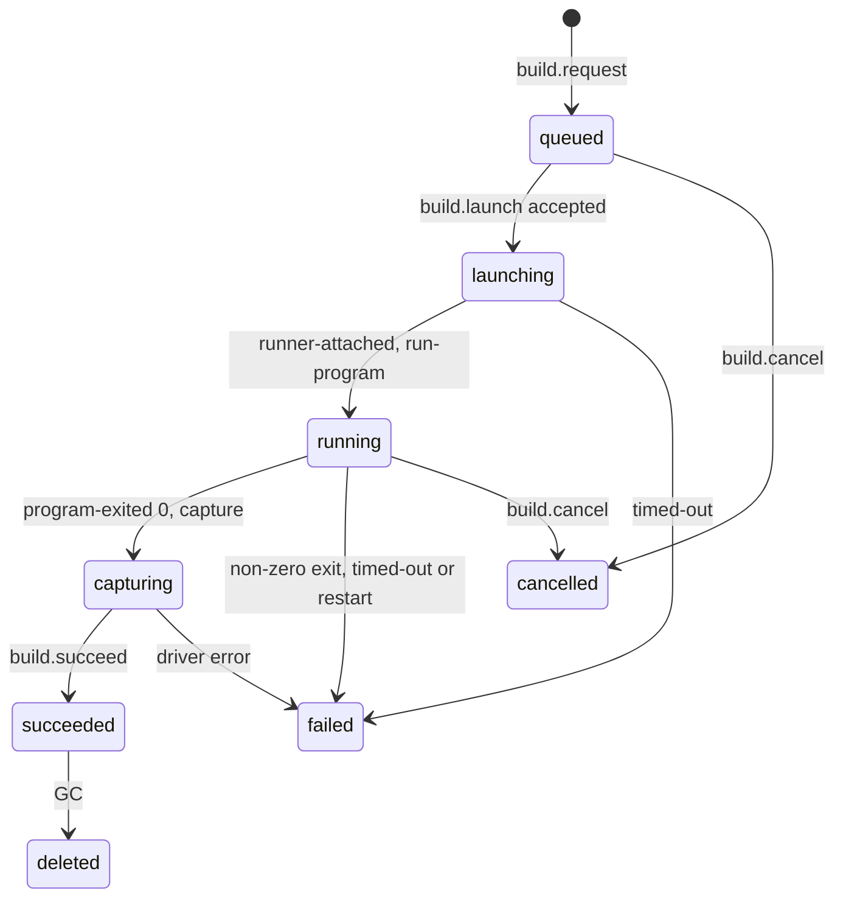

# Team images and builds

Status: M0 and M1 landed; the rest is a proposal, rewritten 2026-11-08 for local-first Pair Cloud.
It follows the shared decisions in the [plan](./README.md) and the build research in
[Conductor Cloud](../conductor-cloud.md#3-what-is-a-build).

How does a team define and build the machine its cloud sessions boot from? M1 built the base image.
This doc is for the engineers building M4 (team builds on the Pair Cloud server) and M5 (AMIs in
the customer's account), and for maintainers reviewing the recipe format.

Three layers decide what a sandbox holds, and each changes at a different speed.

| Layer            | Owner                                | Changes                 | Contents                                                                    | Milestone    |
| ---------------- | ------------------------------------ | ----------------------- | --------------------------------------------------------------------------- | ------------ |
| Base image       | Pair                                 | Each Pair release       | OS, git, gh, runtimes, provider CLIs, a cached runner bundle, the `t3` user | M1 (landed)  |
| Team image build | The team's admins                    | When an admin builds    | System packages, toolchains, pre-cloned repos, warm package stores          | M4           |
| Setup script     | Each project (`t3.json` or Settings) | Every new cloud session | Dependency install, generated files, seed data                              | Exists today |

Until M4 every sandbox boots from the base image, and the project's setup script does the rest.

## 1. The base image

### Distro: Ubuntu 24.04 LTS

| Option            | For                                                                                                                                                                                                                                                                                                 | Against                                          |
| ----------------- | --------------------------------------------------------------------------------------------------------------------------------------------------------------------------------------------------------------------------------------------------------------------------------------------------- | ------------------------------------------------ |
| **Ubuntu 24.04**  | glibc, so npm native prebuilds and the Claude native binary work. Canonical publishes the stock AMI the EC2 driver starts from ([09](./09-byoc.md)). Pair's CI and dev container already use it ([devcontainer.json](../../../.devcontainer/devcontainer.json)). Most install scripts assume `apt`. | Larger than Alpine.                              |
| Amazon Linux 2023 | Conductor's base, so Conductor scripts using `dnf` run unchanged.                                                                                                                                                                                                                                   | Rare outside AWS. No upside after the migration. |
| Alpine            | Small.                                                                                                                                                                                                                                                                                              | musl breaks many native npm prebuilds.           |

The cost of Ubuntu is a one-time port of Conductor install scripts from `dnf` to `apt` (section 2).
The image is published for `linux/amd64` and `linux/arm64`, so Pair Cloud's Docker host and the
customer's VMs can be either architecture (Graviton, Ampere), and Codex already ships both Linux
targets ([CodexInstallation.ts](../../../apps/server/src/provider/CodexInstallation.ts), `RELEASES`).

### Contents

| Group          | Contents                                                                                                                                                      | Why                                                                                                                                                                                                                  |
| -------------- | ------------------------------------------------------------------------------------------------------------------------------------------------------------- | -------------------------------------------------------------------------------------------------------------------------------------------------------------------------------------------------------------------- |
| System         | `ca-certificates`, `curl`, `openssh-client`, `openssh-server` (bound to loopback), `sudo`, `tini`, `locales`, `procps`, `less`, `unzip`, `tmux`, `vim`        | `tini` is PID 1, so the many processes agents spawn get reaped. sshd is for SSH and open in editor, which are Later ([07](./07-access-and-data.md)).                                                                 |
| Source control | `git`, `git-lfs`, `gh`                                                                                                                                        | Checkpoints need git. Agents call `gh` for pull requests; a shim in front of it gets the token git would get for the repo's origin, per call, never on disk ([gh-shim.sh](../../../infra/sandbox-image/gh-shim.sh)). |
| Search         | `ripgrep`, `fd-find`, `jq`                                                                                                                                    | Agents use them constantly.                                                                                                                                                                                          |
| Build tools    | `build-essential`, `pkg-config`, `python3`, `python3-venv`, `python3-pip`                                                                                     | node-gyp fallbacks and common Python work.                                                                                                                                                                           |
| Node           | Node 24 LTS with `corepack` (pnpm, yarn)                                                                                                                      | The runner runs on the image's Node, which must satisfy the server's `engines.node`, `^22.16 \|\| ^23.11 \|\| >=24.10` ([package.json](../../../apps/server/package.json)).                                          |
| Provider CLIs  | Claude Code and Codex. OpenCode, Grok and Kiro are Later. Cursor and Muse run inside the server process and are "not supported in cloud" (README decision 2). | README decision 12.                                                                                                                                                                                                  |
| Runner         | The runner bundle of the release's own build, cached under its `runnerBuildId`                                                                                | A cache only. Pair Cloud serves the bundle by `runnerBuildId`, and fetching it at boot is the normal path after any upgrade ([03](./03-runner.md)). Nothing comes from npm, whose `t3` is upstream T3 Code.          |
| User           | `t3`, uid 1000, home `/home/t3`, passwordless `sudo`                                                                                                          | See below.                                                                                                                                                                                                           |

Left out on purpose: Chrome, Docker inside the sandbox, Go, Rust and Java. Teams add them in recipes.

**Runner as root, agents as `t3` with passwordless sudo** (D3, as Conductor and Claude Code cloud
give agents root). Agents run as `t3` because some provider CLIs refuse permission-bypass modes as
root (inferred from Claude Code's behavior), and install scripts need `apt-get`. Once agents can sudo,
users inside the sandbox are no boundary; the sandbox token's narrow scope and the sandbox's own
isolation are ([06](./06-credentials-and-security.md)). Stock Ubuntu 24.04 ships an `ubuntu` user at
uid 1000, so `provision.sh` removes it before creating `t3`.

**User npm prefix.** `/home/t3/.npm-global` leads `PATH`, so a newer provider CLI installs without `sudo`.

### Fitting how the server checks providers today

Each provider's `binaryPath` defaults to a bare command (`claude`, `codex`, `opencode`, `grok`,
`kiro-cli`; [settings.ts](../../../packages/contracts/src/settings.ts), and the `settings.ts` of
[provider-opencode](../../../packages/provider-opencode/src/settings.ts), `provider-grok` and
`provider-kiro`), so the image only needs those names on `PATH`. Status probes run `<binary> --version` on the server's own install
([ClaudeProvider.ts](../../../apps/server/src/provider/ClaudeProvider.ts)) and grade it against
[model-manifest.json](../../../apps/server/src/provider/model-manifest.json) with
[providerCompatibility.ts](../../../apps/server/src/provider/providerCompatibility.ts). A cloud
session uses the image's CLI instead, and [02](./02-workspace-host.md) leaves keeping them in step to
this doc. Rather than wake a sandbox, the base records its CLI versions in `/etc/pair-image.json`,
every team build records them in its manifest (section 4), and the server grades those with
`resolveProviderCompatibility`.

### Pinning, building and publishing

- Sources live in [infra/sandbox-image/](../../../infra/sandbox-image/): `provision.sh` (everything
  in the table above), a `Dockerfile` that runs it on `ubuntu:24.04`, the entrypoint
  `pair-bootstrap.sh`, the `gh` shim, `versions.env` with pinned Node and gh downloads and their
  checksums, and `providers/package.json` with a lockfile that pins npm-distributed CLIs with
  integrity hashes. M4 adds the build program (section 3).
- `provision.sh` is the single definition of the base. The Dockerfile runs it for the OCI image.
  VM drivers, which start from Canonical's stock Ubuntu image, run it as the first step of a build
  (section 3).
- Codex comes from the same `RELEASES` entry managed Codex uses, checked against the same SHA-256.
  The image build reads that table from the server source instead of copying it.
- A CI check fails a release when a pinned CLI is not `supported` under the bundled manifest for this
  server version (`check-providers`, run before any push).
- Provider bumps ride normal Pair releases. Version tags are never re-pushed. An urgent fix between
  releases goes in the team recipe (`npm i -g @anthropic-ai/claude-code@<version>`), and the build
  manifest records what actually runs.
- Pair publishes the base, as Conductor and Anthropic maintain theirs.
  [sandbox-image.yml](../../../.github/workflows/sandbox-image.yml) runs on Pair's release tags,
  separate from upstream's npm job in [release.yml](../../../.github/workflows/release.yml). It builds
  the release's runner bundle, bakes it into the image's last layer by `runnerBuildId`, builds each
  architecture on a native runner, and pushes `t3-sandbox:<pair version>` to the GHCR of the repo
  running it (`ghcr.io/<repo owner>/t3-sandbox`, D6), so a fork publishes its own unchanged. Pull
  requests that touch `infra/sandbox-image/**` build and smoke-test without pushing.
- The server pulls the image matching its exact version and records its digest on each sandbox
  (`baseImage`). A `sandbox.baseImage` server setting overrides it, for a mirror or a private
  registry. Teams customize through the team image and setup scripts, not by replacing the base. A
  server run from source has a `runnerBuildId` no image caches; its sandboxes fetch the bundle at
  boot, the normal path anyway.

### The base AMI for BYOC (M5)

Pair publishes no AMI (D13). When an admin sets up the EC2 driver, it boots Canonical's stock
Ubuntu 24.04 AMI in the customer's account, runs the release's `provision.sh`, and saves the result
with `CreateImage`, encrypted with the customer's key. That is the first build of the empty recipe
(section 3's step 0), so the base AMI carries the provider CLIs and matches the OCI base, and a
sandbox with no team build boots from it ([09](./09-byoc.md)). GCE, which lands first since 2026-11-10, does the same with a custom image in an image family.

Today CI runs `provision.sh` only inside the Docker build. A VM is a different environment: cloud-init
runs at first boot and creates the default `ubuntu` user, and unattended upgrades may hold the apt
lock (inferred). So from M5, Pair CI also runs `provision.sh` on every release on a VM booted from
Canonical's stock image, the path the EC2 driver takes, so a script that breaks only outside a
container never reaches a customer. The release carries `provision.sh` and the files it reads.

## 2. The recipe format

|                         | Pair recipe                                                 | Dev Container (`devcontainer.json` + features)                                                                                                                                                         | Dockerfile                                                                           |
| ----------------------- | ----------------------------------------------------------- | ------------------------------------------------------------------------------------------------------------------------------------------------------------------------------------------------------ | ------------------------------------------------------------------------------------ |
| Teams have it today     | Conductor teams have an install script in this exact shape. | Many repos, including Pair's. Codespaces, Ona and Coder read it.                                                                                                                                       | Often for production, rarely for development.                                        |
| Scope                   | One per team, across repos, like the team image.            | One per repo. Ten repos, ten files, and nothing says which wins.                                                                                                                                       | One per image.                                                                       |
| Docker                  | Boot, run, commit.                                          | Needs the devcontainer CLI and an OCI client for features.                                                                                                                                             | Native.                                                                              |
| EC2 and GCE VMs         | Boot, run, `CreateImage`.                                   | No daemon to run features in.                                                                                                                                                                          | A VM image is not built from a Dockerfile.                                           |
| A hosted vendor (Later) | Boot, run, snapshot; or a generated Dockerfile for E2B.     | Features run `install.sh` as root in an image build. With no Docker daemon we would reimplement the installer.                                                                                         | E2B converts single-stage Dockerfiles. Vercel takes OCI images through its registry. |
| Cost of partial support | None; we own the format.                                    | High. People expect `mounts`, `runArgs`, Compose, five lifecycle hooks and `customizations`. Even Ona documents known limitations, and Coder's daemonless builder, envbuilder, is in maintenance mode. | Medium. No multi-stage on E2B, BuildKit syntax for secrets.                          |

### Decision: a Pair recipe

README decision 9 settles this: the recipe is Pair's own format. It is a small record on the Pair
Cloud server: a base, the projects to pre-clone, build env, build secret references and one Bash
install script. Conductor teams paste their script. It runs the same way on every driver (section 3),
and we never ship half of someone else's standard.

```ts
// packages/contracts/src/sandboxImage.ts (new)
export const TeamImageBase = Schema.Union([
  Schema.Struct({ type: Schema.Literal("pair") }), // Pair's base for this server version
  Schema.Struct({ type: Schema.Literal("image"), ref: TrimmedNonEmptyString }), // later
]);

export const TeamImageRecipe = Schema.Struct({
  base: TeamImageBase,
  projectIds: Schema.Array(ProjectId).check(Schema.isMaxLength(50)), // repos, by Pair Cloud project
  buildEnv: Schema.Record(EnvVarName, Schema.String), // install script only, never runtime
  buildSecrets: Schema.Record(EnvVarName, SecretReference), // references only, never values
  install: Schema.String.check(Schema.isMaxLength(64_000)), // bash -euo pipefail, as t3, from $HOME
});
```

`SecretReference` names a secret held by a secret provider (`SettingsSecretValue` also takes a literal,
which a recipe must not store; [settingsSecretValue.ts](../../../packages/contracts/src/settingsSecretValue.ts),
[resolver](../../../apps/server/src/secrets/settingsSecretValue.ts)), so the recipe adds no secret store.
Repos are Pair Cloud projects, resolved through
[RepositoryIdentityResolver.ts](../../../apps/server/src/project/RepositoryIdentityResolver.ts), not
free-form URLs. That keeps one list of repos and lets session start map a project to its clone.

### Migration from Conductor

1. Add each Conductor repo as a Pair Cloud project and tick it under **Pre-cloned projects**.
2. Paste the install script. If it uses `dnf` or `yum`, the editor says "Pair's base is Ubuntu. Use
   apt-get.", and the admin agent can port it.
3. Org env vars become team cloud env ([06](./06-credentials-and-security.md)); only values the
   install script reads go in **Build env**. The per-repo setup script becomes a `t3.json` script
   with `runOnWorktreeCreate: true` ([t3ProjectFile.ts](../../../packages/contracts/src/t3ProjectFile.ts)).

**Dockerfile and dev container teams (later).** `base: { type: "image", ref }` points at an image
the team builds, e.g. with `devcontainer build --push` ([devcontainer.md](../../internals/devcontainer.md)).
Pair checks a base contract (glibc, `bash`, `git`, `sudo`, uid 1000) and runs `provision.sh` on top.

## 3. The build pipeline

### One build program, two capture strategies

Every build runs the same generated program, `t3-build.sh`, in a machine started from the base. Only
the capture differs. Drivers declare which one they use, as the image build strategy capability in
README decision 8.

| Strategy             | Drivers                                                                             | How                                                                                                                                                                                                          | Output                                                                                                                                                                                                              |
| -------------------- | ----------------------------------------------------------------------------------- | ------------------------------------------------------------------------------------------------------------------------------------------------------------------------------------------------------------ | ------------------------------------------------------------------------------------------------------------------------------------------------------------------------------------------------------------------- |
| `snapshot` (default) | Docker (M4), GCE then EC2 (M5); Vercel Sandbox and boat if a hosted vendor is added | The build effect asks the driver to create a build machine from the base. The runner connects, the server runs the program through the workspace host, then the driver captures the machine and destroys it. | Docker: an image committed with `docker commit` on the Docker host (local or `DOCKER_HOST`), tagged `t3-team-image:<n>`. EC2: an AMI from `CreateImage`. GCE: an image in a family per team. Vercel: a snapshot id. |
| `buildImage` (Later) | E2B, Kubernetes                                                                     | Pair generates a single-stage Dockerfile, `FROM <base>` plus one `RUN` of the program, and calls the driver's optional `buildImage`.                                                                         | E2B: a template from `Template.fromDockerfile`. Kubernetes: a digest in the customer's registry, built in-cluster by BuildKit or Kaniko.                                                                            |

`snapshot` covers every driver on the M4 and M5 path with one code path, and runs the M4 build on
Docker exactly as M5 runs it on EC2. Builds always go through the driver, never as a `docker build`
on the server ([09](./09-byoc.md)). [04](./04-sandbox-lifecycle.md#6-the-computedriver-interface)
owns the interface; this doc needs:

```ts
interface ComputeDriver {
  readonly capabilities: { readonly imageBuild: "snapshot" | "buildImage" /* ...04 §6 */ };
  // M4. "snapshot" drivers use create, snapshot and destroy.
  readonly snapshot: (
    driverRef: string,
    name: string,
  ) => Effect.Effect<{ readonly imageRef: string }, ComputeDriverError>;
  // Later. Only "buildImage" drivers implement this.
  readonly buildImage?: (input: {
    readonly imageBuildId: TeamImageBuildId;
    readonly dockerfile: string;
    readonly context: ReadonlyMap<string, Uint8Array>; // t3-build.sh, install.sh
    readonly env: ReadonlyArray<{ readonly name: string; readonly value: Redacted.Redacted }>;
    readonly onOutput: (chunk: string) => Effect.Effect<void>;
  }) => Effect.Effect<{ readonly imageRef: string }, ComputeDriverError, Scope.Scope>;
  readonly deleteImage: (imageRef: string) => Effect.Effect<void, ComputeDriverError>; // landed in M1
}
```

### What the build program does

| Step           | Work                                                                                                                                                                                                                                                                                                                                                                                                                            | Fails the build when                                                             |
| -------------- | ------------------------------------------------------------------------------------------------------------------------------------------------------------------------------------------------------------------------------------------------------------------------------------------------------------------------------------------------------------------------------------------------------------------------------- | -------------------------------------------------------------------------------- |
| 0. Provision   | VM drivers only (M5): run `provision.sh` on stock Ubuntu. Container drivers start from the OCI base, which already ran it.                                                                                                                                                                                                                                                                                                      | Provisioning fails.                                                              |
| 1. Preflight   | Check user, `bash`, `git`, `sudo`, free disk.                                                                                                                                                                                                                                                                                                                                                                                   | The base breaks the contract.                                                    |
| 2. Clone       | `git clone` each project from github.com into the image's repo root (section 5). A one-shot credential helper reads the token from the environment, in D1's order: a one-hour, single-repo installation token, else the GitHub credential (connected account or own token) of the admin who started the build, or whose run started it for an agent build. Other hosts wait for the git proxy (Later). Remotes stay token-free. | A clone fails, or no credential exists: "Connect GitHub to clone private repos". |
| 3. Install     | `bash -euo pipefail install.sh` as `t3` from `$HOME`, with build env and secrets.                                                                                                                                                                                                                                                                                                                                               | Non-zero exit.                                                                   |
| 4. Capture env | Diff `bash -lc 'env -0'` against the base's. Save additions, such as `PATH` appended in `~/.profile`, as `imageEnv`.                                                                                                                                                                                                                                                                                                            | Never.                                                                           |
| 5. Verify      | Each cloud-supported provider CLI's `--version`, repo heads, and `t3 runner prefetch` of Pair Cloud's current bundle.                                                                                                                                                                                                                                                                                                           | A cloud-supported CLI is missing or broken.                                      |
| 6. Clean       | Clear shell history, run the leak check (section 6).                                                                                                                                                                                                                                                                                                                                                                            | A build secret's value is on disk.                                               |
| 7. Manifest    | Write `/etc/t3/build.json`; the server reads it back.                                                                                                                                                                                                                                                                                                                                                                           | Never.                                                                           |
| 8. Capture     | Commit, `CreateImage` or snapshot; or finish `buildImage`.                                                                                                                                                                                                                                                                                                                                                                      | The driver fails.                                                                |

The workspace host applies `imageEnv` to every process in a sandbox from that build, login shell or not.

### The build is an orchestration flow

A build follows the command and event pattern
([overview](../../internals/overview.md#durable-intent-and-side-effects)): the
[orchestrator](../../../apps/server/src/orchestration-v2/Orchestrator.ts) decides events with no I/O,
and the [effect worker](../../../apps/server/src/orchestration-v2/EffectWorker.ts) calls the driver
and feeds the result back as a command. The event store knows `project` and `thread` today
([OrchestrationEventStore.ts](../../../apps/server/src/persistence/OrchestrationEventStore.ts)); builds
add `team-image`, one stream per server. A build machine belongs to no thread, so it is not a sandbox
record on a thread's stream (README decision 6); the build record holds the driver's handle itself.

**The outbox needs a key.** Outbox rows have `thread_id TEXT NOT NULL`
([Foundation.ts](../../../apps/server/src/persistence/Migrations/OrchestrationV2/Foundation.ts)),
the worker claims effects per thread ([EffectOutbox.ts](../../../apps/server/src/orchestration-v2/EffectOutbox.ts)),
and project commands write no effects (EventSink's `commitProjectCommand`). M4's 4.1 adds an
aggregate kind and id to outbox rows, and the worker claims per aggregate key. `thread_id` is NOT
NULL, so the migration rebuilds the table, as `EffectCancellation.ts` did, copying existing rows as
threads that behave exactly as today. No synthetic thread. The aggregate also needs what threads and
projects have: its kind in the receipt and event store `"project" | "thread"` literals, an EventSink
commit that writes effects, and a lock (thread commands take a `KeyedLock<ThreadId>`).

**Effects need a bound.** `EFFECT_TIMEOUTS` in the effect worker bounds `delegated-tasks.stop` and
every sandbox effect, and a running effect blocks its key. Build effects call the driver, and a
capture can hang, so each `team-image.build.*` effect gets a bound there too. On timeout it falls
through to the retry path; `maxAttempts` of 5 means five tries in all, then the executor dispatches
`build.fail` outside the bound, whose timeout interrupts it. Like a sandbox, no effect waits on a
boot: driver calls return "accepted", the runner's hello arrives as a command, and the build timeout
comes from the scheduler worker, not a delayed effect.

```ts
type TeamImageCommand =
  | { type: "team-image.recipe.save"; recipe: TeamImageRecipe; actorId: MemberId }
  | { type: "team-image.build.request"; activateOnSuccess: boolean; requestedBy: BuildRequester }
  | {
      type: "team-image.build.cancel" | "team-image.build.activate";
      imageBuildId: TeamImageBuildId;
      actorId: MemberId;
    }
  | { type: "team-image.proposal.file" | "team-image.proposal.dismiss" /* section 7 */ }
  // From the effect worker, the runner channel and the scheduler worker:
  | { type: "team-image.build.machine-accepted"; imageBuildId: TeamImageBuildId; handle: string }
  | {
      type: "team-image.build.runner-attached" | "team-image.build.timed-out";
      imageBuildId: TeamImageBuildId;
    }
  | { type: "team-image.build.phase"; imageBuildId: TeamImageBuildId; phase: BuildPhase }
  | { type: "team-image.build.program-exited"; imageBuildId: TeamImageBuildId; exitCode: number }
  | {
      type: "team-image.build.succeed";
      imageBuildId: TeamImageBuildId;
      imageRef: string;
      manifest: BuildManifest;
    }
  | {
      type: "team-image.build.fail";
      imageBuildId: TeamImageBuildId;
      phase: BuildPhase;
      detail: string;
    }
  | { type: "team-image.build.delete"; imageBuildId: TeamImageBuildId };

type BuildRequester =
  | { kind: "member"; memberId: MemberId }
  | { kind: "agent"; threadId: ThreadId; runId: RunId; promptedBy: ReadonlyArray<MemberId> };

type TeamImageEffect =
  | {
      type: "team-image.build.launch" | "team-image.build.run-program";
      imageBuildId: TeamImageBuildId;
    }
  | { type: "team-image.build.capture" | "team-image.build.cancel"; imageBuildId: TeamImageBuildId }
  | { type: "team-image.build.delete-image"; imageBuildId: TeamImageBuildId; imageRef: string };
```



Rules the decider enforces:

- **One build at a time per team.** A second request is refused. The build machine counts against
  the team's running cap.
- **Recipe revisions.** `recipe.save` creates a numbered revision. A build copies the recipe it ran,
  so history shows what produced it and **Restore recipe** works.
- **No resume.** After a restart, recovery fails a running build as `interrupted` and destroys its
  build machine, found by the driver's `list` and tag. A planned restart drains first
  ([04 §5](./04-sandbox-lifecycle.md#5-crash-and-restart-reconciliation)), so it waits for a running
  build up to the drain's bound.
- **Timeout.** 45 minutes by default, capped by the driver's session limit if it has one (a hosted
  vendor, if one is added; E2B: one hour).

**Logs are not events**, or a busy `apt-get` would flood the event log; command output already
bypasses events in [CommandOutputHub.ts](../../../apps/server/src/orchestration-v2/CommandOutputHub.ts).
Each build writes a redacted `team-image/builds/<n>.log` under the T3 home (5 MB, head and tail kept),
streamed only to someone with the log open. Phase changes are events, so the page shows progress.

## 4. Versions, activation and rollback

```ts
export const TeamImageBuild = Schema.Struct({
  id: TeamImageBuildId,
  number: PositiveInt, // per team
  status: Schema.Literals([
    "queued",
    "launching",
    "running",
    "capturing",
    "succeeded",
    "failed",
    "cancelled",
  ]),
  recipeRevision: PositiveInt,
  recipe: TeamImageRecipe, // a copy; secrets as references
  requestedBy: BuildRequester,
  imageRef: Schema.optional(Schema.String), // image id, AMI id, snapshot id, template id or digest
  manifest: Schema.optional(
    Schema.Struct({
      base: Schema.Struct({
        ref: Schema.String,
        digest: Schema.NullOr(Schema.String),
        pairVersion: Schema.String,
      }),
      providers: Schema.Array(
        Schema.Struct({ driver: ProviderDriverKind, version: Schema.NullOr(Schema.String) }),
      ),
      repos: Schema.Array(
        Schema.Struct({ projectId: ProjectId, path: Schema.String, headSha: Schema.String }),
      ),
      runnerBuildId: Schema.String, // the bundle cached at build time
      imageEnv: Schema.Record(Schema.String, Schema.String),
      sizeBytes: Schema.NullOr(NonNegativeInt),
    }),
  ),
  failure: Schema.optional(Schema.Struct({ phase: BuildPhase, detail: Schema.String })),
});
```

- **The base is the default recipe.** M4 adds `imageBuildId` to the sandbox record
  ([04](./04-sandbox-lifecycle.md#record)). A sandbox without one boots from the base: no repos, no
  install script. On Docker that is the OCI base, whose ref, digest and version the record's
  `baseImage` already carries; on EC2 it is the base AMI saved at driver setup (section 1). The UI
  shows it as "Pair base 0.1.7", so it never special-cases "no image".
- **Auto-activate.** A build an admin starts in Settings becomes active on success. A build an agent
  starts finishes as **Ready** and waits for an admin's **Activate** (README decision 9, section 7).
- **Re-activate.** Any succeeded build GC has not deleted activates at once, with no rebuild. That is
  the rollback.
- **Existing sandboxes keep their build.** The sandbox record carries its `imageBuildId` (README decision
  6). Activation changes only what new sandboxes boot from. A sleeping sandbox wakes from its own disk.
- **Server upgrades.** A build stays on the base it was built from. After an upgrade the page shows
  "Built on Pair base 0.1.7. This server runs 0.1.9. Rebuild to update provider CLIs." No automatic
  rebuild. A stale build still works: its sandboxes fetch the server's runner bundle at boot.

**Garbage collection** runs daily and after each successful build. It keeps the active build, every
build a non-destroyed sandbox references, and the newest 5 other succeeded builds (a setting, 1 to
20, so an older build to roll back to always survives), and deletes the rest through `deleteImage`. Failed and cancelled builds have no image; their logs go after
30 days. A build holds the team's code, so it is treated like a sandbox disk (decision 10).

| Driver                 | Cost of keeping a build                                                                                                             | Watch out for                                                                                                                                                                                             |
| ---------------------- | ----------------------------------------------------------------------------------------------------------------------------------- | --------------------------------------------------------------------------------------------------------------------------------------------------------------------------------------------------------- |
| Docker                 | Disk on the Docker host. Builds share base layers, so each costs its own layer, likely 2 to 10 GB with repos and stores (inferred). | The page shows total image size. Docker refuses to remove an image a container uses, which GC's rules respect anyway.                                                                                     |
| EC2, GCE               | An AMI or image plus its EBS snapshot, encrypted with the customer's KMS key ([09](./09-byoc.md)).                                  | Deregistering an AMI leaves its snapshot; `deleteImage` removes both. GC keeps the base AMI as it keeps the active build.                                                                                 |
| Vercel Sandbox (Later) | Snapshot storage, billed daily.                                                                                                     | Snapshots expire 30 days after last use by default, so a rollback target could vanish: Pair would set `expiration: 0` and delete through GC. Snapshots are per region, so builds run where sandboxes run. |
| E2B (Later)            | Templates; pricing not covered.                                                                                                     | We found no documented way to pass a build secret to `Template.fromDockerfile` without baking it. Verify before adding E2B, or use `snapshot` with its snapshots.                                         |
| Kubernetes (Later)     | The customer's registry.                                                                                                            | Registry retention must not delete referenced tags.                                                                                                                                                       |

## 5. Repos and caches

### Pre-cloned repos, fresh by fetch

Every sandbox's files live under `/t3-sandbox/<sandboxId>/`, the same path on the server and in the
sandbox ([02](./02-workspace-host.md)). A build cannot know a future sandbox's id, so it clones into
`/t3-sandbox/.image/repos/<host>/<owner>/<name>`. At first boot the runner moves `.image/repos` to
`/t3-sandbox/<sandboxId>/repos`, where M1 already clones
([CloudPreparation.ts](../../../apps/server/src/sandbox/lifecycle/CloudPreparation.ts)). A plain
clone holds no absolute paths. On a VM disk that is a rename; on Docker the sandbox root is a named
volume, another filesystem, so the first boot copies the clones and stores. 4.7 measures it.

At session start `checkoutInSandbox` already fetches when the clone exists and clones when it
doesn't, using the runtime credential helper ([06](./06-credentials-and-security.md)), then adds the
session's worktree at `/t3-sandbox/<sandboxId>/worktrees/<branch>`. So a build's clone needs no new
code path: the fetch costs only the commits since the build. A project missing from the build is
cloned at session start, and the setup panel says "Not in the team image. Add it to speed up new
sessions." In M3, Pair Cloud writes a seed's bundle into the same clone over the file channel, as a rebuild
from the mirror does. A worktree of the
image clone is exactly local worktree mode, so the setup script works unchanged.

### The setup script still runs per cloud session

[ThreadLaunchService.ts](../../../apps/server/src/orchestration-v2/ThreadLaunchService.ts) calls
[ProjectSetupScriptRunner.ts](../../../apps/server/src/project/ProjectSetupScriptRunner.ts) when a
worktree is created. It picks the project's `runOnWorktreeCreate` script
([projectScripts.ts](../../../packages/shared/src/projectScripts.ts)), opens a terminal through
`TerminalManager`, types the command and waits for a random completion sentinel, while
[WorktreeSetupTracker.ts](../../../apps/server/src/project/WorktreeSetupTracker.ts) shows the tail.
Terminals go through the workspace host (README decision 3), so this runs in the sandbox.

README decision 9 requires the script's paths to point into the sandbox. The runtime env carries
`T3CODE_PROJECT_ROOT` from the server's project root, which no sandbox has. For a cloud session,
[sandboxScriptEnvironment.ts](../../../apps/server/src/sandbox/scripts/sandboxScriptEnvironment.ts)
sets `T3CODE_SANDBOX=1` and replaces the project root with the clone the worktree belongs to: the
parent of `git rev-parse --path-format=absolute --git-common-dir`, asked of git in the sandbox,
falling back to `T3CODE_WORKTREE_PATH`.

| Variable               | Local worktree thread                                 | Cloud session                                                                                                          |
| ---------------------- | ----------------------------------------------------- | ---------------------------------------------------------------------------------------------------------------------- |
| `T3CODE_PROJECT_ROOT`  | `project.workspaceRoot`, e.g. `/Users/alice/code/web` | The clone, e.g. `/t3-sandbox/sbx_8f2c/repos/github.com/acme/web`, whether it came from the build or from session start |
| `T3CODE_WORKTREE_PATH` | The thread's worktree on the member's Mac             | The session's worktree, e.g. `/t3-sandbox/sbx_8f2c/worktrees/<branch>`                                                 |
| `T3CODE_SANDBOX`       | unset                                                 | `1`                                                                                                                    |

Scripts that read the main checkout, like Pair's own
[setup-worktree.ts](../../../scripts/setup-worktree.ts) linking `.env` files, then find the clone.
Gitignored files are still missing there: those values belong in project cloud env or secrets
([06](./06-credentials-and-security.md)), never in a build. The `async` flag keeps its meaning.

### What goes where

| In the build                                                                | In the setup script                               |
| --------------------------------------------------------------------------- | ------------------------------------------------- |
| System packages (`apt-get install postgresql-client`)                       | `pnpm install --frozen-lockfile --prefer-offline` |
| Runtimes and toolchains (Go, Rust, a Python version)                        | Code generation such as `prisma generate`         |
| Repo clones                                                                 | Copying `.env.example` to `.env`                  |
| Package stores: `pnpm fetch`, `cargo fetch`, `go mod download`, `uv` caches | Migrations and seed data                          |
| Team CLIs (`turbo`, `terraform`), newer provider CLIs                       | Dev servers (scripts with `previewUrl`)           |

Warm stores, not `node_modules`: the session's checkout is a separate worktree, so a `node_modules`
built in the image clone never reaches it, while a warm pnpm store on the same disk makes the setup
script's install a hard-link pass. Branch-dependent work goes in the setup script; slow, shared work
in the build.

## 6. Secrets and env in builds

|         | Build secrets                                                           | Runtime secrets                                                           |
| ------- | ----------------------------------------------------------------------- | ------------------------------------------------------------------------- |
| Example | A token for a private npm registry or apt repo the install script reads | `DATABASE_URL`, or a registry token `pnpm install` needs at session start |
| Set in  | Recipe → **Build secrets**, as `SecretReference`s                       | Team or project cloud env ([06](./06-credentials-and-security.md))        |
| Seen by | The install script, during one build                                    | Processes in one sandbox, injected at start                               |

How a build keeps secrets out of what it captures (README decision 10):

- **Environment only.** Build secrets and the clone tokens reach the install command's environment
  and nothing else, as 06 requires. Commits, AMIs and snapshots capture the disk, not process
  memory. On `buildImage` drivers (Later) the generated Dockerfile passes them the same way, never as
  `ENV` or `ARG`.
- **No provider credentials, ever.** A build gets no provider account, no GitHub token beyond the
  clone credential in step 2, and only the runner channel it needs. Verify runs `--version` only.
- **The config-file trap.** `npm config set //registry.npmjs.org/:_authToken $NPM_TOKEN` writes the
  token into `~/.npmrc`, and anything the script writes is baked into every sandbox. The editor warns
  so, and shows the safe form, `_authToken=${NPM_TOKEN}`, which npm expands from runtime env.
- **Leak check.** Step 6 searches `~/.npmrc`, `~/.config`, `~/.docker/config.json`,
  `~/.git-credentials`, `~/.netrc`, shell history, `/etc/environment` and `imageEnv` for every build
  secret value, and fails the build naming the file. It catches accidents. An admin who writes a
  script to hide a secret already holds it.
- **Logs.** Values become `***` before a line is written or streamed.

**Env layering.** At process start the workspace host builds the env itself, so the server's own
`process.env` never leaks in (README decision 3). Lowest priority first: the base image's env, the
build's `imageEnv`, team cloud env, project cloud env, member cloud env (Later), then Pair-provided
names (`T3CODE_*`, `HOME`, and the allowlisted credentials of decision 10). The cloud env layers
cannot set reserved names, as in Conductor. Build env is not a runtime layer. Changing runtime env
never needs a rebuild.

## 7. The admin agent

Conductor's admin agent can inspect repos, edit the install and setup scripts, and run builds. It
cannot change repos, env or secrets, manage members, or activate older builds. Pair matches that,
with one change Pair's own rules force.

### Authority comes from the people prompting, not the thread

In Pair anyone can prompt any thread ([decisions](../decisions.md#threads)). README decision 9
therefore checks the **run**: every human who authored a message in the current run must be an
active admin when an image tool that changes something is called. Authors are already recorded per
message ([HumanAuthorship.ts](../../../apps/server/src/orchestration-v2/HumanAuthorship.ts)).

- A member's queued message starts a new run, which has no authority.
- A member's **Steer now** adds a non-admin author, so the run loses authority from then on.
- Scheduled tasks, delegated child tasks and messages from other threads have no human author. They
  can only propose.
- An outside `/mcp` client acts as its token's member
  ([McpInvocationContext.ts](../../../apps/server/src/mcp/McpInvocationContext.ts), `memberId`), so an
  admin's token that is not read only may edit and build. From M3 that includes a local agent
  reaching Pair Cloud through a member's agent link.

The role check mirrors provider sign-out's `ensureMaySignOut` in
[ProviderAuthService.ts](../../../apps/server/src/provider/ProviderAuthService.ts).

### Tools

A new toolkit in `apps/server/src/mcp/toolkits/sandboxImage/`, using the `t3_<area>_<verb>` naming
of [project tools](../../../apps/server/src/mcp/toolkits/project/tools.ts) and declared through
[McpToolAccess.ts](../../../apps/server/src/mcp/McpToolAccess.ts).

| Tool                          | Who may call it           | What it does                                                                                        |
| ----------------------------- | ------------------------- | --------------------------------------------------------------------------------------------------- |
| `t3_team_image_read`          | Image threads             | Recipe (secret names only), active build, last 10 builds with manifests.                            |
| `t3_team_image_build_log`     | Image threads             | A tail or range of a build's redacted log.                                                          |
| `t3_team_image_recipe_update` | Runs with admin authority | Replaces the install script (and optionally the base). Cannot touch projects, build env or secrets. |
| `t3_team_image_build_start`   | Runs with admin authority | Builds the saved recipe. The result is Ready, not active.                                           |
| `t3_team_image_build_cancel`  | Runs with admin authority | Cancels the running build.                                                                          |
| `t3_team_image_propose`       | Any cloud session         | Files a proposed install script with a short reason. Changes nothing.                               |

No tool activates or deletes a build, or reads a secret value. An agent that read a hostile file
could be talked into adding a line to the install script, and every new cloud session boots from the
active build; one admin click on **Activate**, after seeing the diff, is the insurance.

**Which threads get the tools.** Every tool description costs context in every session, and
[agentContextBudget.json](../../../apps/server/src/provider/agentContextBudget.json) is enforced in
CI. The full toolkit goes only to _image threads_: cloud sessions started from the page's **Edit with
an agent** button, on a project the admin picks, booted from the active build. The agent can run the
install script in its own terminal before saving, which is what Conductor's admin workspace is for.
Ordinary cloud sessions get only `t3_team_image_propose`. The toolkit ships with
[`mcp-tool-use` eval](../../../evals/README.md) cases: "add the Postgres client and build", and "a
member asks the agent to build". Setup script edits go through the repo and a pull request.

**Proposals** (script, reason, source thread, prompter) are `team-image` events. Admins see a diff
and choose **Accept** (into the editor, unsaved) or **Dismiss**. One open proposal per thread.

## 8. UI and flows

The page is **Team image** in Pair Cloud's top-level **Settings → Cloud** section, next to Overview
and Compute ([01](./01-product.md#6-settings-and-information-architecture)). Settings → Cloud appears
only on a cloud-only server, the only kind that offers Cloud (README decision 7).

```text
Team image
  Active: Build 14 · 2 days ago · Alice · Pair base 0.1.7 · 6.1 GB
          Claude 2.1.301 · Codex 0.166.0 · 3 projects pre-cloned
  [Build]  [Edit with an agent]
  Proposals (1)  "Add postgresql-client for the api tests" · Bob's thread  [Review]
  Recipe (revision 9, unsaved)
    Pre-cloned projects  [x] web  [x] api  [ ] docs
    Install script       <code editor>
    Build env            NODE_OPTIONS = --max-old-space-size=4096
    Build secrets        NPM_TOKEN → 1Password: Eng/npm-read
  [Save]  [Save and build]
  History
    #15  Ready      agent, prompted by Alice   4m   [Activate] [Log]
    #14  Active     Alice                      6m   [Log]
    #13  Succeeded  Alice                      5m   [Activate] [Log] [Restore recipe]
    #12  Failed     install, exit 100               [Log]
```

**Build** opens a streaming log the admin can leave; when it finishes, whoever started it (or
prompted the agent that did) is notified, as 01 specifies. The push comes from the Pair Cloud server
through Pair's one app build (D16). Each history row diffs its recipe.

**Failure.** A failed build never changes the active build, so nobody else notices. The row shows
the phase, the exit code and the last 30 log lines, with **Retry** and **Fix with an agent**, which
starts an image thread whose first message carries the failure.

| Phase       | Message                                                                       |
| ----------- | ----------------------------------------------------------------------------- |
| clone       | "Could not clone acme/api. Check that the GitHub App can read it."            |
| install     | "The install script exited with 100 at line 12."                              |
| verify      | "Claude is not runnable in this build: `claude --version` failed."            |
| clean       | "NPM_TOKEN's value was found in /home/t3/.npmrc. Use `${NPM_TOKEN}` instead." |
| interrupted | "The server restarted during this build."                                     |

**Members** see the page read only, and nobody is pinged when the active build changes. A cloud
session's machine details show "Build 14", plus "New sessions use build 15" when that is true.

**Mobile** shows the active build and the last build's status and log tail on the new read-only
machines screen ([08](./08-clients-and-contracts.md#5-mobile)), opened by the build-finished push.
Editing stays on the web.

**Contracts.** New RPC methods `teamImage.subscribe`, `teamImage.subscribeBuildLog`,
`teamImage.saveRecipe`, `teamImage.startBuild`, `teamImage.cancelBuild`, `teamImage.activateBuild`
and `teamImage.dismissProposal`. Mutations join `CLIENT_GUARDED_RPC_SCOPES` under
`AuthSettingsWriteScope` ([clientRpcPermissions.ts](../../../packages/contracts/src/clientRpcPermissions.ts)),
and the server checks the admin role. Pair Cloud advertises the page with a capability flag, so a
Mac app newer or older than the server shows it only when the server has it (decision 17).

## 9. Work breakdown

One row, one pull request. Server code goes in `apps/server/src/sandbox/image/` (README decision 14).

### M1: the base image and the default recipe on Docker (landed)

| #   | Pull request                                                                                                                       | Proof                                                         |
| --- | ---------------------------------------------------------------------------------------------------------------------------------- | ------------------------------------------------------------- |
| 1.1 | `infra/sandbox-image/`: `provision.sh`, Dockerfile, npm provider lockfile, Codex from `RELEASES`. PR CI builds both architectures. | CI log; `claude --version` and `codex --version` run as `t3`. |
| 1.2 | `sandbox-image.yml`: on Pair release tags, cache the runner bundle and push `t3-sandbox:<version>` to GHCR.                        | Dry run on a fork.                                            |
| 1.3 | CI check that pinned CLIs are `supported` in the bundled manifest.                                                                 | A test that fails on an old pin.                              |
| 1.4 | The Docker driver resolves the base tag and records its digest; a sandbox with no team build shows as "Pair base" (with 04).       | Test on the derived label.                                    |
| 1.5 | Cloud setup script paths: project root from the worktree's clone, `T3CODE_SANDBOX=1`, base env at spawn.                           | Test in `projectScripts` for the cloud case.                  |
| 1.6 | A user docs section on cloud machines and setup scripts in cloud.                                                                  | Review.                                                       |

### M4: team builds, history, rollback and the admin agent

| #    | Pull request                                                                                                                                                                                                                                                          | Proof                                                                                         |
| ---- | --------------------------------------------------------------------------------------------------------------------------------------------------------------------------------------------------------------------------------------------------------------------- | --------------------------------------------------------------------------------------------- |
| 4.1  | Outbox keyed by aggregate: a table rebuild adding aggregate kind and id (existing rows are threads), per-key claiming, a `team-image` receipt and stream kind, an effect-writing commit path and its lock, bounds for `team-image.build.*` effects. Lands before 4.3. | Existing thread effect tests pass unchanged; a test that a non-thread effect claims and runs. |
| 4.2  | Contracts: recipe, build, manifest, RPC methods, guarded scopes, the sandbox record's `imageBuildId`.                                                                                                                                                                 | Typecheck.                                                                                    |
| 4.3  | `team-image` aggregate: decider, events, projection, revisions, one-build rule, timeout from the scheduler worker.                                                                                                                                                    | Decider tests per transition and refusal.                                                     |
| 4.4  | `snapshot` build flow on Docker (`docker commit`): launch, runner attach, program, `imageEnv`, manifest, capture, cancel, restart recovery, log file and subscription.                                                                                                | Effect-worker drain tests; a real build transcript.                                           |
| 4.5  | Leak check and log redaction.                                                                                                                                                                                                                                         | Tests for a leaked `~/.npmrc` and masked output.                                              |
| 4.6  | Activate, re-activate, GC and retention through `deleteImage`.                                                                                                                                                                                                        | GC keeps active, referenced and newest-N.                                                     |
| 4.7  | Sandboxes boot from the active build; `.image` rename or copy, then the existing fetch and worktree at session start; "not in the image" hint (with 02, 03, 04).                                                                                                      | Integration test with a fake driver.                                                          |
| 4.8  | Web Team image page: editor, build, log, history, activate, restore, failures.                                                                                                                                                                                        | Captures; one `test-t3-app` pass.                                                             |
| 4.9  | MCP toolkit, run-authority check, image-thread flag, context budget, eval cases.                                                                                                                                                                                      | Permission tests incl. steer and queued runs; eval run.                                       |
| 4.10 | Proposals: tool, events, admin review.                                                                                                                                                                                                                                | Decider tests.                                                                                |
| 4.11 | Mobile read-only status and the build push.                                                                                                                                                                                                                           | `test-t3-mobile` pass.                                                                        |
| 4.12 | "Rebuild to update" when a build's base is older than the server.                                                                                                                                                                                                     | Test on derived state.                                                                        |

### M5 and later

- **M5:** step 0 (`provision.sh` on stock Ubuntu) and `CreateImage` capture for the EC2 driver; the
  base AMI built at driver setup; the release CI job that runs `provision.sh` on a stock Ubuntu VM
  (with [09](./09-byoc.md)). Then GCE images.
- **Later:** builds on a hosted vendor (Vercel snapshots with `expiration: 0`), and `buildImage` for
  E2B or Kubernetes when a customer asks; OpenCode, Grok and Kiro in `provision.sh`; a custom OCI
  base; scheduled rebuilds; several images per team if a team shows a real need.

## Open questions

1. **One image per team, or per project?** Per team, as Conductor did. Revisit when a team's stacks
   conflict in one machine.
2. **Recipe in the database or a repo?** The database, with a copy per build. A repo would be a
   second source of truth for secret references. JSON export can come later.
3. **Full or blobless clones?** Full, so session start never waits on lazy blob fetches. Add a
   per-project blobless option when a monorepo makes builds too large.
4. **Should the EC2 driver rebuild its base AMI after a server upgrade?** The base AMI carries the
   provider CLIs of the release that built it, and an OCI base follows the server's version on its
   own. Recommend yes, automatically, when no team build is active; otherwise the page's "Rebuild to
   update" hint covers it.
5. **Only github.com is supported.** Builds clone, and sessions push, through GitHub only until the
   git proxy (Later), so a customer on GitHub Enterprise Server or an in-VPC GitLab can't use team
   images or cloud sessions at all. Recommend asking BYOC prospects before M5 whether that blocks
   them.
6. **Chrome in the base?** Not in M1. Decide with [07](./07-access-and-data.md) when previews reach
   cloud (Later).

## Challenges to the plan

None.

## Sources

- [Vercel Sandbox snapshots](https://vercel.com/docs/vercel-sandbox/concepts/snapshots)
- [E2B template quickstart](https://docs.e2b.dev/template/quickstart)
- [E2B template base images](https://docs.e2b.dev/template/base-image)
- [boat.dev templates and sizing](https://docs.boat.dev/platform-guide/templates-and-sizing.md)
- [boat.dev snapshots](https://docs.boat.dev/snapshots.md)
- [Dev Container Features](https://containers.dev/implementors/features/)
- [Ona dev container configuration](https://ona.com/docs/ona/configuration/devcontainer/overview.md)
- [Coder envbuilder](https://github.com/coder/envbuilder)
- [Conductor Cloud Computer](https://www.conductor.build/docs/cloud/cloud-computer)
- [Conductor environment variables](https://www.conductor.build/docs/cloud/environment-variables)
