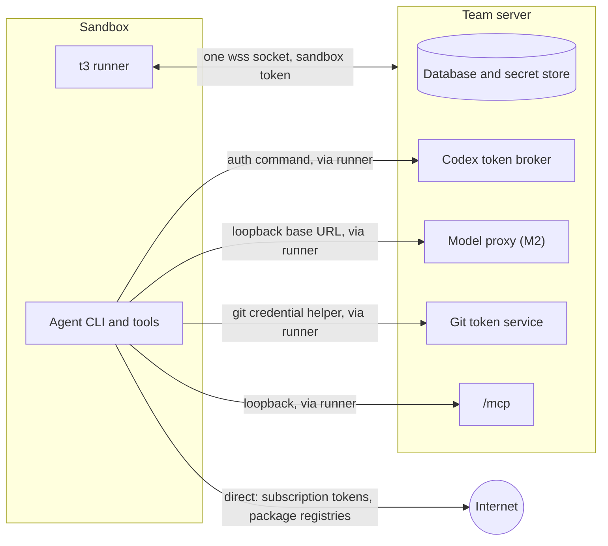
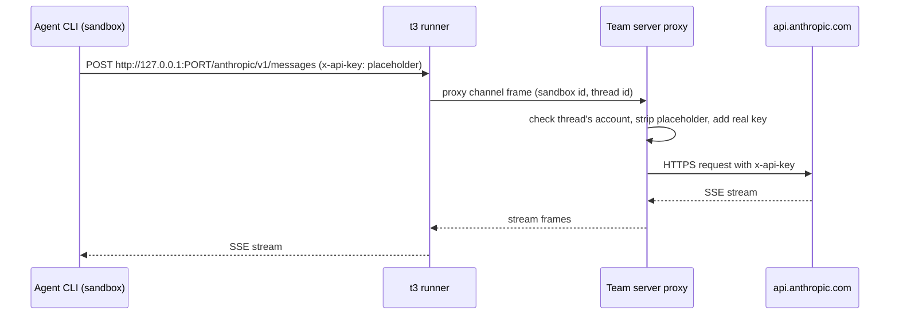
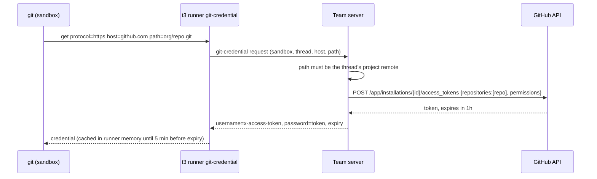

# Credentials and security

Status: proposal, 2026-11-06. Part of the [Pair Cloud plan](./README.md). Nothing here is built.

This page answers two questions. How do provider, git and project credentials reach a cloud thread's
sandbox, and how long do they stay there? And what can a sandbox, or the agent inside it, reach?
It is for the engineers building M1–M4 and for anyone reviewing Pair Cloud's security.

Statements marked (inferred) are our reading of code or vendor behavior, not something verified.
External sources are listed at the end.

## Decisions in short

1. **Minimum, at process start, in memory.** Pair writes no credential to a sandbox's disk. Each
   process gets an environment built from an allowlist, never a copy of the server's.
2. **Short-lived where possible.** Managed Codex reuses the token broker; Claude's token is long-lived.
3. **API keys can stay on the server** behind the opt-in model proxy (M2); subscriptions never.
4. **Git asks a credential helper,** which answers with a one-hour installation token, else the
   thread owner's own GitHub credential, else nothing.
5. **The sandbox token reaches one channel** and never enters the session store.
6. **Default egress: open internet, closed private network** and metadata endpoints.
7. **The Docker driver is not a security boundary** unless rootless or under gVisor. The UI says so.
8. **Cloud-only mode (M4) removes the shell on the server, not trust between members.**

## 1. Threat model

### Today

[Product decisions](../decisions.md#principles) state the rule: membership is the trust boundary. A
member with `terminal:operate` or `orchestration:operate` has a shell as the server's user, and
[environment auth](../../internals/environment-auth.md#authority-survives-transport-changes) argues
that withholding other scopes would protect nothing. Every agent runs as that user, so any agent
can read the database, the secret store
([ServerSecretStore.ts](../../../apps/server/src/auth/ServerSecretStore.ts)), every member's provider
home and the server's git and `gh` logins. A prompt injection in any thread compromises the team.

### Actors and assets

| Actor | Can do today |
| ----- | ------------ |
| **Member** | Sign in, prompt any thread, open terminals, read files the server can read. |
| **Hijacked agent** | Anything its process can do: run commands, read env and files, call the network and the thread's MCP tools. Prompt injection arrives through repos, issues, web pages and tool output. |
| **Malicious repo or dependency** | Run code at install, build, test or setup time (`t3.json` setup scripts, npm `postinstall`). |
| **Compromised sandbox** | Root inside one sandbox, and a live runner connection. |
| **Compute vendor** | Read disks, memory and traffic of sandboxes it hosts. |
| **Network attacker** | Watch or tamper with traffic between sandbox, team server, providers and git hosts. |

| Asset | Where it lives |
| ----- | -------------- |
| Provider credentials | Server secret store, provider instance env in settings, provider homes on the server. |
| GitHub and git host tokens | Server secret store (member connections via [MemberGitHub.ts](../../../apps/server/src/team/MemberGitHub.ts) and, new, member-pasted tokens; the app sign-in; host tokens), and the server user's ambient `gh` and git config. |
| Team server database and secrets | `~/.t3/userdata` on the server's machine. |
| Other threads' code | Other worktrees on the server today; other sandboxes in cloud. |
| The team server itself | Its process, its RPC surface, its host. |

### Pairs that matter

| Actor → asset | Attack | What the design does | Residual risk | M |
| ------------- | ------ | -------------------- | ------------- | - |
| Hijacked agent → provider credential | `env`, `/proc/self/environ`, or reading the provider's config dir, then exfiltrate. | Inject only the thread's own account; prefer brokered short-lived tokens (Codex) and the model proxy for API keys. | A Claude setup token or an unproxied API key can leak. It is valid for a year (setup token) or until revoked (API key). | M1, M2 |
| Hijacked agent → GitHub | Read the git credential and push elsewhere, or use `gh` to act as a person. | Installation token for one repo, one hour, no `workflows`. Without the app key, the owner's own token; from M3 the git proxy substitutes it so it never enters the sandbox, and refuses branch deletions and tags. | With an installation token, pushes to that repo for an hour. With an owner token before M3, everything that token can do. Settings warns. | M1, M3 |
| Hijacked agent → team server | Use the MCP token to launch full-access threads, including local ones. | MCP calls from a sandbox are bound to that sandbox's threads; in cloud-only mode, launches are forced to cloud. | Today's MCP surface stays reachable: an agent can start more cloud threads and spend compute. Caps limit it. | M1, M4 |
| Hijacked agent → other threads' code | Read sibling worktrees. | Gone: unrelated threads never share a sandbox. | Side chats and forks share their parent's sandbox, and with it each other's code and credentials (section 2). | M1 |
| Hijacked admin agent → team image | Prompt injection makes the admin agent plant a backdoor in the image. | Authority comes from the humans who wrote the current run, checked on every call; an agent's build waits for an admin to activate it ([05](./05-team-images.md)). | An admin who activates without reading the diff. | M3 |
| Malicious repo → server | Setup script runs on the server. | Setup scripts for cloud threads run in the sandbox. | Server-side git on the checkpoint mirror and diffs parses attacker objects; see section 10. | M1, M4 |
| Compromised sandbox → server | Abuse the runner channel: spoof other sandboxes, flood, reach `/api`. | Sandbox token reaches one channel; server validates every frame against the sandbox's own threads and paths. | Bugs in the runner protocol handlers on the server are now an attack surface. Fuzz them. | M1 |
| Hijacked agent → sandbox root | `sudo`, then read the runner's memory and every process. | Decided: the runner runs as root, agents as the `t3` user with passwordless sudo, like Conductor's machines. User separation inside a sandbox is no boundary once agents can sudo; the sandbox token's narrow scope and the sandbox's own isolation are. | An agent can act as the runner, for its own sandbox only. | M1 |
| Compromised sandbox → host (Docker driver) | Container escape. | Rootless Docker or gVisor, dropped capabilities, no Docker socket. | With plain runc, an escape lands on the Docker host. | M1 |
| Compromised sandbox → cloud account (BYOC) | Instance metadata endpoint, instance IAM role. | Block metadata, no role on sandbox VMs, IMDSv2 with hop limit 1. | Misconfigured customer accounts. | M5 |
| Compute vendor → everything in a sandbox | Read disk, memory, env. | Inherent. BYOC is the answer for teams that can't accept it. | Total for what the sandbox held. | M2, M5 |
| Network attacker → runner socket | Steal the sandbox token, inject frames. | `wss://` only off-host; tokens are hashed at rest and never in URLs, like WebSocket tickets today. | A team server exposed over plain HTTP on a LAN. The runner refuses `ws://` unless the server is loopback or a bind-mounted socket. | M1 |
| Member → others' credentials | Prompt a teammate's thread to print its token. | Nothing new. Product decision: anyone can prompt any thread. | Unchanged from today. Cloud-only mode narrows it to the thread's own account (section 10). | M4 |

### Compared with today

Cloud threads are better isolated than local ones: an agent no longer sees the database, the secret
store, other members' homes or unrelated checkouts. They are not isolated from members, and until
M4 a local terminal is still a shell on the server.

## 2. What lives in a sandbox, and for how long

"Persists" means it is on disk, so it survives sleep (stop with disk kept) and lands in snapshots.
Vendors that pause with memory also capture what is only in memory (inferred for E2B-style pause).

| Item | Where | Lifetime | Persists? |
| ---- | ----- | -------- | --------- |
| Sandbox boot token | Delivered by the driver at each start | Until exchanged, one use | No, if the driver delivers it per start (section 7). Otherwise a file outside the checkout. |
| Runner session credential | Runner memory | One socket | No (memory snapshots: yes) |
| Provider credential (`CLAUDE_CODE_OAUTH_TOKEN`, API key) | Provider process env | Process lifetime | No (memory: yes). A sleep kills the process. |
| Codex access token | Codex process memory, fetched by its auth command | Token lifetime (unverified) | No |
| Thread MCP token | Claude: SDK options. Codex: per-thread JSON-RPC config (`mcp_servers.t3-code.http_headers`, [CodexAdapterV2.ts](../../../apps/server/src/orchestration-v2/Adapters/CodexAdapterV2.ts)) | Provider session | No, for Claude and Codex. Check other adapters. |
| Git installation token | Runner memory cache; git asks per operation | Up to one hour | No. Helper never writes; Pair sets no `credential.helper store`. |
| Team, project, member env vars | Process env of agents, terminals and scripts | Process lifetime | No by Pair. Yes if a script writes them (`.npmrc`, `.env`). |
| Repo checkout, `.git/config`, checkpoint refs | Workspace | Sandbox lifetime | Yes. Remote URLs carry no credentials. |
| Provider transcripts | `CLAUDE_CONFIG_DIR/projects`, `CODEX_HOME/sessions` | Sandbox lifetime | Yes. They contain whatever the agent read, secrets included. |
| Shell history | `~/.bash_history` and friends | Sandbox lifetime | Yes. |
| Secret request files | Today an owner-only file beside the secret store ([SecretRequests.ts](../../../apps/server/src/secrets/SecretRequests.ts)); in cloud, inside the sandbox | Until deleted | Yes. Give them a TTL and delete on sleep. |
| Refreshed provider logins | A CLI's own home, for login-based auth | Refresh-token lifetime | Yes. This is why login-based auth is "Local only" in cloud (section 3). |

Rules that follow:

- A stopped disk or snapshot is as sensitive as the checkout plus everything the agent saw:
  encrypted at rest, deleted on destroy, vendor retention minimized (decision 10).
- Sleep never keeps memory, so in-memory credentials die with the processes.
- Team image builds ([05](./05-team-images.md)) pass build secrets as environment only, and warn
  that whatever the install script writes is baked into every build.

### Shared sandboxes

Side chats and forks of a cloud thread share its sandbox from M1, and a teammate's fork can have a
different owner. Agents there all run as `t3` with sudo (section 1), so each can read every
process's environment through `/proc`.

- **Credentials stay per process,** but an agent can read a sibling's token from `/proc`. The UI
  says so when someone forks a teammate's cloud thread; they could prompt it anyway.
- **Authorship stays per thread.** Each thread's agent gets `GIT_AUTHOR_*` for that thread's owner
  (Codex through per-thread `shell_environment_policy.set`, since one app-server serves many threads). The sandbox's git config sets no `user.name` or
  `user.email`, so a commit from a terminal or a script has no Pair-chosen author.
- **Git credentials follow the thread.** The helper sends its process's thread; an installation
  token serves every thread, an owner's token only that owner's, though siblings can read it.
- **Forwards are shared too.** Any process can call the Codex token forward for a sibling's
  account. Check the instance against the forward's `ownerKey` and, on the server, against the
  threads bound to this sandbox. A per-thread secret would add nothing, since `/proc` exposes it.
- **Terminals and SSH (M4) reach everything.** A terminal or SSH session in a shared sandbox runs as
  the sandbox user and can read every thread's credentials there. Grant access to anyone who may
  prompt any of those threads, which today is every member.
- Per-thread Unix users would not help while agents can sudo. A separate sandbox is the only fix.

## 3. Provider credentials

### How they flow today

A provider instance carries `{name, value, sensitive}` environment entries, values possibly secret
references ([providerInstance.ts](../../../packages/contracts/src/providerInstance.ts)). In
[MemberProviderAccounts.ts](../../../apps/server/src/team/MemberProviderAccounts.ts) a member's Claude
token becomes `CLAUDE_CODE_OAUTH_TOKEN` (prefix `sk-ant-oat`) or `ANTHROPIC_API_KEY`, and a Codex
account is `setupMode: "managed"`. Claude processes get the server's whole environment plus
the instance's, with `CLAUDE_CONFIG_DIR` pointing at the account's home
([ClaudeHome.ts](../../../apps/server/src/provider/Drivers/ClaudeHome.ts)). Managed Codex runs with a
custom model provider whose `auth.command` runs the server's own CLI as `__managed-chatgpt-token
<socket> <instance> <environment> <profile key>`; that asks [CodexManagedTokenBroker.ts](../../../apps/server/src/provider/CodexManagedTokenBroker.ts)
over a private Unix socket for a fresh access token, and the refresh token stays in the server's secret
store ([CodexManagedRuntime.ts](../../../apps/server/src/provider/CodexManagedRuntime.ts),
[CodexChatGptAuth.ts](../../../apps/server/src/provider/CodexChatGptAuth.ts)).

### Rules for cloud

- **Build env from an allowlist.** `mergeClaudeProcessEnvironment` spreads the server's own
  environment. Through a sandbox that would forward `T3CODE_*` values and, on a BYOC server, the
  driver's cloud credentials. `SandboxWorkspaceHost` must replace the base environment with a fixed
  set (`PATH`, `HOME`, `LANG`, `TERM`, the image's own variables) before the adapter's additions.
  This is the one seam change credentials need from M0.
- **One account per process.** A provider process gets its thread's instance credential and nothing
  from any other instance, as today.
- **Headless only.** An account that authenticates only through a login stored in a home directory
  on the server is "Local only" in cloud. Copying a login with a refresh token into a sandbox would
  race refresh-token rotation (OpenAI's CI guide warns about concurrent jobs sharing one
  `auth.json`) and leave the refresh token on the sandbox's disk.
- **Admin team accounts follow the same rules.** The default Claude instance that uses the server
  user's `~/.claude` login is "Local only" until an admin gives it a token or key.

### Claude Code

| Question | Answer |
| -------- | ------ |
| Mechanism in a sandbox | `CLAUDE_CODE_OAUTH_TOKEN` from `claude setup-token`, or `ANTHROPIC_API_KEY`, in the process env. `apiKeyHelper` is an option for rotating keys: the helper can ask the runner, which asks the server. Bedrock or Vertex need cloud credentials and wait for a decision. |
| Refresh writes to disk | No for env tokens (inferred: env credentials have no refresh). Transcripts still land in `CLAUDE_CONFIG_DIR`. |
| Inference-only | Setup token: yes, per Anthropic it "can only make model requests". Valid one year. API key: full Console API access for that key's workspace. |
| Terms | Anthropic's 2026 guidance, as reported, says subscription OAuth tokens are for Claude Code and claude.ai, and third parties must not offer claude.ai login in their products. Pair runs the real Claude Code with the member's own token on their team's server, which is close to Anthropic's own CI use, but a Pair-hosted control plane would be "offering" it. Primary text not found (unverified). |
| Verdict | **M1, decided.** Setup tokens and API keys; Settings says a setup token lasts a year and the agent can read it, as Conductor's cloud setup also uses `claude setup-token`. Login-only accounts are "Local only". A Pair-managed hosting tier, if it ever exists, uses API keys only. |

### Codex

| Question | Answer |
| -------- | ------ |
| Mechanism in a sandbox | Managed ChatGPT: keep the `auth.command`, pointed at the runner bundle's `__managed-chatgpt-token` entry, which reaches the existing broker through the runner's named forward. The socket path is its first argument, so only that argument changes; the broker checks the environment id and the instance's profile key. API key: `OPENAI_API_KEY` in env; the managed runtime strips it, with `OPENAI_BASE_URL`, only for ChatGPT accounts. |
| Refresh writes to disk | No. The broker refreshes on the server and serializes rotation. Rollouts land in `CODEX_HOME/sessions`. |
| Inference-only | The ChatGPT access token is the account's token, scoped as OpenAI scopes it (unverified). API key: full API access for its project. |
| Terms | OpenAI recommends API keys for automation and calls access tokens for "trusted" private runners. A team's own sandbox fits that reading (inferred). |
| Verdict | **M1.** Managed ChatGPT accounts are cloud-ready with no new user step. Unmanaged Codex with the server's `~/.codex/auth.json` is "Local only". |

### Cursor

| Question | Answer |
| -------- | ------ |
| Mechanism in a sandbox | Cursor's CLI reads `CURSOR_API_KEY`. Pair's adapter instead runs `@cursor/sdk` inside the server process with a local `cwd` ([CursorAgentSdk.ts](../../../packages/provider-cursor/src/server/CursorAgentSdk.ts)), so its tools touch the server's files and cannot move behind the process seam. |
| Refresh writes to disk | Browser login goes to the SDK's credential store on the server ([auth.ts](../../../packages/provider-cursor/src/server/auth.ts)). |
| Inference-only | No. A user API key acts as the account (inferred). |
| Terms | No concern found. |
| Verdict | **Not supported in cloud** (plan decision 2). It would need the SDK or the `agent` CLI inside the sandbox with an API key. |

### Other adapters

These answer the same five questions, one row per adapter, because none is cloud-ready in M1.

| Adapter | Mechanism in a sandbox | Refresh writes to disk | Inference-only, terms | Verdict |
| ------- | ---------------------- | ---------------------- | --------------------- | ------- |
| OpenCode | Provider keys in env, or `OPENCODE_AUTH_CONTENT`, which the adapter already reads ([usageLimits.ts](../../../packages/provider-opencode/src/server/usageLimits.ts)). 2.x serves every directory from one server per instance, so cloud needs one OpenCode server per sandbox. | Yes for logins (v2 keeps credentials in SQLite). | Depends on the upstream key. OpenCode plugins that use a Claude subscription are the third-party use Anthropic reportedly prohibits. | **M3**, API keys only |
| Grok | `XAI_API_KEY`. The adapter also knows `GROK_AUTH` and `GROK_AUTH_PROVIDER_COMMAND` ([usageLimits.ts](../../../packages/provider-grok/src/server/usageLimits.ts)); a command provider could reuse the Codex broker pattern (inferred). | Login writes `~/.grok/auth.json`. | Unknown; terms not researched. | **M3**, API key only |
| Kiro | `KIRO_API_KEY`, documented for headless mode and already detected by [status.ts](../../../packages/provider-kiro/src/server/status.ts). Only Pro, Pro+ and Power plans can create keys. | No for keys (inferred). | Unknown; headless mode is meant for CI. | **M3** |
| Antigravity | None. Sign-in is a Google login stored as files in a per-instance profile, and launch strips ambient Google credentials ([antigravityAuthSupport.ts](../../../apps/server/src/provider/antigravityAuthSupport.ts)). | Yes. | No; terms not researched. | Not yet |
| Pi | The user's own `pi` install with its own keys and extensions ([provider-pi](../../../packages/provider-pi/src/server)). Pair would ship them blind. | Pi's business. | Unknown. | Not supported in cloud |
| fx | Vercel AI Gateway: `fx login`, `fx setup` or `AI_GATEWAY_API_KEY`, per fx's own message ([status.test.ts](../../../packages/provider-fx/src/server/status.test.ts)); the adapter reads `fx status --json` ([status.ts](../../../packages/provider-fx/src/server/status.ts)). Every fx instance on a machine shares one login ([settings.ts](../../../packages/provider-fx/src/settings.ts)). | Yes for login. | Gateway key. | Not yet; API key only when it comes |
| Muse | `META_API_KEY` or `muse login` ([driver.ts](../../../packages/provider-muse/src/server/driver.ts)). Runs inside the server process. | Yes for login. | Unknown. | Not supported in cloud (decision 2) |
| ACP registry (Copilot, Devin, Droid, Claude via ACP) | Each agent's own auth, brokered by [auth.ts](../../../packages/provider-acp-registry/src/server/auth.ts). | Varies. | Varies. | Not yet |

## 4. Keeping tokens out of the sandbox: the model proxy

### Design

The runner already tunnels TCP. Give the provider process a loopback base URL that the runner
forwards to the team server, and let the server add the credential:

- Claude: `ANTHROPIC_BASE_URL=http://127.0.0.1:<port>/anthropic` and a placeholder
  `ANTHROPIC_API_KEY`. Claude Code documents both for LLM gateways.
- Codex with an API key: a custom `model_providers` entry whose `base_url` is the loopback port and
  whose `env_key` names a placeholder. The managed runtime already proves custom providers work.
- The server allows only the provider's API paths, rejects bodies over a limit, and records bytes
  per thread for usage. It refuses requests from a sandbox whose thread's account is not an API-key
  account.

Vercel Sandbox does the same thing at its firewall, outside the VM, by injecting headers into
matching outbound requests. Where the hosted driver is Vercel, use its brokering instead of Pair's.

### Which providers and auth types

| Provider and auth | Proxy? | Why |
| ----------------- | ------ | --- |
| Anthropic API key | Yes | Documented base URL override; key is the most damaging thing to leak. |
| OpenAI API key (Codex) | Yes | Custom provider `base_url` and `env_key`. |
| Claude setup token | No | The request would present a subscription OAuth token from Pair's server, not from Claude Code on the member's machine. Given the reported terms, don't. |
| Codex managed ChatGPT | No | Already brokered: only access tokens enter the sandbox. Proxying would present the ChatGPT token from Pair's server. |
| Bedrock, Vertex | Later | Possible with a signing proxy; no one has asked. |
| Others | No | Not supported in cloud yet. |

### Cost

- **Latency.** Near zero on local Docker (inferred). On a hosted driver each request adds the
  sandbox-to-server round trip. Measure time to first token against the direct path first.
- **Head-of-line blocking.** A clone on the same socket can stall a token stream, so the runner
  protocol needs per-channel flow control ([03 Runner](./03-runner.md) owns it).
- **Availability and complexity.** Nothing new to fail, since adapters already run on the server.
  One streaming reverse proxy with a path allowlist, about the size of the Codex broker.

### Recommendation

Ship env injection in M1. Ship the proxy in M2 for API-key accounts, off by default until the
latency measurement passes, then on by default. In cloud-only mode (M4) turn it on for every
API-key account. This leaves setup tokens as the one long-lived provider credential an agent can
read, which is the honest residual risk to show in Settings.

## 5. Git and GitHub

### Today

- Agent and UI git commands run as the server's user with its ambient credentials (SSH keys, `gh`
  credential helper). Background status refreshes run with prompts disabled
  ([GitVcsDriverCore.ts](../../../apps/server/src/vcs/GitVcsDriverCore.ts)).
- Agent sessions get `GIT_AUTHOR_NAME` and `GIT_AUTHOR_EMAIL` for the thread's holder at launch
  ([RuntimePolicy.ts](../../../apps/server/src/orchestration-v2/RuntimePolicy.ts),
  `gitAuthorEnvironment` in [ProviderAdapter.ts](../../../packages/provider-core/src/server/ProviderAdapter.ts)).
  The committer stays the server's identity.
- Pull requests from the UI use the clicking member's GitHub App user token when the host is covered
  ([GitManager.ts](../../../apps/server/src/git/GitManager.ts), `actingCredentialFor`), else the
  server's credential with "Requested by".
- The server's own "GitHub App" credential is a device-flow **user** token for whoever signed the
  server in ([GitHubAppSignIn.ts](../../../packages/source-control-github/src/server/GitHubAppSignIn.ts),
  [GitHubAppAccess.ts](../../../packages/source-control-github/src/server/GitHubAppAccess.ts)).
  Pair holds only the app's client ID (`T3CODE_GITHUB_APP_CLIENT_ID`); with no App ID or private
  key setting, it cannot mint installation tokens. The session is the secret `signIns` setting.

### Design

A credential helper in the sandbox asks the runner, the runner asks the server, and the server
answers with the narrowest credential it can mint.

- **Configuration in the image.** `credential.helper` is set to `!t3 runner git-credential` with
  `credential.useHttpPath=true`, and no other helper. The runner rewrites `git@github.com:` remotes
  to HTTPS with `url.<https>.insteadOf`, since there is no SSH key in a sandbox.
- **Scope.** The server answers only for the thread's project remote (and its fork for pull
  requests, if one exists). Permissions: `contents: write`, `metadata: read`, `pull_requests:
  write`. No `workflows`, so an agent cannot push changes to `.github/workflows`; an admin can add
  it per project.
- **Agents' `gh`.** `gh` reads `GH_TOKEN` once, so the image puts a small `gh` shim on `PATH` that
  fetches the current credential from the runner and execs the real `gh` (inferred design). Agent
  pull requests show as the app's bot, or as the owner with "via Pair" in the body.
- **Authorship.** Pass `GIT_AUTHOR_*` exactly as today. Also pass `GIT_COMMITTER_NAME` and
  `GIT_COMMITTER_EMAIL` with the server's committer identity, because the sandbox has no global git
  config of the server's. Terminals carry no author, as today.
- **Signing.** Commits from cloud threads are unsigned. If a repo requires signed commits, git's
  `gpg.ssh.program` can point at a runner command that asks the server to sign with a key that never
  enters the sandbox. Build it only when asked (M3 at the earliest).
- **Revocation.** On destroy, the server revokes outstanding installation tokens with `DELETE
  /installation/token`. GitHub moved new installation tokens to a stateless format in 2026; whether
  early revocation still works for them is unverified, so the one-hour expiry is the real bound.

### Credential order

Decided, following Claude Code cloud, whose GitHub proxy swaps a stored member credential for a
scoped one. The server answers with the first of these, for the thread's remote and its fork only:

1. **Installation token,** when an admin has added the App ID and private key in Settings → Source
   Control. The recommended team setup.
2. **The thread owner's own GitHub credential:** their connected account (MemberGitHub), or a
   fine-grained token or `gh auth token` output pasted via **Use a token instead** on their row in
   Settings → Team, stored in the secret store. Needs no GitHub App. It follows the owner whoever
   prompts, like provider accounts. Settings says the agent can read it until the M3 git proxy.
3. **No push.** The thread says "Connect GitHub to push" and links to the member's row.

### Other git hosts

Pair supports GitLab, Bitbucket, Azure DevOps, Forgejo and GitCafe as well
([source-control-gitlab](../../../packages/source-control-gitlab), [source-control-bitbucket](../../../packages/source-control-bitbucket),
[source-control-azure-devops](../../../packages/source-control-azure-devops),
[source-control-forgejo](../../../packages/source-control-forgejo),
[source-control-gitcafe](../../../packages/source-control-gitcafe)). Their server credentials are
tokens in settings or CLI logins ([sourceControlHostSecrets.ts](../../../apps/server/src/sourceControl/sourceControlHostSecrets.ts)).
None gives Pair a per-repo one-hour token.

| Host | Short-lived option (unverified unless noted) | Plan |
| ---- | -------------------------------------------- | ---- |
| GitHub | Installation token, one hour, per repo (verified) | M1 |
| GitLab | Project access tokens with an expiry date, minimum one day | M3 via the git proxy |
| Bitbucket | Repository access tokens | M3 via the git proxy |
| Azure DevOps | PATs with expiry | M3 via the git proxy |
| Forgejo, GitCafe | Long-lived tokens | M3 via the git proxy |

The git proxy is the model proxy applied to smart HTTP: the sandbox's remote points at a loopback
URL, the runner forwards, and the server adds the host's stored credential for the thread's remote
only. No host token enters the sandbox, and the server refuses branch deletions and tag pushes. It
costs clone and push bandwidth through the server, so GitHub installation tokens keep the direct
path; GitHub owner tokens go through the proxy. Until M3, cloud threads on other hosts can clone public repos and commit, but not push.

## 6. Environment variables and secrets

### Layers

| Layer | Who edits | Applies to | M |
| ----- | --------- | ---------- | - |
| Team | Admins, in Settings → Cloud | Every cloud thread | M1 |
| Project | Admins, in project settings | Cloud threads of that project | M1 |
| Member | The member, for themselves | Cloud threads **they own**, whoever prompts them | M2 |

Member variables follow the owner for the same reason the provider account does: one thread, one
identity. Settings says anyone who can prompt those threads can ask the agent to print them.

Precedence: member over project over team, then Pair's own variables over all three. A value is
either plain text or a secret reference resolved on the server by the existing
[SecretResolver](../../../packages/secret-provider-core/src/server/SecretResolver.ts) and secret
provider drivers, including [1Password](../../../packages/secret-provider-onepassword/src/server/driver.ts).
Each entry has a `sensitive` flag, reusing the shape of provider instance environment entries.
An unreadable secret fails the spawn with the existing "Could not read the credential from the
secret provider" error ([settingsSecretValue.ts](../../../apps/server/src/secrets/settingsSecretValue.ts))
rather than starting without it.

Variables are resolved on the server when a process starts and sent in the spawn frame; the runner
keeps no copy. Agents, terminals and scripts get the same set. Changes apply to new processes only.

### Reserved names

| Names | Owner |
| ----- | ----- |
| `PATH`, `HOME`, `USER`, `SHELL`, `PWD` | The image and runner |
| `T3CODE_*`, `T3_*` | Pair |
| `CLAUDE_CODE_OAUTH_TOKEN`, `ANTHROPIC_API_KEY`, `ANTHROPIC_AUTH_TOKEN`, `ANTHROPIC_BASE_URL`, `CLAUDE_CONFIG_DIR`, `OPENAI_API_KEY`, `OPENAI_BASE_URL`, `CODEX_HOME`, `CURSOR_API_KEY`, `XAI_API_KEY`, `KIRO_API_KEY` | The thread's provider account |
| `GIT_AUTHOR_*`, `GIT_COMMITTER_*`, `GIT_ASKPASS`, `GIT_CONFIG_*`, `GH_TOKEN`, `GITHUB_TOKEN`, `SSH_AUTH_SOCK` | Pair's git handling. Git tokens never go in variables. |

### Redaction

Today redaction is by pattern: URL credential parameters in logs and spans, plus `Bearer`/`Basic`
values and `token=`-style pairs in provider failures ([observability.ts](../../../packages/shared/src/observability.ts),
[failure.ts](../../../packages/provider-core/src/server/failure.ts)). Cloud adds value masking,
because the server knows exactly which sensitive values it injected:

- Mask injected sensitive values of eight or more characters as `[secret:NAME]` where terminal
  output, stored tool output and logs are stored and displayed, with one linear multi-pattern
  matcher per sandbox that carries a tail across chunks. Ship it in M2.
- It is best effort: base64 or splitting defeats it, and it does nothing about network exfiltration.

## 7. The sandbox token and what a sandbox can reach

### Token

- The server mints a sandbox credential at create. Store only its SHA-256 hash, as
  [McpSessionRegistry.ts](../../../apps/server/src/mcp/McpSessionRegistry.ts) does in memory (auth sessions are signed instead).
- **It never enters `SessionStore`.** Guest tokens set the pattern
  ([environment auth](../../internals/environment-auth.md#guest-links-are-not-sessions)): a
  credential outside the session store cannot be accepted by any RPC, WebSocket or `/mcp` path. The
  runner route is the only place that reads it.
- **Boot token per start.** Where the driver can pass a secret at each start (Docker `exec`, vendor
  start or exec APIs), it passes a one-use boot token that the runner exchanges for a session bound
  to that socket, held in memory. A sleeping disk then holds nothing that reconnects. Where a driver
  can't, fall back to a token file outside the checkout, rotated at every wake and deleted from the
  server at destroy.
- **Docker driver transport.** On the server's machine, one runner-only Unix socket in the state
  directory is bind-mounted into every container; the sandbox token, not the socket, tells sandboxes
  apart, so no network route to the host is needed. A remote `DOCKER_HOST` dials the server's URL
  ([03](./03-runner.md) section 3).

### What the socket reaches

| Channel | Server check |
| ------- | ------------ |
| Process, PTY, file and watch replies | Only for operations the server started on this sandbox. The runner cannot originate spawns on the server. |
| Port tunnels | Only ports the server asked to forward. |
| Named forward: MCP | The runner serves a loopback HTTP listener and forwards to `/mcp`. `RunnerForwards` checks each request's bearer with `McpSessionRegistry.resolve`, whose scope names the thread and provider session, and passes only thread tokens of threads bound to this sandbox ([03](./03-runner.md) section 8). Member API tokens and `mcp-client` sessions are refused here. |
| Named forwards: Codex token broker, git credential helper (M1); model proxy (M2) | Only for this sandbox's threads, their accounts and their project remote. |
| Checkpoint bundles | The server pulls them; the runner has no way to write refs to the mirror ([07](./07-access-and-data.md)). |

The registry's endpoint is `/mcp` at the server's listen address (`127.0.0.1` when it listens on all
interfaces), which a sandbox cannot reach; only the runner can reach the team server. Hooks and
`canUseTool` are Agent SDK options carried over the CLI's stdio, so they need no forward
([ClaudeAdapterV2.ts](../../../apps/server/src/orchestration-v2/Adapters/ClaudeAdapterV2.ts)).

[agentScope.ts](../../../apps/server/src/process/agentScope.ts) is cgroup limits, not auth; sandbox
limits replace it in cloud.

### Revocation

A shared sandbox is destroyed only when no thread uses it; archiving one thread revokes its MCP
token at once. On `destroyed`, in one effect: close the socket, delete the sandbox credential, call
`McpSessionRegistry.revokeThread` for each bound thread, revoke git installation tokens, drop model
proxy grants, and ask the driver to delete disks and snapshots. On sleep, do the same except disks.
On member removal, nothing changes for the sandbox itself. `retireOrphans` signs their provider
accounts out, wipes their homes, drops secret variables and disables them, so their threads refuse
new turns; a running sandbox process keeps the token it started with until it exits.

### Audit

Sandbox lifecycle is event-sourced (decision 6), so it is its own audit trail. Add an event per git
token minted (host, repo, permissions, expiry, never the value) and the credential source on each
provider session start (account and mechanism). Proxy traffic gets metrics, not events.

## 8. Network egress

Agents need the internet: package registries, docs, provider APIs. A default-deny sandbox would make
cloud threads useless for most teams. What they never need is the inside of the network they run in.

| Driver | Mechanism | Allowlist possible |
| ------ | --------- | ------------------ |
| Docker (local or `DOCKER_HOST`) | Per-sandbox bridge network, inter-container traffic off, `DOCKER-USER` rules dropping the Docker host, private ranges and metadata, except the route to the team server | Yes, through an egress proxy container on an internal network (M3) |
| Vercel Sandbox | Network policy, allow lists, credential brokering | Yes |
| Other hosted vendors | Varies; check per vendor in M2 | Unverified |
| VMs in the customer's cloud (M5) | Security groups, no public IP plus NAT, firewall rules | Yes |

**Recommended default: open internet, closed private.** Deny `169.254.169.254` and `fd00:ec2::254`,
RFC 1918 and other private ranges, the host, and other sandboxes. Allow the rest. Admins can switch
a team to an allowlist where the driver declares the capability, with a starter list (provider APIs,
the git host, package registries). The runner needs only the team server, which serves its bundle.
Settings shows what the active driver can enforce and never claims a block it cannot keep.

## 9. Isolation

| Isolation | Kernel shared with host | Where | Note |
| --------- | ----------------------- | ----- | ---- |
| Docker, runc | Yes | M1, with a warning | An escape reaches the Docker host: the team server's machine when local. |
| Docker, rootless | Yes, but the daemon runs as an unprivileged user | M1 recommended | Escape lands as that user, not root. |
| Docker, gVisor (`runsc`) | No, a user-space kernel intercepts syscalls | M1 recommended | Slower on syscall- and file-heavy work such as `npm install`; measure. |
| Firecracker microVM (Vercel, E2B) | No | M2 hosted | The vendor's boundary. |
| Plain VM (EC2, then GCE) | No | M5 | Strongest; slowest to create. |

What a team on the Docker driver should know, written into Settings → Cloud:

- A runc container protects threads from each other and the host from honest mistakes. Against a
  determined attacker, assume an escape. A separate `DOCKER_HOST` keeps an escape off the server.
- Local Docker gives the server's user the Docker API, which is root on that machine, and every
  local agent runs as that user. Use rootless Docker or gVisor, or accept that.
- Pair's containers run with no Docker socket, no `--privileged`, minimal capabilities, the default
  seccomp profile and pids, memory and CPU limits; not `no-new-privileges`, which would break `sudo`.
  "Docker inside the sandbox" is therefore off on this driver; VM drivers offer it.

## 10. Cloud-only server mode (M4)

Cloud-only mode means no agent, terminal or project script runs on the team server's machine. Only
then can membership stop meaning "shell on the server". Every row must be closed:

| Surface | Today | Cloud-only | Code |
| ------- | ----- | ---------- | ---- |
| Threads without a `sandboxId` | Run on the server | Launches must be cloud; existing local threads are read-only | [environment.ts](../../../packages/contracts/src/environment.ts) |
| Terminals | PTYs on the server | Only sandbox PTYs | [Manager.ts](../../../apps/server/src/terminal/Manager.ts) |
| Setup and project scripts, `t3.json` | Run on the server | Run in sandboxes; the server only parses `t3.json` | [ProjectSetupScriptRunner.ts](../../../apps/server/src/project/ProjectSetupScriptRunner.ts), [T3ProjectFileLoader.ts](../../../apps/server/src/project/T3ProjectFileLoader.ts) |
| MCP launches (`t3_thread_launch`, `delegate_task`, and `create_threads`, which shares its caller's checkout) and scheduled tasks | Can start local full-access threads | Forced to cloud; `create_threads` refused for local callers | [toolkits/project/tools.ts](../../../apps/server/src/mcp/toolkits/project/tools.ts), [orchestrator/tools.ts](../../../apps/server/src/mcp/toolkits/orchestrator/tools.ts), [scheduledTasks](../../../apps/server/src/scheduledTasks) |
| `t3_project_clone`, `t3_project_create` | Clone and create folders on the server | Clone in the sandbox, or on the server with hardened git config (no hooks, `protocol.allow` limited) | [toolkits/project](../../../apps/server/src/mcp/toolkits/project) |
| Device tools (`device_open` and friends) | Run simulators and SSH device hosts from the server | Admin-configured device hosts only; never local | [DeviceHost.ts](../../../apps/server/src/device/DeviceHost.ts) |
| Preview tools | A browser on the server loads agent-served pages | From M2 the server browser reaches previews through the proxy ([07](./07-access-and-data.md)). Whether it may load agent pages in this mode is a maintainer decision at M4 | [preview](../../../apps/server/src/preview), [PortScanner.ts](../../../apps/server/src/preview/PortScanner.ts) |
| `t3_environment_link` | Links other environments | Admin only | [orchestrator/tools.ts](../../../apps/server/src/mcp/toolkits/orchestrator/tools.ts) |
| Text generation (titles, summaries) | Spawns provider CLIs on the server | No tools, no project MCP or hooks, empty `cwd`; or run in a sandbox | [textGeneration](../../../apps/server/src/textGeneration) |
| `filesystem:read` | Any file the server user can read, including the secret store | Confined to sandboxes and the checkpoint mirror | [environment auth](../../internals/environment-auth.md#the-environment-is-the-filesystem-boundary), [AssetAccess.ts](../../../apps/server/src/assets/AssetAccess.ts) |
| Workspace file writes | Workspace path rules on the server | Sandbox only | [WorkspaceFileSystem.ts](../../../apps/server/src/workspace/WorkspaceFileSystem.ts) |
| Checkpoint mirror and diffs | Git on the server reads repo content | Bare repo, `git fsck` on every fetched bundle, server-owned hooks only, never checked out, no diff or filter drivers in server git config | [07 Access and data](./07-access-and-data.md) |
| Provider logins and probes | CLIs run on the server for login and status | Allowed: admin and owner flows, no project `cwd` | [ProviderAuthService.ts](../../../apps/server/src/provider/ProviderAuthService.ts) |
| Member scopes | Roles guard mistakes only ([team.ts](../../../packages/contracts/src/team.ts)) | Re-audit every RPC that executes or reads on the host; then member scopes become a real boundary | [RpcAuthorization.ts](../../../apps/server/src/auth/RpcAuthorization.ts) |
| Model proxy | Optional | On for every API-key account | Section 4 |

An admin turns the mode on, or managed policy forces it ([01](./01-product.md)). Turning it on
refuses while a local thread runs; turning it off is allowed and shows the warning again.

A member can still prompt any thread and reach its provider credential and git token.

## 11. Work breakdown

| M | Work |
| - | ---- |
| M0 | The workspace host owns the base environment of every spawn. `LocalWorkspaceHost` passes the server's environment through unchanged. |
| M1 | Sandbox credential store and runner route outside `SessionStore`; per-start boot tokens for Docker. Allowlist environment for sandbox spawns. Claude setup-token and API-key injection; managed Codex through the broker over the runner; API-key Codex. "Local only" marking for login-only accounts. MCP forwarding with thread-to-sandbox binding. Git credential helper with the credential order: App ID and private key setting, installation tokens, member token store with **Use a token instead** in Settings → Team, "Connect GitHub to push". `gh` shim, committer identity. Team and project env vars with reserved names. Docker hardening, per-sandbox networks and the private-range block, local and `DOCKER_HOST`. Shared-sandbox warning on forks. Revocation on destroy and sleep. Audit events for git tokens and credential source. Settings text on Docker isolation and on what an agent can read. |
| M2 | Model proxy for API keys, with latency measurement and per-channel priority. Member env vars. Value masking. Secret-request file TTL in sandboxes. Hosted driver review: isolation, egress capabilities, snapshot encryption, retention and deletion. Vercel credential brokering if Vercel is the vendor. |
| M3 | Cloud credentials for OpenCode, Grok and Kiro (API keys). Git proxy for GitHub owner tokens (substituted, no branch deletions or tags) and for GitLab, Bitbucket, Azure DevOps, Forgejo and GitCafe. Egress allowlists on Docker. Build secrets for team images. Commit signing broker only if asked. |
| M4 | Cloud-only mode and every row in section 10. Proxy on by default in that mode. Amended trust text and, if asked, a Viewer role. |
| M5 | BYOC plain-VM driver: IMDSv2 with hop limit 1, no instance roles on sandbox VMs, the server's cloud credentials never forwarded, security groups, customer-managed disk keys. |

## Open questions

1. **Model proxy on by default?** Recommend opt-in in M2, default on once time to first token through
   the proxy is within 10% of direct on the hosted driver, and always on in cloud-only mode.
2. **Do forks by another member need their own sandbox?** Recommend no: share it as the plan says,
   warn on fork, and offer a separate sandbox per owner only if a team asks.

## Challenges to the plan

None. The revised README adopts this doc's earlier challenges in decisions 2, 3, 8 and 10.

## Sources

- [Claude Code authentication](https://code.claude.com/docs/en/authentication.md): precedence,
  `apiKeyHelper`, `claude setup-token` (one year, model requests only), `.credentials.json`.
- [Codex authentication](https://learn.chatgpt.com/docs/auth) and
  [Codex CI/CD auth](https://developers.openai.com/codex/auth/ci-cd-auth): `auth.json`, API keys
  for automation, custom provider `auth` commands, refresh races between jobs sharing `auth.json`.
- [Cursor CLI](https://cursor.com/help/integrations/cli) (`CURSOR_API_KEY`; headless details
  unverified), [Kiro headless mode](https://kiro.dev/docs/cli/headless/),
  [OpenCode providers](https://opencode.ai/v2/docs/cli/providers).
- Anthropic subscription-token policy, secondary reports only (unverified):
  [GIGAZINE](https://gigazine.net/gsc_news/en/20260220-anthropic-third-party-block),
  [WinBuzzer](https://winbuzzer.com/2026/02/19/anthropic-bans-claude-subscription-oauth-in-third-party-apps-xcxwbn/).
- [Claude Code on the web](https://code.claude.com/docs/en/claude-code-on-the-web): GitHub App or
  `/web-setup` token, held server-side behind a GitHub proxy (precedent for section 5).
- [Vercel Sandbox firewall](https://vercel.com/docs/sandbox/concepts/firewall) and
  [credential injection](https://vercel.com/changelog/safely-inject-credentials-in-http-headers-with-vercel-sandbox).
- [GitHub installation access tokens](https://docs.github.com/en/apps/creating-github-apps/authenticating-with-a-github-app/generating-an-installation-access-token-for-a-github-app):
  one-hour expiry, `repositories` and `permissions`, the 2026 stateless format.
- Not re-fetched for this page: [git credentials](https://git-scm.com/docs/gitcredentials),
  [gh environment](https://cli.github.com/manual/gh_help_environment),
  [Docker rootless](https://docs.docker.com/engine/security/rootless/),
  [Docker daemon attack surface](https://docs.docker.com/engine/security/#docker-daemon-attack-surface),
  [gVisor](https://gvisor.dev/docs/),
  [AWS instance metadata](https://docs.aws.amazon.com/AWSEC2/latest/UserGuide/configuring-instance-metadata-service.html).
- GitLab, Bitbucket and Azure DevOps token lifetimes in section 5 are unverified.
