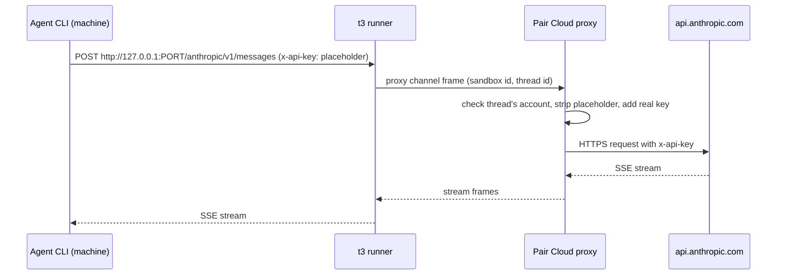
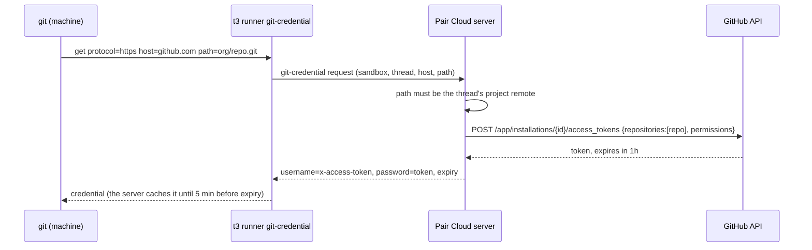

# Credentials and security

Status: M0 and M1 landed; the rest is a proposal, rewritten 2026-11-08 for local-first Pair Cloud.
Part of the [Pair Cloud plan](./README.md).

This page answers two questions. How do provider, git and project credentials reach a cloud
session's machine, and how long do they stay there? And what can a machine, or the agent inside it,
reach? It is for the engineers building Pair Cloud and for anyone reviewing its security.

Statements marked (inferred) are our reading of code or vendor behavior, not something verified.
External sources are listed at the end.

## Decisions in short

1. **Minimum, at process start, in memory.** Pair writes no credential to a machine's disk. Each
   process gets an environment built from an allowlist, never a copy of the server's.
2. **The thread owner's own account by default, company accounts as an option** (D8). Members
   connect provider accounts and GitHub on Pair Cloud, separately from their Mac. Managed Codex
   reuses the token broker; Claude's setup token is long-lived and the agent can read it.
3. **API keys could stay on the server** behind a model proxy, a Later, opt-in item for company
   keys. Subscription tokens are never proxied.
4. **Git asks a credential helper,** which answers with a one-hour installation token, else the
   thread owner's own GitHub credential, else nothing. Pair's PR button opens PRs as the member.
5. **The sandbox token reaches one channel** and never enters the session store. Clients can't
   start a machine past the launch gate, and members never see driver config (M2).
6. **Default egress: open internet, closed private network** and metadata endpoints.
7. **The Docker driver is not a security boundary** unless rootless or under gVisor. The UI says
   so. On Pair Cloud an escape usually lands on the server's own machine.
8. **Pair Cloud is cloud-only from M2.** No agent, terminal or project script runs on its machine.
   That removes the shell on the server, not trust between members. A member's Mac local server
   keeps today's model.

## 1. Threat model

### Two servers, two trust models

A member's Mac runs its own **local server**, and nothing on this page changes it.
[Product decisions](../decisions.md#principles) state its rule: membership is the trust boundary.
A member with `terminal:operate` or `orchestration:operate` has a shell as the server's user, and
[environment auth](../../internals/environment-auth.md#authority-survives-transport-changes) argues
that withholding other scopes would protect nothing. Every agent runs as that user, so any agent
can read the database, the secret store
([ServerSecretStore.ts](../../../apps/server/src/auth/ServerSecretStore.ts)), every member's provider
home and the server's git and `gh` logins. A prompt injection in any thread compromises that
server. M1 as built on a shared team server works the same way.

**Pair Cloud** is cloud-only from M2 (section 10): agents, terminals and project scripts run only
in machines. Membership is still the trust boundary, at today's level (D15): everyone sees and can
prompt every thread. What a member reaches moves from the server's user to the machines, each with
its thread's provider credential and git credential. The local server never hands Pair Cloud a
provider or GitHub credential; members connect their accounts there separately (section 3).

### Actors and assets

| Actor                            | Can do                                                                                                                                                                                    |
| -------------------------------- | ----------------------------------------------------------------------------------------------------------------------------------------------------------------------------------------- |
| **Member**                       | Sign in, prompt any thread, open terminals in any machine, read files in machines, project checkouts and the mirror. On a local or team server, also read anything the server's user can. |
| **Hijacked agent**               | Anything its process can do: run commands, read env and files, call the network and the thread's MCP tools. Prompt injection arrives through repos, issues, web pages and tool output.    |
| **Malicious repo or dependency** | Run code at install, build, test or setup time (`t3.json` setup scripts, npm `postinstall`).                                                                                              |
| **Compromised sandbox**          | Root inside one machine, and a live runner connection.                                                                                                                                    |
| **Compute or cloud vendor**      | Read disks, memory and traffic of the machines and servers it hosts.                                                                                                                      |
| **Network attacker**             | Watch or tamper with traffic between members, Pair Cloud, machines, providers and git hosts.                                                                                              |

| Asset                           | Where it lives                                                                                                                                                                                                                              |
| ------------------------------- | ------------------------------------------------------------------------------------------------------------------------------------------------------------------------------------------------------------------------------------------- |
| Provider credentials            | Pair Cloud's secret store, provider instance env in settings, provider homes on the server. A member's Mac keeps its own logins, which Pair Cloud never sees.                                                                               |
| GitHub and git host tokens      | The secret store (member connections via [MemberGitHub.ts](../../../apps/server/src/team/MemberGitHub.ts) and member-pasted tokens, the App key, the server's own sign-in, host tokens), and the server user's ambient `gh` and git config. |
| Pair Cloud database and secrets | The T3 home's `userdata` on Pair Cloud's machine, and its hourly disk snapshots, which hold the same secrets.                                                                                                                               |
| Other threads' code             | Other worktrees on a local or team server; other machines, project checkouts and the mirror on Pair Cloud.                                                                                                                                  |
| Pair Cloud itself               | Its process, its listeners and RPC surface, its host.                                                                                                                                                                                       |
| Member sign-ins                 | Each client's session, and from M3 the Mac local server's member-scoped agent link.                                                                                                                                                         |

### Pairs that matter

| Actor → asset                              | Attack                                                                                                                                                | What the design does                                                                                                                                                                                                                                          | Residual risk                                                                                                                                                                | M         |
| ------------------------------------------ | ----------------------------------------------------------------------------------------------------------------------------------------------------- | ------------------------------------------------------------------------------------------------------------------------------------------------------------------------------------------------------------------------------------------------------------- | ---------------------------------------------------------------------------------------------------------------------------------------------------------------------------- | --------- |
| Hijacked agent → provider credential       | `env`, `/proc/self/environ`, or reading the provider's config dir, then exfiltrate.                                                                   | Inject only the thread's own account; prefer brokered short-lived tokens (Codex). A model proxy for API keys is Later.                                                                                                                                        | A Claude setup token or an API key can leak. It is valid for a year (setup token) or until revoked (API key).                                                                | M1, Later |
| Hijacked agent → GitHub                    | Read the git credential and push elsewhere, or use `gh` to act as a person.                                                                           | Installation token for one repo, one hour, no `workflows`. Without the App key, the owner's own token. A git proxy (Later) would keep it out of the machine and refuse branch deletions and tags.                                                             | With an installation token, pushes to that repo for an hour. With an owner token, everything that token can do. Settings warns.                                              | M1        |
| Hijacked agent → Pair Cloud                | Use the MCP token to launch full-access threads.                                                                                                      | MCP calls from a machine are bound to that machine's threads; on a cloud-only server every launch goes through the launch gate and is a cloud launch.                                                                                                         | The MCP surface stays reachable: an agent can start more cloud sessions and spend compute. Caps limit it.                                                                    | M1, M2    |
| Hijacked agent → other threads' code       | Read sibling worktrees.                                                                                                                               | Gone: unrelated threads never share a machine.                                                                                                                                                                                                                | Side chats and forks share their parent's machine, and with it each other's code and credentials (section 2).                                                                | M1        |
| Hijacked admin agent → team image          | Prompt injection makes the admin agent plant a backdoor in the image.                                                                                 | Authority comes from the humans who wrote the current run, checked on every call; an agent's build waits for an admin to activate it ([05](./05-team-images.md)).                                                                                             | An admin who activates without reading the diff.                                                                                                                             | M4        |
| Malicious repo → server                    | Setup script runs on the server.                                                                                                                      | Setup scripts for cloud sessions run in the machine.                                                                                                                                                                                                          | Server-side git on the project checkout, the checkpoint mirror and diffs parses attacker objects; see section 10.                                                            | M1, M2    |
| Compromised sandbox → server               | Abuse the runner channel: spoof other machines, flood, reach `/api`.                                                                                  | Sandbox token reaches one channel; server validates every frame against the machine's own threads and paths.                                                                                                                                                  | Bugs in the runner protocol handlers on the server are now an attack surface. Fuzz them.                                                                                     | M1        |
| Hijacked agent → sandbox root              | `sudo`, then read the runner's memory and every process.                                                                                              | Decided (D3): the runner runs as root, agents as the `t3` user with passwordless sudo, like Conductor's machines. User separation inside a machine is no boundary once agents can sudo; the sandbox token's narrow scope and the machine's own isolation are. | An agent can act as the runner, for its own machine only.                                                                                                                    | M1        |
| Compromised sandbox → host (Docker driver) | Container escape.                                                                                                                                     | Rootless Docker or gVisor, dropped capabilities, no Docker socket.                                                                                                                                                                                            | With plain runc, an escape lands on the Docker host, which on Pair Cloud is usually the server's own machine: the database, the secret store and every member's credentials. | M1        |
| Compromised sandbox → cloud account (BYOC) | Instance metadata endpoint, instance IAM role.                                                                                                        | Block metadata, no role on machine VMs, IMDSv2 with hop limit 1.                                                                                                                                                                                              | Misconfigured customer accounts.                                                                                                                                             | M5        |
| Compute vendor → everything in a machine   | Read disk, memory, env.                                                                                                                               | Inherent. BYOC is the answer for teams that can't accept it.                                                                                                                                                                                                  | Total for what the machine held.                                                                                                                                             | M5, Later |
| Network attacker → runner socket           | Steal the sandbox token, inject frames.                                                                                                               | `wss://` only off-host; tokens are hashed at rest and never in URLs, like WebSocket tickets today.                                                                                                                                                            | A Pair Cloud reached over plain HTTP. The runner refuses `ws://` unless the server is loopback or a bind-mounted socket.                                                     | M1        |
| Outsider → Pair Cloud's listeners          | Reach sign-in, the client RPC surface or `/runner/*` from the internet.                                                                               | Members reach Pair Cloud over HTTPS on the team's own domain. BYOC is private by default (VPN or Tailscale), with an opt-in public listener that serves client routes only, never `/runner/*`; T3 Connect is off for BYOC (D10, section 7).                   | An opted-in public listener puts sign-in and invite links on the internet.                                                                                                   | M2, M5    |
| Member's client → machine lifecycle        | Dispatch a `delegated_task.request` carrying its own `sandbox` to get a machine past the launch gate, or read driver config from the settings stream. | The launch gate picks driver and size, `delegated_task.request` becomes an internal command that `dispatchCommand` refuses, and driver config is redacted for non-admins (section 7).                                                                         | None known after M2. In M1, any member with operate scope can do both.                                                                                                       | M2        |
| Member → others' credentials               | Prompt a teammate's thread to print its token.                                                                                                        | Nothing new. Product decision: anyone can prompt any thread.                                                                                                                                                                                                  | Unchanged from today. Cloud-only mode narrows it to the thread's own account (section 10).                                                                                   | M2        |
| Hijacked local agent → Pair Cloud          | Use the Mac's agent link to start or delegate cloud sessions.                                                                                         | One member-scoped link, from the laptop to Pair Cloud only; Pair Cloud never reaches into the Mac.                                                                                                                                                            | A local agent can do on Pair Cloud what its member can through MCP, the CLI and `delegate_task`.                                                                             | M3        |
| Member's Mac → Pair Cloud mirror           | A seed carries untracked files the member didn't mean to share, or crafted git objects.                                                               | A preview with an exclusion list; ignored files never move. Authenticated upload, staged per command id, refs and size checked, strict import into the mirror ([07](./07-access-and-data.md)).                                                                | An untracked, unignored secret file goes along unless the member excludes it.                                                                                                | M3        |

### Compared with today

Cloud sessions are better isolated than local threads on a shared server: an agent no longer sees
the database, the secret store, other members' homes or unrelated checkouts. They are not isolated
from members. On Pair Cloud from M2 there is no local terminal, so no member has a shell on the
server's machine; on M1's team server a local terminal is still one.

## 2. What lives in a sandbox, and for how long

"Persists" means it is on disk, so it survives sleep (stop with disk kept) and lands in snapshots.
Vendors that pause with memory also capture what is only in memory (inferred for E2B-style pause).

| Item                                                     | Where                                                                                                                                                                                  | Lifetime                    | Persists?                                                                                   |
| -------------------------------------------------------- | -------------------------------------------------------------------------------------------------------------------------------------------------------------------------------------- | --------------------------- | ------------------------------------------------------------------------------------------- |
| Sandbox boot token                                       | Delivered by the driver at each start                                                                                                                                                  | Until exchanged, one use    | No, if the driver delivers it per start (section 7). Otherwise a file outside the checkout. |
| Runner session credential                                | Runner memory                                                                                                                                                                          | One socket                  | No (memory snapshots: yes)                                                                  |
| Provider credential (`CLAUDE_CODE_OAUTH_TOKEN`, API key) | Provider process env                                                                                                                                                                   | Process lifetime            | No (memory: yes). A sleep kills the process.                                                |
| Codex access token                                       | Codex process memory, fetched by its auth command                                                                                                                                      | Token lifetime (unverified) | No                                                                                          |
| Thread MCP token                                         | Claude: SDK options. Codex: per-thread JSON-RPC config (`mcp_servers.t3-code.http_headers`, [CodexAdapterV2.ts](../../../apps/server/src/orchestration-v2/Adapters/CodexAdapterV2.ts)) | Provider session            | No, for Claude and Codex. Check other adapters.                                             |
| Git installation token                                   | Server memory cache; git asks per operation through the runner                                                                                                                         | Up to one hour              | No. Helper never writes; Pair sets no `credential.helper store`.                            |
| Team and project env vars                                | Process env of agents, terminals and scripts                                                                                                                                           | Process lifetime            | No by Pair. Yes if a script writes them (`.npmrc`, `.env`).                                 |
| Repo checkout, `.git/config`, checkpoint refs            | Workspace                                                                                                                                                                              | Sandbox lifetime            | Yes. Remote URLs carry no credentials.                                                      |
| Provider transcripts                                     | `CLAUDE_CONFIG_DIR/projects`, `CODEX_HOME/sessions`                                                                                                                                    | Sandbox lifetime            | Yes. They contain whatever the agent read, secrets included.                                |
| Shell history                                            | `~/.bash_history` and friends                                                                                                                                                          | Sandbox lifetime            | Yes.                                                                                        |
| Secret request files                                     | Today an owner-only file beside the secret store ([SecretRequests.ts](../../../apps/server/src/secrets/SecretRequests.ts)); in cloud, inside the machine                               | Until deleted               | Yes. Give them a TTL and delete on sleep.                                                   |
| Refreshed provider logins                                | A CLI's own home, for login-based auth                                                                                                                                                 | Refresh-token lifetime      | Yes. This is why login-based auth is "Local only" in cloud (section 3).                     |

Rules that follow:

- A stopped disk or snapshot is as sensitive as the checkout plus everything the agent saw:
  encrypted at rest, deleted on destroy, vendor retention minimized (decision 10).
- Sleep never keeps memory, so in-memory credentials die with the processes.
- Team image builds ([05](./05-team-images.md)) pass build secrets as environment only, and warn
  that whatever the install script writes is baked into every build.

### Shared sandboxes

Side chats and forks of a cloud thread share its machine, and a teammate's fork can have a
different owner. Agents there all run as `t3` with sudo (section 1), so each can read every
process's environment through `/proc`.

- **Credentials stay per process,** but an agent can read a sibling's token from `/proc`. The UI
  says so when someone forks a teammate's cloud thread; they could prompt it anyway.
- **Authorship stays per thread.** Each thread's agent gets `GIT_AUTHOR_*` for that thread's owner
  (Codex through per-thread `shell_environment_policy.set`, since one app-server serves many
  threads). The image's git config sets no identity. Every process gets the server's identity as
  `user.name` and `user.email` through `GIT_CONFIG_*`, which `GIT_AUTHOR_*` overrides, so a commit
  from a terminal or a script names the server, as on a local checkout.
- **Git credentials follow the thread.** The helper sends its process's thread; an installation
  token serves every thread, an owner's token only that owner's, though siblings can read it.
- **Forwards are shared too.** Any process can call the Codex token forward for a sibling's
  account. Check the instance against the forward's `ownerKey` and, on the server, against the
  threads bound to this machine. A per-thread secret would add nothing, since `/proc` exposes it.
- **Terminals, and SSH when it comes (Later), reach everything.** A terminal in a shared machine
  runs as the machine's user and can read every thread's credentials there. Grant access to anyone
  who may prompt any of those threads, which today is every member.
- Per-thread Unix users would not help while agents can sudo. A separate machine is the only fix.

## 3. Provider credentials

### How they flow today

A provider instance carries `{name, value, sensitive}` environment entries, values possibly secret
references ([providerInstance.ts](../../../packages/contracts/src/providerInstance.ts)). A member's
own account is an instance they own, added in Settings → Team; a company account is an instance an
admin sets up in Settings → Providers. In
[MemberProviderAccounts.ts](../../../apps/server/src/team/MemberProviderAccounts.ts) a member's Claude
token becomes `CLAUDE_CODE_OAUTH_TOKEN` (prefix `sk-ant-oat`) or `ANTHROPIC_API_KEY`, and a Codex
account is `setupMode: "managed"`. On a local host, Claude processes get the server's whole
environment plus the instance's, with `CLAUDE_CONFIG_DIR` pointing at the account's home
([ClaudeHome.ts](../../../apps/server/src/provider/Drivers/ClaudeHome.ts)). Managed Codex runs with a
custom model provider whose `auth.command` runs the server's own CLI as `__managed-chatgpt-token
<socket> <instance> <environment> <profile key>`; that asks [CodexManagedTokenBroker.ts](../../../apps/server/src/provider/CodexManagedTokenBroker.ts)
over a private Unix socket for a fresh access token, and the refresh token stays in the server's secret
store ([CodexManagedRuntime.ts](../../../apps/server/src/provider/CodexManagedRuntime.ts),
[CodexChatGptAuth.ts](../../../apps/server/src/provider/CodexChatGptAuth.ts)).

### Whose account a cloud session uses

- **The thread owner's own subscription by default.** A member adds their Claude account (a setup
  token or an API key) or their ChatGPT account (through the existing broker) on Pair Cloud, and
  new threads they start use it when it matches the provider
  ([team guide](../../user/team.md#your-own-provider-account)). This is how M1 works.
- **Company accounts as an option.** Any member can pick an instance an admin set up in
  Settings → Providers, such as a team API key.
- **A turn runs on the thread's account, whoever prompts it,** as today. Pair never switches
  accounts per prompter and never pools personal subscriptions
  ([decisions](../decisions.md#provider-accounts)).
- **Pair Cloud accounts are separate from the Mac's.** A member connects provider accounts and
  GitHub on Pair Cloud, in the existing Settings → Team flows, even when the same accounts already
  work on their Mac. The Mac's own Claude login, in the keychain or from signing in in a terminal,
  can't serve a cloud machine: it lives on another computer, and copying a login with a refresh
  token is what "Headless only" below rules out.
- **Cloud without a usable account (M2).** M1 already refuses a "Local only" or unsupported account
  before any thread or machine exists
  ([ThreadLaunchService.ts](../../../apps/server/src/orchestration-v2/ThreadLaunchService.ts)), and
  the model picker says what to add. From M2, when a member picks Cloud with no usable provider
  account or GitHub credential on Pair Cloud, the client says what to add, linking their row in
  Settings → Team, or offers a company account.

### Accepted risks

These are in today's user guides ([cloud](../../user/cloud.md#what-agents-in-a-machine-can-read),
[team](../../user/team.md#your-own-provider-account)) and stay accepted:

- **The agent can read a Claude setup token,** which is valid for a year (D2). An API key is
  readable too, until revoked, because the model proxy is Later (section 4).
- **Teammates spend the owner's subscription.** Anyone who prompts a thread that runs on a member's
  account uses that account. Settings → Team shows each member's turns and tokens for the last
  7 days, counted against whoever sent each prompt.
- **The terms reading holds for a team's own server.** On Pair Cloud the real Claude Code or Codex
  runs with a member's own credential on infrastructure their team controls (tables below). A
  Pair-hosted service would be "offering" subscription login, so it would take API keys only.

### Rules for cloud

- **Build env from an allowlist.** `mergeClaudeProcessEnvironment` spreads the server's own
  environment. Through a machine that would forward `T3CODE_*` values and, on a BYOC server, the
  driver's cloud credentials. The workspace host owns every spawn's base environment (M0), and on a
  sandbox host [SandboxProcessEnvironment.ts](../../../apps/server/src/sandbox/credentials/SandboxProcessEnvironment.ts)
  builds it from the image's own variables plus team and project variables, with reserved names
  dropped, before the adapter's additions (M1).
- **One account per process.** A provider process gets its thread's instance credential and nothing
  from any other instance, as today.
- **Headless only.** An account that authenticates only through a login stored in a home directory
  on the server is "Local only" in cloud. Copying a login with a refresh token into a machine would
  race refresh-token rotation (OpenAI's CI guide warns about concurrent jobs sharing one
  `auth.json`) and leave the refresh token on the machine's disk.
- **Company accounts follow the same rules.** The default Claude instance that uses the server
  user's `~/.claude` login is "Local only" until an admin gives it a token or key.

### Claude Code

| Question               | Answer                                                                                                                                                                                                                                                                                                                                                                                                                 |
| ---------------------- | ---------------------------------------------------------------------------------------------------------------------------------------------------------------------------------------------------------------------------------------------------------------------------------------------------------------------------------------------------------------------------------------------------------------------- |
| Mechanism in a sandbox | `CLAUDE_CODE_OAUTH_TOKEN` from `claude setup-token`, or `ANTHROPIC_API_KEY`, in the process env. `apiKeyHelper` is an option for rotating keys: the helper can ask the runner, which asks the server. Bedrock or Vertex need cloud credentials and wait for a customer who asks (open questions).                                                                                                                      |
| Refresh writes to disk | No for env tokens (inferred: env credentials have no refresh). Transcripts still land in `CLAUDE_CONFIG_DIR`.                                                                                                                                                                                                                                                                                                          |
| Inference-only         | Setup token: yes, per Anthropic it "can only make model requests". Valid one year. API key: full Console API access for that key's workspace.                                                                                                                                                                                                                                                                          |
| Terms                  | Anthropic's 2026 guidance, as reported, says subscription OAuth tokens are for Claude Code and claude.ai, and third parties must not offer claude.ai login in their products. Pair runs the real Claude Code with the member's own token on their team's own Pair Cloud server, which is close to Anthropic's own CI use, but a Pair-hosted control plane would be "offering" it. Primary text not found (unverified). |
| Verdict                | **M1, decided.** Setup tokens and API keys; Settings says a setup token lasts a year and the agent can read it, as Conductor's cloud setup also uses `claude setup-token`. Login-only accounts are "Local only". A Pair-hosted service, if it ever exists, uses API keys only.                                                                                                                                         |

### Codex

| Question               | Answer                                                                                                                                                                                                                                                                                                                                                                                                                                         |
| ---------------------- | ---------------------------------------------------------------------------------------------------------------------------------------------------------------------------------------------------------------------------------------------------------------------------------------------------------------------------------------------------------------------------------------------------------------------------------------------- |
| Mechanism in a sandbox | Managed ChatGPT: keep the `auth.command`, pointed at the runner bundle's `__managed-chatgpt-token` entry, which reaches the existing broker through the runner's named forward. The socket path is its first argument, so only that argument changes; the broker checks the environment id and the instance's profile key. API key: `OPENAI_API_KEY` in env; the managed runtime strips it, with `OPENAI_BASE_URL`, only for ChatGPT accounts. |
| Refresh writes to disk | No. The broker refreshes on the server and serializes rotation. Rollouts land in `CODEX_HOME/sessions`.                                                                                                                                                                                                                                                                                                                                        |
| Inference-only         | The ChatGPT access token is the account's token, scoped as OpenAI scopes it (unverified). API key: full API access for its project.                                                                                                                                                                                                                                                                                                            |
| Terms                  | OpenAI recommends API keys for automation and calls access tokens for "trusted" private runners. A team's own machine fits that reading (inferred).                                                                                                                                                                                                                                                                                            |
| Verdict                | **M1.** Managed ChatGPT accounts are cloud-ready with no new user step. Unmanaged Codex with the server's `~/.codex/auth.json` is "Local only".                                                                                                                                                                                                                                                                                                |

### Cursor

| Question               | Answer                                                                                                                                                                                                                                                                                            |
| ---------------------- | ------------------------------------------------------------------------------------------------------------------------------------------------------------------------------------------------------------------------------------------------------------------------------------------------- |
| Mechanism in a sandbox | Cursor's CLI reads `CURSOR_API_KEY`. Pair's adapter instead runs `@cursor/sdk` inside the server process with a local `cwd` ([CursorAgentSdk.ts](../../../packages/provider-cursor/src/server/CursorAgentSdk.ts)), so its tools touch the server's files and cannot move behind the process seam. |
| Refresh writes to disk | Browser login goes to the SDK's credential store on the server ([auth.ts](../../../packages/provider-cursor/src/server/auth.ts)).                                                                                                                                                                 |
| Inference-only         | No. A user API key acts as the account (inferred).                                                                                                                                                                                                                                                |
| Terms                  | No concern found.                                                                                                                                                                                                                                                                                 |
| Verdict                | **Not supported in cloud** (plan decision 2). It would need the SDK or the `agent` CLI inside the machine with an API key.                                                                                                                                                                        |

### Other adapters

These answer the same five questions, one row per adapter, because none is cloud-ready in M1.

| Adapter                                              | Mechanism in a sandbox                                                                                                                                                                                                                                                                                                                                                                       | Refresh writes to disk                           | Inference-only, terms                                                                                                                | Verdict                             |
| ---------------------------------------------------- | -------------------------------------------------------------------------------------------------------------------------------------------------------------------------------------------------------------------------------------------------------------------------------------------------------------------------------------------------------------------------------------------- | ------------------------------------------------ | ------------------------------------------------------------------------------------------------------------------------------------ | ----------------------------------- |
| OpenCode                                             | Provider keys in env, or `OPENCODE_AUTH_CONTENT`, which the adapter already reads ([usageLimits.ts](../../../packages/provider-opencode/src/server/usageLimits.ts)). 2.x serves every directory from one server per instance, so cloud needs one OpenCode server per machine.                                                                                                                | Yes for logins (v2 keeps credentials in SQLite). | Depends on the upstream key. OpenCode plugins that use a Claude subscription are the third-party use Anthropic reportedly prohibits. | **Later**, API keys only            |
| Grok                                                 | `XAI_API_KEY`. The adapter also knows `GROK_AUTH` and `GROK_AUTH_PROVIDER_COMMAND` ([usageLimits.ts](../../../packages/provider-grok/src/server/usageLimits.ts)); a command provider could reuse the Codex broker pattern (inferred).                                                                                                                                                        | Login writes `~/.grok/auth.json`.                | Unknown; terms not researched.                                                                                                       | **Later**, API key only             |
| Kiro                                                 | `KIRO_API_KEY`, documented for headless mode and already detected by [status.ts](../../../packages/provider-kiro/src/server/status.ts). Only Pro, Pro+ and Power plans can create keys.                                                                                                                                                                                                      | No for keys (inferred).                          | Unknown; headless mode is meant for CI.                                                                                              | **Later**                           |
| Antigravity                                          | None. Sign-in is a Google login stored as files in a per-instance profile, and launch strips ambient Google credentials ([antigravityAuthSupport.ts](../../../apps/server/src/provider/antigravityAuthSupport.ts)).                                                                                                                                                                          | Yes.                                             | No; terms not researched.                                                                                                            | Not yet                             |
| Pi                                                   | The user's own `pi` install with its own keys and extensions ([provider-pi](../../../packages/provider-pi/src/server)). Pair would ship them blind.                                                                                                                                                                                                                                          | Pi's business.                                   | Unknown.                                                                                                                             | Not supported in cloud              |
| fx                                                   | Vercel AI Gateway: `fx login`, `fx setup` or `AI_GATEWAY_API_KEY`, per fx's own message ([status.test.ts](../../../packages/provider-fx/src/server/status.test.ts)); the adapter reads `fx status --json` ([status.ts](../../../packages/provider-fx/src/server/status.ts)). Every fx instance on a machine shares one login ([settings.ts](../../../packages/provider-fx/src/settings.ts)). | Yes for login.                                   | Gateway key.                                                                                                                         | Not yet; API key only when it comes |
| Muse                                                 | `META_API_KEY` or `muse login` ([driver.ts](../../../packages/provider-muse/src/server/driver.ts)). Runs inside the server process.                                                                                                                                                                                                                                                          | Yes for login.                                   | Unknown.                                                                                                                             | Not supported in cloud (decision 2) |
| ACP registry (Copilot, Devin, Droid, Claude via ACP) | Each agent's own auth, brokered by [auth.ts](../../../packages/provider-acp-registry/src/server/auth.ts).                                                                                                                                                                                                                                                                                    | Varies.                                          | Varies.                                                                                                                              | Not yet                             |

## 4. Keeping tokens out of the sandbox: the model proxy (Later)

Not scheduled. The model proxy is a Later, opt-in item for company API keys, and nothing waits on
it. Until it exists, an API key reaches the machine in the provider process's environment, like a
setup token, and the agent can read it (section 3).

### Design

The runner already tunnels TCP. Give the provider process a loopback base URL that the runner
forwards to Pair Cloud, and let the server add the credential:

- Claude: `ANTHROPIC_BASE_URL=http://127.0.0.1:<port>/anthropic` and a placeholder
  `ANTHROPIC_API_KEY`. Claude Code documents both for LLM gateways.
- Codex with an API key: a custom `model_providers` entry whose `base_url` is the loopback port and
  whose `env_key` names a placeholder. The managed runtime already proves custom providers work.
- The server allows only the provider's API paths, rejects bodies over a limit, and records bytes
  per thread for usage. It refuses requests from a machine whose thread's account is not an API-key
  account.

Vercel Sandbox does the same thing at its firewall, outside the VM, by injecting headers into
matching outbound requests. If a hosted Vercel driver ever comes (Later), use its brokering instead
of Pair's.

### Which providers and auth types

| Provider and auth      | Proxy? | Why                                                                                                                                                     |
| ---------------------- | ------ | ------------------------------------------------------------------------------------------------------------------------------------------------------- |
| Anthropic API key      | Yes    | Documented base URL override; key is the most damaging thing to leak.                                                                                   |
| OpenAI API key (Codex) | Yes    | Custom provider `base_url` and `env_key`.                                                                                                               |
| Claude setup token     | No     | The request would present a subscription OAuth token from Pair's server, not from Claude Code on the member's machine. Given the reported terms, don't. |
| Codex managed ChatGPT  | No     | Already brokered: only access tokens enter the machine. Proxying would present the ChatGPT token from Pair's server.                                    |
| Bedrock, Vertex        | Later  | Possible with a signing proxy; no one has asked (open questions).                                                                                       |
| Others                 | No     | Not supported in cloud yet.                                                                                                                             |

### Cost

- **Latency.** Near zero for Docker on Pair Cloud's own machine (inferred). For remote machines
  (EC2 in M5, a hosted vendor later) each request adds the machine-to-server round trip. Measure
  time to first token against the direct path first.
- **Head-of-line blocking.** A clone on the same socket can stall a token stream, so the runner
  protocol needs per-channel flow control ([03 Runner](./03-runner.md) owns it).
- **Availability and complexity.** Nothing new to fail, since adapters already run on the server.
  One streaming reverse proxy with a path allowlist, about the size of the Codex broker.

### Recommendation

Env injection shipped in M1 and stays the default. Build the proxy when a team asks to keep a
company API key off its machines: opt-in per API-key account, turned on only after time to first
token through it measures within 10% of direct on that team's driver. Members' own API keys can opt
in the same way. Setup tokens and ChatGPT tokens are never proxied, so they stay the honest residual
risk Settings shows.

## 5. Git and GitHub

### Today

- On a local or team server, agent and UI git commands run as the server's user with its ambient
  credentials (SSH keys, `gh` credential helper). Background status refreshes run with prompts
  disabled ([GitVcsDriverCore.ts](../../../apps/server/src/vcs/GitVcsDriverCore.ts)).
- Agent sessions get `GIT_AUTHOR_NAME` and `GIT_AUTHOR_EMAIL` for the thread's holder at launch
  ([RuntimePolicy.ts](../../../apps/server/src/orchestration-v2/RuntimePolicy.ts),
  `gitAuthorEnvironment` in [ProviderAdapter.ts](../../../packages/provider-core/src/server/ProviderAdapter.ts)).
  The committer stays the server's identity.
- The server's own "GitHub App" sign-in is a device-flow **user** token for whoever signed the
  server in ([GitHubAppSignIn.ts](../../../packages/source-control-github/src/server/GitHubAppSignIn.ts),
  [GitHubAppAccess.ts](../../../packages/source-control-github/src/server/GitHubAppAccess.ts)),
  stored as the secret `signIns` setting. The App's client ID (`T3CODE_GITHUB_APP_CLIENT_ID`) serves
  member connections and sign-in. Installation tokens need the App ID and private key, which an
  admin adds in Settings → Source Control (M1).
- Pair's PR list and review panel read GitHub through the server's own sign-in
  ([GitHubRequestPolicy.ts](../../../packages/source-control-github/src/server/GitHubRequestPolicy.ts)),
  never a member's token. Where that sign-in is missing or cannot see a repository the App covers,
  the read runs under a read-only installation token instead
  ([pullRequestAppReads.ts](../../../apps/server/src/pullRequest/pullRequestAppReads.ts), M2 2.44).
  That token lives only in the server's process.

### Design

A credential helper in the machine asks the runner, the runner asks the server, and the server
answers with the narrowest credential it can mint
([GitCredentialService.ts](../../../apps/server/src/sandbox/credentials/GitCredentialService.ts),
[GitHubAppInstallationTokens.ts](../../../apps/server/src/sandbox/credentials/GitHubAppInstallationTokens.ts)).

- **Configuration in the image.** The image's `/etc/gitconfig`
  ([provision.sh](../../../infra/sandbox-image/provision.sh)) sets `credential.helper` to
  `!t3 runner git-credential` with `credential.useHttpPath=true`, and no other helper, and rewrites
  `git@github.com:` remotes to HTTPS with `url.<https>.insteadOf`, since there is no SSH key in a
  machine.
- **Scope.** The server answers only for the thread's project remote (and its fork for pull
  requests, if one exists). Permissions: `contents: write`, `metadata: read`, `pull_requests:
  write`. No `workflows`, so an agent cannot push changes to `.github/workflows`. A per-project
  opt-in for it is not built.
- **Agents' `gh`.** `gh` reads `GH_TOKEN` once, so the image puts a `gh` shim on `PATH`
  ([gh-shim.sh](../../../infra/sandbox-image/gh-shim.sh)) that fetches the current credential from
  the runner and execs the real `gh`. See [Pull requests](#pull-requests) for whose name that puts on
  a PR.
- **Authorship.** Agents get `GIT_AUTHOR_*` exactly as today, plus `GIT_COMMITTER_*` and the
  server's identity as `user.name` and `user.email` through `GIT_CONFIG_*`
  ([SandboxProcessEnvironment.ts](../../../apps/server/src/sandbox/credentials/SandboxProcessEnvironment.ts)),
  because the machine has no global git config of the server's. A member with no git email still
  commits, as the server.
- **Signing.** Commits from cloud sessions are unsigned. If a repo requires signed commits, git's
  `gpg.ssh.program` can point at a runner command that asks the server to sign with a key that
  never enters the machine. Build it only when asked (Later).
- **Revocation.** On destroy, the server revokes outstanding installation tokens with `DELETE
  /installation/token`. GitHub moved new installation tokens to a stateless format in 2026; whether
  early revocation still works for them is unverified, so the one-hour expiry is the real bound.

### Credential order

Decided (D1), following Claude Code cloud, whose GitHub proxy swaps a stored member credential for
a scoped one. The server answers with the first of these, for the thread's remote and its fork only:

1. **Installation token,** when an admin has added the App ID and private key in Settings → Source
   Control and the App is installed on the repo. The recommended team setup.
2. **The thread owner's own GitHub credential:** their connected account (MemberGitHub), or a
   fine-grained token or `gh auth token` output pasted via **Use a token instead** on their row in
   Settings → Team, stored in the secret store. Needs no App key. It follows the owner whoever
   prompts, like provider accounts. Settings says the agent can read it; only the git proxy (Later)
   would keep it on the server.
3. **No push, and no clone of a private repo.** The thread says "Connect GitHub to push". Today a
   private repo with no credential fails provisioning with a bare "git clone failed"; from M2 it
   says "Connect GitHub to clone private repos".

### Pair Cloud projects (M2)

A Pair Cloud project is a read-only checkout plus a bare mirror (decision 16,
[07](./07-access-and-data.md)). Its credential rules:

- Pair Cloud clones both with the App's installation token, and only after checking that the member
  adding the project can access the repo. Everyone on Pair Cloud sees every project, so without
  that check an App installed across an organization would let any member pull a repo they can't
  read into the team's view.
- https from github.com only, with the hardened server git config of section 10. No agent works in
  the checkout.

### Pull requests

As today, for local and cloud threads alike (D9):

- **Pair's PR button** opens the PR as the clicking member, through their GitHub connection made
  via the team's App or their pasted token
  ([GitManager.ts](../../../apps/server/src/git/GitManager.ts), `actingCredentialFor` and
  `runPrStep`). Without one, or when GitHub refuses it, the server's own GitHub account opens it,
  and on a team its body ends "Requested by `<name>` via Pair". The POST runs on the server, so the
  machine never sees either credential ([07](./07-access-and-data.md#3-pull-requests)).
- **An agent's own `gh pr create`** in the machine goes through the `gh` shim with the thread's git
  credential. With an installation token the App's bot is the author; where the owner's own GitHub
  is what pushes, the PR opens as the owner, with no "via Pair" footer.

### Other git hosts

Pair supports GitLab, Bitbucket, Azure DevOps, Forgejo and GitCafe as well
([source-control-gitlab](../../../packages/source-control-gitlab), [source-control-bitbucket](../../../packages/source-control-bitbucket),
[source-control-azure-devops](../../../packages/source-control-azure-devops),
[source-control-forgejo](../../../packages/source-control-forgejo),
[source-control-gitcafe](../../../packages/source-control-gitcafe)). Their server credentials are
tokens in settings or CLI logins ([sourceControlHostSecrets.ts](../../../apps/server/src/sourceControl/sourceControlHostSecrets.ts)).
None gives Pair a per-repo one-hour token.

| Host             | Short-lived option (unverified unless noted)               | Plan                     |
| ---------------- | ---------------------------------------------------------- | ------------------------ |
| GitHub           | Installation token, one hour, per repo (verified)          | M1                       |
| GitLab           | Project access tokens with an expiry date, minimum one day | Later, via the git proxy |
| Bitbucket        | Repository access tokens                                   | Later, via the git proxy |
| Azure DevOps     | PATs with expiry                                           | Later, via the git proxy |
| Forgejo, GitCafe | Long-lived tokens                                          | Later, via the git proxy |

The git proxy is the model proxy applied to smart HTTP: the machine's remote points at a loopback
URL, the runner forwards, and the server adds the host's stored credential for the thread's remote
only. No host token enters the machine, and the server refuses branch deletions and tag pushes. It
costs clone and push bandwidth through the server, so GitHub installation tokens keep the direct
path; GitHub owner tokens would go through the proxy. Pair Cloud projects are github.com only, so
other hosts wait for it (open questions).

## 6. Environment variables and secrets

### Layers

| Layer   | Who edits                   | Applies to                                        | M     |
| ------- | --------------------------- | ------------------------------------------------- | ----- |
| Team    | Admins, in Settings → Cloud | Every cloud session                               | M1    |
| Project | Admins, in project settings | Cloud sessions of that project                    | M1    |
| Member  | The member, for themselves  | Cloud sessions **they own**, whoever prompts them | Later |

Member variables follow the owner for the same reason the provider account does: one thread, one
identity. Settings says anyone who can prompt those threads can ask the agent to print them.

Precedence: member over project over team, then Pair's own variables over all three. A value is
either plain text or a secret reference resolved on the server by the existing
[SecretResolver](../../../packages/secret-provider-core/src/server/SecretResolver.ts) and secret
provider drivers, including [1Password](../../../packages/secret-provider-onepassword/src/server/driver.ts).
Each entry has a `sensitive` flag, reusing the shape of provider instance environment entries.
An unreadable secret fails the spawn with the existing "Could not read the credential from the
secret provider" error ([settingsSecretValue.ts](../../../apps/server/src/secrets/settingsSecretValue.ts))
rather than starting without it.

Variables are resolved on the server when a process starts and sent in the spawn frame; the runner
keeps no copy. Agents, terminals and scripts get the same set. Changes apply to new processes only.

### Reserved names

| Names                                                                                                                                                                                                                 | Owner                                                  |
| --------------------------------------------------------------------------------------------------------------------------------------------------------------------------------------------------------------------- | ------------------------------------------------------ |
| `PATH`, `HOME`, `USER`, `SHELL`, `PWD`                                                                                                                                                                                | The image and runner                                   |
| `T3CODE_*`, `T3_*`, `PAIR_*`                                                                                                                                                                                          | Pair                                                   |
| `CLAUDE_CODE_OAUTH_TOKEN`, `ANTHROPIC_API_KEY`, `ANTHROPIC_AUTH_TOKEN`, `ANTHROPIC_BASE_URL`, `CLAUDE_CONFIG_DIR`, `OPENAI_API_KEY`, `OPENAI_BASE_URL`, `CODEX_HOME`, `CURSOR_API_KEY`, `XAI_API_KEY`, `KIRO_API_KEY` | The thread's provider account                          |
| `GIT_AUTHOR_*`, `GIT_COMMITTER_*`, `GIT_ASKPASS`, `GIT_CONFIG_*`, `GH_TOKEN`, `GITHUB_TOKEN`, `SSH_AUTH_SOCK`                                                                                                         | Pair's git handling. Git tokens never go in variables. |

### Redaction

Today redaction is by pattern: URL credential parameters in logs and spans, plus `Bearer`/`Basic`
values and `token=`-style pairs in provider failures ([observability.ts](../../../packages/shared/src/observability.ts),
[failure.ts](../../../packages/provider-core/src/server/failure.ts)). Cloud can add value masking,
because the server knows exactly which sensitive values it injected:

- Mask injected sensitive values of eight or more characters as `[secret:NAME]` where terminal
  output, stored tool output and logs are stored and displayed, with one linear multi-pattern
  matcher per machine that carries a tail across chunks. Later, with member variables.
- It is best effort: base64 or splitting defeats it, and it does nothing about network exfiltration.

## 7. The sandbox token and what a sandbox can reach

### Token

- The server mints a sandbox credential at create. Store only its SHA-256 hash, as
  [McpSessionRegistry.ts](../../../apps/server/src/mcp/McpSessionRegistry.ts) does in memory (auth sessions are signed instead).
- **It never enters `SessionStore`.** Guest tokens set the pattern
  ([environment auth](../../internals/environment-auth.md#guest-links-are-not-sessions)): a
  credential outside the session store cannot be accepted by any RPC, WebSocket or `/mcp` path. The
  runner route is the only place that reads it.
- **Boot token per start.** Where the driver can pass a secret at each start (Docker `exec`, vendor
  start or exec APIs), it passes a one-use boot token that the runner exchanges for a session bound
  to that socket, held in memory. A sleeping disk then holds nothing that reconnects. Where a driver
  can't, fall back to a token file outside the checkout, rotated at every wake and deleted from the
  server at destroy.
- **Docker driver transport.** On the server's machine, one runner-only Unix socket in the state
  directory is bind-mounted into every container; the sandbox token, not the socket, tells machines
  apart, so no network route to the host is needed. A remote `DOCKER_HOST` dials the server's URL
  ([03](./03-runner.md) section 3).

### Who reaches `/runner/*`

`/runner/*` ([RunnerRoute.ts](../../../apps/server/src/sandbox/runnerHub/RunnerRoute.ts)) shares
nothing with `/ws` but the HTTP server, and every request needs a runner credential. It should
still be reachable only from machine networks. Today the server mounts it on its main listener,
for a remote `DOCKER_HOST` whose machines dial the Runner URL, and on the runner-only Unix socket
([RunnerEndpoint.ts](../../../apps/server/src/sandbox/runnerHub/RunnerEndpoint.ts)) that Pair Cloud's
own Docker machines use. In BYOC (M5) the kit serves `/runner/*` and the forwards on an
internal-only listener, and the optional public client listener never routes them.

### What the socket reaches

| Channel                                                                             | Server check                                                                                                                                                                                                                                                                                                                                                          |
| ----------------------------------------------------------------------------------- | --------------------------------------------------------------------------------------------------------------------------------------------------------------------------------------------------------------------------------------------------------------------------------------------------------------------------------------------------------------------- |
| Process, PTY, file and watch replies                                                | Only for operations the server started on this machine. The runner cannot originate spawns on the server.                                                                                                                                                                                                                                                             |
| Port tunnels                                                                        | Only ports the server asked to forward.                                                                                                                                                                                                                                                                                                                               |
| Named forward: MCP                                                                  | The runner serves a loopback HTTP listener and forwards to `/mcp`. `RunnerForwards` checks each request's bearer with `McpSessionRegistry.resolve`, whose scope names the thread and provider session, and passes only thread tokens of threads bound to this machine ([03](./03-runner.md) section 8). Member API tokens and `mcp-client` sessions are refused here. |
| Named forwards: Codex token broker, git credential helper (M1); model proxy (Later) | Only for this machine's threads, their accounts and their project remote.                                                                                                                                                                                                                                                                                             |
| Checkpoint bundles                                                                  | The server pulls them; the runner has no way to write refs to the mirror ([07](./07-access-and-data.md)).                                                                                                                                                                                                                                                             |
| Seeds (M3)                                                                          | The server pushes a seed into the machine as a bundle over the file channel, the same path a rebuild from the mirror uses. The runner never requests one, so there is no seed forward.                                                                                                                                                                                |

The registry's endpoint is `/mcp` at the server's listen address (`127.0.0.1` when it listens on all
interfaces), which a machine cannot reach; only the runner can reach Pair Cloud. Hooks and
`canUseTool` are Agent SDK options carried over the CLI's stdio, so they need no forward
([ClaudeAdapterV2.ts](../../../apps/server/src/orchestration-v2/Adapters/ClaudeAdapterV2.ts)).

[agentScope.ts](../../../apps/server/src/process/agentScope.ts) is cgroup limits, not auth; sandbox
limits replace it in cloud.

### What a member's client can reach (M2)

The runner is one way to drive a machine; a member's client is another.

- **Server-only commands.** `sandbox.provision`, `sandbox.created`, `sandbox.runner.attached` and
  the other lifecycle commands the server dispatches live in the internal command union, which
  `dispatchCommand`'s input schema already excludes
  ([orchestrationV2.ts](../../../packages/contracts/src/orchestrationV2.ts)). The open path is
  `delegated_task.request`: its optional `sandbox` field (id, driver and size) is
  client-dispatchable, and the orchestrator provisions that machine in the delegation's commit
  without the launch gate's checks (Cloud allowed for the project, credential refusals); only the
  caps apply. Only MCP's `delegate_task` on the server sends it, so M2 moves the command into the
  internal union ([04](./04-sandbox-lifecycle.md#the-launch-gate-m2)). The server's launch gate then
  picks driver and size for every launch, and `rpc.test.ts` keeps internal commands out of
  `dispatchCommand`, so a later contract change can't reopen it.
- **Driver config.** A session without `settings:write` gets each driver's `kind`, `id`, `label`
  and `size` only, so `dockerHost` and `runnerUrl` reach admins alone
  ([08](./08-clients-and-contracts.md#member-redaction-of-driver-settings-m2)).

### Revocation

A shared machine is destroyed only when no thread uses it; archiving one thread revokes its MCP
token at once. On `destroyed`, in one effect: close the socket, delete the sandbox credential, call
`McpSessionRegistry.revokeThread` for each bound thread, revoke git installation tokens, drop model
proxy grants once that exists, and ask the driver to delete disks and snapshots. On sleep, do the
same except disks. On member removal, nothing changes for the machine itself. `retireOrphans` signs
their provider accounts out, wipes their homes, drops secret variables and disables them, so their
threads refuse new turns; a running machine process keeps the token it started with until it
exits.

### Audit

Sandbox lifecycle is event-sourced (decision 6), so it is its own audit trail. Add an event per git
token minted (host, repo, permissions, expiry, never the value) and the credential source on each
provider session start (account and mechanism). Proxy traffic, once the proxy exists, gets metrics,
not events.

## 8. Network egress

Agents need the internet: package registries, docs, provider APIs. A default-deny machine would make
cloud sessions useless for most teams. What they never need is the inside of the network they run in.

| Driver                           | Mechanism                                                                                                                                                                                                                     | Allowlist possible                                                    |
| -------------------------------- | ----------------------------------------------------------------------------------------------------------------------------------------------------------------------------------------------------------------------------- | --------------------------------------------------------------------- |
| Docker (local or `DOCKER_HOST`)  | One bridge network per install (one per machine would exhaust Docker's address pools), inter-container traffic off, `DOCKER-USER` rules dropping the Docker host, private ranges and metadata, except the route to Pair Cloud | Yes, through an egress proxy container on an internal network (Later) |
| VMs in the customer's cloud (M5) | Security groups, no public IP plus NAT, firewall rules                                                                                                                                                                        | Yes                                                                   |
| Vercel Sandbox (Later)           | Network policy, allow lists, credential brokering                                                                                                                                                                             | Yes                                                                   |
| Other hosted vendors (Later)     | Varies; check per vendor if one comes                                                                                                                                                                                         | Unverified                                                            |

**Recommended default: open internet, closed private.** Deny `169.254.169.254` and `fd00:ec2::254`,
RFC 1918 and other private ranges, the host, and other machines. Allow the rest. Allowlists are
Later: once a driver declares the capability, admins can switch a team to one, with a starter list
(provider APIs, the git host, package registries). The runner needs only Pair Cloud, which serves
its bundle. Settings shows what the active driver can enforce and never claims a block it cannot
keep.

## 9. Isolation

| Isolation                         | Kernel shared with host                          | Where                       | Note                                                                                |
| --------------------------------- | ------------------------------------------------ | --------------------------- | ----------------------------------------------------------------------------------- |
| Docker, runc                      | Yes                                              | M1, with a warning          | An escape reaches the Docker host: Pair Cloud's own machine when Docker runs there. |
| Docker, rootless                  | Yes, but the daemon runs as an unprivileged user | M1 recommended              | Escape lands as that user, not root.                                                |
| Docker, gVisor (`runsc`)          | No, a user-space kernel intercepts syscalls      | M1 recommended              | Slower on syscall- and file-heavy work such as `npm install`; measure.              |
| Plain VM (GCE, then EC2)          | No                                               | M5                          | Strongest; slowest to create.                                                       |
| Firecracker microVM (Vercel, E2B) | No                                               | Later, with a hosted vendor | The vendor's boundary.                                                              |

What a team on the Docker driver should know, written into Settings → Cloud:

- A runc container protects threads from each other and the host from honest mistakes. Against a
  determined attacker, assume an escape. A separate `DOCKER_HOST` keeps an escape off the server.
- Local Docker gives the server's user the Docker API, which is root on that machine. On Pair Cloud
  no agent runs as that user, so the remaining path from an agent to the server's machine is a
  container escape. Use gVisor or rootless Docker, or a separate Docker host, or accept that.
- Pair's containers run with no Docker socket, no `--privileged`, minimal capabilities, the default
  seccomp profile and pids, memory and CPU limits; not `no-new-privileges`, which would break `sudo`.
  "Docker inside the machine" is therefore off on this driver; VM drivers offer it.

## 10. Cloud-only server mode (M2)

Pair Cloud runs in cloud-only mode from M2 (old 4.7): no agent, terminal or project script runs on
its machine. Only a server in this mode offers Cloud (D12). Desktop and other servers no longer do:
their existing cloud threads stay readable, and a new cloud launch there is refused with a pointer
to Pair Cloud. A member's Mac local server is not cloud-only and keeps today's model. Cloud-only
mode is what lets membership on Pair Cloud stop meaning "shell on the server". Every row must be
closed:

| Surface                                                                                                                                                         | Today                                                                                           | Cloud-only                                                                                                                                                                                                                     | Code                                                                                                                                                                                                                                 |
| --------------------------------------------------------------------------------------------------------------------------------------------------------------- | ----------------------------------------------------------------------------------------------- | ------------------------------------------------------------------------------------------------------------------------------------------------------------------------------------------------------------------------------ | ------------------------------------------------------------------------------------------------------------------------------------------------------------------------------------------------------------------------------------ |
| Threads without a `sandboxId`                                                                                                                                   | Run on the server                                                                               | Every launch is a cloud launch through the launch gate, which picks driver and size; existing local threads are read-only                                                                                                      | [environment.ts](../../../packages/contracts/src/environment.ts)                                                                                                                                                                     |
| Terminals                                                                                                                                                       | PTYs on the server                                                                              | Only machine PTYs                                                                                                                                                                                                              | [Manager.ts](../../../apps/server/src/terminal/Manager.ts)                                                                                                                                                                           |
| Setup and project scripts, `t3.json`                                                                                                                            | Run on the server                                                                               | Run in machines; the server only parses `t3.json`                                                                                                                                                                              | [ProjectSetupScriptRunner.ts](../../../apps/server/src/project/ProjectSetupScriptRunner.ts), [T3ProjectFileLoader.ts](../../../apps/server/src/project/T3ProjectFileLoader.ts)                                                       |
| Launch tools and automation (`t3_thread_launch`, `delegate_task`, `create_threads`, which shares its caller's checkout, `t3 thread`, scheduled tasks, webhooks) | Can start local full-access threads                                                             | Cloud launches through the gate; `create_threads` refused for local callers; scheduled tasks and webhooks launch cloud sessions (old 2.18)                                                                                     | [toolkits/project/tools.ts](../../../apps/server/src/mcp/toolkits/project/tools.ts), [orchestrator/tools.ts](../../../apps/server/src/mcp/toolkits/orchestrator/tools.ts), [scheduledTasks](../../../apps/server/src/scheduledTasks) |
| Client commands and settings                                                                                                                                    | `delegated_task.request` carries a client-chosen `sandbox`; every member receives driver config | `delegated_task.request` becomes internal, and `rpc.test.ts` keeps it out of `dispatchCommand`; driver config redacted for non-admins (section 7)                                                                              | [orchestrationV2.ts](../../../packages/contracts/src/orchestrationV2.ts), [rpc.test.ts](../../../packages/contracts/src/rpc.test.ts)                                                                                                 |
| `t3_project_clone`, `t3_project_create`                                                                                                                         | Clone and create folders on the server                                                          | Adding a project means a Pair Cloud project: https from github.com, the member's repo access checked, cloned with the App token under hardened git config (no hooks, `protocol.allow` limited)                                 | [toolkits/project](../../../apps/server/src/mcp/toolkits/project)                                                                                                                                                                    |
| Device tools (`device_open` and friends)                                                                                                                        | Run simulators and SSH device hosts from the server                                             | Admin-configured device hosts only; never local                                                                                                                                                                                | [DeviceHost.ts](../../../apps/server/src/device/DeviceHost.ts)                                                                                                                                                                       |
| Preview tools                                                                                                                                                   | A browser on the server loads agent-served pages                                                | Previews are Later, so the server browser loads no agent-served page until they land; whether it may then is decided with them                                                                                                 | [preview](../../../apps/server/src/preview), [PortScanner.ts](../../../apps/server/src/preview/PortScanner.ts)                                                                                                                       |
| `t3_environment_link`                                                                                                                                           | Links other environments                                                                        | Admin only                                                                                                                                                                                                                     | [orchestrator/tools.ts](../../../apps/server/src/mcp/toolkits/orchestrator/tools.ts)                                                                                                                                                 |
| Text generation (titles, summaries)                                                                                                                             | Spawns provider CLIs on the server                                                              | No tools, no project MCP or hooks, empty `cwd`; or run in a machine                                                                                                                                                            | [textGeneration](../../../apps/server/src/textGeneration)                                                                                                                                                                            |
| `filesystem:read`                                                                                                                                               | Any file the server user can read, including the secret store                                   | Confined to machines, project checkouts and the checkpoint mirror                                                                                                                                                              | [environment auth](../../internals/environment-auth.md#the-environment-is-the-filesystem-boundary), [AssetAccess.ts](../../../apps/server/src/assets/AssetAccess.ts)                                                                 |
| Workspace file writes                                                                                                                                           | Workspace path rules on the server                                                              | Machines only                                                                                                                                                                                                                  | [WorkspaceFileSystem.ts](../../../apps/server/src/workspace/WorkspaceFileSystem.ts)                                                                                                                                                  |
| Checkpoint mirror and diffs                                                                                                                                     | Git on the server reads repo content                                                            | Bare repo, `git index-pack --strict` on every bundle, server-owned hooks only, never checked out, no diff or filter drivers in server git config                                                                               | [07 Access and data](./07-access-and-data.md)                                                                                                                                                                                        |
| Provider logins and probes                                                                                                                                      | CLIs run on the server for login and status                                                     | Allowed: admin and owner flows, no project `cwd`. Claude's terminal sign-in for a member account goes with the server's terminals; it made a "Local only" account anyway, so Settings → Team asks for a setup token or API key | [ProviderAuthService.ts](../../../apps/server/src/provider/ProviderAuthService.ts)                                                                                                                                                   |
| Member scopes                                                                                                                                                   | Roles guard mistakes only ([team.ts](../../../packages/contracts/src/team.ts))                  | Re-audit every RPC that executes or reads on the host; then member scopes become a real boundary                                                                                                                               | [RpcAuthorization.ts](../../../apps/server/src/auth/RpcAuthorization.ts)                                                                                                                                                             |

Cloud-only is a startup mode, because capability flags are fixed when the server starts
([08](./08-clients-and-contracts.md)). A Pair Cloud install starts with it on, and managed policy
can force it (`cloudOnly`, M5, [01](./01-product.md)). Switching an existing server needs a restart,
and the server refuses to start in this mode while a local thread is running. The
aws-ec2 driver (M5) refuses to run on a server that is not cloud-only.

Cloud-only mode keeps agents off the server's machine only if no machine escapes onto it. Pair Cloud
on Docker usually runs its containers on its own machine, so use gVisor or rootless Docker, or a
separate Docker host (section 9).

A member can still prompt any thread and reach its provider credential and git token.

## 11. Work breakdown

| M           | Work                                                                                                                                                                                                                                                                                                                                                                                                                                                                                                                                                                                                                                                                                                                                                                                                                                                                                                                                                       |
| ----------- | ---------------------------------------------------------------------------------------------------------------------------------------------------------------------------------------------------------------------------------------------------------------------------------------------------------------------------------------------------------------------------------------------------------------------------------------------------------------------------------------------------------------------------------------------------------------------------------------------------------------------------------------------------------------------------------------------------------------------------------------------------------------------------------------------------------------------------------------------------------------------------------------------------------------------------------------------------------- |
| M0 (landed) | The workspace host owns the base environment of every spawn. `LocalWorkspaceHost` passes the server's environment through unchanged.                                                                                                                                                                                                                                                                                                                                                                                                                                                                                                                                                                                                                                                                                                                                                                                                                       |
| M1 (landed) | Sandbox credential store and runner route outside `SessionStore`; per-start boot tokens for Docker. Allowlist environment for sandbox spawns. Claude setup-token and API-key injection; managed Codex through the broker over the runner; API-key Codex. "Local only" marking for login-only accounts. MCP forwarding with thread-to-sandbox binding. Git credential helper with the credential order: App ID and private key setting, installation tokens, member token store with **Use a token instead** in Settings → Team, "Connect GitHub to push". `gh` shim, committer identity. Team and project env vars with reserved names. Docker hardening, one install network with inter-container traffic off and the private-range block, local and `DOCKER_HOST`. Shared-sandbox warning on forks. Revocation on destroy and sleep. Audit events for git tokens and credential source. Settings text on Docker isolation and on what an agent can read. |
| M2          | Cloud-only mode and every row in section 10. The launch gate: the server picks driver and size, `delegated_task.request` becomes an internal command. Driver config redacted for non-admins. Account onboarding: what to add, or a company account, when a member picks Cloud. "Connect GitHub to clone private repos". Pair Cloud projects cloned with the App token after the member access check. Claude member accounts on Pair Cloud by setup token or API key only. Amended trust text in the invite dialog, at today's trust level (D15).                                                                                                                                                                                                                                                                                                                                                                                                           |
| M3          | The member-scoped agent link, laptop to Pair Cloud only. The seed upload route: authenticated, staged per command id, refs and size checked, strict import into the mirror; the server writes each seed into its machine over the file channel.                                                                                                                                                                                                                                                                                                                                                                                                                                                                                                                                                                                                                                                                                                            |
| M4          | Build secrets for team images, and the admin agent's authority checks ([05](./05-team-images.md)).                                                                                                                                                                                                                                                                                                                                                                                                                                                                                                                                                                                                                                                                                                                                                                                                                                                         |
| M5          | BYOC plain-VM driver: IMDSv2 with hop limit 1, no instance roles on machine VMs, the server's cloud credentials never forwarded, security groups, customer-managed disk keys. The aws-ec2 driver refuses non-cloud-only servers. `/runner/*` and the forwards on an internal-only listener (old 4.8); the optional public client listener; no T3 Connect. AWS Secrets Manager (old 5.2). `cloudOnly` in managed policy (old 4.9).                                                                                                                                                                                                                                                                                                                                                                                                                                                                                                                          |
| Later       | The model proxy for company API keys, opt-in (old 2.15, 4.10). Member env vars, value masking and a secret-request file TTL in machines (old 2.16). The git proxy for GitHub owner tokens (substituted, no branch deletions or tags) and for GitLab, Bitbucket, Azure DevOps, Forgejo and GitCafe (old 3.17). Egress allowlists on Docker (old 3.18). Cloud credentials for OpenCode, Grok and Kiro (old 3.13 to 3.15). Commit signing broker if asked. A hosted driver review: isolation, egress capabilities, snapshot encryption, retention and deletion, and Vercel credential brokering if Vercel is the vendor. Claude through Bedrock (old 5.15). A Viewer role if asked.                                                                                                                                                                                                                                                                           |

## Open questions

1. **Do forks by another member need their own machine?** Recommend no: share it as the plan says,
   warn on fork, and offer a separate machine per owner only if a team asks.
2. **Should the App's installation token serve PR list and panel reads where the App is
   installed?** Today `GitHubRequestPolicy` needs the server's own GitHub sign-in, so a Pair Cloud
   server with only the App key shows "GitHub has no working credential for this host".
3. **Do BYOC customers want their own Bedrock or Vertex model access?** Claude Code supports both,
   but they need cloud credentials in the machine or a signing proxy (section 4).
4. **Other git hosts.** Only github.com is supported, so GitHub Enterprise Server and in-VPC GitLab
   customers are blocked until the git proxy and other hosts land.
5. **Offboarding is manual.** Leaving the GitHub organization doesn't remove a member from Pair
   Cloud. An admin removes them, which revokes their sessions and GitHub token and retires their
   provider accounts (section 7), until a GitHub org-membership check lands.

## Challenges to the plan

- **Docker machines share Pair Cloud's own machine.** The plan says no agent runs on Pair Cloud's
  machine, but its Docker driver usually runs containers there, and with plain runc an escape
  reaches the database, the secret store and every member's credentials. Recommend that the Pair
  Cloud install guide sets up gVisor, and that a cloud-only server with a plain-runc driver on its
  own machine asks an admin to acknowledge the risk once rather than only warning.

## Sources

- [Claude Code authentication](https://code.claude.com/docs/en/authentication.md): precedence,
  `apiKeyHelper`, `claude setup-token` (one year, model requests only), `.credentials.json`.
- [Codex authentication](https://learn.chatgpt.com/docs/auth) and
  [Codex CI/CD auth](https://developers.openai.com/codex/auth/ci-cd-auth): `auth.json`, API keys
  for automation, custom provider `auth` commands, refresh races between jobs sharing `auth.json`.
- [Cursor CLI](https://cursor.com/help/integrations/cli) (`CURSOR_API_KEY`; headless details
  unverified), [Kiro headless mode](https://kiro.dev/docs/cli/headless/),
  [OpenCode providers](https://opencode.ai/v2/docs/cli/providers).
- Anthropic subscription-token policy, secondary reports only (unverified):
  [GIGAZINE](https://gigazine.net/gsc_news/en/20260220-anthropic-third-party-block),
  [WinBuzzer](https://winbuzzer.com/2026/02/19/anthropic-bans-claude-subscription-oauth-in-third-party-apps-xcxwbn/).
- [Claude Code on the web](https://code.claude.com/docs/en/claude-code-on-the-web): GitHub App or
  `/web-setup` token, held server-side behind a GitHub proxy (precedent for section 5).
- [Vercel Sandbox firewall](https://vercel.com/docs/sandbox/concepts/firewall) and
  [credential injection](https://vercel.com/changelog/safely-inject-credentials-in-http-headers-with-vercel-sandbox).
- [GitHub installation access tokens](https://docs.github.com/en/apps/creating-github-apps/authenticating-with-a-github-app/generating-an-installation-access-token-for-a-github-app):
  one-hour expiry, `repositories` and `permissions`, the 2026 stateless format.
- Not re-fetched for this page: [git credentials](https://git-scm.com/docs/gitcredentials),
  [gh environment](https://cli.github.com/manual/gh_help_environment),
  [Docker rootless](https://docs.docker.com/engine/security/rootless/),
  [Docker daemon attack surface](https://docs.docker.com/engine/security/#docker-daemon-attack-surface),
  [gVisor](https://gvisor.dev/docs/),
  [AWS instance metadata](https://docs.aws.amazon.com/AWSEC2/latest/UserGuide/configuring-instance-metadata-service.html).
- GitLab, Bitbucket and Azure DevOps token lifetimes in section 5 are unverified.
