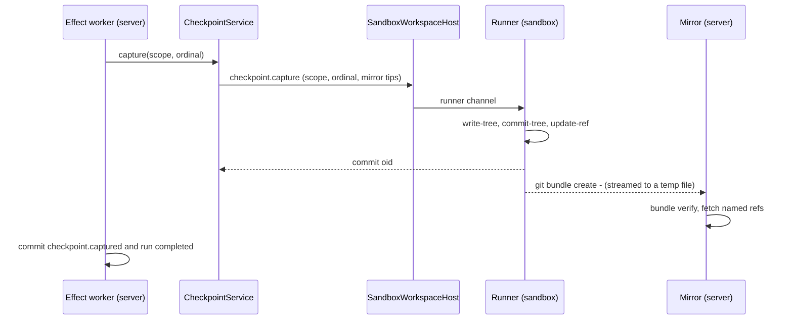

# 07 Access and data

Status: proposal, 2026-11-06. Nothing here is built. Read the [plan](./README.md) first.

This page covers what people and agents do with a cloud thread's data: checkpoints and diffs,
restore and fork, pull requests, terminals, previews, files, SSH, moving a thread between local and
cloud, and what happens to all of it when a thread ends. It also covers what stays readable while
the sandbox sleeps. The runner's wire protocol is [03](./03-runner.md). Sandbox states, sleep and
wake are [04](./04-sandbox-lifecycle.md). Credentials are [06](./06-credentials-and-security.md).
Contract shapes are [08](./08-clients-and-contracts.md).

Statements marked (inferred) are our reading, not something verified in code or vendor docs.

## Summary

- The server pulls checkpoints into a bare **mirror** per project as `git bundle` streams. Cloud diffs always read the mirror.
- A **sleep snapshot** in the mirror backs the read-only file browser, "Continue locally" while asleep, and rebuilding a discarded disk.
- Restore, revert and rewind wake the sandbox. Forks and side chats share the source's sandbox from M1.
- Git runs in the sandbox and forge calls run on the server. PR discovery never wakes a sandbox.
- Terminals keep their history on the server. Previews reach sandbox `localhost` through a server proxy and a runner tunnel.
- SSH (M4) goes through the server to sshd in the sandbox. Moving a thread (M4) carries files and refs, and uses a portable handoff.

## 1. Checkpoints and the mirror

### How checkpoints work today

A checkpoint is a commit object on a hidden ref. It is not on the user's branch.

- [GitVcsDriver.ts](../../../apps/server/src/vcs/GitVcsDriver.ts) `captureCheckpoint` builds a temp
  index in the repo's common git dir and adds the whole working tree to it, including untracked
  files that aren't ignored. Then it runs `write-tree`, `commit-tree -p HEAD`, and `update-ref`. With
  HEAD as the parent, `listAuthoredPaths` can tell the agent's edits from a pull or a rebase.
- [CheckpointService.ts](../../../apps/server/src/orchestration-v2/CheckpointService.ts) names the
  refs `refs/t3/orchestration-v2/checkpoints/<scope key>/ordinal/<n>`. The scope key is a hash of the
  scope id. It serializes all work on one `cwd` with a keyed lock and computes each turn's file
  summary (numstat minus git imports) when it captures.
- [CheckpointCaptureService.ts](../../../apps/server/src/orchestration-v2/CheckpointCaptureService.ts)
  is an effect-worker step. It runs after the provider turn ends, then commits `checkpoint.captured`
  and marks the run completed. The file summary travels in the event, so the timeline's file list
  never needs git again.
- [CheckpointDiffQuery.ts](../../../apps/server/src/checkpointing/CheckpointDiffQuery.ts) serves
  turn and full-thread diffs. It finds the two refs from the projection, then runs `diff` and `log`
  on the two commits with the scope's `cwd`. It needs no working tree.
- [CheckpointRollbackService.ts](../../../apps/server/src/orchestration-v2/CheckpointRollbackService.ts)
  rolls the provider conversation back, runs `restoreCheckpoint` (`git restore --source`, `git
  clean -fd`, `git reset`) in the working tree, deletes the now-stale refs, and marks them `stale`.
- [CheckpointRestoreSafety.ts](../../../apps/server/src/orchestration-v2/CheckpointRestoreSafety.ts)
  refuses a file restore when another thread shares the checkout. It decides that by calling
  `realPath` on local paths.

Worktree threads write their refs into the project's shared object store. Nothing deletes a
thread's refs except a rollback, so they pile up for good (verified: `deleteCheckpointRefs` has no
other caller).

In a cloud thread, the same code runs on the server, and its git commands run in the sandbox
through the workspace host ([02](./02-workspace-host.md)). The refs and objects then live only on
the sandbox's disk. The mirror puts a copy on the server.

### Where the mirror lives

One bare repo per project at `<stateDir>/sandbox/mirrors/<projectId>.git`. `stateDir` is the same
userdata folder that holds `attachments` and the database ([config.ts](../../../apps/server/src/config.ts)).

| Ref in the mirror | Written when | Used by |
| ----------------- | ------------ | ------- |
| `refs/t3/orchestration-v2/checkpoints/...` | After each capture, under its original name | Diffs, restore previews, moving threads |
| `refs/t3/sandbox/<threadId>/branch` | After each capture and each push | Bring it local, rebuilding a sandbox, PR head context |
| `refs/t3/sandbox/<threadId>/snapshot` | Before sleep, and at "Continue locally" | The read-only file browser, bring it local, rebuild |

Checkpoint refs keep their original names. Scope keys are already unique per scope, so threads can't
collide, and the diff code can use the names it computes today. Branches go under the thread's own
namespace because two threads can use the same branch name.

Seed a new mirror with `git clone --bare --local` from the project's checkout on the server. That
hardlinks the existing objects, so the first sync from a sandbox carries only what the sandbox
added (inferred: true for any repo cloned from the same origin). Don't use `alternates`. A `git gc`
in the user's checkout could then prune objects the mirror still points to. Set
`transfer.fsckObjects=true` in the mirror, because its input comes from an agent-controlled
machine.

### Push from the sandbox, or pull by the server?

| | Sandbox pushes | Server pulls a bundle (chosen) |
| --- | --- | --- |
| Trigger | The server must tell the runner when to push. The server already knows, because it ran the capture. | The server runs the sync in the same effect that captured. |
| Server surface | A receive-pack endpoint, auth by sandbox token, and a hook that keeps each sandbox in its own ref namespace. | None. The runner's existing channels carry the bundle. |
| Trust | An agent-controlled machine writes refs into server storage. | The server picks which refs to take. The sandbox only produces bytes. |
| Negotiation | Native have/want. | The server passes the mirror's tips as prerequisites (`^<oid>`). It knows them because it owns the mirror. |
| Runner work | A git transport on the runner socket, or a git URL on the server for the sandbox to push to. | Part of the checkpoint capture coarse operation (plan decision 2). |

Pull wins on every row except negotiation. Negotiation is easy here: the server knows exactly what
the mirror has for this thread.

The sync, in order:

1. Checkpoint capture is a coarse runner operation from M1 (plan decision 2). It runs today's
   capture code in the sandbox, returns the commit oid, then streams
   `git bundle create - <checkpoint refs of this capture> <branch> ^<mirror tips>`. `-` writes the
   bundle to stdout
   ([git-bundle](https://git-scm.com/docs/git-bundle)). The prerequisites are the previous checkpoint
   of each scope and the branch tip the mirror already holds.
2. Stream stdout into a temp file on the server, with a size cap (default 512 MiB).
3. `git bundle verify` against the mirror. If a prerequisite is missing, for example after a
   rollback deleted refs and the sandbox pruned objects, retry once with fewer prerequisites, then
   with none.
4. `git fetch <file> <explicit refspecs>` into the mirror. Use `--prune` only within the thread's
   own checkpoint names, which the server computes from the projection.

**The sync runs inside the capture effect, before `checkpoint.captured` commits**, with a 15-second
bound. A client that sees a checkpoint can then read its diff from the mirror. If the sync fails or
times out, the checkpoint still commits as `ready`. A drainable retry worker syncs it later, and the
diff reader falls back to the sandbox if it is awake. The wait happens after the provider turn has
ended, so the recorded provider duration doesn't grow
([overview](../../internals/overview.md#turn-completion-and-checkpoints)). It does delay the
`completed` status by the sync time. Measure it in M1. If p95 goes over one second, commit first and
sync after.

Rollback also syncs: after `deleteStaleRefs`, the server deletes the same refs in the mirror.

### Which reads use the mirror

Rule: **for a cloud thread, checkpoint reads resolve the git directory from where the thread runs
now, not from `scope.cwd`.** A thread with a `sandboxId` (plan decision 7) reads the mirror. Local and worktree threads read the
thread's worktree or the project root, which share one object store. Moving a thread copies its refs
across (section 8), so this rule needs no new field on checkpoint scopes.

Today's checkpoint store finds a repo with `rev-parse --is-inside-work-tree --show-toplevel`, which
fails in a bare repo. Add a `MirrorCheckpointReader` that runs the same `diff` and `log` arguments
with `git --git-dir=<mirror>`. `diffCheckpoints`, `listAuthoredPaths` and `hasCheckpointRef` only
compare commits, so the arguments don't change.

| Read | Source today | Cloud, awake | Cloud, asleep |
| ---- | ------------ | ------------ | ------------- |
| Turn and full-thread diff ([CheckpointDiffQuery.ts](../../../apps/server/src/checkpointing/CheckpointDiffQuery.ts)) | Worktree git | Mirror | Mirror |
| Timeline file list per turn | The event payload | Same | Same |
| Restore preview (files a restore would change) | Worktree git | Mirror: target vs latest checkpoint | Mirror: target vs sleep snapshot |
| Uncommitted changes and branch status ([VcsStatusBroadcaster.ts](../../../apps/server/src/vcs/VcsStatusBroadcaster.ts)) | Live git and a remote poller | Sandbox | The last status before sleep, labeled. No polling. |
| PR list, PR file views, viewed-file marks ([PullRequestService.ts](../../../apps/server/src/pullRequest/PullRequestService.ts), [pullRequestViewedFiles.ts](../../../apps/server/src/pullRequest/pullRequestViewedFiles.ts)) | Forge API, with the project root as `cwd` | Unchanged | Unchanged |
| Review guide ([PullRequestReviewGuideService.ts](../../../apps/server/src/pullRequest/PullRequestReviewGuideService.ts)) | Fetches into the project root | Unchanged | Unchanged |
| PR discovery for the thread's branch | Git state in the worktree, plus the forge | Sandbox, plus the forge | The head context saved at the last sync, plus the forge |
| File browser and search | Disk | Sandbox | The mirror's snapshot tree, read-only |
| Terminal scrollback | Server history | Server history | Server history, read-only |

Opening a thread wakes its sandbox ([04](./04-sandbox-lifecycle.md#2-idle-policy-and-wake-triggers)),
so the asleep column matters while it wakes, on surfaces that don't wake it (the sidebar, diffs,
search), and after a disk is discarded.

**Docker in M1.** Sleep and snapshot browsing are M2, but a Docker sandbox already stops in M1,
through `sandbox.sleep`, once every attached thread is settled or archived ([04](./04-sandbox-lifecycle.md)).
While it is stopped, diffs read the mirror, file reads use the mirror's latest checkpoint ("As of
turn 7"), writes are refused, and terminals show exited.

Pull request views already read through the forge with the project's own checkout on the server.
They never touched a thread's worktree, so they need nothing new.

**Cloud-only mode (M4) still keeps a git checkout per project on the server.** PR views, the review
guide and repository identity run git in `project.workspaceRoot`
([PullRequestService.ts](../../../apps/server/src/pullRequest/PullRequestService.ts),
[PullRequestReviewGuideService.ts](../../../apps/server/src/pullRequest/PullRequestReviewGuideService.ts)).
"No agent runs on the team server's machine" therefore doesn't mean "no repo on it". Recommend
keeping the project checkout as data that no agent writes to. Making the mirror serve those reads
instead is possible but touches every PR code path. Previews follow section 5 from M2; whether the server's browser may load
agent-served pages in cloud-only mode is a maintainer decision at M4.

## 2. Restore, revert and fork

**Restore and revert.** In a cloud thread, `CheckpointRollbackService.execute` and its file restore
run unchanged through the workspace host. The only addition is a guard in front:

- If the sandbox is `ready`, run.
- If it is `sleeping`, `waking` or `provisioning`, send a wake request and park the rollback effect
  until the sandbox's `ready` event. A prompt sent to a sleeping thread already waits this way
  ([04](./04-sandbox-lifecycle.md)).
- If it is `failed` or `destroyed`, fail with "The machine is gone. Retry or discard it first."

"Rewind the conversation without restoring files" (`restoreFiles: false`) also wakes the sandbox.
The provider session it rolls back, such as Claude's session file under `~/.claude`, lives in the
sandbox (inferred from where the adapter spawns the CLI).

Two server-side checks in the rollback path touch the local disk directly. Plan decision 3 puts
them behind the workspace host in M0:

- `isCheckpointRestoreIsolated` calls `fileSystem.realPath` on `scope.cwd` and on other threads'
  worktrees. For cloud threads, it should compare sandbox ids first, then paths inside that sandbox.
- Re-creating a missing worktree (`fileSystem.exists(worktreePath)`) means nothing for a sandbox.
  If the checkout is gone, the sandbox is rebuilt from the mirror (section 9).

**Fork.** Today a fork copies the source's `worktreePath` and `branch` and runs in the same checkout
([ThreadForkService.ts](../../../apps/server/src/orchestration-v2/ThreadForkService.ts); its test
asserts `targetThread.worktreePath === sourceThread.worktreePath`). A side chat exists precisely to
share the parent's worktree (the `orchestrationV2WorktreePending` guard in
[Orchestrator.ts](../../../apps/server/src/orchestration-v2/Orchestrator.ts)).

| Fork kind | Cloud behavior | Milestone |
| --------- | -------------- | --------- |
| Side chat | Shares the source's sandbox. Its turns wake it through the owning thread's stream. | M1 |
| Fork from a run | Shares the source's sandbox, matching local semantics. | M1 |
| "Fork to a new machine" | A new sandbox starts from the mirror at the source run's checkpoint, on a new branch. | M2 |

Sharing follows plan decision 6. The fork or side chat references its source's sandbox. Wake,
sleep and discard go to the owning thread's stream, and the sandbox is destroyed only when no thread
uses it. [04](./04-sandbox-lifecycle.md) owns the record, including what happens when the owning
thread is deleted while others still use the sandbox. Restore safety treats two threads on one
sandbox and one `cwd` as shared, which is today's rule.

## 3. Pull requests

Where each step runs today, and in a cloud thread:

| Step | Code | Cloud thread |
| ---- | ---- | ------------ |
| Commit (UI "Commit") | `GitManager.runStackedAction` with git in `cwd` ([GitManager.ts](../../../apps/server/src/git/GitManager.ts)) | Sandbox, through the workspace host. Authorship follows [decisions](../decisions.md#git-and-github). |
| Push | `pushCurrentBranch` with `git push` in `cwd` | Sandbox. The credential helper asks the server for a one-hour GitHub App token ([06](./06-credentials-and-security.md)). Then sync the branch ref to the mirror. **GitHub only until the server's git proxy lands in M3** (plan decision 10). Other hosts can commit but not push. |
| PR text | `readRangeContext`, the template, then text generation | Git reads in the sandbox. Generation on the server. |
| Create the PR | `createChangeRequest` is a REST POST from the server ([GitHubSourceControlProvider.ts](../../../packages/source-control-github/src/server/GitHubSourceControlProvider.ts)). The body file is in the server's temp dir. | Unchanged. Runs on the server as the connected member or the server. |
| Agent runs `gh pr create` | In the agent's shell | Sandbox, with the agent's git credential, never the owner's GitHub token |
| Discovery and linking ([ThreadPullRequestService.ts](../../../apps/server/src/orchestration-v2/ThreadPullRequestService.ts)) | `branchPullRequest` reads `for-each-ref`, remotes and config in `cwd`, then asks the forge | Awake: unchanged. Asleep: see below. |

**Discovery must never wake a sandbox.** The service sweeps unsettled threads every minute, and it
also checks whether `<worktreePath>/.git` exists with the server's own filesystem. Neither works for
a sandbox. While a sandbox sleeps, its git state can't change. So at each mirror sync, also store the
thread's head context: branch, upstream, remote URLs and head sha. Discovery for a sleeping cloud
thread uses that record and asks only the forge. The `.git` existence check moves behind the
workspace host.

## 4. Terminals

The [terminal manager](../../../apps/server/src/terminal/Manager.ts) owns sessions, bounded history
(5,000 lines, 8 MiB) and the history files under `terminalLogsDir`. The
[output protocol](../../../apps/server/src/terminal/OutputProtocol.ts) windows chunks to each client
(8 chunks or 64 KiB in flight). In a cloud thread, only the PTY moves:

- `PtyAdapter.spawn` goes through the workspace host to a runner PTY channel
  ([03](./03-runner.md)). Manager, history, snapshots, viewers and the client protocol stay as they
  are, so web, desktop and mobile change nothing to see a cloud terminal.
- The runner-to-server PTY channel needs its own flow control with the same budget as the client
  window. Otherwise one `cat` of a big file fills the socket that also carries provider stdio.
- Subprocess detection polls the process table about once a second, and terminals register their
  PIDs with port discovery. Both must read the sandbox's process table, which is a coarse runner
  operation from M1 (plan decision 2). The server must not run `ps` on itself.

**While asleep.** Sleep kills the PTYs. The manager marks each session exited, with a reason the
client can show: "Stopped when the machine slept at 14:02". Attaching with `resume` shows the
scrollback. `write` and `resize` fail with a typed `SandboxAsleep` error, and the client shows a
read-only banner, "This machine is asleep", with **Wake**. Conductor's cloud terminals are read-only while asleep too.
Contract: today's `TerminalSessionStatus` is a strict literal union
([terminal.ts](../../../packages/contracts/src/terminal.ts)). Add an optional `stoppedBy` field, not
a new status, so older clients still decode it ([08](./08-clients-and-contracts.md)).

**After waking.** Nothing restarts by itself. The next attach with `restartIfNotRunning`, or the
first keystroke, starts a new shell in the same `cwd`. Before it starts, the server writes a divider
into history ("Machine woke at 15:10. Earlier processes were stopped."). That line is history only
and never goes to the shell, which keeps the replay rule in
[terminal runtime](../../internals/terminal-runtime.md). Viewing a sleeping thread's terminal
doesn't wake it. Typing or pressing **Wake** does. Opening the thread itself wakes the sandbox
([04](./04-sandbox-lifecycle.md#2-idle-policy-and-wake-triggers)).

## 5. Previews and ports

Today [PortScanner.ts](../../../apps/server/src/preview/PortScanner.ts) polls listeners on the
server's host every 3 seconds with `lsof` or `/proc`. It credits each listener to a thread through
the `T3CODE_THREAD_ID` variable in the process environment. Remote clients see previews by streaming
the server's own headless browser ([ServerBrowser.ts](../../../apps/server/src/preview/ServerBrowser.ts),
[remote access](../../user/remote-access.md#browser-on-a-remote-environment)). The desktop app draws
its own environment's tabs in an Electron view over CDP
([DesktopBrowserChannel.ts](../../../apps/server/src/preview/DesktopBrowserChannel.ts)).

**Detection.** Port listing (`ports.listeners`) is a coarse runner operation that lands in M1
(plan decision 2). Previews and stopping servers use it from M2. The runner pushes listener changes (port, pid,
command) on a watch channel, so an idle sandbox sends nothing. Every listener in a sandbox belongs to
that sandbox's threads, so the environment-variable trick isn't needed there. Stopping a listed
server signals its process group through the runner. A sleeping sandbox lists no ports. A preview
that was open shows "Stopped while asleep" with **Restart**, which wakes the sandbox and reruns the
project script that started it.

**Reaching the port. Clients never connect to a sandbox, and the sandbox never connects to a
client.** Tunnel bytes ride the runner's own outbound connection to the team server (plan decision
4), and clients see only the server's origin. That holds over LAN, Tailscale and T3 Connect alike.

1. The server runs a loopback HTTP proxy that accepts plain requests and `CONNECT`. Requests to
   `localhost`, `127.0.0.1` or `[::1]` open a runner TCP tunnel to the same port inside the sandbox.
   Other hosts go direct from the server, as they do for local threads today.
2. A cloud thread's tabs use a browser context with `proxy: { server, bypass: "<-loopback>" }`.
   Playwright supports a proxy per context ([Playwright](https://playwright.dev/docs/api/class-browser#browser-new-context-option-proxy)).
   Chromium skips the proxy for loopback unless the bypass list includes `<-loopback>`
   ([Chromium proxy docs](https://chromium.googlesource.com/chromium/src/+/HEAD/net/docs/proxy.md)).
   The page keeps `http://localhost:3000` as its URL, so the app sees the Host header and origin it
   expects. OAuth callbacks registered for localhost keep working.
3. Persistent contexts are per profile, but `contextFor(profileId, isolationKey)` already creates
   isolated, non-persistent contexts
   ([ServerBrowserContexts.ts](../../../apps/server/src/preview/ServerBrowserContexts.ts), used by
   [ServerBrowser.ts](../../../apps/server/src/preview/ServerBrowser.ts)). Cloud tabs pass the
   `sandboxId` as the isolation key, and `createContext` adds the proxy option for them. Seeding
   that context from the profile's storage state is optional (inferred workable; try it in the M2
   spike).
4. The desktop app shows cloud tabs the way other devices do: streamed from the server browser. A
   per-partition proxy in Electron could come later. It isn't needed for parity.

Agents get the same tabs through the existing MCP preview tools, so "agent preview tools" need no
cloud-specific code. An agent's own `curl localhost:3000` runs inside the sandbox and needs nothing
at all.

**Ports on a member's own machine** (Conductor's "forward ports") come with SSH in M4:
`ssh -L 3000:localhost:3000 t3-<thread>`, or the editor's port forwarding. There are no public
preview URLs.

## 6. Files and attachments

**File browser and search, awake.** [WorkspaceFileSystem.ts](../../../apps/server/src/workspace/WorkspaceFileSystem.ts)
reads and writes through the workspace host's file channel. [WorkspaceSearchIndex.ts](../../../apps/server/src/workspace/WorkspaceSearchIndex.ts)
scans with the native `fff-node` finder, which watches files and holds up to 25,000 entries. Walking
that over the socket file by file is plainly too slow. The index runs in the runner as a coarse
operation from M1 (plan decision 2): `search.entries`, `search.contents` and `entries.browse`
([03](./03-runner.md#46-coarse-operations)). The runner's index watches files itself, so refresh
needs no separate operation. The runner bundle carries `fff-node`'s Linux binary
([03](./03-runner.md#21-same-build-slim-entry)). These RPCs are keyed by `cwd`
([KnownWorkspaces.ts](../../../apps/server/src/workspace/KnownWorkspaces.ts)), which stays unique
because sandbox checkouts live under 02's reserved root, `/t3-sandbox/<sandboxId>/`
([02](./02-workspace-host.md#3-how-a-thread-finds-its-host)).

**Asleep.** The server reads the mirror's `refs/t3/sandbox/<threadId>/snapshot` tree:

| Operation | Asleep implementation |
| --------- | --------------------- |
| List and name search | `git ls-tree -r -z --name-only <snapshot>`, filtered in memory, capped at 25,000 like today |
| Read a file | `git cat-file blob <snapshot>:<path>`, with the existing byte cap and binary check |
| Content search | `git grep -z --max-count=100 <snapshot>` within the existing 250 ms time budget |
| Ignored files (`.env`, `node_modules`) | Not available. The snapshot follows `.gitignore`. |
| Write | Refused with `SandboxAsleep`. The editor says "This machine is asleep" and shows **Wake**. |

The header says "As of 14:02, when the machine slept". If no snapshot exists, because sleep came
from a crash or a driver timeout, it uses the latest checkpoint and says "As of turn 7".

**Attachments.** Uploads land on the server under `attachmentsDir`
([attachmentStore.ts](../../../apps/server/src/attachmentStore.ts)), and
[AttachmentClaims.ts](../../../apps/server/src/orchestration-v2/AttachmentClaims.ts) moves them to
the thread. Adapters give the provider two things: image bytes, read on the server, and a text line
with the file's server path ([attachmentPrompt.ts](../../../packages/provider-core/src/server/attachmentPrompt.ts)).
Claude also gets `attachmentsDir` as an extra directory
([ClaudeAdapterV2.ts](../../../apps/server/src/orchestration-v2/Adapters/ClaudeAdapterV2.ts)).
An agent in a sandbox can't open a server path. So:

- Before the provider turn starts, the turn-start effect copies the message's attachments, and their
  extracted `.txt` files, into the sandbox at `$HOME/.t3/attachments/<thread segment>/<file>`. The
  copy is idempotent: skip a file whose id and size already match.
- For cloud threads, `resolveAttachmentPath` returns the sandbox path, and Claude's extra directory
  is the sandbox's attachments folder. Image bytes are still read on the server.
- Files the agent makes and the server reads by path, such as local images inlined by
  [HtmlRender.ts](../../../apps/server/src/htmlRender/HtmlRender.ts), go through the workspace host
  while awake and the mirror while asleep. A path outside the repo shows as unavailable.

## 7. SSH and open in editor (M4)

**Design.** sshd runs in the sandbox, bound to `127.0.0.1:22`. It has no inbound port. The team
image includes it (see [05](./05-team-images.md)).

- **Setup.** In Settings → Cloud → Access, a member registers SSH public keys, as
  [01](./01-product.md#6-settings-and-information-architecture) proposes. On their computer they run
  `t3 ssh setup <server>`. It pairs that computer with the existing sign-in link and code flow,
  stores a device credential scoped only to the SSH tunnel endpoint, uploads `~/.ssh/id_ed25519.pub`
  if no key is registered, and writes `Include ~/.t3/ssh/config` with
  `Host t3-*` and `ProxyCommand t3 ssh proxy %h`. The desktop app does this itself from its existing
  session.
- **Auth inside.** sshd's `AuthorizedKeysCommand` asks the runner, which asks the server over the
  runner socket, for the registered keys of active members. Removing a key or a member takes effect
  on the next connection, with no file to rewrite in every sandbox. We considered certificates from a
  per-team CA. They need a signing step on every computer, and live lookup already gives revocation.
- **Open in editor.** [editor.ts](../../../packages/contracts/src/editor.ts) already builds
  `vscode://vscode-remote/ssh-remote+<host><path>`, Cursor and Zed URLs, and JetBrains Gateway URLs
  for remote environments (`RemoteOpenTarget` is `tailscale` or `mdns`). Add a `sandbox` target
  (the menu says "Open machine in VS Code") whose host is `t3-<thread id>` and whose path is the
  thread's checkout. Gateway reading
  `ProxyCommand` from the SSH config is inferred, so test it in M4. Mobile shows "Open on a
  computer".
- **Server role.** Every SSH byte crosses the server, so the server can cut a member's tunnels when
  they are removed, when the sandbox sleeps or is discarded, or when an admin turns SSH off.
- **Activity.** An open SSH tunnel counts as terminal activity for the idle policy
  ([04](./04-sandbox-lifecycle.md)). Connecting to a sleeping sandbox wakes it. The proxy prints
  "Waking machine..." on stderr and waits up to 90 seconds.
- **No agent forwarding.** The agent shares the sandbox's user, so a forwarded agent would hand the
  member's keys to it. Port forwarding stays on, because VS Code Remote-SSH depends on it. VS Code
  and Cursor download their server into the sandbox, which needs egress to their CDNs
  ([06](./06-credentials-and-security.md)).

**Who may SSH into whose thread.** Any active member, into any cloud thread's sandbox. Anyone may
already prompt any thread and open its terminal ([decisions](../decisions.md#threads)), so SSH adds
no new reach. Admins get one team switch, "Allow SSH into machines", on by default. Guests,
guest links, API tokens and the sandbox token can never open a tunnel. An open SSH session shows in
presence as viewing the thread. It gets no timeline row.

| | Conductor | Codespaces | Pair |
| --- | --- | --- | --- |
| Path | Through Conductor. The mechanism isn't documented. Port 22 is reserved. | `gh codespace ssh` through GitHub. `--config` writes SSH config for editors and `scp`. | `t3 ssh proxy` through the team server and a runner tunnel |
| sshd | Provided | Must run in the container (the default image or the `sshd` feature) | In the team image |
| Keys | Not documented | `gh` creates a key in `~/.ssh` | Member keys registered with the team server, checked live |
| Inbound port on the machine | Not documented | None (inferred) | None |
| Self-hostable | No | No | Yes, including BYOC |

## 8. Moving threads between local and cloud (M4)

Both directions are blocked while a run is active. The menu says why. Any member can start a move,
because a thread's mode is shared state ([01](./01-product.md#rules-that-stay-unchanged)). The
timeline gets "Continued in cloud" or "Continued locally" in team mode.

| Item | Moves? | How |
| ---- | ------ | --- |
| Branch and commits, pushed or not | Yes | Through the mirror |
| Uncommitted and untracked files | Yes | A snapshot commit made with the checkpoint capture code, then `restoreCheckpoint` on the other side |
| Ignored files (`.env`, `node_modules`, build output) | No | The project setup script recreates them, as it does for any new worktree or sandbox |
| Checkpoint refs | Yes | Copied by exact name, so earlier diffs keep working |
| Transcript, approvals, PR links, owner, account | Yes | They are on the server. Nothing moves. |
| Provider session | Context only | A [portable handoff](../../user/portable-handoffs.md) starts a fresh session. Native sessions are files keyed by machine and absolute `cwd` (inferred), so moving them waits until someone asks. |
| Terminals | No | Closed. Scrollback stays visible as exited. |
| Running processes and previews | No | Stopped. Rerun them after the move. |

**Continue in cloud** (local or worktree thread, then sandbox):

1. Capture a snapshot of the checkout into `refs/t3/sandbox/<threadId>/snapshot` in the project repo.
2. Fetch the branch, the snapshot and the thread's checkpoint refs from the project repo into the
   mirror. This is a local fetch, so it's fast.
3. Create the sandbox ([04](./04-sandbox-lifecycle.md)). When the runner connects, bundle the same
   refs from the mirror, write the bundle into the sandbox through the file channel, `git fetch` it,
   check out the branch and restore the snapshot. Then run the setup script.
4. Commit the move: the thread gains its `sandboxId`. The next prompt starts a fresh provider session with the handoff.
5. After the sandbox's tree matches the snapshot's tree hash, remove the local worktree. Keep its
   branch. If the thread used the project root ("local" mode), leave the root alone.

**Continue locally, on the team server** (sandbox, then worktree):

1. If the sandbox is awake, capture a snapshot and sync it. If it is asleep, use the existing sleep
   snapshot without waking it, as [01](./01-product.md#j9-bringing-a-cloud-thread-local-and-sending-a-local-thread-to-cloud)
   promises.
2. Fetch the branch, the snapshot and the checkpoint refs from the mirror into the project repo.
   Create the worktree on the branch, then `restoreCheckpoint` from the snapshot.
3. Commit the move: the thread drops its `sandboxId` and gets the worktree. The sandbox goes to sleep and follows retention. Discard it at once only
   if the person asks.

**Continue locally, on a member's own machine.** That machine is a different environment with its
own event store. A thread can't move between stores (plan decision 2). Instead:

1. The member's desktop app, connected to both servers, asks the team server for a bundle of the
   branch and snapshot. It is a new read RPC, streamed over the existing connection, so it works over
   LAN, Tailscale and T3 Connect. The prerequisite is the default branch's tip, which the local repo
   most likely has. If it doesn't, the full history is sent.
2. The app hands the bundle to its local server. That server creates a worktree and a new thread
   whose first message is a portable handoff linking back to the cloud thread.
3. The cloud thread settles and its sandbox sleeps. History stays on the team server.

This pushes nothing to the forge and works for branches that were never pushed.

## 9. Retention and deletion

What each event does. "Disk" means a stopped sandbox's disk or the driver's saved snapshot
([04](./04-sandbox-lifecycle.md) owns the mechanics). "Mirror refs" means the thread's checkpoint,
branch and snapshot refs. A sandbox shared by forks and side chats is destroyed only when no thread
uses it; until then, events on one thread change only that thread's use of it
([04](./04-sandbox-lifecycle.md) owns the record).

| Event | Running sandbox | Disk and driver snapshots | Mirror refs | Terminal history and attachments |
| ----- | --------------- | ------------------------- | ----------- | -------------------------------- |
| Archive | Sleeps now, unless another thread sharing it is running a turn | Kept, then discarded after 04's retention period | Kept | Kept |
| Unarchive | Stays asleep until something wakes it | If discarded, rebuilt from the mirror on wake | Kept | Kept |
| Settle | Sleeps now ([04](./04-sandbox-lifecycle.md#2-idle-policy-and-wake-triggers)) | Discarded after the settled period, or on merge if that rule is on | Kept | Kept |
| Delete (owner or admin) | Destroyed only when no thread uses it | Destroyed with the sandbox | Deleted now. Pruned by the next maintenance run. | Deleted as today ([ThreadDeletion.ts](../../../apps/server/src/orchestration-v2/ThreadDeletion.ts)) |
| Assign to someone else | Unchanged. Caps and usage go to the new owner from now on. | Unchanged | Unchanged | Unchanged |
| Owner removed | Sleeps now, and the removed member's SSH tunnels close. The thread's account may be disabled, so no new turn runs on it. | Normal retention | Kept, so a reassigned thread resumes | Kept |
| Project removed | Destroyed | Destroyed | The project's mirror is deleted | As today |
| Machine failed | Stays failed. **Retry** or **Discard**. | Discard destroys it | Kept. Retry can rebuild from it. | Kept |

**Rebuilding from the mirror.** If a thread's disk is gone, waking it creates a new sandbox from the
team's active image build (its current `imageBuildId`), fetches the branch and snapshot from the mirror, restores the snapshot and reruns the
setup script. The header says "Rebuilt from the snapshot of 14:02". Ignored files and caches are
lost. This is what makes discarding disks safe and cheap. It also covers drivers that have no
persistent disk.

**Settings.** Reuse the worktree cleanup rules for sandbox disks rather than inventing new ones
([WorktreeCleanupRules](../../../packages/contracts/src/settings.ts),
[storageCleanup.ts](../../../apps/server/src/storageCleanup.ts)). A disk is the cloud form of a
worktree. The cloud defaults (sleep, discard after archive, discard after a long sleep) are
[04's](./04-sandbox-lifecycle.md#2-idle-policy-and-wake-triggers); this doc only applies them through
those rules. `worktreeKeepWhen: "uncommitted-changes"` doesn't hold a disk,
because the snapshot in the mirror already keeps those changes. The admin sets these in
Settings → Cloud → Compute, as [01](./01-product.md#6-settings-and-information-architecture) lists.

**Mirror upkeep.** Run `git maintenance run --auto` per mirror after syncs, at most once an hour. Show
each project's mirror size in Settings → Cloud → Overview. Deleted threads' refs are dropped, then
pruned by maintenance. Mirror refs follow the thread and are never on a timer, so diffs keep working
for as long as the thread exists. That is today's rule for local checkpoint refs.

**Where code rests.** The mirror is on the team server. In every BYOC tier the customer runs the team
server, so code stays in their account. In the optional managed tier, where Pair hosts the team
server, the mirror is customer code on Pair's machines. [09](./09-byoc.md) should say so.

## 10. Work breakdown

Each row is about one pull request.

| # | Milestone | Work |
| - | --------- | ---- |
| 1 | M0 | Route the direct local-disk checks behind the workspace host. That covers `realPath` in `CheckpointRestoreSafety`, `exists(worktreePath)` in rollback, and the `.git` existence check in `ThreadPullRequestService`. No behavior change. |
| 2 | M1 | Mirror store: create and seed a bare repo per project, set `fsckObjects`, delete it with the project. Tests for seeding and deletion. |
| 3 | M1 | Mirror sync: the bundle pull inside `CheckpointCaptureService`, with prerequisites, the size cap, the retry worker, ref deletion after rollback, and the head-context record. Tests: a missing prerequisite falls back, refs outside the request are ignored, and a rollback prunes. |
| 4 | M1 | `MirrorCheckpointReader`, and diff queries that resolve the git dir by placement. Tests on a bare repo. |
| 5 | M1 | Side chats and forks reference their source's sandbox in the rollback, restore-safety and file flows here, comparing by sandbox id. The shared record is [04](./04-sandbox-lifecycle.md)'s. |
| 6 | M1 | Terminals over the runner PTY channel: spawn, flow control, and process-table inspection through the runner. |
| 7 | M1 | Files: read and write through the file channel, and the search index as a runner operation. |
| 8 | M1 | Attachment staging into the sandbox, and sandbox paths in the Claude and Codex adapters. |
| 9 | M1 | Pull requests on GitHub: the push syncs the branch to the mirror, and other hosts show that push needs M3. Tests that PR creation runs on the server with git reads from the sandbox. |
| 10 | M1 | Delete and project removal destroy sandboxes and drop mirror refs. |
| 11 | M1 | `ports.listeners` in the runner. A stopped Docker sandbox: file reads from the latest checkpoint in the mirror, writes refused, terminals exited. |
| 12 | M2 | Sleep snapshot: a pre-sleep hook that captures and syncs the snapshot ref, with a timeout and a checkpoint fallback. |
| 13 | M2 | Asleep reads from the sleep snapshot: the file browser and search, labeled. |
| 14 | M2 | Terminals asleep: `stoppedBy`, read-only errors, the wake divider, restart on attach. |
| 15 | M2 | Restore, revert and rewind wake the sandbox and wait. Tests drain the effect worker through `waking` to `ready`. |
| 16 | M2 | Status and PR discovery never wake: frozen VCS status and a forge-only lookup from the head context. |
| 17 | M2 | Stopping listed servers through the runner, and preview tabs from `ports.listeners`. |
| 18 | M2 | The loopback preview proxy, per-sandbox browser contexts, and desktop cloud tabs streamed. Spike first: `<-loopback>` through Playwright's context proxy, and seeding storage state. |
| 19 | M2 | Retention: the worktree rules applied to disks with 04's defaults. |
| 20 | M2 | Rebuild from the mirror when a disk is gone. |
| 21 | M2 | Fork to a new machine. |
| 22 | M3 | Each newly supported provider: an attachment-path decision and a check that its rollback works in a sandbox. |
| 23 | M4 | SSH keys in Settings → Cloud → Access, and the SSH-scoped device credential. |
| 24 | M4 | The tunnel endpoint, `t3 ssh proxy`, `t3 ssh setup`, and the runner's `authorized-keys` command. Tests: a removed member is refused, and tunnels close on sleep. |
| 25 | M4 | The `sandbox` open target in editor.ts for VS Code, Cursor, Zed and JetBrains. |
| 26 | M4 | Continue in cloud. |
| 27 | M4 | Continue locally on the team server. |
| 28 | M4 | Continue locally on a member's machine: the bundle RPC and the desktop flow. |
| 29 | M5 | Measure sync and rebuild times over a WAN link to a customer VPC, and tune the bundle size cap. No new mechanism. |

## Open questions

1. **Should the mirror sync block `checkpoint.captured`?** Recommend yes, bounded at 15 seconds with
   a retry worker. Measure in M1, and switch to syncing after commit if p95 goes over one second.
2. **Should diffs of an awake cloud thread read the mirror or the sandbox?** Recommend the mirror,
   always. One code path, no socket round trips, and the same result asleep.
3. **Does a pre-sleep snapshot cost too much on big repos?** No: it is the capture every turn pays.
   Keep it, with capture's timeout and the latest checkpoint as fallback.
4. **A shared browser profile or a context per sandbox for cloud tabs?** Recommend a context per
   sandbox seeded from the profile, with no write-back. Revisit if people complain about losing
   logins.
5. **SSH: keys checked live, or certificates?** Recommend registered keys with
   `AuthorizedKeysCommand`. It gives live revocation with no CA and no per-computer signing.
6. **Which credential does `t3 ssh proxy` use?** API tokens are `/mcp` only
   ([decisions](../decisions.md#api-tokens)). Recommend a new device credential limited to the SSH
   tunnel endpoint, minted by the existing sign-in link flow and revoked with the member. Owned with
   [06](./06-credentials-and-security.md).
7. **Should moving a thread try to carry the native provider session?** Recommend no. Use the
   portable handoff until a team asks for more.
8. **How long should mirror refs live?** Recommend as long as the thread. Settled and archived
   threads still show diffs, and refs cost little next to disks.

## Challenges to the plan

None. The revised plan accepts this doc's earlier challenges: shared sandboxes for forks and side
chats in M1 (decision 6), a server pull into the mirror (decision 11), coarse operations from M1
(decision 2), and disk checks through the seam (decision 3).

## Sources

- [git-bundle](https://git-scm.com/docs/git-bundle): `create -` writes to stdout, prerequisites, `verify`.
- [Playwright `browser.newContext` proxy option](https://playwright.dev/docs/api/class-browser#browser-new-context-option-proxy)
- [Chromium proxy settings, implicit bypass and `<-loopback>`](https://chromium.googlesource.com/chromium/src/+/HEAD/net/docs/proxy.md)
- [`gh codespace ssh` manual](https://cli.github.com/manual/gh_codespace_ssh): `--config`, an SSH server is required, and keys are created in `~/.ssh`.
- [Using GitHub Codespaces with GitHub CLI](https://docs.github.com/en/codespaces/developing-in-a-codespace/using-github-codespaces-with-github-cli): the `sshd` feature requirement.
- [ssh-keygen(1), CERTIFICATES](https://man.openbsd.org/ssh-keygen#CERTIFICATES): the certificate alternative we considered.
- Conductor's access model: [Working with cloud workspaces](https://www.conductor.build/docs/cloud/working-with-cloud-workspaces), summarized in [conductor-cloud](../conductor-cloud.md#how-conductor-cloud-works).
