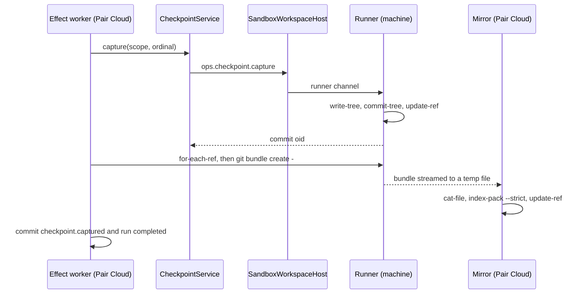
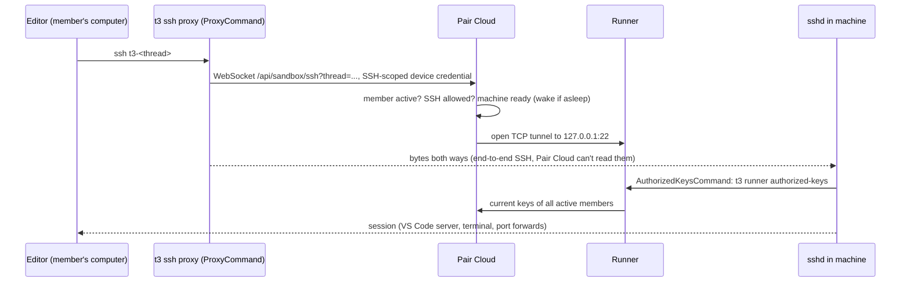

# 07 Access and data

Status: M0 and M1 landed; the rest is a proposal, rewritten 2026-11-08 for local-first Pair Cloud.
Read the [plan](./README.md) first.

This page covers what people and agents do with a cloud session's data on Pair Cloud: the Pair
Cloud project and its mirror, checkpoints and diffs, restore and fork, pull requests, terminals,
files, moving a session between a member's Mac and Pair Cloud, and what happens to all of it when a
thread ends. It also covers what stays readable while the machine sleeps. Previews, SSH and open in
editor are Later; their designs stay here for when they are picked up. The runner's wire protocol
is [03](./03-runner.md). Sandbox states, sleep and wake are [04](./04-sandbox-lifecycle.md).
Credentials are [06](./06-credentials-and-security.md). Contract shapes are
[08](./08-clients-and-contracts.md).

Statements marked (inferred) are our reading, not something verified in code or vendor docs.

## Summary

- A **Pair Cloud project** (M2) is a read-only checkout plus a bare **mirror**. No agent works in the checkout; it serves reads and is the base machines start from.
- Pair Cloud pulls checkpoints into the mirror as `git bundle` streams (M1, landed). Cloud diffs always read the mirror.
- A **sleep snapshot** in the mirror (M2) backs the read-only file browser, "Continue locally" while asleep, and rebuilding a discarded disk.
- Restore, revert and rewind wake the machine (M2). Forks and side chats share the source's machine (M1, landed).
- Git runs in the machine and forge calls run on Pair Cloud. PR discovery never wakes a machine.
- Terminals keep their history on Pair Cloud.
- Moving a session between a member's Mac and Pair Cloud (M3) carries a seed (bundle plus snapshot commit) and a context export, and creates a linked thread on the other server.
- Previews, SSH, open in editor and fork to a new machine are Later.

## 1. Checkpoints and the mirror

### How checkpoints work today

A checkpoint is a commit object on a hidden ref. It is not on the user's branch.

- [GitVcsDriver.ts](../../../apps/server/src/vcs/GitVcsDriver.ts) `captureCheckpoint` builds a temp
  index in the repo's common git dir, seeded from the user's index or HEAD, and adds the `cwd` tree
  (`add -A -- .`), including untracked files that aren't ignored. Then it runs `write-tree`,
  `commit-tree -p HEAD`, and `update-ref`. With HEAD as the parent, `listAuthoredPaths` can tell
  the agent's edits from a pull or a rebase.
- [CheckpointService.ts](../../../apps/server/src/orchestration-v2/CheckpointService.ts) names the
  refs `refs/t3/orchestration-v2/checkpoints/<scope key>/ordinal/<n>`. The scope key is a hash of the
  scope id, which embeds the thread id. It serializes all work on one `cwd` with an in-memory keyed
  lock and computes each turn's file summary (numstat minus git imports) when it captures.
- [CheckpointCaptureService.ts](../../../apps/server/src/orchestration-v2/CheckpointCaptureService.ts)
  is an effect-worker step. It runs after the provider turn ends, then commits `checkpoint.captured`
  and marks the run completed in one command. The file summary travels in the event, so the
  timeline's file list never needs git again. Side chats capture nothing (`forceMissing`).
- [CheckpointDiffQuery.ts](../../../apps/server/src/checkpointing/CheckpointDiffQuery.ts) serves
  turn and full-thread diffs. It finds the two refs from the projection, then runs `diff` and `log`
  on the two commits with the scope's `cwd`. Those arguments need no working tree, but they go
  through `CheckpointStore`, whose `VcsDriverRegistry` lookup does.
- [CheckpointRollbackService.ts](../../../apps/server/src/orchestration-v2/CheckpointRollbackService.ts)
  rolls the provider conversation back, runs `restoreCheckpoint` (`git restore --source`, `git
  clean -fd`, `git reset`) in the working tree, deletes the now-stale refs, and marks them `stale`.
- [CheckpointRestoreSafety.ts](../../../apps/server/src/orchestration-v2/CheckpointRestoreSafety.ts)
  refuses a file restore when another thread shares the checkout, at admission in the orchestrator
  and again in rollback.

Worktree threads write refs into the project's shared object store. Only a rollback deletes them
(`deleteCheckpointRefs` has no other caller; thread deletion leaves them), so they pile up for good.

In a cloud thread, the same code runs on Pair Cloud, and its git commands run in the machine
through the workspace host ([02](./02-workspace-host.md)). The refs and objects then live only on
the machine's disk. The mirror puts a copy on Pair Cloud.

### Where the mirror lives

Pair Cloud keeps two git repos per project, together called the Pair Cloud project (decision 16).
The mirror lives in the userdata folder that holds `attachments` and the database
([config.ts](../../../apps/server/src/config.ts)). Pair Cloud clones checkouts onto the same data
volume, so its hourly snapshots cover both.

| Part                                                             | What it is                                                                                                                 | Serves                                                                                                                                                                                                                                                                                                                                                              |
| ---------------------------------------------------------------- | -------------------------------------------------------------------------------------------------------------------------- | ------------------------------------------------------------------------------------------------------------------------------------------------------------------------------------------------------------------------------------------------------------------------------------------------------------------------------------------------------------------- |
| Checkout (`project.workspaceRoot`)                               | A normal clone of the repo. No agent, terminal or project script runs in it.                                               | PR views, the review guide and repository identity, which run git in the project root ([PullRequestService.ts](../../../apps/server/src/pullRequest/PullRequestService.ts), [PullRequestReviewGuideService.ts](../../../apps/server/src/pullRequest/PullRequestReviewGuideService.ts)); the origin URL a machine clones from; parsing `t3.json`; seeding the mirror |
| Mirror (`<stateDir>/sandbox/mirrors/<base64url(projectId)>.git`) | A bare repo that is never checked out ([CheckpointMirror.ts](../../../apps/server/src/sandbox/mirror/CheckpointMirror.ts)) | Checkpoints, each thread's branch and snapshot, and from M3 staged seeds                                                                                                                                                                                                                                                                                            |

**Adding a project (M2).** In Settings → Projects, or through `t3_project_clone` and
`t3_project_create` ([06](./06-credentials-and-security.md) section 10):

1. Accept only `https://github.com/...` URLs. Other hosts fail before any git runs.
2. Check that the member adding it can read the repo through their own GitHub connection. Everyone
   on Pair Cloud sees every project, so without the check an App installed across an organization
   would let any member pull in a repo they can't read.
3. Clone the checkout with the App's installation token, or the member's own credential where the
   App isn't installed ([06](./06-credentials-and-security.md)).
4. Run every git command on it with hardened config: no hooks, `protocol.allow` limited to https,
   `transfer.fsckObjects`, no submodule recursion, `core.fsmonitor` off, and no filter or diff
   drivers. Server git already sets `safe.bareRepository=explicit`
   ([VcsProcess.ts](../../../apps/server/src/vcs/VcsProcess.ts), `explicitBareRepositoryEnv`), and
   workspace git already turns off `core.fsmonitor` and `core.untrackedCache`
   ([GitVcsDriver.ts](../../../apps/server/src/vcs/GitVcsDriver.ts),
   `WORKSPACE_GIT_HARDENED_CONFIG_ARGS`).
5. Seed the mirror from the checkout.

Pair Cloud fetches the checkout before each launch, so the mirror's seed refs stay close to GitHub
and bundles stay small. A member's local project matches the Pair Cloud project with the same
origin key, `repositoryGroupingKeyOf` in [environment.ts](../../../packages/contracts/src/environment.ts),
which is also how the sidebar groups projects across servers.

Making the mirror serve the checkout's reads instead is possible but touches every PR code path, so
the checkout stays.

| Ref in the mirror                                 | Written when                                                                       | Used by                                                                  |
| ------------------------------------------------- | ---------------------------------------------------------------------------------- | ------------------------------------------------------------------------ |
| `refs/t3/seed/origin/*`                           | At every sync, fetched from the checkout's `refs/remotes/origin/*` (M1)            | Bundle prerequisites, so a machine's first sync sends only what it added |
| `refs/t3/orchestration-v2/checkpoints/...`        | After each capture, under its original name (M1)                                   | Diffs, restore previews, reads while the machine is stopped              |
| `refs/t3/sandbox/<thread>/branch`                 | After each capture and at the flush before stop (M1); with the sleep snapshot (M2) | Rebuilding a machine (M2), Continue locally (M3), PR head context        |
| `refs/t3/sandbox/<thread>/snapshot`               | Before sleep (M2), and at Continue locally (M3)                                    | The read-only file browser, Continue locally, rebuild                    |
| `refs/t3/sandbox/<thread>/head`                   | With the sleep snapshot (M2), a JSON blob                                          | PR discovery while the machine sleeps                                    |
| `refs/t3/staged/<command>/branch` and `/snapshot` | When a seed upload passes its checks (M3)                                          | The cloud launch that names it (section 8)                               |

`<thread>` is the base64url thread id (`sandboxThreadRefPrefix`). Checkpoint refs keep their original
names. Scope ids embed the thread id, and a fork gets its own scope, so threads can't collide, and
the diff code can use the names it computes today. Branches go under the thread's own namespace
because two threads can use the same branch name.

A new mirror is a `git clone --bare --local --template=` of the checkout, renamed into place when
done. That hardlinks the existing objects and leaves no hooks. Don't use `alternates`: a `git gc` in
the checkout could then prune objects the mirror still points to. The mirror's input comes from an
agent-controlled machine, and Git 2.43 skips `transfer.fsckObjects` when fetching a bundle
(tested), so imports go through `git index-pack --strict`. `safe.bareRepository=explicit` refuses
`git -C <bare repo>`, so every mirror command passes `--git-dir`.

### Push from the machine, or pull by the server?

|                | Machine pushes                                                                                               | Server pulls a bundle (chosen, built)                                                                      |
| -------------- | ------------------------------------------------------------------------------------------------------------ | ---------------------------------------------------------------------------------------------------------- |
| Trigger        | The server must tell the runner when to push. The server already knows, because it ran the capture.          | The server runs the sync right after the capture.                                                          |
| Server surface | A receive-pack endpoint, auth by sandbox token, and a hook that keeps each machine in its own ref namespace. | None. The runner's existing channels carry the bundle.                                                     |
| Trust          | An agent-controlled machine writes refs into server storage.                                                 | The server picks which refs to take. The machine only produces bytes.                                      |
| Negotiation    | Native have/want.                                                                                            | The server passes the mirror's tips as prerequisites (`^<oid>`). It knows them because it owns the mirror. |
| Runner work    | A git transport on the runner socket, or a git URL on the server for the machine to push to.                 | None: `process.run` streams the bundle after the capture coarse operation (decision 2).                    |

Pull wins on every row except negotiation. Negotiation is easy here: the server knows exactly what
the mirror has for this thread.

The sync, as built in M1 ([MirrorSync.ts](../../../apps/server/src/sandbox/mirror/MirrorSync.ts),
[MirrorSyncWorker.ts](../../../apps/server/src/sandbox/mirror/MirrorSyncWorker.ts)):

1. Checkpoint capture is a coarse runner operation (`ops.checkpoint.capture`,
   [runner.ts](../../../packages/contracts/src/runner.ts)). After it, the worker's `afterCapture`
   hook runs for threads whose `cwd` is in a machine.
2. The sync reads the thread's tips in the machine with `for-each-ref`: this capture's checkpoint
   refs and `refs/heads/<branch>`. It skips refs the mirror already holds at that oid.
3. It runs `git bundle create - <refs> ^<prerequisites>` through `process.run`
   ([03](./03-runner.md#46-coarse-operations)); `-` writes to stdout
   ([git-bundle](https://git-scm.com/docs/git-bundle)). Stdout streams into
   `<stateDir>/sandbox/tmp/<uuid>.bundle`, capped at 512 MiB. Prerequisites come in tiers: the
   previous ordinals, the mirror's branch tip and `refs/t3/seed/origin/HEAD`; then the seed ref
   alone; then none. "bad object" (the machine lacks a prerequisite, for example after a rollback
   deleted refs and the machine pruned objects) drops a tier. "Refusing to create empty bundle"
   means the mirror already has every object.
4. The import checks prerequisites with `cat-file --batch-check`, admits objects with
   `index-pack --strict --fix-thin`, then writes only server-chosen names with `update-ref --stdin`:
   checkpoint refs under their own names, and the branch as `<thread prefix>branch`. No `git fetch`,
   no `bundle verify`, no prune. Deletions come from rollback, below.

**The sync runs inside the capture effect, before `checkpoint.captured` commits**: in
`CheckpointCaptureService`, between the capture and `eventSink.commitCommand`. The effect worker
bounds no capture, so the sync carries its own 15-second bound. A client that sees a checkpoint can
then read its diff from the mirror. If the sync fails or times out, the checkpoint still commits as
`ready` and the thread stays pending. The worker retries pending threads every 30 seconds, seeds its
pending set at startup from threads on machines that aren't destroyed, and `sandbox.stop` flushes
it first. The diff reader falls back to the machine for refs a pending sync hasn't delivered. The
wait comes after the provider turn ends, so the recorded provider duration doesn't grow
([overview](../../internals/overview.md#turn-completion-and-checkpoints)). It does delay
`completed`, and the thread's next effect (such as the next turn's start), by the sync time. M2's
capacity load test runs a concurrent bundle among 30 machines; if the sync's p95 goes over one
second there, sync after the commit, in
[RunFinalizationService.ts](../../../apps/server/src/orchestration-v2/RunFinalizationService.ts).

A push doesn't sync anything: the branch reaches the mirror with the next capture, the flush before
stop, or the sleep snapshot (M2). Rollback also syncs: `afterRollback` deletes the same refs in the
mirror.

### Which reads use the mirror

Rule: **for a cloud thread, checkpoint reads resolve the git directory from where the thread runs,
not from `scope.cwd`.** A thread with a `sandboxId` (decision 7) reads the mirror. Local and
worktree threads read the worktree or the project root, which share one object store. A moved
session is a new thread on the other server (section 8), so the rule needs no new field on
checkpoint scopes.

The checkpoint store finds a repo through `VcsDriverRegistry`, whose
`rev-parse --is-inside-work-tree --show-toplevel --git-common-dir` fails in a bare repo. The git
driver's `diffCheckpoints`, `listAuthoredPaths` and `hasCheckpointRef` only compare commits, so
[MirrorCheckpointReader.ts](../../../apps/server/src/sandbox/mirror/MirrorCheckpointReader.ts)
calls them directly with `--git-dir` prepended, skipping the registry. `CheckpointDiffPlacement`
picks the reader per thread.

| Read                                                                                                                                                                                                                         | Source today                              | Cloud, awake                        | Cloud, asleep                                                                      |
| ---------------------------------------------------------------------------------------------------------------------------------------------------------------------------------------------------------------------------- | ----------------------------------------- | ----------------------------------- | ---------------------------------------------------------------------------------- |
| Turn and full-thread diff ([CheckpointDiffQuery.ts](../../../apps/server/src/checkpointing/CheckpointDiffQuery.ts))                                                                                                          | Worktree git                              | Mirror                              | Mirror                                                                             |
| Timeline file list per turn                                                                                                                                                                                                  | The event payload                         | Same                                | Same                                                                               |
| Restore preview (files a restore would change)                                                                                                                                                                               | Worktree git                              | Mirror: target vs latest checkpoint | Mirror: target vs sleep snapshot                                                   |
| Uncommitted changes and branch status ([VcsStatusBroadcaster.ts](../../../apps/server/src/vcs/VcsStatusBroadcaster.ts))                                                                                                      | Live git and a remote poller              | Machine                             | The last status before sleep, labeled. No polling.                                 |
| Changes panel ([ReviewService.ts](../../../apps/server/src/review/ReviewService.ts) `getDiffPreview`)                                                                                                                        | Worktree git                              | Machine                             | Fails in M1. M2 diffs the sleep snapshot against the branch.                       |
| PR list, PR file views, viewed-file marks ([PullRequestService.ts](../../../apps/server/src/pullRequest/PullRequestService.ts), [pullRequestViewedFiles.ts](../../../apps/server/src/pullRequest/pullRequestViewedFiles.ts)) | Forge API, with the project root as `cwd` | The Pair Cloud checkout             | Same                                                                               |
| Review guide ([PullRequestReviewGuideService.ts](../../../apps/server/src/pullRequest/PullRequestReviewGuideService.ts))                                                                                                     | Fetches into the project root             | The Pair Cloud checkout             | Same                                                                               |
| PR discovery for the thread's branch                                                                                                                                                                                         | Git state in the worktree, plus the forge | Machine, plus the forge             | Skipped in M1. M2: the head context saved with the sleep snapshot, plus the forge. |
| File browser and search                                                                                                                                                                                                      | Disk                                      | Machine                             | M1: the mirror's latest checkpoint. M2: the sleep snapshot. Read-only.             |
| Terminal scrollback                                                                                                                                                                                                          | Server history                            | Server history                      | Server history, read-only                                                          |

Opening a thread wakes its machine ([04](./04-sandbox-lifecycle.md#2-idle-policy-and-wake-triggers)),
so the asleep column matters while it wakes, on surfaces that don't wake it (the sidebar, diffs,
search), and after a disk is discarded.

**Stopped Docker machines (M1, landed).** A Docker machine stops through `sandbox.sleep` once every
attached thread is settled or archived ([04](./04-sandbox-lifecycle.md)). While it is stopped,
diffs read the mirror, file reads use the mirror's latest checkpoint ("As of turn 7") with the live
reads' caps ([StoppedSandboxReads.ts](../../../apps/server/src/sandbox/mirror/StoppedSandboxReads.ts)),
writes fail with `SandboxAsleep`, terminals show exited, and PR discovery keeps the last link.
Idle sleep and the snapshot before sleep are M2.

## 2. Restore, revert and fork

**Restore and revert.** In a cloud thread, `CheckpointRollbackService.execute` and its file restore
run unchanged through the workspace host. M2 adds a guard in front:

- If the machine is `ready`, run.
- If it is `sleeping`, `waking` or `provisioning`, send a wake request and park the rollback effect
  until the machine's `ready` event. A prompt sent to a sleeping thread already waits this way
  ([04](./04-sandbox-lifecycle.md)).
- If it is `failed` or `destroyed`, fail with "The machine is gone. Retry or discard it first."

"Rewind the conversation without restoring files" (`restoreFiles: false`) also wakes the machine.
Rollback opens the provider session first (`sessions.open`), and Codex rolls back by forking its
thread through its app-server, which runs in the machine. Claude's rollback only records a resume
point on the server, but one rule is simpler.

Two server-side checks in the rollback path used to touch the local disk directly. M0 put them
behind the workspace host (decision 3), and M1 made them machine-aware:

- `isCheckpointRestoreIsolated` calls `realPath` on `scope.cwd` and on the worktree, scope cwds,
  live session cwds and project root of every other thread. It now skips threads on a different
  `sandboxId` and compares paths only within one machine.
- Re-creating a missing worktree treats an unreachable machine as existing, since it means nothing
  for a machine. If the machine's disk is gone, M2 rebuilds it from the mirror (section 9).

**Fork.** A fork copies the source's thread record, `worktreePath` and `branch` included, and runs
in the same checkout ([ThreadForkService.ts](../../../apps/server/src/orchestration-v2/ThreadForkService.ts);
its test asserts `targetThread.worktreePath === sourceThread.worktreePath`). A side chat exists
precisely to share the parent's worktree (the `orchestrationV2WorktreePending` guard in
[Orchestrator.ts](../../../apps/server/src/orchestration-v2/Orchestrator.ts)).

| Fork kind               | Cloud behavior                                                                        | Milestone  |
| ----------------------- | ------------------------------------------------------------------------------------- | ---------- |
| Side chat               | Shares the source's machine. Its turns wake it through the owning thread's stream.    | M1, landed |
| Fork from a run         | Shares the source's machine, matching local semantics.                                | M1, landed |
| "Fork to a new machine" | A new machine starts from the mirror at the source run's checkpoint, on a new branch. | Later      |

Sharing follows decision 6. The fork or side chat references its source's machine. Wake, sleep and
discard go to the owning thread's stream, and the machine is destroyed only when no thread uses it.
[04](./04-sandbox-lifecycle.md) owns the record, including what happens when the owning thread is
deleted while others still use the machine. Restore safety treats two threads on one machine and one
`cwd` as shared, which is today's rule.

## 3. Pull requests

Where each step runs today, and in a cloud thread. GitHub and pull requests stay as M1 ships them
(D9):

| Step                                                                                                                         | Code                                                                                                                                                                                                                   | Cloud thread                                                                                                                                                                                                                                                                                                                                                                                                                                                                                                                                  |
| ---------------------------------------------------------------------------------------------------------------------------- | ---------------------------------------------------------------------------------------------------------------------------------------------------------------------------------------------------------------------- | --------------------------------------------------------------------------------------------------------------------------------------------------------------------------------------------------------------------------------------------------------------------------------------------------------------------------------------------------------------------------------------------------------------------------------------------------------------------------------------------------------------------------------------------- |
| Commit (UI "Commit")                                                                                                         | `GitManager.runStackedAction` with git in `cwd` ([GitManager.ts](../../../apps/server/src/git/GitManager.ts))                                                                                                          | Machine, through the workspace host. Authorship follows [decisions](../decisions.md#git-and-github).                                                                                                                                                                                                                                                                                                                                                                                                                                          |
| Push                                                                                                                         | `pushCurrentBranch` with `git push` in `cwd`                                                                                                                                                                           | Machine. The credential helper asks Pair Cloud for a one-hour GitHub App installation token, or the owner's own GitHub credential (D1, [06](./06-credentials-and-security.md)). **GitHub only**: [GitCredentialService.ts](../../../apps/server/src/sandbox/credentials/GitCredentialService.ts) answers only for https on github.com, and [SandboxGitHooks.ts](../../../apps/server/src/sandbox/credentials/SandboxGitHooks.ts) refuses other hosts before git runs (`cloud-push-unsupported-host`). The git proxy for other hosts is Later. |
| PR text                                                                                                                      | `readRangeContext`, the template, then text generation                                                                                                                                                                 | Git reads in the machine. Generation on Pair Cloud.                                                                                                                                                                                                                                                                                                                                                                                                                                                                                           |
| Create the PR (Pair's PR button)                                                                                             | `createChangeRequest` is a REST POST from the server ([GitHubSourceControlProvider.ts](../../../packages/source-control-github/src/server/GitHubSourceControlProvider.ts)). The body file is in the server's temp dir. | The POST runs on Pair Cloud as the clicking member, through their GitHub connection. Without one, or when GitHub refuses it, the server's own account opens it and the body ends "Requested by `<name>` via Pair" ([GitManager.ts](../../../apps/server/src/git/GitManager.ts)). Its `resolveRepository` reads `git remote -v` in `cwd`, so in the machine.                                                                                                                                                                                   |
| Agent runs `gh pr create`                                                                                                    | In the agent's shell                                                                                                                                                                                                   | Machine, through the `gh` shim with the thread's git credential. With an installation token the App's bot is the author; with the owner's own GitHub (D1), the owner is.                                                                                                                                                                                                                                                                                                                                                                      |
| Discovery and linking ([ThreadPullRequestService.ts](../../../apps/server/src/orchestration-v2/ThreadPullRequestService.ts)) | `branchPullRequest` reads `for-each-ref`, remotes and config in `cwd`, then asks the forge                                                                                                                             | Awake: unchanged. Stopped: see below.                                                                                                                                                                                                                                                                                                                                                                                                                                                                                                         |

**Discovery must never wake a machine.** The service sweeps unsettled threads every minute. Since
M1 it skips threads whose machine is stopped and keeps their last link, because a stopped machine's
branch can't move. That misses a PR someone opens on GitHub while the machine sleeps. M2's snapshot
before sleep therefore also stores what `branchPullRequest` reads: remote names and URLs, the
branch's upstream and tip (`for-each-ref`), and the default branch. Discovery for a sleeping cloud
thread uses that record and asks only the forge. The record is a blob at
`refs/t3/sandbox/<thread>/head`, with credentials stripped from remote URLs. A lookup that finds
nothing keeps the last link, and a thread with no record keeps it too.

**PR list and panel.** These reads run on Pair Cloud against the project checkout and the forge API.
[GitHubRequestPolicy.ts](../../../packages/source-control-github/src/server/GitHubRequestPolicy.ts)
makes them use the server's own GitHub sign-in in Settings → Source Control. Where the server has
none, or it cannot see a repository the team's GitHub App covers, the read runs under the App's
read-only installation token, so a Pair Cloud server with only the App shows PRs
([user guide](../../user/cloud.md#pushing-and-pull-requests), open question 1).

## 4. Terminals

The [terminal manager](../../../apps/server/src/terminal/Manager.ts) owns sessions, bounded history
(5,000 lines, 8 MiB) and the history files under `terminalLogsDir`. The
[output protocol](../../../apps/server/src/terminal/OutputProtocol.ts) windows chunks to each client
(8 chunks or 64 KiB in flight). In a cloud thread, only the PTY moves (M1, landed):

- `PtyAdapter.spawn` goes through the workspace host to a runner PTY channel
  ([03](./03-runner.md)). Manager, history, snapshots, viewers and the client protocol stay as they
  are, so web, desktop and mobile change nothing to see a cloud terminal.
- The runner-to-server PTY channel has its own flow control with the same budget as the client
  window. Otherwise one `cat` of a big file fills the socket that also carries provider stdio.
- Subprocess detection polls the process table about once a second, and terminals register their
  PIDs with port discovery. Both read the machine's process table, which is a coarse runner
  operation (decision 2). Pair Cloud must not run `ps` on itself.

**While asleep (M2).** Sleep kills the PTYs. The manager marks each session exited, with a reason
the client can show: "Stopped when the machine slept at 14:02". Attaching with `resume` shows the
scrollback. `write` and `resize` fail with a typed `SandboxAsleep` error, and the client shows a
read-only banner, "This machine is asleep", with **Wake**. Conductor's cloud terminals are
read-only while asleep too. Contract: `TerminalSessionStatus` is a strict literal union
([terminal.ts](../../../packages/contracts/src/terminal.ts)). Add an optional `stoppedBy` field, not
a new status, so older clients still decode it ([08](./08-clients-and-contracts.md)).

**After waking.** Nothing restarts by itself. The next attach with `restartIfNotRunning`, or the
first keystroke, starts a new shell in the same `cwd`. Before it starts, the server writes a divider
into history ("Machine woke at 15:10. Earlier processes were stopped."). That line is history only
and never goes to the shell, which keeps the replay rule in
[terminal runtime](../../internals/terminal-runtime.md). Viewing a sleeping thread's terminal
doesn't wake it. Typing or pressing **Wake** does. Opening the thread itself wakes the machine
([04](./04-sandbox-lifecycle.md#2-idle-policy-and-wake-triggers)).

## 5. Previews and ports (Later)

Previews are not scheduled. Until they land, Pair Cloud's server browser loads no agent-served page
([06](./06-credentials-and-security.md) section 10). This is the design for when they are picked up.

Today [PortScanner.ts](../../../apps/server/src/preview/PortScanner.ts) polls listeners on the
server's host every 3 seconds with `lsof` or `/proc`. It credits each listener to a thread through
the `T3CODE_THREAD_ID` variable in the process environment. Remote clients see previews by streaming
the server's own headless browser ([ServerBrowser.ts](../../../apps/server/src/preview/ServerBrowser.ts),
[remote access](../../user/remote-access.md#browser-on-a-remote-environment)). The desktop app draws
its own environment's tabs in an Electron view over CDP
([DesktopBrowserChannel.ts](../../../apps/server/src/preview/DesktopBrowserChannel.ts)).

**Decide first.** Pair Cloud's server browser would load agent-served pages on the machine that
holds every member's credentials and the mirror. Whether it may, or whether the browser itself must
run in a machine, is the first decision when previews are picked up.

**Detection.** Port listing (`ports.listeners`) is a coarse runner operation that landed in M1
(decision 2). The runner pushes listener changes (port, pid, command) on a watch channel, so an idle
machine sends nothing. Every listener in a machine belongs to that machine's threads, so the
environment-variable trick isn't needed there. Stopping a listed server signals its process group
through the runner. A sleeping machine lists no ports. A preview that was open shows "Stopped while
asleep" with **Restart**, which wakes the machine and reruns the project script that started it.

**Reaching the port. Clients never connect to a machine, and the machine never connects to a
client.** Tunnel bytes ride the runner's own outbound connection to Pair Cloud (decision 4), and
clients see only Pair Cloud's origin. That holds over a VPN, Tailscale and the optional public
listener alike.

1. Pair Cloud runs a loopback HTTP proxy that accepts plain requests and `CONNECT`. Requests to
   `localhost`, `127.0.0.1` or `[::1]` open a runner TCP tunnel to the same port inside the machine.
   Other hosts go direct from the server.
2. A cloud thread's tabs use a browser context with `proxy: { server, bypass: "<-loopback>" }`.
   Playwright supports a proxy per context ([Playwright](https://playwright.dev/docs/api/class-browser#browser-new-context-option-proxy)).
   Chromium skips the proxy for loopback unless the bypass list includes `<-loopback>`
   ([Chromium proxy docs](https://chromium.googlesource.com/chromium/src/+/HEAD/net/docs/proxy.md)).
   The page keeps `http://localhost:3000` as its URL, so the app sees the Host header and origin it
   expects. OAuth callbacks registered for localhost keep working.
3. Persistent contexts are per profile, but `contextFor(profileId, isolationKey)` already creates
   isolated, non-persistent contexts ([ServerBrowserContexts.ts](../../../apps/server/src/preview/ServerBrowserContexts.ts),
   used by [ServerBrowser.ts](../../../apps/server/src/preview/ServerBrowser.ts) per tab today).
   Cloud tabs pass the `sandboxId` as the isolation key, and `createContext` adds the proxy option
   for them. Seeding that context from the profile's storage state is optional (inferred workable;
   try it in a spike first).
4. The desktop app shows cloud tabs the way other devices do: streamed from Pair Cloud's browser. A
   per-partition proxy in Electron could come later. It isn't needed for parity.

Agents get the same tabs through the existing MCP preview tools, so they need no cloud-specific
code. An agent's own `curl localhost:3000` runs inside the machine and needs nothing at all.

**Ports on a member's own computer** (Conductor's "forward ports") would come with SSH (section 7):
`ssh -L 3000:localhost:3000 t3-<thread>`, or the editor's port forwarding. There are no public
preview URLs.

## 6. Files and attachments

**File browser and search, awake.** [WorkspaceFileSystem.ts](../../../apps/server/src/workspace/WorkspaceFileSystem.ts)
reads and writes through the workspace host's file channel. [WorkspaceSearchIndex.ts](../../../apps/server/src/workspace/WorkspaceSearchIndex.ts)
scans with the native `fff-node` finder, which watches files and holds up to 25,000 entries. Walking
that over the socket file by file is plainly too slow. The index runs in the runner as a coarse
operation (decision 2): `search.entries`, `search.contents` and `entries.browse`
([03](./03-runner.md#46-coarse-operations)). The server also forces a rescan
(`WorkspaceEntries.refresh`) after a write that adds a file and at run finalization, so the runner
has a refresh call too. The runner bundle carries `fff-node`'s Linux binary
([03](./03-runner.md#21-same-build-slim-entry)). These RPCs are keyed by `cwd`, unique because
machine checkouts live under `/t3-sandbox/<sandboxId>/` ([02](./02-workspace-host.md#3-how-a-thread-finds-its-host)).
[KnownWorkspaces.ts](../../../apps/server/src/workspace/KnownWorkspaces.ts) `assertContains` checks
each `cwd` through the seam.

**Asleep.** Since M1 a stopped machine's files read from the mirror's latest checkpoint
([StoppedSandboxReads.ts](../../../apps/server/src/sandbox/mirror/StoppedSandboxReads.ts)). From M2
they read the sleep snapshot, `refs/t3/sandbox/<thread>/snapshot`, the same way:

| Operation                              | Asleep implementation                                                                      |
| -------------------------------------- | ------------------------------------------------------------------------------------------ |
| List and name search                   | `git ls-tree -z` of the tree, filtered in memory, capped at 25,000 like today              |
| Read a file                            | `git cat-file blob`, with the existing byte cap and binary check                           |
| Content search                         | `git grep` on the tree within the existing 250 ms time budget                              |
| Ignored files (`.env`, `node_modules`) | Not available. The tree follows `.gitignore`.                                              |
| Write                                  | Refused with `SandboxAsleep`. The editor says "This machine is asleep" and shows **Wake**. |

The header says "As of 14:02, when the machine slept". If no snapshot exists, because sleep came
from a crash or a driver timeout, it uses the latest checkpoint and says "As of turn 7".

**Attachments (M1, landed).** Uploads land on the server under `attachmentsDir`
([attachmentStore.ts](../../../apps/server/src/attachmentStore.ts)), and
[AttachmentClaims.ts](../../../apps/server/src/orchestration-v2/AttachmentClaims.ts) moves them to
the thread. Adapters give the provider image bytes, read on the server, and a text line with the
file's server path ([attachmentPrompt.ts](../../../packages/provider-core/src/server/attachmentPrompt.ts)).
Claude also gets `attachmentsDir` as an extra directory ([ClaudeAdapterV2.ts](../../../apps/server/src/orchestration-v2/Adapters/ClaudeAdapterV2.ts)).
An agent in a machine can't open a server path, so
[SandboxAttachments.ts](../../../apps/server/src/sandbox/attachments/SandboxAttachments.ts) stages
them:

- Before the provider turn starts, the turn-start effect copies the message's attachments, and their
  extracted `.txt` files, into `/t3-sandbox/<sandboxId>/attachments/<thread segment>/<file>`, under
  the reserved root so the server's writes route to the machine (not `$HOME`). The copy is
  idempotent: it skips a file whose id and size already match.
- For cloud threads, `resolveAttachmentPath` returns the machine path, and Claude's extra directory
  is the machine's attachments folder. Image bytes are still read on the server.
- Files the agent makes and the server reads by path, such as local images inlined by
  [HtmlRender.ts](../../../apps/server/src/htmlRender/HtmlRender.ts), go through the workspace host
  while awake and the mirror while asleep. A path outside the repo shows as unavailable.

Seeds (section 8) never use the chat attachment route, `/api/attachments/upload`
([AttachmentUpload.ts](../../../apps/server/src/assets/AttachmentUpload.ts)). Its files become
message attachments copied into machines, and a seed is git data for the mirror.

## 7. SSH and open in editor (Later)

SSH and open in editor are not scheduled. This is the design for when they are picked up, with
member keys registered on Pair Cloud.

**Design.** sshd runs in the machine, bound to `127.0.0.1:22`. It has no inbound port. The team
image includes it (see [05](./05-team-images.md)).

- **Setup.** A member registers SSH public keys in a Pair Cloud settings page that lands with this
  work. On their computer they run `t3 ssh setup <server>`. It pairs that computer with the existing
  sign-in link and code flow, stores a device credential scoped only to the SSH tunnel endpoint,
  uploads `~/.ssh/id_ed25519.pub` if no key is registered, and writes `Include ~/.t3/ssh/config`
  with `Host t3-*` and `ProxyCommand t3 ssh proxy %h`. The desktop app does this itself from its
  existing Pair Cloud session.
- **Auth inside.** sshd's `AuthorizedKeysCommand` asks the runner, which asks Pair Cloud over the
  runner socket, for the registered keys of active members. Removing a key or a member takes effect
  on the next connection, with no file to rewrite in every machine. We considered certificates from
  a per-team CA. They need a signing step on every computer, and live lookup already gives
  revocation.
- **Open in editor.** [editor.ts](../../../packages/contracts/src/editor.ts) already builds
  `vscode://vscode-remote/ssh-remote+<host><path>`, Cursor and Zed URLs, and JetBrains Gateway URLs
  for remote environments (`RemoteOpenTarget` is `tailscale` or `mdns`, sent in a forward-compatible
  array). Add a `sandbox` target (the menu says "Open machine in VS Code") whose host is
  `t3-<thread id>` and whose path is the thread's checkout. Gateway reading `ProxyCommand` from the
  SSH config is inferred, so test it when this is built. Mobile shows "Open on a computer".
- **Server role.** Every SSH byte crosses Pair Cloud, so it can cut a member's tunnels when they are
  removed, when the machine sleeps or is discarded, or when an admin turns SSH off.
- **Activity.** An open SSH tunnel counts as terminal activity for the idle policy
  ([04](./04-sandbox-lifecycle.md)). Connecting to a sleeping machine wakes it. The proxy prints
  "Waking machine..." on stderr and waits up to 90 seconds.
- **No agent forwarding.** The agent shares the machine's user, so a forwarded agent would hand the
  member's keys to it. Port forwarding stays on, because VS Code Remote-SSH depends on it. VS Code
  and Cursor download their server into the machine, which needs egress to their CDNs
  ([06](./06-credentials-and-security.md)).

**Who may SSH into whose thread.** Any active member, into any cloud thread's machine. Anyone may
already prompt any thread ([decisions](../decisions.md#threads)) and so run commands in it, so SSH
adds no new reach. Admins get one team switch, "Allow SSH into machines", on by default. Guests,
guest links, API tokens and the sandbox token can never open a tunnel. An open SSH session shows in
presence as viewing the thread. It gets no timeline row.

|                             | Conductor                                                               | Codespaces                                                                             | Pair                                                  |
| --------------------------- | ----------------------------------------------------------------------- | -------------------------------------------------------------------------------------- | ----------------------------------------------------- |
| Path                        | Through Conductor. The mechanism isn't documented. Port 22 is reserved. | `gh codespace ssh` through GitHub. `--config` writes SSH config for editors and `scp`. | `t3 ssh proxy` through Pair Cloud and a runner tunnel |
| sshd                        | Provided                                                                | Must run in the container (the default image or the `sshd` feature)                    | In the team image                                     |
| Keys                        | Not documented                                                          | `gh` creates a key in `~/.ssh`                                                         | Member keys registered with Pair Cloud, checked live  |
| Inbound port on the machine | Not documented                                                          | None (inferred)                                                                        | None                                                  |
| Self-hostable               | No                                                                      | No                                                                                     | Yes, including BYOC                                   |

## 8. Moving sessions between a member's Mac and Pair Cloud (M3)

A member's Mac and Pair Cloud are different environments, each with its own event store, and the
servers never sync (decision 1). A session can't move between stores, so a move creates a new thread
on the other server, and the two link to each other. Both directions are blocked while a run is
active, and the menu says why. The Mac app offers them only when Pair Cloud reports
`capabilities.cloudImport` ([08](./08-clients-and-contracts.md)). Nothing goes through GitHub, so
both directions work for branches that were never pushed.

| Item                                                 | Moves?              | How                                                                                                                                                                        |
| ---------------------------------------------------- | ------------------- | -------------------------------------------------------------------------------------------------------------------------------------------------------------------------- |
| Branch and commits, pushed or not                    | Yes                 | A git bundle against the branch's merge-base with `origin/<base>`                                                                                                          |
| Uncommitted and untracked files                      | Yes                 | A snapshot commit made with the checkpoint capture code, then `restoreCheckpoint` on the other side                                                                        |
| Ignored files (`.env`, `node_modules`, build output) | No                  | The project setup script recreates them, as it does for any new worktree or machine                                                                                        |
| Earlier checkpoints                                  | No                  | The new thread starts its own. The old thread keeps its diffs.                                                                                                             |
| Conversation                                         | Context and history | A context export: a [portable handoff](../../user/portable-handoffs.md) starts a fresh provider session, and the transcript, size-capped, comes along as read-only history |
| Owner and provider account                           | New                 | Whoever moved it owns the new thread, on their own account on the destination                                                                                              |
| Approvals and PR links                               | No                  | They stay on the old thread. Discovery links the new thread to the branch's PR once the branch is pushed.                                                                  |
| Terminals, running processes, previews               | No                  | They stay with the old thread. Rerun them on the destination.                                                                                                              |
| Native provider session                              | No                  | Native sessions are files keyed by machine and absolute `cwd` (inferred). Mirroring them is Later.                                                                         |

### The seed

When a member picks **Continue in cloud**, the Mac's local server builds a seed and sends it:

1. **Preview.** List what would go: commits ahead of `origin/<base>`, and changed and untracked
   files that aren't ignored. The member can exclude files. An untracked secret that isn't ignored
   goes along unless excluded ([06](./06-credentials-and-security.md)).
2. **Snapshot.** Capture the working tree with `captureCheckpoint` onto a temporary ref, as a
   checkpoint would, leaving the excluded paths out of the temp index.
3. **Bundle.** `git bundle create` of the branch and the snapshot ref, with
   `^<merge-base of the branch and origin/<base>>` as the prerequisite. Pair Cloud's checkout most
   likely has that commit.
4. **Upload.** POST the bundle to an authenticated HTTP route on Pair Cloud, as the member, over the
   member-scoped link from the laptop to Pair Cloud (D14). The upload is keyed by the command id, so
   a retry replaces the staged seed instead of adding another.
5. **Stage.** Pair Cloud checks the 512 MiB cap and that the bundle holds exactly two refs, which it
   writes under server-chosen names in `refs/t3/staged/<command>/`. The import is the mirror's strict
   path: `cat-file --batch-check`, `index-pack --strict`, `update-ref`
   ([CheckpointMirror.ts](../../../apps/server/src/sandbox/mirror/CheckpointMirror.ts)). If a
   prerequisite is missing, Pair Cloud fetches the checkout and retries once, then asks the local
   server for a bundle with full history.
6. **Launch.** The cloud launch carries an optional `seedRef`. `checkoutInSandbox`
   ([CloudPreparation.ts](../../../apps/server/src/sandbox/lifecycle/CloudPreparation.ts)) clones
   from GitHub as in M2, then Pair Cloud bundles the seed refs from the mirror and writes the bundle
   into the machine through the runner's file channel. The machine fetches it, checks out the branch,
   restores the snapshot with `restoreCheckpoint`, and runs the setup script. This is the path M2's
   rebuild already takes (section 9). The staged refs become the new thread's `branch` and `snapshot`
   refs; a sweep deletes seeds no launch claimed.

A pushed branch with a clean working tree needs no seed: the launch is an M2 launch on that branch,
plus the context export.

Rejected: pushing a temporary branch to GitHub as the seed (every repo reader sees it, and someone
must clean it up), uploading over the WebSocket (a large bundle would hold up the socket that carries
every stream), the chat attachment route (section 6), and copying every checkpoint ref (earlier diffs
stay readable on the old thread).

### The context export

`OrchestrationV2ContextTransfer.sourceThreadId`
([orchestrationV2.ts](../../../packages/contracts/src/orchestrationV2.ts)) names a thread in the same
event store, so it can't point across servers. M3 adds an export type that carries its own
provenance (`environmentId`, `threadId`, title) and the thread's messages. The receiving server
imports the messages, size-capped, as read-only history on the new thread, and builds the handoff
from them in the shape `prepareLegacyImport` already produces for V1 migration
([ContextHandoffService.ts](../../../apps/server/src/orchestration-v2/ContextHandoffService.ts),
[LegacyV1ThreadImporter.ts](../../../apps/server/src/orchestration-v2/legacy/LegacyV1ThreadImporter.ts)):
a `manual_context` handoff with no source provider threads. The handoff's "omitted history"
references then resolve on the new thread, and teammates can scroll back. The same type serves both
directions.

`historyOrigin` is a strict literal union (`native`, `v1_import`) and optional on the thread and the
thread shell ([orchestrationV2.ts](../../../packages/contracts/src/orchestrationV2.ts)). If imported
history needs a new value, make the field `ForwardCompatibleOptional`
([baseSchemas.ts](../../../packages/contracts/src/baseSchemas.ts)) in M2, so M2 clients still decode
M3 threads.

### Continue in cloud, from the Mac

- The thread menu and command palette offer it on a local thread whose project matches a Pair Cloud
  project by origin key, once Pair Cloud reports `capabilities.cloudImport`. Agents reach the same
  service method through MCP ([08](./08-clients-and-contracts.md)).
- Before anything uploads, the client checks that the member has a usable provider account and
  GitHub on Pair Cloud, as an M2 launch does, and says what to add if not.
- Preview, seed, export, launch. The local thread gets a "Continued in cloud" timeline row linking
  to the cloud session. Its worktree and branch stay; nothing local is deleted.

### Continue locally, on a member's Mac

**Continue locally** on a cloud session, in the Mac app (a phone has no local server):

1. If the machine is awake, capture a snapshot and sync it to the mirror. If it is asleep, use the
   snapshot taken before sleep without waking it, as
   [01](./01-product.md#j9-bringing-a-cloud-thread-local-and-sending-a-local-thread-to-cloud)
   promises.
2. The local server downloads a bundle of the thread's branch and snapshot from the mirror, and the
   context export, from Pair Cloud as the member over the same link. The prerequisite is the default
   branch's tip, which the local repo most likely has; if it doesn't, the full history is sent.
3. It imports them into the local project matched by origin key: a new worktree on the branch,
   `restoreCheckpoint` from the snapshot, and a new local thread whose history and handoff come from
   the export and link back.
4. When the owner does this, the cloud session gets "Continued on `<name>`'s Mac", settles, and its
   machine sleeps and follows retention. When anyone else does, they get a copy on a new branch, so
   two lines of work never push to one remote branch, and the cloud session stays live for the team.

Nothing is pushed to GitHub.

### What M2 does so M3 is additive

- Capability flags from M2 (`capabilities.cloudLaunch`). M3 adds `capabilities.cloudImport`, and
  the Mac app shows both moves only when Pair Cloud reports it.
- One function decides where a machine's code comes from, `checkoutInSandbox`. M2 has two cases, a
  branch on GitHub and the mirror's copy on rebuild; M3's seed reuses the rebuild case.
- The mirror keeps each thread's branch and, from M2, its snapshot. M3 imports seeds into it.
- Contract changes stay optional: `seedRef` on the cloud launch and a new export type. M2 makes
  `historyOrigin` forward compatible if M3 needs a new value.
- An M2 launch refuses a branch that isn't on GitHub (Challenges), so M3's seed is the one way
  unpushed work reaches a machine.

## 9. Retention and deletion

What each event does. "Disk" means a stopped machine's disk or the driver's saved snapshot
([04](./04-sandbox-lifecycle.md) owns the mechanics). "Mirror refs" means the thread's checkpoint,
branch and snapshot refs. A machine shared by forks and side chats is destroyed only when no thread
uses it; until then, events on one thread change only that thread's use of it
([04](./04-sandbox-lifecycle.md) owns the record).

| Event                               | Running machine                                                              | Disk and driver snapshots                                          | Mirror refs                                                                       | Terminal history and attachments                                                                    |
| ----------------------------------- | ---------------------------------------------------------------------------- | ------------------------------------------------------------------ | --------------------------------------------------------------------------------- | --------------------------------------------------------------------------------------------------- |
| Archive                             | Sleeps now, unless another thread sharing it is running a turn               | Kept, then discarded after 04's retention period                   | Kept                                                                              | Kept                                                                                                |
| Unarchive                           | Stays asleep until something wakes it                                        | If discarded, rebuilt from the mirror on wake                      | Kept                                                                              | Kept                                                                                                |
| Settle                              | Sleeps now ([04](./04-sandbox-lifecycle.md#2-idle-policy-and-wake-triggers)) | Discarded after the settled period, or on merge if that rule is on | Kept                                                                              | Kept                                                                                                |
| Continued locally by its owner (M3) | Sleeps now                                                                   | Normal retention                                                   | Kept                                                                              | Kept                                                                                                |
| Delete (owner or admin)             | Destroyed only when no thread uses it                                        | Destroyed with the machine                                         | Deleted now (`sandbox.mirror.forget-thread`). Pruned by the next maintenance run. | Deleted as today ([ThreadDeletion.ts](../../../apps/server/src/orchestration-v2/ThreadDeletion.ts)) |
| Assign to someone else              | Unchanged. Caps and usage go to the new owner from now on.                   | Unchanged                                                          | Unchanged                                                                         | Unchanged                                                                                           |
| Owner removed                       | Sleeps now. The thread's account may be disabled, so no new turn runs on it. | Normal retention                                                   | Kept, so a reassigned thread resumes                                              | Kept                                                                                                |
| Project removed                     | Destroyed                                                                    | Destroyed                                                          | The project's mirror and checkout are deleted                                     | As today                                                                                            |
| Machine failed                      | Stays failed. **Retry** or **Discard**.                                      | Discard destroys it                                                | Kept. Retry can rebuild from it.                                                  | Kept                                                                                                |

**Rebuilding from the mirror (M2).** In M1, a thread whose disk is gone (`hasNoDisk` in
[SandboxDecisions.ts](../../../apps/server/src/sandbox/lifecycle/SandboxDecisions.ts): destroyed, or
failed with no driver ref) gets a fresh checkout from the remote on its next prompt, so unpushed
commits and uncommitted files are lost. M2 rebuilds from the mirror instead: a new machine from the
current image (the active build once team images land in M4), a clone from GitHub, then the branch
and snapshot from the mirror, written into the machine as a bundle through the runner, the snapshot
restored and the setup script rerun. The thread's timeline says "Rebuilt from the snapshot of 14:02". Ignored
files and caches are lost. This is what makes discarding disks safe and cheap, and it covers drivers
with no persistent disk. M3's seeds take the same path.

**Settings.** Reuse the worktree cleanup rules for machine disks rather than inventing new ones
([WorktreeCleanupRules](../../../packages/contracts/src/settings.ts),
[storageCleanup.ts](../../../apps/server/src/storageCleanup.ts)). A disk is the cloud form of a
worktree. The cloud defaults (sleep, discard after archive, discard after a long sleep) are
[04's](./04-sandbox-lifecycle.md#2-idle-policy-and-wake-triggers); this doc only applies them through
those rules. `worktreeKeepWhen: "uncommitted-changes"` doesn't hold a disk, because the snapshot in
the mirror already keeps those changes. The admin sets these in Settings → Cloud → Compute, as
[01](./01-product.md#6-settings-and-information-architecture) lists.

**Mirror upkeep.** The worker runs `git maintenance run --auto` per mirror after syncs, at most once
an hour. Settings → Cloud → Overview shows the mirrors' total size. Deleted threads' refs are
dropped, then pruned by maintenance. Mirror refs follow the thread and are never on a timer, so diffs
keep working for as long as the thread exists. That is today's rule for local checkpoint refs.

**Where code rests.** The mirror and the checkout are on Pair Cloud, which runs in an account the
team controls: a VM they run, or their own AWS VPC (BYOC, [09](./09-byoc.md)). The data volume's
hourly snapshots cover both (decision 18). A Pair-hosted, multi-tenant control plane is rejected
(decision 1), so the mirror never sits on Pair's machines.

## 10. Work breakdown

Each row is about one pull request.

| #   | Milestone  | Work                                                                                                                                                                                                                                                                                                        |
| --- | ---------- | ----------------------------------------------------------------------------------------------------------------------------------------------------------------------------------------------------------------------------------------------------------------------------------------------------------- |
| 1   | M0, landed | Route the direct local-disk checks behind the workspace host. That covers `realPath` in `CheckpointRestoreSafety`, `exists(worktreePath)` in rollback, and the `.git` existence check in `ThreadPullRequestService`. No behavior change.                                                                    |
| 2   | M1, landed | Mirror store: create and seed a bare repo per project, `index-pack --strict` on import, delete it with the project.                                                                                                                                                                                         |
| 3   | M1, landed | Mirror sync: the bundle pull after capture, prerequisite tiers, the size cap, the retry worker with a flush before stop, and ref deletion after rollback.                                                                                                                                                   |
| 4   | M1, landed | `MirrorCheckpointReader`, and diff queries that resolve the git dir by placement.                                                                                                                                                                                                                           |
| 5   | M1, landed | Side chats and forks reference their source's machine in the rollback, restore-safety and file flows here, comparing by sandbox id. The shared record is [04](./04-sandbox-lifecycle.md)'s.                                                                                                                 |
| 6   | M1, landed | Terminals over the runner PTY channel: spawn, flow control, and process-table inspection through the runner.                                                                                                                                                                                                |
| 7   | M1, landed | Files: read and write through the file channel, and the search index as a runner operation.                                                                                                                                                                                                                 |
| 8   | M1, landed | Attachment staging into the machine, and machine paths in the Claude and Codex adapters.                                                                                                                                                                                                                    |
| 9   | M1, landed | Pull requests on GitHub: PR creation on the server with git reads from the machine; pushes to other hosts refused before git runs.                                                                                                                                                                          |
| 10  | M1, landed | Delete and project removal destroy machines and drop mirror refs.                                                                                                                                                                                                                                           |
| 11  | M1, landed | `ports.listeners` in the runner. A stopped Docker machine: file reads from the latest checkpoint in the mirror, writes refused, terminals exited.                                                                                                                                                           |
| 12  | M2         | Sleep snapshot: a pre-sleep hook that captures and syncs the snapshot ref and the branch tip, with a timeout and a checkpoint fallback.                                                                                                                                                                     |
| 13  | M2         | Asleep reads from the sleep snapshot: the file browser, search and the Changes panel, labeled.                                                                                                                                                                                                              |
| 14  | M2         | Terminals asleep: `stoppedBy`, read-only errors, the wake divider, restart on attach.                                                                                                                                                                                                                       |
| 15  | M2         | Restore, revert and rewind wake the machine and wait. Tests drain the effect worker through `waking` to `ready`.                                                                                                                                                                                            |
| 16  | M2         | Status and PR discovery never wake: the head-context record stored at sleep, frozen VCS status, and a forge-only lookup from it.                                                                                                                                                                            |
| 17  | M2         | Retention: the worktree rules applied to disks with 04's defaults.                                                                                                                                                                                                                                          |
| 18  | M2         | Rebuild from the mirror when a disk is gone, in place of M1's fresh checkout.                                                                                                                                                                                                                               |
| 19  | M2         | Pair Cloud projects: add by repo (https github.com only, the member's access checked), checkout and mirror cloned with the App token under hardened git config, fetched at launch, matched by origin key. Tests: a repo the member can't read and a non-GitHub URL are refused; the checkout runs no hooks. |
| 20  | M3         | The seed upload route: authenticated as the member, staged per command id, size and refs checked, strict import into `refs/t3/staged/`, and a sweep of unclaimed seeds.                                                                                                                                     |
| 21  | M3         | The seed as `checkoutInSandbox`'s second source, and the optional `seedRef` on the cloud launch. Tests: an unpushed commit and an untracked file arrive; a retried upload doesn't duplicate.                                                                                                                |
| 22  | M3         | The context export: provenance, messages, read-only history import, and the handoff in `prepareLegacyImport`'s shape.                                                                                                                                                                                       |
| 23  | M3         | Continue in cloud from the Mac: preview with exclusions, seed, export, launch, the "Continued in cloud" row.                                                                                                                                                                                                |
| 24  | M3         | Continue locally: the bundle and export download, import into the matching local project, the owner's move and everyone else's copy.                                                                                                                                                                        |
| 25  | M5         | Measure sync, seed and rebuild times on the AWS kit's network, and tune the bundle size cap. No new mechanism.                                                                                                                                                                                              |
| 26  | Later      | Stopping listed servers through the runner, and preview tabs from `ports.listeners`.                                                                                                                                                                                                                        |
| 27  | Later      | The loopback preview proxy, per-machine browser contexts, and desktop cloud tabs streamed. Spike first: `<-loopback>` through Playwright's context proxy, and seeding storage state.                                                                                                                        |
| 28  | Later      | Fork to a new machine.                                                                                                                                                                                                                                                                                      |
| 29  | Later      | Each newly supported provider (OpenCode, Grok, Kiro): an attachment-path decision and a check that its rollback works in a machine.                                                                                                                                                                         |
| 30  | Later      | SSH keys on Pair Cloud, and the SSH-scoped device credential.                                                                                                                                                                                                                                               |
| 31  | Later      | The tunnel endpoint, `t3 ssh proxy`, `t3 ssh setup`, and the runner's `authorized-keys` command. Tests: a removed member is refused, and tunnels close on sleep.                                                                                                                                            |
| 32  | Later      | The `sandbox` open target in editor.ts for VS Code, Cursor, Zed and JetBrains.                                                                                                                                                                                                                              |

## Open questions

1. **Should the GitHub App's installation token serve PR list and panel reads where the App is
   installed?** Answered by M2 2.44: yes, through `PinnedGitHubCredential`, so `GitHubRequestPolicy`
   stays unchanged. The server's own sign-in still reads first and the App serves what it cannot.
   App-first would make the panel show the bot's read-only permissions, and refuse writes, to a
   server that is signed in: a client pins the signed-in account only when it routes between
   environments.
2. **github.com only.** Adding a project, the credential service (`unsupported-host`) and the push
   hook all refuse other hosts, so GitHub Enterprise Server and in-VPC GitLab customers are blocked.
   The git proxy for other hosts is Later; the first customer who asks sets its order.
3. **Fork workflows.** A member who pushes to a fork has the branch on a remote the Pair Cloud
   checkout doesn't track. Matching on origin key finds the project, but `checkoutInSandbox` looks
   only at `origin/<branch>`, so the launch can fail with `base-ref-missing` or start from the base
   (Challenges). Recommend that the launch name the branch's remote, and that the machine fetch from
   it.
4. **Offboarding is manual until a GitHub org-membership check lands.** The access check runs only
   when a project is added, so a member who leaves the GitHub organization still reads every project
   on Pair Cloud until an admin removes them.
5. **(Later, previews) A shared browser profile or a context per machine for cloud tabs?** Recommend
   a context per machine seeded from the profile, with no write-back. Revisit if people complain
   about losing logins.
6. **(Later, SSH) Keys checked live, or certificates?** Recommend registered keys with
   `AuthorizedKeysCommand`. It gives live revocation with no CA and no per-computer signing.
7. **(Later, SSH) Which credential does `t3 ssh proxy` use?** API tokens are `/mcp` only
   ([decisions](../decisions.md#api-tokens)). Recommend a new device credential limited to the SSH
   tunnel endpoint, minted by the existing sign-in link flow and revoked with the member. Owned with
   [06](./06-credentials-and-security.md).

## Challenges to the plan

- **An M2 launch must refuse an unpushed branch.** `checkoutInSandbox` checks out `origin/<branch>`
  when it exists, and otherwise silently creates the branch from `origin/<base>`
  ([CloudPreparation.ts](../../../apps/server/src/sandbox/lifecycle/CloudPreparation.ts)). That is
  right for a new session's new branch, but a launch on a member's existing local branch that isn't
  pushed, or is ahead of its remote, would start from the base and drop their commits without a
  word. Settled for M2: the launch says which case it is, Pair Cloud refuses a named branch missing
  on origin with a typed `branch-not-pushed` error, and the client warns when the local branch is
  ahead of its pushed copy.
- **"One code source in M2" is two.** Decision 19 is right that one function picks where a machine's
  code comes from, but M2's rebuild already reads the mirror. Plan for `checkoutInSandbox` to have
  two cases in M2 and three in M3.

The plan already accepts this doc's earlier challenges, and M1 built them: shared machines for forks
and side chats (decision 6), a server pull into the mirror (decision 11), coarse operations (decision
2), and disk checks through the seam (decision 3).

## Sources

- [git-bundle](https://git-scm.com/docs/git-bundle): `create -` writes to stdout, prerequisites, `verify`.
- [Playwright `browser.newContext` proxy option](https://playwright.dev/docs/api/class-browser#browser-new-context-option-proxy)
- [Chromium proxy settings, implicit bypass and `<-loopback>`](https://chromium.googlesource.com/chromium/src/+/HEAD/net/docs/proxy.md)
- [`gh codespace ssh` manual](https://cli.github.com/manual/gh_codespace_ssh): `--config`, an SSH server is required, and keys are created in `~/.ssh`.
- [Using GitHub Codespaces with GitHub CLI](https://docs.github.com/en/codespaces/developing-in-a-codespace/using-github-codespaces-with-github-cli): the `sshd` feature requirement.
- [ssh-keygen(1), CERTIFICATES](https://man.openbsd.org/ssh-keygen#CERTIFICATES): the certificate alternative we considered.
- Conductor's access model: [Working with cloud workspaces](https://www.conductor.build/docs/cloud/working-with-cloud-workspaces), summarized in [conductor-cloud](../conductor-cloud.md#how-conductor-cloud-works).
