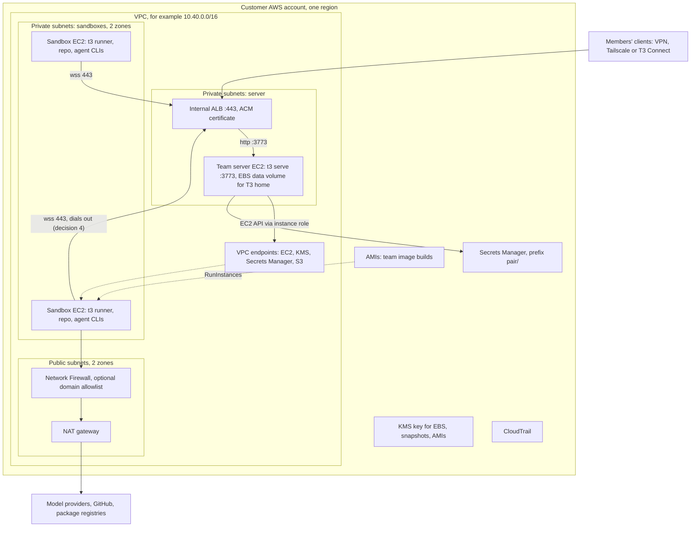

# 09 Bring your own cloud

Status: proposal, 2026-11-06. Nothing here is built. Read the [plan](./README.md) first; this doc
follows its decisions, milestones and words.

Audience: maintainers deciding what the BYOC offering is, and the engineers building M5. Doc 04
owns the compute driver interface and how each vendor's API maps onto it. This doc owns
deployment, networking, operations and the offering itself.

## Summary

- **Pair is self-hosted already.** A team that runs its team server in its own cloud keeps its
  transcripts, diffs and credentials there today. BYOC for Pair means putting the *sandboxes* in
  the customer's account too, with a driver and a kit that make it a `terraform apply`.
- **M5 ships one offering: self-hosted everything** (offering A below). A Pair-hosted control
  plane with sandboxes in the customer's account (offering B) is a business decision, sketched in
  section 7 and not built in M5.
- **The first BYOC driver is a plain-VM driver on EC2. The second is the same driver on GCE**
  (decision 8). Each sandbox is one VM from a team image build (an AMI or a GCE image), shared by
  its cloud thread's side chats and forks (decision 6). Stop keeps the disk. Kubernetes waits for
  a customer who asks for it.
- **Single-node E2B in the customer's account comes almost free** if the maintainers pick E2B as
  the M2 hosted vendor: E2B Embed speaks the same API as E2B Cloud, so it is configuration, not a
  driver. Decision 8 recommends Vercel, which has no BYOC path, with E2B as runner-up; this is a
  factor for that choice.
- **Runners reach the team server over the VPC,** through an internal load balancer that
  terminates TLS. T3 Connect works for runners but routes every byte of sandbox traffic through a
  third party, so the kit does not use it for runners.
- **The kit builds on two decisions:** the team server serves its own build's runner by
  `runnerBuildId` (decision 5), and Pair publishes a team server release the kit installs
  (decision 15).

## 1. What BYOC means for a self-hosted product

Conductor's BYOC question was "can the VMs run in my account instead of Vercel's?" For Pair the
control plane is already the customer's: a team installs the team server on a machine it owns
([Install Pair](../../user/install.md), [background service](../../user/background-service.md)).
What changes with Pair Cloud is that execution can move to a sandbox, and the sandbox can live in
three places.

### Offerings

| Offering | Team server (control plane) | Sandboxes | Model it copies | Milestone |
| -------- | --------------------------- | --------- | --------------- | --------- |
| **A. Self-hosted everything** | Customer's account | Customer's account, via the EC2 or GCE driver | Coder, E2B Embed, self-managed Buildkite | M5 |
| **B. Managed control plane, customer compute** | Hosted by Pair, or a company built on it | Customer's account; runners dial out to the hosted server | Ona runners, E2B BYOC, GitHub Actions self-hosted runners, Buildkite hybrid | Not planned; business decision |
| **C. Hosted sandboxes** | Customer's account (or anywhere) | A vendor's cloud (the M2 hosted driver) | Conductor on Vercel | M2 |

A and C mix on one team server. A server holds several configured driver instances, with one
default per project (decision 8), so a team trialling BYOC keeps its hosted driver while it migrates.

### The tiers table, refined

This replaces the BYOC tiers table in [conductor-cloud.md](../conductor-cloud.md#byoc-deployment-tiers).

| Tier | Control plane | Compute | Isolation between threads | For | Milestone |
| ---- | ------------- | ------- | ------------------------- | --- | --------- |
| 0 | One box | Local worktrees | None (shared shell) | Teams of 8–10 on one server, today | Shipped |
| 1 | One box | Docker driver on that box | Container | Teams that want caps and clean checkouts, no new vendor | M1 |
| 2 | Anywhere | Hosted vendor (offering C) | Vendor VM | Fastest Conductor-like setup | M2 |
| 3a | Customer cloud | E2B Embed node in customer cloud, via the E2B driver | Firecracker microVM | Small teams that want fast boots in their account | M5, if M2 picks E2B |
| 3b | Customer cloud | EC2 or GCE driver (offering A) | Full VM | Teams whose code and credentials must stay in their account | M5 |
| 3c | Customer cloud | Kubernetes driver | gVisor or Kata | Enterprises with a platform team | After M5 |
| M | Pair-hosted, one server per customer | Tier 2 or 3 (offering B) | As the compute tier | Customers who want SaaS | Business decision |

### What leaves the customer's account

"Leaves" means it is stored or readable outside the customer's cloud account. Model traffic always
leaves for a model provider unless the team uses one inside its cloud (see section 8). "Proxy"
means the opt-in model proxy from M2 (decision 10): API-key accounts send model calls through the
team server, which holds the key. Subscription tokens are never proxied, so those calls always go
straight from the sandbox.

| Data | A. Self-hosted everything | B. Managed control plane | C. Hosted sandboxes |
| ---- | ------------------------- | ------------------------ | ------------------- |
| Transcripts, event store, projections | Stays | **Stored by the host** | Stays on the team server; passes through the vendor VM while a turn runs |
| Checkpoints and diffs | Stays (sandbox disk and the server mirror, decision 11) | **Mirror stored by the host** | **On the vendor's disk**; mirror stays |
| Provider credentials | Stays; in process memory only (decision 10) | **Stored by the host** | Subscription tokens **in the vendor VM's memory**; API keys too, unless proxied |
| Git tokens | Stays; one-hour GitHub App tokens | **Minted by the host** | **In the vendor VM's memory** |
| Terminal, file and stdio traffic | Stays inside the VPC | **Crosses to the host** over the runner socket | **Crosses** between vendor and server |
| Team image builds | Stays (AMIs or images in the account) | Stays | **Stored by the vendor** |
| Model traffic, API keys | Sandbox to provider; with the proxy, team server to provider | Sandbox to provider; with the proxy, **through the host's server, which holds the key** | Vendor VM to provider; with the proxy, team server to provider |
| Model traffic, subscriptions | Sandbox to provider | Sandbox to provider | Vendor VM to provider |
| Product usage events | **Sent to `ingest.t3.codes` unless disabled** ([telemetry](../../user/telemetry.md)) | Same | Same |

Two rows are easy to miss. First, a Pair server sends product usage events to T3 Code by default.
The events carry no prompts or file contents, but a "nothing leaves" promise must turn them off,
so the kit sets `T3CODE_TELEMETRY_ENABLED=false`. Second, a team server reached only through
T3 Connect sends client traffic, and runner traffic if the runner uses that route, through the
managed Cloudflare tunnel that T3's relay allocates (see [T3 Connect](../../internals/t3-connect.md)).
TLS for that tunnel ends at Cloudflare's edge (inferred from how Cloudflare Tunnel works), so in
offering A the kit keeps runners off it.

## 2. Prior art

Research date 2026-11-06. Sources at the end.

| Product | Who dials whom | Install | Cloud permissions | Upgrades | License |
| ------- | -------------- | ------- | ----------------- | -------- | ------- |
| **Ona (formerly Gitpod) AWS runner** | The runner, in the customer VPC, reports to Ona's management plane; PrivateLink to the management plane is an option | CloudFormation link generated in the Ona dashboard with a runner id and exchange token; 20–25 minutes | Runner is a Fargate service; dev environments are EC2 in the customer VPC; a long list of VPC endpoints when there is no NAT | Not documented on the pages read | Proprietary |
| **Coder** | Workspace agent connects to the control plane's access URL over HTTPS and WebSocket; peer connections over WireGuard, relayed through DERP when direct UDP fails | Customer runs the control plane (Postgres plus `coder server`); templates are Terraform | Whatever the template's Terraform needs, held by the provisioner | Customer upgrades the control plane; agents come from it | AGPL-3.0 core, paid Premium |
| **E2B BYOC** | E2B's control plane reaches orchestrators through an edge controller's gRPC proxy; sandbox traffic goes client to customer VPC directly | E2B provisions with Terraform and machine images into a dedicated account or project | AWS: an IAM role shared with E2B. GCP and Azure: an E2B Terraform module grants E2B scoped access | Managed by E2B (not documented) | Runtime Apache-2.0; BYOC is Enterprise only |
| **E2B Embed** | Clients call the node's API directly; nothing calls home | One node: Docker Compose, Terraform for AWS, GCP or Azure, or a Kubernetes manifest | AWS module creates a VPC, an instance role, an S3 bucket and an Auto Scaling group of one `m8i.xlarge` with nested virtualization | Change the module's pinned `ref` and apply | Apache-2.0 |
| **Daytona** | n/a | n/a | n/a | Core development moved to a private codebase in June 2026; the public repo was archived on 2026-10-03 | Last public code (v0.190.0) is AGPL-3.0, unmaintained |
| **GitHub Actions self-hosted runners and ARC** | Runner, or ARC's listener pod, holds an outbound HTTPS connection to GitHub; no inbound | ARC: two Helm charts (controller and scale set) | Kubernetes service account to scale runner pods | Runners auto-update; a runner more than 30 days behind stops getting jobs | Runner and ARC Apache-2.0 |
| **Buildkite agents** | Agents poll Buildkite's API over HTTPS; no inbound ports | Elastic CI Stack for AWS as CloudFormation or Terraform; an agent stack for Kubernetes | Auto Scaling group, a Lambda scaler, an S3 secrets bucket, SSM for the agent token | Stack updates roll instances; agent release channel is selectable | Agent MIT (inferred, not checked) |

### Lessons for Pair

1. **Outbound-only is universal.** Every product puts the long-lived connection on the compute
   side, dialing out over 443. Decision 4 matches the industry. Coder's extra UDP path for
   WireGuard is a latency optimization Pair does not need, because clients never reach a sandbox
   directly (decision 1).
2. **Install is one generated artifact with the secrets pre-filled.** Ona's dashboard emits a
   CloudFormation link carrying a runner id and an exchange token. Pair's Settings → Cloud
   should emit the Terraform variables block for the driver the same way (M5).
3. **Version skew is handled by the control plane, not by compatibility tables.** GitHub refuses
   runners more than 30 days old; Coder serves agents from the control plane. Pair does what Coder
   does (decision 5): the team server serves its own build's runner by `runnerBuildId`.
4. **The managed-BYOC vendors need a role in the customer's account.** E2B's BYOC needs an IAM
   role shared with E2B. That is the price of offering B, and the reason it needs a trust story
   (section 7).
5. **Single-node packages win small teams.** E2B Embed exists because a Nomad cluster is too much
   for most buyers. Pair's equivalent is the team server on one VM launching sandbox VMs, with no
   cluster at all.
6. **Health checks of the network path pay for themselves.** Ona checks every required endpoint
   at start and every five minutes, and shows which path (VPC endpoint, NAT, internet gateway)
   each takes. Pair's driver should report the same for the EC2 API and the runner route (M5).
   And build only on open components: Daytona went private, E2B's runtime stayed Apache-2.0.

## 3. Driver options inside a customer's cloud

Three ways to run sandboxes in the customer's account. Numbers marked (inferred) are estimates to
replace with M5 measurements.

| | (i) Kubernetes (EKS or GKE) | (ii) Plain VM (EC2 or GCE) | (iii) E2B Firecracker in the account |
| --- | --- | --- | --- |
| Unit | One pod per sandbox with a PersistentVolumeClaim | One VM per sandbox with its own boot disk | One microVM per sandbox on an E2B node |
| Isolation | gVisor: a userspace kernel, no privileged containers, so no Docker inside. Kata (GKE's `microvm` RuntimeClass): a VM per pod, needs nested virtualization | Hardware VM. The agent has root and can run Docker | Firecracker microVM with a per-sandbox egress firewall |
| Cold start | Seconds on a warm node; minutes when the autoscaler adds one (inferred) | Tens of seconds to boot from an image (inferred). Blocks load lazily from the snapshot behind the image, so first reads are slow unless Fast Snapshot Restore is on | Sub-second: a sandbox is a resumed snapshot |
| Sleep | Delete the pod, keep the PVC | Stop the instance, keep the disk | E2B's pause saves memory too, which decision 10 forbids; a Pair driver needs a disk-only sleep (doc 04) |
| Wake | Schedule a pod and attach the volume, which is pinned to one zone | Start the instance, in the same zone | Resume from the saved disk |
| Sleeping cost | Volume storage | Disk storage only | Object storage for the diffs |
| Processes across sleep | Lost (decision 10: sleep never keeps memory) | Lost | Lost |
| Customer runs | A cluster, node pools, a CSI driver, RuntimeClasses, an autoscaler | Nothing beyond the team server VM | One node (Embed), or an E2B-managed cluster (BYOC, Enterprise) |
| Pair builds | A driver against the Kubernetes API, plus a Helm chart | A driver against EC2 or Compute Engine | Nothing new if the M2 driver is E2B |
| Fit | Enterprises that already run clusters and want bin-packing | Teams of any size; the simplest true VM | Small teams on one node; large teams only through an E2B contract |

### Notes on each

**Kubernetes.** EKS has no built-in gVisor. It needs a custom node image or a launch-template
script that installs `runsc`, plus taints and a RuntimeClass. GKE Sandbox is built in, with
`gvisor` and `microvm` RuntimeClasses. gVisor's ban on privileged containers rules out Docker
inside the sandbox, which agents use for test databases and `docker compose`. Kata or GKE's
`microvm` allows it, at the cost of nested virtualization. EBS-backed volumes are pinned to one
zone, as with VMs. The cluster is the customer's to run, and that is the real cost: a five-person
team does not want an EKS cluster for its agents.

**Plain VM.** Each operation in decision 8's driver interface is one cloud API call: create is
`RunInstances` from an AMI, stop and start keep the EBS volume, snapshot is `CreateSnapshot` or
`CreateImage` (`imageBuild: "snapshot"`), destroy is `TerminateInstances`, list is
`DescribeInstances` filtered by tag, and deleting an image is `DeregisterImage`.
GCE has the same shape. EC2 hibernation and GCE suspend would keep a dev server running across
sleep, but they write RAM, and the credentials in it, to disk. Decision 10 rules that out, so the
driver never uses them. The traps: a stopped instance restarts in its own zone, so a
capacity shortage there fails the wake (the driver falls back to snapshot and relaunch elsewhere),
and images built from snapshots read lazily until warmed. Fast Snapshot Restore fixes that at
$0.75 per snapshot per zone per hour, about $540 a month, so it is an opt-in for large teams.

**E2B in the account.** The README of the E2B runtime now steers self-hosting to two paths. Embed
is the whole stack on one node, Apache-2.0, installable on AWS with a Terraform module that
launches one `m8i.xlarge` with nested virtualization. Multi-node production is E2B's
Enterprise BYOC, which E2B provisions and operates. The older self-hosting path, a Terraform,
Nomad and Consul cluster, is no longer what the README offers; the E2B row in
[conductor-cloud.md](../conductor-cloud.md#sandbox-vendors) still describes it. Embed boots
fastest of the three, but one node holds only a few 8 vCPU sandboxes (shared side chats and forks
stretch that a little), and growing past it means a contract with E2B.

### Recommendation

1. **First M5 driver: `aws-ec2`, a plain-VM driver.** Hardware isolation, Docker works inside,
   no cluster, every operation maps to one API call, and the customer already knows how to audit
   and pay for EC2. It fits a five-person team and an enterprise alike.
2. **Second M5 driver: `gce`,** the same driver shape on Compute Engine. It completes the "AWS or
   GCP" promise of M5 for little extra code, since both drivers share their sleep, wake and
   orphan-cleanup logic through doc 04's interface.
3. **Tier 3a by configuration:** if the maintainers pick E2B over Vercel for M2, document pointing
   the E2B driver at an Embed node and test it once in M5. No new driver. Vercel Sandbox runs only
   in Vercel's cloud, so this path exists only with E2B; weigh it in the M2 vendor choice.
4. **Kubernetes after M5,** when a design partner with a platform team asks. It is the right
   answer for bin-packing at scale, and the wrong first answer for a product whose users run one
   team server.

## 4. Reference architectures

### AWS

One account, or one dedicated account per team (recommended, because the account is then the
blast radius and the bill). One region.



| Piece | Choice | Why |
| ----- | ------ | --- |
| VPC | Two private subnets for the server, two for sandboxes (a /20 each), public subnets only for NAT | Sandboxes and server get separate security groups and route tables |
| Team server | One EC2 instance in an Auto Scaling group of one, with a separate gp3 data volume holding T3 home | The event store is SQLite on local disk (`statev2.sqlite`), so one writer and no shared filesystem. The ASG only replaces a dead instance; the data volume reattaches |
| Server backups | Data Lifecycle Manager snapshots of the data volume, hourly | Crash-consistent snapshots of SQLite with its WAL (inferred safe; verify restore in M5) |
| TLS | Internal ALB with an ACM certificate on a private hosted zone name | The server has no native TLS listener (no `https.createServer` in [apps/server/src](../../../apps/server/src)), so TLS ends at a proxy |
| Sandboxes | EC2 from the active team image AMI, no instance profile, IMDSv2 with hop limit 1 | A sandbox needs no AWS permissions. The agent can read anything in the VM, so nothing cloud-privileged goes there |
| Images | AMIs in the account, made by `CreateImage` from a build sandbox (doc 05 owns the recipe) | No container registry needed for VMs. ECR only arrives with a Kubernetes driver |
| Secrets | A new `aws_secrets_manager` secret provider kind, read by the team server's instance role | Fits the existing [secret provider driver](../../../packages/secret-provider-core/src/server/driver.ts): references like `awssm://pair/github-app#private_key` resolve on the server. The GitHub App key never leaves it; sandboxes get only one-hour tokens, in memory (decision 10) |
| Egress | NAT gateway; optional AWS Network Firewall with a domain allowlist (git host, package registries, and model providers for subscription accounts) | Security groups filter by IP only. A domain allowlist needs a firewall or a proxy. With the model proxy, API-key traffic leaves from the team server, so the sandbox list can drop those providers |
| Encryption | One customer-managed KMS key; EBS encryption by default in the region | Volumes, snapshots and AMIs inherit it |
| Audit | CloudTrail in the account | Every driver call is attributed to the team server's role session |

**Git hosts.** Pushing from a sandbox works only with GitHub until the server's git proxy lands in
M3 (decision 10). M5 comes after M3, so a BYOC customer on GitLab or Bitbucket can push when the
kit ships, but only through the team server. That suits BYOC: a self-hosted GitLab inside the VPC
needs to be reachable from the team server alone, and sandboxes need no git credentials or route
to it for pushes. A GitLab or Bitbucket team that tries cloud threads on Docker or a hosted vendor
before M3 cannot push from a sandbox, and may not be able to clone a private repo there either
(inferred; doc 06 owns git credentials).

The `aws_secrets_manager` kind is worth having before the driver. It lets a team on any tier keep
its GitHub App key, API keys and webhook secrets in Secrets Manager, through the same
[SecretResolver](../../../apps/server/src/secrets/SecretResolver.ts) that resolves 1Password
references today ([definition](../../../packages/secret-provider-onepassword/src/shared/definition.ts)).
GCP gets a `gcp_secret_manager` kind the same way.

#### Least-privilege IAM for the driver

The driver runs inside the team server, so this policy goes on the server's instance role. A
sketch, scoped by doc 04's `pair.install` tag, which the driver writes on create (AWS tag keys allow
the dot; GCE labels do not, so the GCE driver writes `pair-install` (inferred)). Validate
with the IAM policy simulator in M5; some EC2 actions need extra resource ARNs.

```json
{
  "Version": "2012-10-17",
  "Statement": [
    { "Sid": "Read", "Effect": "Allow", "Resource": "*",
      "Action": ["ec2:DescribeInstances", "ec2:DescribeInstanceStatus", "ec2:DescribeImages",
                 "ec2:DescribeSnapshots", "ec2:DescribeVolumes"] },
    { "Sid": "LaunchTagged", "Effect": "Allow", "Action": "ec2:RunInstances",
      "Resource": ["arn:aws:ec2:REGION:ACCOUNT:instance/*", "arn:aws:ec2:REGION:ACCOUNT:volume/*",
                   "arn:aws:ec2:REGION:ACCOUNT:network-interface/*"],
      "Condition": { "StringEquals": { "aws:RequestTag/pair.install": "INSTALL_ID" } } },
    { "Sid": "LaunchInto", "Effect": "Allow", "Action": "ec2:RunInstances",
      "Resource": ["arn:aws:ec2:REGION:ACCOUNT:subnet/SANDBOX_SUBNET_A",
                   "arn:aws:ec2:REGION:ACCOUNT:subnet/SANDBOX_SUBNET_B",
                   "arn:aws:ec2:REGION:ACCOUNT:security-group/SANDBOX_SG",
                   "arn:aws:ec2:REGION:ACCOUNT:launch-template/SANDBOX_LT"] },
    { "Sid": "LaunchFromImage", "Effect": "Allow", "Action": "ec2:RunInstances",
      "Resource": "arn:aws:ec2:REGION::image/*",
      "Condition": { "StringEquals": { "ec2:Owner": ["ACCOUNT", "099720109477"] } } },
    { "Sid": "TagOnCreate", "Effect": "Allow", "Action": "ec2:CreateTags", "Resource": "*",
      "Condition": { "StringEquals": { "ec2:CreateAction":
        ["RunInstances", "CreateImage", "CreateSnapshot"] } } },
    { "Sid": "ManageOwn", "Effect": "Allow", "Resource": "*",
      "Action": ["ec2:StartInstances", "ec2:StopInstances", "ec2:TerminateInstances",
                 "ec2:CreateImage", "ec2:CreateSnapshot", "ec2:DeregisterImage",
                 "ec2:DeleteSnapshot", "ec2:ModifyInstanceMetadataOptions"],
      "Condition": { "StringEquals": { "aws:ResourceTag/pair.install": "INSTALL_ID" } } },
    { "Sid": "EbsKms", "Effect": "Allow", "Resource": "KMS_KEY_ARN",
      "Action": ["kms:CreateGrant", "kms:GenerateDataKeyWithoutPlaintext", "kms:Decrypt",
                 "kms:DescribeKey"],
      "Condition": { "Bool": { "kms:GrantIsForAWSResource": "true" } } },
    { "Sid": "Secrets", "Effect": "Allow", "Action": "secretsmanager:GetSecretValue",
      "Resource": "arn:aws:secretsmanager:REGION:ACCOUNT:secret:pair/*" }
  ]
}
```

What the role cannot do: pass a role to EC2 (sandboxes have no instance profile, so no
`iam:PassRole`), launch outside the sandbox subnets and security group, touch any instance it did
not tag, or read secrets outside `pair/`. `099720109477` is Canonical's account, for the stock
Ubuntu image that the automatic first build starts from.

### GCP, briefly

| AWS piece | GCP equivalent |
| --------- | -------------- |
| Dedicated account | Dedicated project; the project is the IAM boundary, because IAM conditions on labels are weaker than EC2 tag conditions (inferred; verify in M5) |
| NAT gateway | Cloud NAT on a Cloud Router |
| Internal ALB with ACM | Internal Application Load Balancer with a Google-managed or self-managed certificate |
| Sandbox EC2 with no instance profile | GCE instance with no service account attached |
| AMI | Custom image in an image family per team image |
| EBS encryption with KMS | CMEK on disks, snapshots and images |
| Driver IAM policy | A custom role with `compute.instances.{create,start,stop,delete,get,list,setMetadata,setLabels}`, `compute.disks.{create,createSnapshot,use}`, `compute.images.{create,useReadOnly}`, `compute.subnetworks.use`, bound to the team server's service account on the sandbox project |
| Secrets Manager | Secret Manager, through a `gcp_secret_manager` secret provider |
| CloudTrail | Cloud Audit Logs (Admin Activity is always on) |

## 5. Networking

Decision 4 says the runner dials out over one authenticated WebSocket. The question is which
route it dials.

| Topology | Runner route | When | Notes |
| -------- | ------------ | ---- | ----- |
| **N1. Same VPC** (default in the kit) | `wss://pair.internal.example:443` to an internal load balancer, then `http://server:3773` | Offering A | All traffic stays in the VPC. Members reach the server through VPN, Tailscale, or T3 Connect on the server |
| **N2a. Server reachable only through T3 Connect** | `wss://<tunnel host>` over the internet through NAT | A team server on an office machine or laptop, with sandboxes in a cloud account | Works, because the tunnel forwards every path to the server's loopback origin ([ingress rule](../../../infra/relay/src/environments/ManagedEndpointProvider.ts)). The edge drops idle requests after about 100 seconds ([remote.md](../../internals/remote.md)), so the runner pings every 15 seconds. Every sandbox byte crosses Cloudflare under T3's account |
| **N2b. Server reachable only through Tailscale** | A subnet router in the sandbox VPC advertises the route to the server's tailnet address | Teams already on a tailnet | Do not put Tailscale in each sandbox: an auth key in the sandbox is a credential the agent can read. One subnet router per VPC is simpler |
| **N3. Managed control plane** | `wss://<team>.<host domain>:443` over the internet, or PrivateLink later | Offering B | The customer allows one hostname out. See section 7 |

### Ports, TLS and proxies

| Flow | Port | Notes |
| ---- | ---- | ----- |
| Runner to load balancer | 443/tcp, TLS | The only flow sandboxes must open toward the server |
| Load balancer to team server | 3773/tcp (the default `DEFAULT_PORT` in [config.ts](../../../apps/server/src/config.ts)) | Plain HTTP inside the server subnet; the server's security group admits only the load balancer |
| Members to load balancer | 443/tcp | Or T3 Connect from the server, unchanged |
| Team server to cloud APIs | 443/tcp | Through VPC endpoints or NAT |
| Sandbox to the internet | 443/tcp (and 22 for SSH git remotes, if used) | Through NAT and the optional firewall |
| Into a sandbox | None | Security group has no inbound rules. Previews and SSH ride the runner socket (decision 4; doc 07) |

- **The private-network listener lets this work as is.** A background service with no configured
  host serves only connections whose two ends are loopback, private or tailnet IPv4
  ([startupAccess.ts](../../../apps/server/src/startupAccess.ts)). An internal load balancer's
  address is private, so it passes. Two consequences: an IPv6-only VPC is refused (the check is
  IPv4 only), and the kit should set `T3CODE_HOST` explicitly rather than rely on the default.
- **TLS with a private CA.** If the customer's load balancer uses an internal CA, the runner trusts
  it through `NODE_EXTRA_CA_CERTS`, which the driver writes from a kit variable into the sandbox's
  boot configuration. No certificate pinning in M5.
- **Proxies.** Corporate egress proxies are common in BYOC accounts. The runner honors
  `HTTPS_PROXY` and `NO_PROXY` and opens its WebSocket through HTTP `CONNECT` (M5, doc 03 owns
  the runner). A TLS-inspecting proxy must let WebSocket upgrades through; the driver's health
  check reports when it does not.
- **No per-sandbox DNS or certificates.** Unlike E2B's `<port>-<sandbox>.<domain>` URLs, nothing
  addresses a sandbox from outside. That removes wildcard certificates and a sandbox edge router
  from the kit.

## 6. The deployment kit

What Pair ships for M5. It lives in a new `infra/sandbox/` folder (decision 14), beside
[infra/relay](../../../infra/relay), which is T3's own relay.

### Contents

| Artifact | What it does | Milestone |
| -------- | ------------ | --------- |
| `infra/sandbox/aws` Terraform module | VPC (or an existing one by id), team server ASG of one with its data volume and DLM policy, internal ALB, security groups, KMS key, the driver's IAM role, the sandbox launch template, optional Network Firewall. Outputs the server URL and the driver settings block | M5 |
| `infra/sandbox/gcp` Terraform module | The same on GCP | M5 |
| Team server bootstrap | Cloud-init that installs the pinned team server release (decision 15), writes `service.env` (host, port, `T3CODE_TELEMETRY_ENABLED=false`, OTLP endpoints), and runs `t3 service install` | M5 |
| Base AMI | Agreeing with doc 05 (open question 4): when an admin sets up the EC2 or GCE driver, it runs an automatic first build of the empty recipe. That build runs `provision.sh` on stock Ubuntu 24.04 and captures the result with `CreateImage`, so the base AMI carries the provider CLIs and matches the OCI base (decision 15). No cloud thread boots from stock Ubuntu | M5 |
| Image build pipeline | No separate pipeline: a build is a sandbox the driver launches, runs the recipe in, and turns into an AMI with `CreateImage` (doc 05 owns the recipe) | M3 shape, M5 for AMIs |
| Helm chart; CloudFormation | Helm ships with a Kubernetes driver. A one-click CloudFormation link like Ona's is worth adding once the Terraform settles | After M5 |

Terraform first, because one tool covers AWS and GCP and BYOC buyers already run it.

### Upgrades and version pinning

- **Team server.** The kit pins an exact team server release in a variable, and upgrading means
  changing it. `t3 update` fetches upstream T3 Code's releases, so the kit must not rely on it.
  The new release should still install through the
  [launcher's trial and rollback](../../internals/server-updates.md), so a failed migration
  restores the SQLite snapshot (inferred: the release format must support this; decision 15).
- **Runner.** Decision 5: each sandbox fetches the runner bundle from the team server by
  `runnerBuildId`, over its own route. An upgrade restarts the server, which ends every sandbox
  process, so the kit schedules upgrades outside working hours. A runner from the old build gets
  a `426` on reconnect and refetches its bundle (doc 03). Images cache bundles by
  `runnerBuildId`. No npm, so npm needs no place in a locked-down egress allowlist.
- **Terraform module.** Versioned with the Pair release it installs. A module upgrade never
  replaces the data volume (`prevent_destroy`).

### Observability the customer sees

| Signal | Where |
| ------ | ----- |
| Server traces, logs, metrics | The server's existing OTLP export ([observability](../../operations/observability.md), [telemetry](../../user/telemetry.md)), pointed at the customer's collector. The kit can deploy an ADOT collector to CloudWatch |
| Driver metrics | New, in [Metrics.ts](../../../apps/server/src/observability/Metrics.ts): sandboxes by state, create and wake latency, driver call errors by cloud error code, orphans found by `list` |
| Driver health | The network path check from lesson 6, shown on Settings → Cloud → Compute |
| Runner logs | Over the runner socket into the server's trace (doc 03). The EC2 console output covers a runner that never connects |
| Cloud audit | CloudTrail or Cloud Audit Logs, joined to Pair's sandbox events by the `pair.sandbox` tag (`pair-sandbox` on GCE) |

### Support boundary

| Pair (the open-source project) owns | The customer owns |
| ----------------------------------- | ----------------- |
| Server, runner, drivers, the Terraform modules, their docs | The account, VPC, IAM, quotas, KMS key policy, egress rules |
| A tested path: the modules' defaults, in the regions CI tests | Changes to the modules, custom networks, proxies |
| Bugs filed as GitHub issues | Backups beyond the DLM default, disaster recovery, cost |
| | Model provider contracts and their data terms |

Pair has no support organization: "support" means the documented path is tested in CI against a
real account. A company selling Pair would add an SLA.

## 7. The managed control plane option (sketch)

**This is a business decision for maintainers, not an M5 deliverable.** It is offering B: Pair, or
a company built on it, hosts team servers, and the customer's sandboxes stay in the customer's
account.

| Question | Sketch |
| -------- | ------ |
| Tenancy | One team server per customer, each on its own VM and disk. "Several teams on one server" is a non-goal ([decisions](../decisions.md#non-goals)), and SQLite per server makes cells natural. The host runs a fleet, not a multi-tenant service |
| Reaching the server | A per-customer HTTPS hostname on the host's own domain. T3 Connect is T3's relay with per-user Clerk accounts and tunnel caps ([T3 Connect](../../internals/t3-connect.md)); a hosting business should not depend on another company's relay for its main route |
| Runners | Dial out of the customer's VPC to that hostname (N3). PrivateLink endpoint services later for customers who refuse internet egress |
| Cloud API access | The host's server needs to call EC2 in the customer's account. Use a cross-account role with an external id, created by the customer's Terraform. This is E2B BYOC's model. The alternative, a small agent in the customer's account that calls EC2 locally, adds a process Pair does not have |
| Trust | The host stores transcripts and credentials, and its server can run any command in the customer's sandboxes. Customers who refuse that are offering A customers |
| Billing | Billing is a non-goal today. A host would bill per seat or per server, and pass sandbox cost through to the customer's own cloud bill, which is the attraction |
| Identity | SSO is a non-goal today, and nearly every buyer of a managed tier will ask for it |
| SOC 2-style expectations | Access control and logging for operators who can reach customer servers; encryption at rest per customer; backups and restore drills; incident response; a sub-processor list; vulnerability management for the fleet image |

The architecture supports B without change, because decision 4 already makes runners dial out.
The work is operational and commercial: a fleet manager, per-customer DNS, backups, SSO and
billing.

## 8. Compliance and data residency

- **Region.** The kit takes one region. The team server, sandboxes, volumes, snapshots, AMIs and
  secrets all live there. The kit makes no cross-region copies. Disaster recovery to a second
  region is a customer choice (copy DLM snapshots).
- **Encryption at rest.** Decision 10 treats a stopped disk or snapshot as sensitive: it holds code
  and transcripts even though no credential is written there. EBS encryption by default with the
  customer's KMS key covers sandbox disks, the server's data volume, snapshots and AMIs, and the
  driver deletes a sandbox's volumes and snapshots when it is destroyed. A sandbox shared by side
  chats and forks is destroyed only when no thread uses it (decision 6). On GCP, CMEK on disks,
  snapshots and images.
- **Audit.** Two logs that join. Pair's event store records each sandbox transition with the member
  who caused it (decision 6). CloudTrail records each driver call by the server's role, tagged with
  the sandbox id. Pair has no exportable audit log of member actions today; the
  [activity log](../../user/activity-log.md) is a tool-call view inside a thread, not an audit
  trail. An enterprise buyer will ask for one; it is outside M5.
- **Model traffic.** Subscription accounts always call the provider from the sandbox, through NAT.
  API-key accounts do the same unless the team turns on the M2 model proxy (decision 10); then the
  sandbox's calls ride the runner socket to the team server, which adds the key and calls the
  provider. Either way traffic leaves the account for Anthropic or OpenAI. What the proxy changes
  is where the key lives and which host needs egress to the provider.
- **Keeping model traffic in the cloud: Bedrock behind the proxy.** The proxy makes Bedrock simple.
  Claude Code can talk to a gateway that adds credentials on its side (`ANTHROPIC_BASE_URL`, or
  the Mantle variables `CLAUDE_CODE_USE_MANTLE`, `CLAUDE_CODE_SKIP_MANTLE_AUTH` and
  `ANTHROPIC_BEDROCK_MANTLE_BASE_URL`). If the proxy's upstream can be Bedrock, signed with the
  team server's instance role, then no AWS credential reaches the sandbox at all, and model
  traffic goes from the team server to Bedrock through a VPC endpoint in the customer's region.
  That beats injecting short-lived Bedrock API keys (`AWS_BEARER_TOKEN_BEDROCK`) into the
  sandbox, which would put a credential in its memory. The server role then needs
  `bedrock:InvokeModel` and `bedrock:InvokeModelWithResponseStream` on the chosen inference
  profiles. Codex has no equivalent here yet (inferred; not researched).
- **Telemetry.** Off in the kit, as section 1 says. The runner sends nothing anywhere but the team
  server.
- **No certification claims.** The kit gives the controls an auditor asks about (encryption,
  region, audit trail, egress); the customer certifies their own deployment.

## 9. Work breakdown

### M5 pull requests

| # | Pull request | Depends on |
| - | ------------ | ---------- |
| 1 | `aws_secrets_manager` secret provider kind (new `packages/secret-provider-aws`), with tests for reference parsing and batch reads | Nothing; can land any time |
| 2 | `gcp_secret_manager` secret provider kind | Nothing |
| 3 | `aws-ec2` compute driver: create, start, stop, snapshot, destroy, status, list, delete an image, against doc 04's interface; `imageBuild: "snapshot"`; tag scoping; zone fallback on wake | Doc 04's interface (M1) |
| 4 | Driver settings for `aws-ec2` in contracts: region, subnets, security group, launch template, instance types, KMS key, CA bundle; credentials from the instance role only | 3 |
| 5 | Driver health check: EC2 API, KMS, the runner route; shown on Settings → Cloud → Compute | 3 |
| 6 | Team image builds produce AMIs through the driver (`provision.sh` on stock Ubuntu, then `CreateImage`, tagged with the `imageBuildId`), including the automatic first build at driver setup | Doc 05's build pipeline (M3), 3 |
| 7 | `infra/sandbox/aws` Terraform module with a README and an example | 3, 4, the team server release (decision 15) |
| 8 | CI job that applies `infra/sandbox/aws` in a test account, runs one cloud thread on the Replay provider, sleeps, wakes and destroys it | 7 |
| 9 | `gce` compute driver and its settings | 3 (shared helpers) |
| 10 | `infra/sandbox/gcp` Terraform module and its CI job | 9 |
| 11 | Driver metrics in `Metrics.ts` | 3 |
| 12 | User guide: "Run cloud threads in your own AWS or GCP account", plus the E2B Embed recipe if M2 shipped an E2B driver | 7, 10 |
| 13 | Bedrock as a model proxy upstream, signed with the server's role (Vertex on GCP later) | The M2 model proxy; open question 2 |

### What earlier milestones must not break

| Milestone | Keep BYOC possible by |
| --------- | --------------------- |
| M0 | Nothing specific; the seam is local only |
| M1 | The runner reaches the server by a URL the server gives it, never by assuming the Docker bridge or `localhost`. The runner trusts a CA bundle and honors `HTTPS_PROXY` from the start. The runner bundle is fetched over that same route by `runnerBuildId` (decision 5), with no second host to reach |
| M1 | The sandbox record keeps the driver's handle as an opaque string (an instance id, a container id, an E2B sandbox id). No Docker-shaped fields in contracts. Caps and usage count sandboxes, not threads, since side chats and forks share one |
| M1 | The GitHub App private key is a secret setting, so a secret provider such as Secrets Manager can hold it |
| M1 | Driver settings are an array of configured instances, each a tagged union per driver kind, with secrets as secret settings ([settingsSecretValue.ts](../../../apps/server/src/secrets/settingsSecretValue.ts)). No hosted-vendor assumptions in shared code: no public sandbox URLs for previews (they ride the runner socket), no vendor lifetime cap treated as universal, no assumption that wake is sub-second |
| M1 | The runner pings every 15 seconds (doc 03), inside the edge's 100-second idle cutoff, so N2a works |
| M2 | Sleep and wake tolerate minutes, not seconds, and a wake that fails for capacity |
| M2 | The model proxy rides the runner socket and its upstream is configurable per provider instance, so Bedrock fits later |
| M3 | A team image build's output is a driver-specific reference (AMI id, image name, OCI digest, E2B template id). Builds run through the driver, not as `docker build` on the server |
| M3 | The git proxy reaches the git host from the team server, so a GitLab inside the customer's VPC works with no route from sandboxes |
| M4 | Cloud-only server mode works on a small VM with no provider CLIs installed, because that is the team server in the reference architecture. SSH reaches sandboxes through the runner, never a public IP |

## Open questions

1. **Should the sandbox token travel in EC2 user data?** User data is readable from inside the VM
   for its whole life, and cloud-init copies it to disk, which decision 10 forbids for a live
   credential. Recommended: user data carries a single-use bootstrap token that expires within
   minutes and that the runner exchanges for its session token in memory; the driver then turns
   the metadata endpoint off with `ModifyInstanceMetadataOptions`. Doc 06 owns the token.
2. **Bedrock and Vertex behind the model proxy?** Recommended: yes for Claude, as M5 pull request
   13: an admin-shared provider instance whose upstream is Bedrock, signed by the team server's
   role. It is the only way to say "model traffic stays in your cloud," and it keeps every AWS
   credential off the sandbox. Doc 06 decides whether the proxy's design allows it.
3. **One account per team, or a shared account?** Recommended: the kit defaults to a dedicated
   account or project and documents a shared one. Tag scoping in the IAM policy makes shared safe
   enough.
4. **What form does the team server release take (decision 15)?** Recommended: Pair CI publishes a
   versioned server tarball, in the `t3` CLI archive format that
   [pinnedRuntime.ts](../../../apps/server/src/cloud/pinnedRuntime.ts) installs, to the fork's
   GitHub releases, with checksums. The kit downloads it by exact version.
5. **Should Pair offer the managed tier?** Recommended: not until offering A has paying or design
   partner users. It needs SSO, billing and a fleet, all non-goals today.

## Challenges to the plan

None. The revised README and the final resolutions took in what this doc raised: the runner
served by the team server (decision 5), release artifacts (decision 15), a plain-VM driver first
and several driver instances per server (decision 8). The cheap BYOC path through E2B Embed stays in this doc as a factor for the
maintainers' M2 vendor choice (section 3).

## Sources

Retrieved 2026-11-06.

- Ona: [AWS runner setup](https://ona.com/docs/ona/runners/aws/setup),
  [AWS runner networking](https://ona.com/docs/ona/runners/aws/networking.md)
- Coder: [architecture](https://coder.com/docs/admin/infrastructure/architecture),
  [networking](https://coder.com/docs/admin/networking),
  [coder/coder repository](https://github.com/coder/coder) (AGPL-3.0)
- E2B: [BYOC](https://docs.e2b.dev/byoc.md),
  [runtime repository README](https://github.com/e2b-dev/runtime) (Apache-2.0; renamed from
  e2b-dev/infra), [Embed README](https://github.com/e2b-dev/runtime/tree/main/embed),
  [Embed on AWS](https://github.com/e2b-dev/runtime/tree/main/embed/terraform/aws)
- Daytona: [repository and maintenance notice](https://github.com/daytonaio/daytona) (archived;
  [AGPL-3.0 at v0.190.0](https://github.com/daytonaio/daytona/blob/v0.190.0/LICENSE))
- GitHub: [self-hosted runners reference](https://docs.github.com/en/actions/reference/runners/self-hosted-runners),
  [Actions Runner Controller](https://docs.github.com/en/actions/concepts/runners/actions-runner-controller)
- Buildkite: [agent v3](https://buildkite.com/docs/agent/v3),
  [Elastic CI Stack for AWS](https://buildkite.com/docs/agent/v3/aws/elastic-ci-stack)
- Google Cloud: [GKE Sandbox](https://docs.cloud.google.com/kubernetes-engine/docs/concepts/sandbox-pods),
  [suspend and resume](https://docs.cloud.google.com/compute/docs/instances/suspend-resume-instance)
- AWS: [hibernation prerequisites](https://docs.aws.amazon.com/AWSEC2/latest/UserGuide/hibernating-prerequisites.html),
  [EBS Fast Snapshot Restore](https://docs.aws.amazon.com/ebs/latest/userguide/ebs-fast-snapshot-restore.html),
  [nested virtualization on C8i, M8i and R8i, The Register, 2026-02-17](https://theregister.com/2026/02/17/nested_virtualization_aws_ec2)
- gVisor on EKS needs a custom node setup (third-party, unverified against AWS docs):
  [devopscube](https://devopscube.com/set-up-gvisor-on-aws-eks/)
- Anthropic: [Claude Code on Amazon Bedrock](https://code.claude.com/docs/en/amazon-bedrock)
