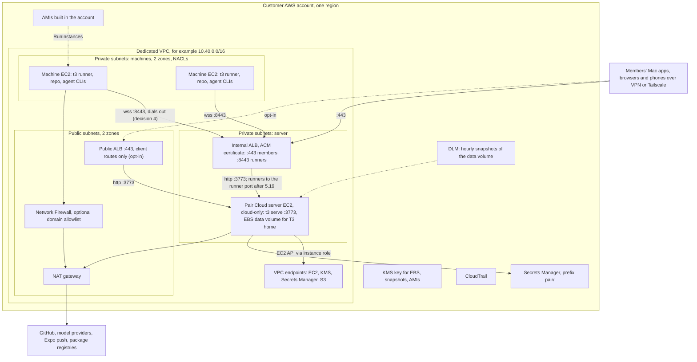

# 09 Bring your own cloud

Status: M0 and M1 landed; the rest is a proposal, rewritten 2026-11-08 for local-first Pair Cloud.
Read the [plan](./README.md) first; this doc follows its decisions, milestones and words.

Order changed on 2026-11-10: BYOC launches on Google Cloud first, then AWS. This doc was written
AWS-first. Its summary, tables and work breakdown carry the new order; sections 4 to 6 still draw
AWS in full and Google Cloud as a table of equivalents.
[m5-byoc.md](./implementation/m5-byoc.md) has the Google Cloud reference architecture, the kits'
two ingress modes, and where the code differs from this doc.

Audience: maintainers deciding what the BYOC offering is, and the engineers building M5. Doc 04
owns the compute driver interface and how each vendor's API maps onto it. This doc owns
deployment, networking, operations and the offering itself.

## Summary

- **BYOC puts Pair Cloud and its machines in the customer's account.** The team's Pair Cloud
  server, in cloud-only mode, and the VMs its cloud sessions run on live in the
  customer's own cloud account and VPC: Google Cloud first, then AWS. Members keep working locally in the Pair Mac app, whose local
  server stays on their own machine. Only cloud sessions run in the account.
- **Pair is self-hosted already.** From M2 a team runs its one Pair Cloud server on a VM it
  controls, with Docker machines. A team that puts that VM in its own cloud keeps transcripts, code
  and credentials there. M5 adds machines as VMs of their own, a deployment kit that makes the whole
  thing a `terraform apply`, and the network hardening around it.
- **M5 is BYOC on Google Cloud, then AWS.** The first driver is a plain-VM driver on GCE, the second
  the same driver on EC2 (decision 8; order set 2026-11-10). Each machine is one VM from an image
  built in the customer's account,
  shared by its cloud thread's side chats and forks (decision 6). Stop keeps the disk. Kubernetes
  waits for a customer who asks.
- **Private by default** (D10). Members reach Pair Cloud on the team's own domain over VPN or
  Tailscale, through an internal load balancer. A public HTTPS listener that serves only client
  routes is an opt-in. T3 Connect is off. Runners dial a listener that only machine subnets reach.
- **A Pair-hosted control plane is rejected** (section 7). Hosted sandbox vendors, and E2B Embed
  with them, are Later, by demand.
- **The kit builds on earlier milestones:** cloud-only mode, the versioned Pair Cloud release that
  carries the runner, restore mode and idle sleep (M2), and team image builds (M4).

## 1. What BYOC means for a self-hosted product

Conductor's BYOC question was "can the VMs run in my account instead of Vercel's?" For Pair the
control plane is already the customer's. Each member's Mac app bundles its own local server
([Install Pair](../../user/install.md)), and the team installs its one Pair Cloud server on a
machine it controls ([background service](../../user/background-service.md)). Clients connect to
both directly: local work goes to the Mac's local server, cloud sessions to Pair Cloud, and the two
servers never sync. BYOC decides where Pair Cloud and its machines run.

BYOC does not move local work. Local threads, worktrees and checkpoints stay on members' Macs, and
so does the code those Macs already hold. A team that wants its laptops locked down sets
[managed policy](../../user/managed-policy.md) on them; that is separate from the kit.

### Offerings

| Offering                       | Pair Cloud server                                                                    | Machines                                                    | Model it copies                                                             | Milestone            |
| ------------------------------ | ------------------------------------------------------------------------------------ | ----------------------------------------------------------- | --------------------------------------------------------------------------- | -------------------- |
| **A. Pair Cloud on a team VM** | A VM the team runs, in any cloud or on its own hardware (Pair's dogfood is a GCE VM) | Docker on that VM, or a Docker host through `DOCKER_HOST`   | Coder, E2B Embed                                                            | M2                   |
| **B. BYOC**                    | The customer's VPC, installed by the kit: Google Cloud first, then AWS               | VMs in private subnets of that VPC: GCE instances, then EC2 | Coder, self-managed Buildkite                                               | M5                   |
| **C. Hosted machines**         | A VM the team runs                                                                   | A sandbox vendor's cloud                                    | Conductor on Vercel                                                         | Later, by demand     |
| Pair-hosted control plane      | Pair                                                                                 | The customer's account; runners dial out to Pair            | Ona runners, E2B BYOC, GitHub Actions self-hosted runners, Buildkite hybrid | Rejected (section 7) |

A and B run the same cloud-only server, launch gate and lifecycle. They differ in where machines
run and how much of the network the kit sets up. A server holds several configured driver instances
(decision 8), so a team on A keeps its Docker driver while it trials EC2.

### The tiers table, refined

This replaces the BYOC tiers table in [conductor-cloud.md](../conductor-cloud.md#byoc-deployment-tiers).

| Tier   | Pair Cloud server    | Machines                                       | Isolation between cloud sessions | For                                                         | Milestone                                    |
| ------ | -------------------- | ---------------------------------------------- | -------------------------------- | ----------------------------------------------------------- | -------------------------------------------- |
| 0      | None                 | Members' own Macs, through their local servers | Each member's own machine        | Local work, today and after                                 | Shipped                                      |
| 1      | A team VM            | Docker driver on that VM                       | Container                        | Teams that want shared cloud sessions with no new vendor    | M2 (M1 built the machinery on a team server) |
| 2a     | Customer AWS account | EC2 driver (offering B)                        | Full VM                          | Teams whose code and credentials must stay in their account | M5, after GCP                                |
| 2b     | Customer GCP project | GCE driver                                     | Full VM                          | The same, on GCP                                            | M5, first                                    |
| 3      | Customer cloud       | Kubernetes driver                              | gVisor or Kata                   | Enterprises with a platform team                            | Later, by demand                             |
| Hosted | A team VM            | Hosted vendor (offering C)                     | Vendor VM                        | Fastest Conductor-like setup                                | Later, by demand                             |
| Embed  | Customer cloud       | E2B Embed node, through an E2B driver          | Firecracker microVM              | Small teams that want fast boots in their account           | Later, only with an E2B driver               |

### What leaves the customer's account

"Leaves" means it is stored or readable outside the customer's cloud account.

| Data                                             | B. BYOC                                                                                                                                                                | C. Hosted machines (Later)                                          |
| ------------------------------------------------ | ---------------------------------------------------------------------------------------------------------------------------------------------------------------------- | ------------------------------------------------------------------- |
| Transcripts, event store, projections            | Stays, on the server's data volume                                                                                                                                     | Stays on the server; passes through the vendor VM while a turn runs |
| Project checkouts, mirror, checkpoints and diffs | Stays: machine disks and the server's data volume (decisions 11, 16)                                                                                                   | **On the vendor's disk**; the mirror stays                          |
| Provider credentials                             | Stays: the server's secret store or Secrets Manager, and machine memory while a process runs (decision 10)                                                             | **In the vendor VM's memory**                                       |
| Git tokens                                       | Stays: one-hour GitHub App tokens, or the owner's GitHub credential, in machine memory                                                                                 | **In the vendor VM's memory**                                       |
| Terminal, file and stdio traffic                 | Stays inside the VPC                                                                                                                                                   | **Crosses** between vendor and server                               |
| Machine images                                   | Stays: AMIs in the account                                                                                                                                             | **Stored by the vendor**                                            |
| Client traffic                                   | Stays on the customer's network over VPN or Tailscale. With the opt-in public listener it crosses the internet to the customer's load balancer, over TLS               | Depends on the server's ingress                                     |
| Code to and from GitHub                          | **github.com:** clones, fetches, pushes and pull requests                                                                                                              | Same                                                                |
| Model traffic                                    | **Machine to the provider**, through NAT, for subscriptions and API keys alike                                                                                         | **Vendor VM to the provider**                                       |
| Push notifications                               | **Thread titles and a deep link to Expo's push service**, then Apple or Google ([MemberPushNotifier.ts](../../../apps/server/src/notifications/MemberPushNotifier.ts)) | Same                                                                |
| Product usage events                             | Off in the kit; otherwise **sent to `ingest.t3.codes`** ([telemetry](../../user/telemetry.md))                                                                         | **Sent unless disabled**                                            |

Three rows are easy to miss. First, a Pair server sends product usage events to T3 Code by default.
The events carry no prompts or file contents, but a "nothing leaves" promise must turn them off, so
the kit's managed policy sets `telemetry: false`. Second, a phone gets notifications only through
Expo, and the body is the thread's title. Third, a server reached through T3 Connect sends all
client traffic through the managed Cloudflare tunnel that T3's relay allocates
([T3 Connect](../../internals/t3-connect.md)). TLS for that tunnel ends at Cloudflare's edge
(inferred from how Cloudflare Tunnel works), so the kit turns T3 Connect off (section 5).

## 2. Prior art

Research date 2026-11-06. Sources at the end.

| Product                                        | Who dials whom                                                                                                                                                   | Install                                                                                               | Cloud permissions                                                                                                                 | Upgrades                                                                                              | License                                               |
| ---------------------------------------------- | ---------------------------------------------------------------------------------------------------------------------------------------------------------------- | ----------------------------------------------------------------------------------------------------- | --------------------------------------------------------------------------------------------------------------------------------- | ----------------------------------------------------------------------------------------------------- | ----------------------------------------------------- |
| **Ona (formerly Gitpod) AWS runner**           | The runner, in the customer VPC, reports to Ona's management plane; PrivateLink to the management plane is an option                                             | CloudFormation link generated in the Ona dashboard with a runner id and exchange token; 20–25 minutes | Runner is a Fargate service; dev environments are EC2 in the customer VPC; a long list of VPC endpoints when there is no NAT      | Not documented on the pages read                                                                      | Proprietary                                           |
| **Coder**                                      | Workspace agent connects to the control plane's access URL over HTTPS and WebSocket; peer connections over WireGuard, relayed through DERP when direct UDP fails | Customer runs the control plane (Postgres plus `coder server`); templates are Terraform               | Whatever the template's Terraform needs, held by the provisioner                                                                  | Customer upgrades the control plane; agents come from it                                              | AGPL-3.0 core, paid Premium                           |
| **E2B BYOC**                                   | E2B's control plane reaches orchestrators through an edge controller's gRPC proxy; sandbox traffic goes client to customer VPC directly                          | E2B provisions with Terraform and machine images into a dedicated account or project                  | AWS: an IAM role shared with E2B. GCP and Azure: an E2B Terraform module grants E2B scoped access                                 | Managed by E2B (not documented)                                                                       | Runtime Apache-2.0; BYOC is Enterprise only           |
| **E2B Embed**                                  | Clients call the node's API directly; nothing calls home                                                                                                         | One node: Docker Compose, Terraform for AWS, GCP or Azure, or a Kubernetes manifest                   | AWS module creates a VPC, an instance role, an S3 bucket and an Auto Scaling group of one `m8i.xlarge` with nested virtualization | Change the module's pinned `ref` and apply                                                            | Apache-2.0                                            |
| **Daytona**                                    | n/a                                                                                                                                                              | n/a                                                                                                   | n/a                                                                                                                               | Core development moved to a private codebase in June 2026; the public repo was archived on 2026-10-03 | Last public code (v0.190.0) is AGPL-3.0, unmaintained |
| **GitHub Actions self-hosted runners and ARC** | Runner, or ARC's listener pod, holds an outbound HTTPS connection to GitHub; no inbound                                                                          | ARC: two Helm charts (controller and scale set)                                                       | Kubernetes service account to scale runner pods                                                                                   | Runners auto-update; a runner more than 30 days behind stops getting jobs                             | Runner and ARC Apache-2.0                             |
| **Buildkite agents**                           | Agents poll Buildkite's API over HTTPS; no inbound ports                                                                                                         | Elastic CI Stack for AWS as CloudFormation or Terraform; an agent stack for Kubernetes                | Auto Scaling group, a Lambda scaler, an S3 secrets bucket, SSM for the agent token                                                | Stack updates roll instances; agent release channel is selectable                                     | Agent MIT (inferred, not checked)                     |

### Lessons for Pair

1. **Outbound-only is universal.** Every product puts the long-lived connection on the compute
   side, dialing out over 443. Decision 4 matches the industry. Coder's extra UDP path for
   WireGuard is a latency optimization Pair does not need, because clients never reach a machine
   directly.
2. **Install is one generated artifact with the secrets pre-filled.** Ona's dashboard emits a
   CloudFormation link carrying a runner id and an exchange token. Pair has no hosted dashboard to
   emit one, so the kit is the artifact: it creates the network and the server, and hands the
   server the driver settings it created (subnets, security group, launch template, KMS key), so an
   admin never copies ids by hand (M5).
3. **Version skew is handled by the control plane, not by compatibility tables.** GitHub refuses
   runners more than 30 days old; Coder serves agents from the control plane. Pair does what Coder
   does (decision 5): Pair Cloud serves its own build's runner by `runnerBuildId`.
4. **The managed-BYOC vendors need a role in the customer's account.** E2B's BYOC needs an IAM
   role shared with E2B. That is the price of a vendor-hosted control plane, and one reason Pair
   rejects one (section 7).
5. **Single-node packages win small teams.** E2B Embed exists because a Nomad cluster is too much
   for most buyers. Pair's equivalent is the Pair Cloud server on one VM launching machine VMs, with
   no cluster at all.
6. **Health checks of the network path pay for themselves.** Ona checks every required endpoint
   at start and every five minutes, and shows which path (VPC endpoint, NAT, internet gateway)
   each takes. Pair's driver should report the same for the EC2 API and the runner route (M5).
   And build only on open components: Daytona went private, E2B's runtime stayed Apache-2.0.

## 3. Driver options inside a customer's cloud

Three ways to run machines in the customer's account. Numbers marked (inferred) are estimates to
replace with M5 measurements.

|                        | (i) Kubernetes (EKS or GKE)                                                                                                                               | (ii) Plain VM (EC2 or GCE)                                                                                                                                          | (iii) E2B Firecracker in the account                                                                    |
| ---------------------- | --------------------------------------------------------------------------------------------------------------------------------------------------------- | ------------------------------------------------------------------------------------------------------------------------------------------------------------------- | ------------------------------------------------------------------------------------------------------- |
| Unit                   | One pod per machine with a PersistentVolumeClaim                                                                                                          | One VM per machine with its own boot disk                                                                                                                           | One microVM per machine on an E2B node                                                                  |
| Isolation              | gVisor: a userspace kernel, no privileged containers, so no Docker inside. Kata (GKE's `microvm` RuntimeClass): a VM per pod, needs nested virtualization | Hardware VM. The agent has root and can run Docker                                                                                                                  | Firecracker microVM with a per-sandbox egress firewall                                                  |
| Cold start             | Seconds on a warm node; minutes when the autoscaler adds one (inferred)                                                                                   | Tens of seconds to boot from an image (inferred). Blocks load lazily from the snapshot behind the image, so first reads are slow unless Fast Snapshot Restore is on | Sub-second: a sandbox is a resumed snapshot                                                             |
| Sleep                  | Delete the pod, keep the PVC                                                                                                                              | Stop the instance, keep the disk                                                                                                                                    | E2B's pause saves memory too, which decision 10 forbids; a Pair driver needs a disk-only sleep (doc 04) |
| Wake                   | Schedule a pod and attach the volume, which is pinned to one zone                                                                                         | Start the instance, in the same zone                                                                                                                                | Resume from the saved disk                                                                              |
| Sleeping cost          | Volume storage                                                                                                                                            | Disk storage only                                                                                                                                                   | Object storage for the diffs                                                                            |
| Processes across sleep | Lost (decision 10: sleep never keeps memory)                                                                                                              | Lost                                                                                                                                                                | Lost                                                                                                    |
| Customer runs          | A cluster, node pools, a CSI driver, RuntimeClasses, an autoscaler                                                                                        | Nothing beyond the Pair Cloud server VM                                                                                                                             | One node (Embed), or an E2B-managed cluster (BYOC, Enterprise)                                          |
| Pair builds            | A driver against the Kubernetes API, plus a Helm chart                                                                                                    | A driver against EC2 or Compute Engine                                                                                                                              | An E2B driver (Later), then nothing new                                                                 |
| Fit                    | Enterprises that already run clusters and want bin-packing                                                                                                | Teams of any size; the simplest true VM                                                                                                                             | Small teams on one node; large teams only through an E2B contract                                       |

### Notes on each

**Kubernetes.** EKS has no built-in gVisor. It needs a custom node image or a launch-template
script that installs `runsc`, plus taints and a RuntimeClass. GKE Sandbox is built in, with
`gvisor` and `microvm` RuntimeClasses. gVisor's ban on privileged containers rules out Docker
inside the machine, which agents use for test databases and `docker compose`. Kata or GKE's
`microvm` allows it, at the cost of nested virtualization. EBS-backed volumes are pinned to one
zone, as with VMs. The cluster is the customer's to run, and that is the real cost: a five-person
team does not want an EKS cluster for its agents.

**Plain VM.** Each operation in the driver interface
([ComputeDriver.ts](../../../apps/server/src/sandbox/compute/ComputeDriver.ts)) is one cloud API
call: create is `RunInstances` from an AMI, stop and start keep the EBS volume, snapshot is
`CreateSnapshot` or `CreateImage` (`imageBuild: "snapshot"`), destroy is `TerminateInstances`, list
is `DescribeInstances` filtered by tag, and deleting an image is `DeregisterImage`. GCE has the same
shape. EC2 hibernation and GCE suspend would keep a dev server running across sleep, but they write
RAM, and the credentials in it, to disk. Decision 10 rules that out, so the driver never uses them.
The traps: a stopped instance restarts in its own zone, so a capacity shortage there fails the wake
(the driver falls back to snapshot and relaunch elsewhere), and images built from snapshots read
lazily until warmed. Fast Snapshot Restore fixes that at $0.75 per snapshot per zone per hour, about
$540 a month, so it is an opt-in for large teams.

**E2B in the account.** The README of the E2B runtime now steers self-hosting to two paths. Embed
is the whole stack on one node, Apache-2.0, installable on AWS with a Terraform module that
launches one `m8i.xlarge` with nested virtualization. Multi-node production is E2B's
Enterprise BYOC, which E2B provisions and operates. The older self-hosting path, a Terraform,
Nomad and Consul cluster, is no longer what the README offers; the E2B row in
[conductor-cloud.md](../conductor-cloud.md#sandbox-vendors) still describes it. Embed boots
fastest of the three, but one node holds only a few 8 vCPU machines (shared side chats and forks
stretch that a little), and growing past it means a contract with E2B. Pair has no E2B driver:
hosted vendors are Later, by demand.

### Recommendation

1. **An M5 driver: `aws-ec2`, a plain-VM driver** (second to land since 2026-11-10). Hardware isolation, Docker works inside,
   no cluster, every operation maps to one API call, and the customer already knows how to audit
   and pay for EC2. It fits a five-person team and an enterprise alike.
2. **The other M5 driver, and the first to land: `gce`,** the same driver shape on Compute Engine.
   It costs little extra code, since both drivers share their sleep, wake and
   orphan-cleanup logic through doc 04's interface.
3. **E2B Embed only with an E2B driver.** If a hosted E2B driver ever ships (Later), pointing it at
   an Embed node is configuration, tested once. Vercel Sandbox runs only in Vercel's cloud, so it
   has no such path.
4. **Kubernetes Later, by demand,** when a design partner with a platform team asks. It is the right
   answer for bin-packing at scale, and the wrong first answer for a product whose users run one
   Pair Cloud server.

## 4. Reference architectures

### AWS

One dedicated VPC in one region, in a dedicated account per team (recommended, because the account
is then the blast radius and the bill) or in a shared account, where tag scoping keeps the driver to
its own instances. Ports on the load balancer are examples.



| Piece             | Choice                                                                                                                                                                                                                                                                  | Why                                                                                                                                                                                                                                                                                  |
| ----------------- | ----------------------------------------------------------------------------------------------------------------------------------------------------------------------------------------------------------------------------------------------------------------------- | ------------------------------------------------------------------------------------------------------------------------------------------------------------------------------------------------------------------------------------------------------------------------------------ |
| VPC               | A dedicated VPC, or an existing one by id. Two private subnets for the server, two for machines (a /20 each), and public subnets for NAT and, when enabled, the public listener                                                                                         | Server and machines get separate security groups, route tables and NACLs                                                                                                                                                                                                             |
| NACLs             | On the machine subnets: inside the VPC, allow only the runner listener's port on the server subnets, deny the rest of the VPC's range, and allow the internet through NAT. NACLs are stateless, so the rules also admit return traffic on ephemeral ports               | A second layer under security groups, so a mistaken security group change still can't open the server, the VPN or the rest of the VPC to an agent. NACLs don't filter traffic inside one subnet; machines' security groups have no inbound rules, so machines can't reach each other |
| Pair Cloud server | One EC2 instance in an Auto Scaling group of one, in cloud-only mode, IMDSv2 with hop limit 1, and a separate gp3 data volume holding T3 home: the event store, secrets, project checkouts and mirrors. Sized for the M2 target of 30 concurrent machines (decision 18) | The event store is SQLite on local disk (`statev2.sqlite`), so one writer and no shared filesystem. The ASG only replaces a dead instance; the data volume reattaches                                                                                                                |
| Server backups    | Data Lifecycle Manager snapshots of the data volume, hourly, encrypted with the KMS key                                                                                                                                                                                 | Up to an hour of session history at risk (D11). See [backups and restore](#backups-and-restore)                                                                                                                                                                                      |
| TLS               | Internal ALB with an ACM certificate for the team's own name in a private hosted zone                                                                                                                                                                                   | The server has no native TLS listener (no `https.createServer` in [apps/server/src](../../../apps/server/src)), so TLS ends at a proxy                                                                                                                                               |
| Machines          | EC2 from the active team image AMI, no instance profile, IMDSv2 with hop limit 1, a security group with no inbound rules                                                                                                                                                | A machine needs no AWS permissions. The agent can read anything in the VM, so nothing cloud-privileged goes there                                                                                                                                                                    |
| Images            | AMIs built in the account (section 6)                                                                                                                                                                                                                                   | No container registry needed for VMs. ECR only arrives with a Kubernetes driver                                                                                                                                                                                                      |
| Secrets           | A new `aws_secrets_manager` secret provider kind, read by the server's instance role                                                                                                                                                                                    | Fits the existing [secret provider driver](../../../packages/secret-provider-core/src/server/driver.ts): references like `awssm://pair/github-app#private_key` resolve on the server. The GitHub App key never leaves it; machines get only one-hour tokens, in memory (decision 10) |
| Egress            | NAT gateway; optional AWS Network Firewall with a domain allowlist (github.com, package registries, model providers)                                                                                                                                                    | Security groups filter by IP only. A domain allowlist needs a firewall or a proxy                                                                                                                                                                                                    |
| Encryption        | One customer-managed KMS key; EBS encryption by default in the region                                                                                                                                                                                                   | Machine disks, the data volume, every snapshot and every AMI inherit it                                                                                                                                                                                                              |
| Audit             | CloudTrail in the account                                                                                                                                                                                                                                               | Every driver call is attributed to the server's role session                                                                                                                                                                                                                         |

#### Backups and restore

Hourly snapshots bound the loss to an hour of session history: threads, messages and events since
the last snapshot. Code is safer than that. It lives on the machines' own disks, in the mirror and,
once pushed, on GitHub, so a restore loses conversation, not the work on a live machine. Snapshots
of SQLite with its WAL are crash-consistent (inferred safe; the kit's CI job restores one, 5.10).

A restore needs one more thing. The reconciler destroys any backend it has no record for once the
backend is five minutes old
([SandboxReconciler.ts](../../../apps/server/src/sandbox/lifecycle/SandboxReconciler.ts)), and
every machine made after the snapshot is such a backend. So a restored server starts with the
reconciler in restore mode (M2): it reports machines and records that disagree and destroys nothing
until an admin ends restore mode. The BYOC guide's restore steps start the server that way.

The kit never puts the `pair.install` tag on the data volume or its snapshots, so the driver's
role, which may delete snapshots it tagged, can't delete the server's backups. Continuous
replication of the database waits for a customer who asks for a tighter bound.

**Git hosts.** Pair Cloud projects are https github.com only (decision 16): Pair Cloud clones each
one with the App's installation token after checking the member's access, and machines push with
that token or the owner's GitHub credential. A customer on GitHub Enterprise Server, or with GitLab
or Bitbucket inside the VPC, is blocked until the server's git proxy and other hosts arrive (Later,
by demand; open question 5). The proxy suits BYOC when it comes: a git host inside the VPC needs to
be reachable from the server alone, and machines need no git credentials or route to it for pushes.

The `aws_secrets_manager` kind is worth having before the driver. It lets a team on a team VM in
AWS keep its GitHub App key, company API keys and webhook secrets in Secrets Manager, through the
same [SecretResolver](../../../packages/secret-provider-core/src/server/SecretResolver.ts) that
resolves 1Password references today
([definition](../../../packages/secret-provider-onepassword/src/shared/definition.ts)). The server
wires its built-in drivers into it in
[secretProviderDefinitions.ts](../../../apps/server/src/secrets/secretProviderDefinitions.ts), where
the new kind is registered. GCP gets a `gcp_secret_manager` kind the same way.

#### Least-privilege IAM for the driver

The driver runs inside the Pair Cloud server, so this policy goes on the server's instance role.
Any process on the server's machine can use that role through the metadata endpoint, which is why
the driver refuses to run on a server that isn't cloud-only (decision 8): no agent may run there.
The policy is scoped by the `pair.install` tag, which M1's drivers already write on create
([ComputeDriver.ts](../../../apps/server/src/sandbox/compute/ComputeDriver.ts)). AWS tag keys allow
the dot; GCE labels do not, so the GCE driver writes `pair-install` (inferred). Validate with the
IAM policy simulator in M5; some EC2 actions need extra resource ARNs.

```json
{
  "Version": "2012-10-17",
  "Statement": [
    {
      "Sid": "Read",
      "Effect": "Allow",
      "Resource": "*",
      "Action": [
        "ec2:DescribeInstances",
        "ec2:DescribeInstanceStatus",
        "ec2:DescribeImages",
        "ec2:DescribeSnapshots",
        "ec2:DescribeVolumes"
      ]
    },
    {
      "Sid": "LaunchTagged",
      "Effect": "Allow",
      "Action": "ec2:RunInstances",
      "Resource": [
        "arn:aws:ec2:REGION:ACCOUNT:instance/*",
        "arn:aws:ec2:REGION:ACCOUNT:volume/*",
        "arn:aws:ec2:REGION:ACCOUNT:network-interface/*"
      ],
      "Condition": { "StringEquals": { "aws:RequestTag/pair.install": "INSTALL_ID" } }
    },
    {
      "Sid": "LaunchInto",
      "Effect": "Allow",
      "Action": "ec2:RunInstances",
      "Resource": [
        "arn:aws:ec2:REGION:ACCOUNT:subnet/SANDBOX_SUBNET_A",
        "arn:aws:ec2:REGION:ACCOUNT:subnet/SANDBOX_SUBNET_B",
        "arn:aws:ec2:REGION:ACCOUNT:security-group/SANDBOX_SG",
        "arn:aws:ec2:REGION:ACCOUNT:launch-template/SANDBOX_LT"
      ]
    },
    {
      "Sid": "LaunchFromImage",
      "Effect": "Allow",
      "Action": "ec2:RunInstances",
      "Resource": "arn:aws:ec2:REGION::image/*",
      "Condition": { "StringEquals": { "ec2:Owner": ["ACCOUNT", "099720109477"] } }
    },
    {
      "Sid": "TagOnCreate",
      "Effect": "Allow",
      "Action": "ec2:CreateTags",
      "Resource": "*",
      "Condition": {
        "StringEquals": { "ec2:CreateAction": ["RunInstances", "CreateImage", "CreateSnapshot"] }
      }
    },
    {
      "Sid": "ManageOwn",
      "Effect": "Allow",
      "Resource": "*",
      "Action": [
        "ec2:StartInstances",
        "ec2:StopInstances",
        "ec2:TerminateInstances",
        "ec2:CreateImage",
        "ec2:CreateSnapshot",
        "ec2:DeregisterImage",
        "ec2:DeleteSnapshot",
        "ec2:ModifyInstanceMetadataOptions"
      ],
      "Condition": { "StringEquals": { "aws:ResourceTag/pair.install": "INSTALL_ID" } }
    },
    {
      "Sid": "EbsKms",
      "Effect": "Allow",
      "Resource": "KMS_KEY_ARN",
      "Action": [
        "kms:CreateGrant",
        "kms:GenerateDataKeyWithoutPlaintext",
        "kms:Decrypt",
        "kms:DescribeKey"
      ],
      "Condition": { "Bool": { "kms:GrantIsForAWSResource": "true" } }
    },
    {
      "Sid": "Secrets",
      "Effect": "Allow",
      "Action": "secretsmanager:GetSecretValue",
      "Resource": "arn:aws:secretsmanager:REGION:ACCOUNT:secret:pair/*"
    }
  ]
}
```

What the role cannot do: pass a role to EC2 (machines have no instance profile, so no
`iam:PassRole`), launch outside the machine subnets and security group, touch any instance it did
not tag, delete the server's own backups, or read secrets outside `pair/`. `099720109477` is
Canonical's account, for the stock Ubuntu image that the base AMI build starts from. DLM runs under
its own service role, which the kit creates.

### GCP, briefly

| AWS piece                            | GCP equivalent                                                                                                                                                                                                                                                                           |
| ------------------------------------ | ---------------------------------------------------------------------------------------------------------------------------------------------------------------------------------------------------------------------------------------------------------------------------------------- |
| Dedicated account                    | Dedicated project; the project is the IAM boundary, because IAM conditions on labels are weaker than EC2 tag conditions (inferred; verify in M5)                                                                                                                                         |
| NACLs on the machine subnets         | VPC firewall rules by network tag or service account; GCP has no subnet-level ACLs                                                                                                                                                                                                       |
| NAT gateway                          | Cloud NAT on a Cloud Router                                                                                                                                                                                                                                                              |
| Internal ALB with ACM                | Internal Application Load Balancer with a Google-managed or self-managed certificate                                                                                                                                                                                                     |
| DLM hourly snapshots                 | A snapshot schedule attached to the data disk                                                                                                                                                                                                                                            |
| Machine EC2 with no instance profile | GCE instance with no service account attached                                                                                                                                                                                                                                            |
| AMI                                  | Custom image in an image family per team image                                                                                                                                                                                                                                           |
| EBS encryption with KMS              | CMEK on disks, snapshots and images                                                                                                                                                                                                                                                      |
| Driver IAM policy                    | A custom role with `compute.instances.{create,start,stop,delete,get,list,setMetadata,setLabels}`, `compute.disks.{create,createSnapshot,use}`, `compute.images.{create,useReadOnly}`, `compute.subnetworks.use`, bound to the Pair Cloud server's service account on the machine project |
| Secrets Manager                      | Secret Manager, through a `gcp_secret_manager` secret provider                                                                                                                                                                                                                           |
| CloudTrail                           | Cloud Audit Logs (Admin Activity is always on)                                                                                                                                                                                                                                           |

## 5. Networking and member ingress

Two kinds of traffic reach Pair Cloud: members' clients and machines' runners. They arrive on
separate listeners, and neither side can reach the other's.

### Members

| Route                             | In the kit                                | Serves                                                                                                                             | Notes                                                                                                                                                                                                                                                                                                                                                                                                                            |
| --------------------------------- | ----------------------------------------- | ---------------------------------------------------------------------------------------------------------------------------------- | -------------------------------------------------------------------------------------------------------------------------------------------------------------------------------------------------------------------------------------------------------------------------------------------------------------------------------------------------------------------------------------------------------------------------------- |
| **N1. Private: VPN or Tailscale** | Default                                   | Every route except `/runner/*`, on the internal load balancer at the team's own name (for example `https://pair.internal.example`) | Members' Mac apps, browsers and phones need the VPN or the tailnet. Tailscale reaches the VPC through one subnet router that advertises the server subnets. Never Tailscale inside a machine: an auth key there is a credential the agent can read                                                                                                                                                                               |
| **N2. Public HTTPS listener**     | Off; an admin opts in with a kit variable | Client routes only. `/runner/*` is never routed there                                                                              | An internet-facing ALB in the public subnets with the team's certificate. Its listener rules forward client paths to the server and answer `/runner/*` with 404. Pair's own sign-in (pairing links, member sessions) is then the gate, so the kit also takes an optional source IP allowlist                                                                                                                                     |
| **T3 Connect**                    | Off                                       | Nothing                                                                                                                            | The kit writes `"connect": false` into the server's [managed policy](../../user/managed-policy.md) (`/etc/t3code/policy.json` on Linux), which turns T3 Connect off and unlinks the machine ([managedPolicy.ts](../../../packages/contracts/src/managedPolicy.ts)). Through T3 Connect every byte of client traffic would leave the customer's network through a tunnel under T3's account, with TLS ending at Cloudflare's edge |

Pair Cloud's web surface is its own origin on the team's domain, served by the server itself, not
app.t3.codes. The Mac app and the phone add it as an environment beside the Mac's local server.

- **Phones.** Push notifications reach a phone off the VPN, because the server sends them out
  through Expo, but opening one needs a route to Pair Cloud: the VPN or tailnet on the phone, or
  N2. A member's phone keeps its connection to their own Mac exactly as today; the kit's
  `connect: false` applies to Pair Cloud, not to members' Macs.
- **Webhook tasks.** A sender on the internet (GitHub, a CI service) reaches `/api/hooks/*` only
  through N2 once T3 Connect is off. See challenges to the plan.

### Machines

The runner dials one route: `wss://<runner name>:8443/runner/v1/connect` on the internal load
balancer's runner listener. The server picks this URL and passes it to the driver in the machine's
bootstrap ([03](./03-runner.md) §3.2; `runnerUrl` overrides it for split DNS), so the runner never
guesses. Runner traffic never leaves the VPC.

- **Only machine subnets reach the runner listener.** Its security group rule admits the machine
  subnets alone, and their NACLs allow nothing else in the VPC (section 4). A separate port, not a
  host name, so security groups and NACLs can tell the two listeners apart.
- **The member listeners never route `/runner/*`.** Today the server mounts its runner routes on
  its main port ([server.ts](../../../apps/server/src/server.ts)), so until 5.19 lands the load
  balancer's rules are what keep them off the member side. 5.19 (M5) gives `/runner/*`, and the
  forwards that ride the runner socket (MCP, the Codex token broker, git credentials), a listener
  of their own. The runner-only Unix socket already does this for Docker on the server's own
  machine ([RunnerEndpoint.ts](../../../apps/server/src/sandbox/runnerHub/RunnerEndpoint.ts)).
- **Idle timeouts.** The server pings each runner socket every 15 seconds, and a runner redials
  after 45 seconds of silence
  ([RunnerSocketServer.ts](../../../apps/server/src/sandbox/runner/RunnerSocketServer.ts)), well
  inside an ALB's default 60-second idle timeout.

### Ports, TLS and proxies

| Flow                                  | Port                                                                                                                | Notes                                                                                                                   |
| ------------------------------------- | ------------------------------------------------------------------------------------------------------------------- | ----------------------------------------------------------------------------------------------------------------------- |
| Runner to the internal load balancer  | 8443/tcp, TLS (example)                                                                                             | The only flow machines open toward the server                                                                           |
| Load balancer to the server           | 3773/tcp (the default `DEFAULT_PORT` in [config.ts](../../../apps/server/src/config.ts)); the runner port from 5.19 | Plain HTTP inside the server subnet; the server's security group admits only the load balancer                          |
| Members to the internal load balancer | 443/tcp, over VPN or Tailscale                                                                                      | N1                                                                                                                      |
| Members to the public listener        | 443/tcp                                                                                                             | N2, opt-in, client routes only                                                                                          |
| Server to cloud APIs                  | 443/tcp                                                                                                             | Through VPC endpoints or NAT                                                                                            |
| Server to the internet                | 443/tcp                                                                                                             | Through NAT: GitHub (installation tokens, clones into the project store, PR calls), Expo push, provider token refreshes |
| Machine to the internet               | 443/tcp                                                                                                             | Through NAT and the optional firewall: github.com over HTTPS, package registries, model providers                       |
| Into a machine                        | None                                                                                                                | The security group has no inbound rules. Previews and SSH, when they come (Later), ride the runner socket               |

- **The service must be told to listen beyond loopback.** `t3 service install` writes
  `T3CODE_LAN=false`, so a new service answers only on its own machine. With `T3CODE_LAN=true`
  and no `T3CODE_HOST`, it serves only connections whose two ends are loopback, private or
  tailnet IPv4 ([startupAccess.ts](../../../apps/server/src/startupAccess.ts),
  [cli/config.ts](../../../apps/server/src/cli/config.ts)). An internal load balancer's address
  is private, so it passes, but an IPv6-only VPC is refused (the check is IPv4 only). An explicit
  `T3CODE_HOST` turns that filter off and leaves the security group as the gate; the kit sets one
  rather than rely on either default.
- **TLS with a private CA.** If the customer's load balancer uses an internal CA, the runner trusts
  it through `NODE_EXTRA_CA_CERTS`, which the driver writes from a kit variable into the machine's
  boot configuration (5.8). No certificate pinning in M5.
- **Proxies.** Corporate egress proxies are common in BYOC accounts. The runner honors
  `HTTPS_PROXY` and `NO_PROXY` and opens its WebSocket through HTTP `CONNECT` with an explicit proxy
  agent (5.8; doc 03 owns the runner). M1's runner does neither yet. A TLS-inspecting proxy must
  let WebSocket upgrades through; the driver's health check reports when it does not.
- **No per-machine DNS or certificates.** Unlike E2B's `<port>-<sandbox>.<domain>` URLs, nothing
  addresses a machine from outside. That removes wildcard certificates and a machine edge router
  from the kit.

## 6. The deployment kit

What Pair ships for M5. It lives in a new `infra/sandbox/` folder (decision 14), beside
[infra/sandbox-image](../../../infra/sandbox-image), which defines the machine base, and
[infra/relay](../../../infra/relay), which is T3's own relay.

### Contents

| Artifact                             | What it does                                                                                                                                                                                                                                                                                                                                                                                                                                                      | Milestone                |
| ------------------------------------ | ----------------------------------------------------------------------------------------------------------------------------------------------------------------------------------------------------------------------------------------------------------------------------------------------------------------------------------------------------------------------------------------------------------------------------------------------------------------- | ------------------------ |
| `infra/sandbox/aws` Terraform module | A dedicated VPC (or an existing one by id), machine subnets with their NACLs, the Pair Cloud server's ASG of one with its data volume and the hourly DLM policy, the internal ALB with its member and runner listeners, the public client listener (off by default), security groups, the KMS key, the server's IAM role, the machine launch template, an optional Network Firewall. Hands the server the driver settings it created and outputs the server's URL | M5                       |
| `infra/sandbox/gcp` Terraform module | The same on GCP                                                                                                                                                                                                                                                                                                                                                                                                                                                   | M5, first                |
| Server bootstrap                     | Cloud-init that installs the pinned Pair Cloud release (decision 15), writes `service.env` (host, port, OTLP endpoints, `T3CODE_RELEASE_BASE_URL`), turns on cloud-only mode, writes `/etc/t3code/policy.json` with `connect: false`, `telemetry: false` and, once 4.9 lands, `cloudOnly`, and runs `t3 service install`                                                                                                                                          | M5                       |
| Base AMI                             | Built in the customer's account at driver setup (next section). No machine boots from stock Ubuntu                                                                                                                                                                                                                                                                                                                                                                | M5                       |
| Image build pipeline                 | No separate pipeline: a build is a machine the driver launches, runs the recipe in, and saves with `CreateImage` (doc 05 owns the recipe)                                                                                                                                                                                                                                                                                                                         | M4 pipeline, M5 for AMIs |
| Helm chart; CloudFormation           | Helm ships with a Kubernetes driver. A one-click CloudFormation link like Ona's is worth adding once the Terraform settles                                                                                                                                                                                                                                                                                                                                        | Later                    |

Terraform first, because one tool covers AWS and GCP and BYOC buyers already run it.

### Machine images

- **The base AMI is built in the customer's account** (D13). When an admin sets up the EC2 driver,
  it boots stock Ubuntu 24.04 from Canonical's AMI, runs the release's `provision.sh`, and saves the
  result with `CreateImage`. That is the first build of the empty recipe (doc 05), so the base AMI
  carries the provider CLIs and matches the OCI base. It is encrypted with the customer's KMS key.
  Pair publishes no AMI.
- **Team image builds run the same way** (M4's pipeline, doc 05): the driver launches a build
  machine from the base AMI, the server runs the recipe through it, and `CreateImage` captures it,
  tagged with the `imageBuildId`. BYOC depends on team image builds, which is why M5 comes after
  M4; the EC2 work is only the capture.
- **Pair CI runs `provision.sh` on every release.**
  [provision.sh](../../../infra/sandbox-image/provision.sh) is the one definition of the base for
  Docker and VMs. The Sandbox image workflow already runs it inside the Docker build on every
  release tag ([sandbox-image.yml](../../../.github/workflows/sandbox-image.yml)). M5 adds a run on
  a stock Ubuntu 24.04 VM per release, the path the EC2 driver takes, so a script that breaks only
  outside a container never reaches a customer. The release must carry `provision.sh` and the files
  it reads beside it (5.7).

### Upgrades and version pinning

- **Pair Cloud server.** The kit pins an exact Pair Cloud release in a variable, and upgrading means
  changing it. The release lands in M2 and carries the runner tree (decision 15). The installer
  reads its release host from `T3CODE_RELEASE_BASE_URL`
  ([cliRelease.ts](../../../packages/shared/src/cliRelease.ts)), whose default is upstream T3
  Code's `pingdotgg/t3code`, so the kit sets it to Pair's. The new release should still install
  through the [launcher's trial and rollback](../../internals/server-updates.md), so a failed
  migration restores the SQLite snapshot (inferred: the release format must support this).
- **Drain, then restart.** The kit's upgrade drains the server first (M2, decision 18). Upgrades
  still interrupt running agents: provider adapters run in the server process, and when it
  restarts each runner kills its old boot's process groups before answering `hello`
  ([03](./03-runner.md) §5). Interrupted turns continue through startup recovery. So the kit
  schedules upgrades outside working hours (open question 7).
- **Runner.** Decision 5: each machine fetches the runner bundle from the server by
  `runnerBuildId`, over its own route. Because the release carries the runner tree, the server
  serves the bundle without building it. A runner from the old build gets a `426` on reconnect and
  refetches its bundle (doc 03). Images cache bundles by `runnerBuildId`. No npm, so npm needs no
  place in a locked-down egress allowlist.
- **Terraform module.** Versioned with the Pair release it installs. A module upgrade never
  replaces the data volume (`prevent_destroy`).

### Observability the customer sees

| Signal                       | Where                                                                                                                                                                                                                 |
| ---------------------------- | --------------------------------------------------------------------------------------------------------------------------------------------------------------------------------------------------------------------- |
| Server traces, logs, metrics | The server's existing OTLP export ([observability](../../operations/observability.md), [telemetry](../../user/telemetry.md)), pointed at the customer's collector. The kit can deploy an ADOT collector to CloudWatch |
| Driver metrics               | New, in [Metrics.ts](../../../apps/server/src/observability/Metrics.ts): machines by state, create and wake latency, driver call errors by cloud error code, orphans found by `list`                                  |
| Driver health                | The network path check from lesson 6, shown on Settings → Cloud → Compute                                                                                                                                             |
| Runner logs                  | Over the runner socket into the server's trace (doc 03). The EC2 console output covers a runner that never connects                                                                                                   |
| Cloud audit                  | CloudTrail or Cloud Audit Logs, joined to Pair's sandbox events by the `pair.sandbox` tag (`pair-sandbox` on GCE)                                                                                                     |

### Support boundary

| Pair (the open-source project) owns                           | The customer owns                                                               |
| ------------------------------------------------------------- | ------------------------------------------------------------------------------- |
| Server, runner, drivers, the Terraform modules, their docs    | The account, VPC, IAM, quotas, KMS key policy, egress rules, the VPN or tailnet |
| A tested path: the modules' defaults, in the regions CI tests | Changes to the modules, custom networks, proxies                                |
| Bugs filed as GitHub issues                                   | Backups beyond the hourly DLM default, restore drills, disaster recovery, cost  |
|                                                               | Model provider contracts and their data terms                                   |

Pair has no support organization: "support" means the documented path is tested in CI against a
real account. A company selling Pair would add an SLA.

## 7. Rejected: a Pair-hosted control plane

Pair, or a company built on it, would host Pair Cloud servers, and runners would dial out of the
customer's VPC to them. It is rejected: Pair Cloud runs in an account the team controls.

- **Multi-tenant is out on its face.** "Several teams on one server" is a non-goal
  ([decisions](../decisions.md#non-goals)), the event store is SQLite with one writer per server,
  and everyone on a server sees every thread.
- **A fleet of single-tenant servers is a company, not a feature.** The host would store
  transcripts, credentials and the mirror, which is customer code, and its server could run any
  command in the customer's machines. Calling EC2 in the customer's account would need a
  cross-account role with an external id, E2B BYOC's model. Buyers of a hosted tier ask for SSO and
  billing, both non-goals, and for SOC 2-style controls: logged operator access, per-customer
  encryption, restore drills, incident response, a sub-processor list.
- **Nothing in M2 to M5 builds toward it.** Runners already dial out (decision 4), so it stays
  possible. If it ever exists, running the whole agent loop inside the machine, rejected today
  because it splits a thread across event stores, is worth revisiting.

## 8. Compliance and data residency

- **Region.** The kit takes one region. The Pair Cloud server, machines, volumes, snapshots, AMIs
  and secrets all live there. The kit makes no cross-region copies. Disaster recovery to a second
  region is a customer choice (copy DLM snapshots).
- **Encryption at rest.** Decision 10 treats a stopped disk or snapshot as sensitive: it holds code
  and transcripts even though no credential is written there. EBS encryption by default with the
  customer's KMS key covers machine disks, the server's data volume and its hourly snapshots, and
  AMIs, and the driver deletes a machine's volumes and snapshots when it is destroyed. A machine
  shared by side chats and forks is destroyed only when no thread uses it (decision 6). On GCP,
  CMEK on disks, snapshots and images.
- **Access.** Membership is the trust boundary: everyone on Pair Cloud sees every project and thread
  ([decisions](../decisions.md)), and the team invites only its own members (D15). Adding a Pair
  Cloud project checks that the member can access the repo (decision 16). Removing a member revokes
  their sessions, push devices and GitHub token, but nothing removes a member who leaves the
  company's GitHub org (open question 6).
- **Audit.** Two logs that join. Pair's event store records each sandbox transition with the member
  who caused it (decision 6). CloudTrail records each driver call by the server's role, tagged with
  the sandbox id. Pair has no exportable audit log of member actions today; the
  [activity log](../../user/activity-log.md) is a tool-call view inside a thread, not an audit
  trail. An enterprise buyer will ask for one; it is outside M5.
- **Model traffic.** Machines call the provider directly through NAT, on the thread owner's
  subscription (a Claude setup token, or ChatGPT through the server's token broker) or on a company
  account's API key from Settings → Providers (decision 10). Either way traffic leaves the account
  for Anthropic or OpenAI. A model proxy that keeps company API keys on the server is a later
  opt-in.
- **Keeping model traffic in the cloud** (open question 2). Bedrock is the likely ask, and the model
  proxy would make it simple. Claude Code can talk to a gateway that adds credentials on its side
  (`ANTHROPIC_BASE_URL`, or the Mantle variables `CLAUDE_CODE_USE_MANTLE`,
  `CLAUDE_CODE_SKIP_MANTLE_AUTH` and `ANTHROPIC_BEDROCK_MANTLE_BASE_URL`). If the proxy's upstream
  can be Bedrock, signed with the server's instance role, then no AWS credential reaches the machine
  at all, and model traffic goes from the server to Bedrock through a VPC endpoint in the customer's
  region. That beats injecting short-lived Bedrock API keys (`AWS_BEARER_TOKEN_BEDROCK`) into the
  machine, which would put a credential in its memory. The server role then needs
  `bedrock:InvokeModel` and `bedrock:InvokeModelWithResponseStream` on the chosen inference
  profiles. Codex has no equivalent here yet (inferred; not researched). Claude through Bedrock is
  Later, by demand.
- **Telemetry.** Off in the kit, as section 1 says. The runner sends nothing anywhere but the
  server.
- **No certification claims.** The kit gives the controls an auditor asks about (encryption,
  region, audit trail, egress); the customer certifies their own deployment.

## 9. Work breakdown

### M5 pull requests

Ids are those of [m2-m5.md](./implementation/m2-m5.md). The tables keep their first order, AWS then
GCP. Since 2026-11-10 the GCP rows land first; [m5-byoc.md](./implementation/m5-byoc.md) has the
build order and the full specs.

| #   | Id             | Pull request                                                                                                                                                                                                                                                                                              | Depends on                                      |
| --- | -------------- | --------------------------------------------------------------------------------------------------------------------------------------------------------------------------------------------------------------------------------------------------------------------------------------------------------- | ----------------------------------------------- |
| 1   | 5.2            | `aws_secrets_manager` secret provider kind (new `packages/secret-provider-aws`), with tests for reference parsing and batch reads                                                                                                                                                                         | Nothing; can land any time                      |
| 2   | 5.4            | `aws-ec2` compute driver: create, start, stop, snapshot, destroy, status, list, delete an image, against doc 04's interface; `imageBuild: "snapshot"`; tag scoping on `pair.install`; IMDSv2 hop limit 1 and no instance profile; zone fallback on wake. Refuses to run on a server that isn't cloud-only | M1's driver interface; cloud-only mode (M2)     |
| 3   | 5.5            | Driver settings for `aws-ec2` in contracts: region, subnets, security group, launch template, instance types, KMS key, CA bundle; credentials from the instance role only; redacted for members like every driver's config (M2)                                                                           | 5.4                                             |
| 4   | 5.6            | Driver health check: EC2 API, KMS, the runner route; shown on Settings → Cloud → Compute                                                                                                                                                                                                                  | 5.4                                             |
| 5   | 5.7            | AMIs built in the customer's account: the base AMI at driver setup (stock Ubuntu, `provision.sh`, `CreateImage`) and team image builds captured as AMIs tagged with the `imageBuildId`. Plus the CI job that runs `provision.sh` on a stock Ubuntu VM for every release                                   | M4's build pipeline, 5.4                        |
| 6   | 5.8            | The runner trusts private CAs (`NODE_EXTRA_CA_CERTS` from the boot configuration) and opens its WebSocket through `HTTPS_PROXY` with an explicit proxy agent                                                                                                                                              | M1's runner                                     |
| 7   | 5.19 (was 4.8) | `/runner/*`, and the forwards on the runner socket, on an internal-only listener; the member listener stops serving them                                                                                                                                                                                  | Cloud-only mode (M2)                            |
| 8   | 5.20 (was 4.9) | `limits.cloud` and `cloudOnly` in managed policy (`ManagedPolicyLimits` in [managedPolicy.ts](../../../packages/contracts/src/managedPolicy.ts)), so the kit locks cloud-only mode                                                                                                                        | Cloud-only mode (M2)                            |
| 9   | 5.9            | `infra/sandbox/aws` Terraform module (section 6): dedicated VPC, NACLs, the server with its data volume, the internal ALB, the optional public client listener, hourly DLM snapshots, KMS. With a README and an example                                                                                   | The Pair Cloud release (M2), 5.5, 5.7, 4.8, 4.9 |
| 10  | 5.10           | CI job that applies the kit in a test account, starts a cloud session, runs a terminal command and one turn on the cheapest model with a CI key (Replay exists only on dev servers), sleeps, wakes and destroys it, and starts a server from the latest data-volume snapshot in restore mode              | 5.9                                             |
| 11  | 5.13           | Driver metrics in `Metrics.ts`                                                                                                                                                                                                                                                                            | 5.4                                             |
| 12  | 5.14           | Measure mirror sync and disk rebuild between the server and machines across the kit's zones; tunes the bundle size cap, no new mechanism                                                                                                                                                                  | 5.10                                            |
| 13  | 5.17           | `limits.cloud.allowedDrivers`                                                                                                                                                                                                                                                                             | 5.20                                            |
| 14  | 5.18           | User guide: "Run Pair Cloud in your own AWS account": the ingress choices, restore and upgrades                                                                                                                                                                                                           | 5.10                                            |

Google Cloud, first to land:

| #   | Id   | Pull request                                                                  | Depends on           |
| --- | ---- | ----------------------------------------------------------------------------- | -------------------- |
| 15  | 5.3  | `gcp_secret_manager` secret provider kind                                     | Nothing              |
| 16  | 5.11 | `gce` compute driver and its settings (`pair-install` label)                  | 5.4 (shared helpers) |
| 17  | 5.12 | `infra/sandbox/gcp` Terraform module and its CI job; the user guide gains GCP | 5.11                 |

Claude through Bedrock (5.15) and the E2B Embed recipe (5.16) are Later, by demand. The Pair Cloud
release (5.1) moved to M2.

### What earlier milestones must not break

| Milestone   | Keep BYOC possible by                                                                                                                                                                                                                                                                                                                                                                                                                                                                                                              |
| ----------- | ---------------------------------------------------------------------------------------------------------------------------------------------------------------------------------------------------------------------------------------------------------------------------------------------------------------------------------------------------------------------------------------------------------------------------------------------------------------------------------------------------------------------------------- |
| M1 (landed) | The runner dials the URL in its bootstrap (`serverUrl` in [ComputeDriver.ts](../../../apps/server/src/sandbox/compute/ComputeDriver.ts)), never the Docker bridge by assumption, and fetches its bundle over that route by `runnerBuildId` (decision 5), with no second host to reach. The bootstrap's enrollment secret is single-use and lasts 15 minutes                                                                                                                                                                        |
| M1 (landed) | The sandbox record keeps the driver's handle as an opaque `driverRef`, and backends carry `pair.install` and `pair.sandbox` tags. No Docker-shaped fields in contracts. Caps and usage count machines, not threads, since side chats and forks share one                                                                                                                                                                                                                                                                           |
| M1 (landed) | Driver settings are a `ForwardCompatibleArray` of tagged instances ([settings.ts](../../../packages/contracts/src/settings.ts)), so `aws-ec2` joins the union and old clients drop it. The GitHub App private key can be a secret reference ([GitHubAppInstallationTokens.ts](../../../apps/server/src/sandbox/credentials/GitHubAppInstallationTokens.ts)), so Secrets Manager can hold it                                                                                                                                        |
| M2          | Cloud-only mode and the one launch gate, which the EC2 driver requires. Cloud-only mode works on a small VM with no provider CLIs installed, because that is the server in the reference architecture                                                                                                                                                                                                                                                                                                                              |
| M2          | The versioned Pair Cloud release carries the runner tree, installs by exact version from a configurable host, and drains before an upgrade                                                                                                                                                                                                                                                                                                                                                                                         |
| M2          | Idle sleep and retention (2.1, 2.12): an idle EC2 machine costs money, unlike a container on a VM the team already pays for. Settle-sleep is gated by a driver capability, not the `docker` kind check it uses today ([SandboxLifecycleWorker.ts](../../../apps/server/src/sandbox/lifecycle/SandboxLifecycleWorker.ts)). `retryAfterMs` (2.4), because the effect worker's fast retries would turn an EC2 capacity or rate-limit error into a failed machine. Sleep and wake tolerate minutes, and a wake that fails for capacity |
| M2          | The reconciler's restore mode, which a DLM restore needs. Member ingress on the team's own origin, without T3 Connect or app.t3.codes. Driver config redacted for members, since EC2's holds subnet and security group ids                                                                                                                                                                                                                                                                                                         |
| M3          | Seeds upload over an authenticated client route on Pair Cloud and reach machines through the mirror and the runner, never straight from a laptop. The agent link is member-scoped, from the laptop to Pair Cloud. Both work over private ingress with no extra route                                                                                                                                                                                                                                                               |
| M4          | A team image build's output is a driver-specific reference (AMI id, image name, OCI digest). Builds run through the driver, not as `docker build` on the server, and the build program's provision step for VM drivers (doc 05 §3) is there from the start                                                                                                                                                                                                                                                                         |

## Open questions

1. **Should the machine's bootstrap travel in EC2 user data?** M1's bootstrap already carries a
   one-use enrollment secret that expires in 15 minutes, which the runner exchanges for its token
   in memory ([ComputeDriver.ts](../../../apps/server/src/sandbox/compute/ComputeDriver.ts)). What is
   left on EC2: user data stays readable from the metadata endpoint for the VM's whole life, and
   cloud-init copies it to disk. Recommended: the driver turns the metadata endpoint off with
   `ModifyInstanceMetadataOptions` once the runner says hello. Doc 06 owns the token.
2. **Do customers want their own Bedrock or Vertex model access?** Not scheduled. If a BYOC customer
   asks, the design in section 8 (Bedrock behind the model proxy, signed by the server's role) keeps
   every AWS credential off the machine, but it needs the model proxy first. Doc 06 decides whether
   the proxy's design allows it.
3. **One account per team, or a shared account?** Recommended: the kit defaults to a dedicated
   account or project and documents a shared one. Tag scoping in the IAM policy makes shared safe
   enough.
4. **What form does the Pair Cloud release take (decision 15)?** It lands in M2, which decides.
   What the kit needs: an archive it downloads by exact version, with checksums. Recommended: Pair
   CI publishes a versioned server tarball, in the `t3` CLI archive format that
   [pinnedRuntime.ts](../../../apps/server/src/cloud/pinnedRuntime.ts) installs, to the fork's
   GitHub releases. That installer already takes another release host through
   `T3CODE_RELEASE_BASE_URL`; its default is upstream's.
5. **github.com only.** Customers on GitHub Enterprise Server, or with GitLab inside their VPC, are
   blocked until the git proxy and other hosts arrive (Later, by demand). BYOC buyers are the ones
   most likely to run their own forge, so ask the first design partners before M5 starts.
6. **Offboarding is manual.** Nothing removes a member who leaves the company's GitHub org until an
   org-membership check lands. Until then, the BYOC guide puts "remove them from Pair Cloud" in the
   customer's offboarding steps.
7. **Every upgrade still interrupts running agents,** because adapters stay on the server. Drain
   and scheduling soften it. Revisit if a customer needs upgrades during working hours.

## Challenges to the plan

1. **Webhook tasks need a public route that BYOC turns off by default.** With T3 Connect off and
   private ingress, a sender on the internet such as GitHub can't reach `/api/hooks/*`, yet M2
   makes webhooks launch cloud sessions (2.18). The task editor also builds a full webhook URL only
   from a T3 Connect tunnel ([project settings](../../user/project-settings.md)), so even with N2 an
   admin sees only the path, and "Hold webhooks while offline" goes away with T3 Connect. Proposed:
   the editor shows the server's own public origin when there is no tunnel, and the kit's public
   listener can be limited to `/api/hooks/*` for teams that want webhooks but not public client
   access. The first half may matter in M2 too, for teams that run Pair Cloud without T3 Connect.

## Sources

Retrieved 2026-11-06.

- Ona: [AWS runner setup](https://ona.com/docs/ona/runners/aws/setup),
  [AWS runner networking](https://ona.com/docs/ona/runners/aws/networking.md)
- Coder: [architecture](https://coder.com/docs/admin/infrastructure/architecture),
  [networking](https://coder.com/docs/admin/networking),
  [coder/coder repository](https://github.com/coder/coder) (AGPL-3.0)
- E2B: [BYOC](https://docs.e2b.dev/byoc.md),
  [runtime repository README](https://github.com/e2b-dev/runtime) (Apache-2.0; renamed from
  e2b-dev/infra), [Embed README](https://github.com/e2b-dev/runtime/tree/main/embed),
  [Embed on AWS](https://github.com/e2b-dev/runtime/tree/main/embed/terraform/aws)
- Daytona: [repository and maintenance notice](https://github.com/daytonaio/daytona) (archived;
  [AGPL-3.0 at v0.190.0](https://github.com/daytonaio/daytona/blob/v0.190.0/LICENSE))
- GitHub: [self-hosted runners reference](https://docs.github.com/en/actions/reference/runners/self-hosted-runners),
  [Actions Runner Controller](https://docs.github.com/en/actions/concepts/runners/actions-runner-controller)
- Buildkite: [agent v3](https://buildkite.com/docs/agent/v3),
  [Elastic CI Stack for AWS](https://buildkite.com/docs/agent/v3/aws/elastic-ci-stack)
- Google Cloud: [GKE Sandbox](https://docs.cloud.google.com/kubernetes-engine/docs/concepts/sandbox-pods),
  [suspend and resume](https://docs.cloud.google.com/compute/docs/instances/suspend-resume-instance)
- AWS: [hibernation prerequisites](https://docs.aws.amazon.com/AWSEC2/latest/UserGuide/hibernating-prerequisites.html),
  [EBS Fast Snapshot Restore](https://docs.aws.amazon.com/ebs/latest/userguide/ebs-fast-snapshot-restore.html),
  [nested virtualization on C8i, M8i and R8i, The Register, 2026-02-17](https://theregister.com/2026/02/17/nested_virtualization_aws_ec2)
- gVisor on EKS needs a custom node setup (third-party, unverified against AWS docs):
  [devopscube](https://devopscube.com/set-up-gvisor-on-aws-eks/)
- Anthropic: [Claude Code on Amazon Bedrock](https://code.claude.com/docs/en/amazon-bedrock)
