# 10 Delivery plan

Status: M0 and M1 landed; the rest is a proposal, rewritten 2026-11-08 for local-first Pair Cloud.
This page puts the work in docs 01–09 in order: which pull requests, in which milestone, what runs
in parallel, how each milestone is proved, how it rolls out, and what maintainers must decide
first. It follows the decisions, milestones and words in the [plan](./README.md). Contract and
client rows come from [08 Clients and contracts](./08-clients-and-contracts.md) §9, which owns their
detail. What landed, and what its passes found, is in [progress](./implementation/progress.md).

## 1. Summary

M0 and M1 landed on `feat/pair`: 57 pull requests, built on a team server. M0 routes every machine
access through `LocalWorkspaceHost` and changes nothing. M1 built the runner, the sandbox record
and lifecycle, the Docker compute driver, the base image, credentials, the mirror and the client
surfaces. That machinery carries over unchanged into Pair Cloud.

What is left turns it into local-first Pair Cloud. M2 is the first release: a team installs one
always-on, cloud-only Pair Cloud server with Docker machines, members keep working locally in the
Mac app, and clients route a Cloud launch on a local project to Pair Cloud, from a branch already
pushed to GitHub. Machines sleep when idle and wake on demand. M3 moves sessions between a member's
Mac and Pair Cloud and links local agents to it. M4 gives admins the team image. M5 runs Pair Cloud
and its machines in the customer's own cloud account: Google Cloud first, then AWS. Everything else waits for a team that
asks.

Inside M2, four tracks run side by side once cloud-only mode (2.22) and the launch gate (2.23) land:
the server (Pair Cloud projects, member-safe settings), the clients (the capability flag, the
resolver and routing on web, desktop and mobile), lifecycle (sleep, wake, asleep reads, rebuild),
and operations (the release, drain, restore mode, capacity). They meet at the M2 gate.

Each milestone ends with an end-to-end gate ([section 4](#milestone-gates)): a real desktop app on a
member's Mac, through the Pair Cloud server on a real cloud VM, to a real machine. A milestone is
done only when its gate passes, and the next milestone's PRs merge only after it. G1 runs now, on
M1, before any M2 PR merges.

Sizes assume an engineer-week is one engineer who knows this codebase, driving coding agents, with
review and verification included. They exclude waiting on vendors or terms. Treat them as ±50%.

| Milestone                               | Goal                                                                                                        | Exit criteria a user can check                                                                                                                                                                                                                                                                                                                                                                                                                                                                                                                                   | Size           | Unblocks                            |
| --------------------------------------- | ----------------------------------------------------------------------------------------------------------- | ---------------------------------------------------------------------------------------------------------------------------------------------------------------------------------------------------------------------------------------------------------------------------------------------------------------------------------------------------------------------------------------------------------------------------------------------------------------------------------------------------------------------------------------------------------------- | -------------- | ----------------------------------- |
| M0 Seam (landed)                        | Every thread-scoped process, PTY, file, watch, port, disk check and host fact goes through `WorkspaceHost`. | Nothing changes. Git operation counts equal `main`. Local git p50 at head is about 15% slower than `main`, spread over many commits; M2 closes or explains it (R1).                                                                                                                                                                                                                                                                                                                                                                                              | Landed, 11 PRs | M1                                  |
| M1 Cloud threads on Docker (landed)     | A cloud thread runs its agent, terminals and git in a Docker machine, on a team server.                     | The server-side pass on a GCE VM: **Test**, a cloud thread from `t3 thread start --cloud`, a terminal, checkpoints and diffs read from the mirror, settle and sleep, **Machine failed** with **Retry** and **Discard**, a Haiku turn, a private-repo clone, and the agent's own push and `gh pr create`. Codex turns, the member-token push and PR, the 1.42 evals, test-t3-mobile and desktop captures are still to run.                                                                                                                                        | Landed, 46 PRs | M2                                  |
| M2 Pair Cloud on Docker (first release) | One always-on, cloud-only Pair Cloud server per team. Members work locally and start cloud sessions there.  | An admin installs a versioned Pair Cloud release on a VM and adds Docker and the GitHub App. A local project whose origin matches a Pair Cloud project offers **Cloud** in the Mac app, and a cloud session starts from a pushed branch while local work is untouched. A teammate joins and prompts from web, desktop or mobile. The phone drives local work through the Mac and starts a cloud session on Pair Cloud. Idle machines sleep and wake on send. Scheduled tasks and webhooks launch cloud sessions. One server drives 30 machines in the load test. | L, 14–18 weeks | Outside teams on Docker. M3 and M4. |
| M3 Continue in cloud                    | Sessions move between a member's Mac and Pair Cloud, and local agents reach Pair Cloud.                     | **Continue in cloud** moves a local thread with unpushed commits, uncommitted files and its conversation. **Continue locally** brings a session back, and a non-owner gets a copy. A local agent's `delegate_task` starts a cloud session.                                                                                                                                                                                                                                                                                                                       | M, 8–10 weeks  | ICs who share before pushing        |
| M4 Team images                          | Admins own the machine.                                                                                     | An admin builds, activates and rolls back a team image, and an agent's build waits for **Activate**.                                                                                                                                                                                                                                                                                                                                                                                                                                                             | L, 10–12 weeks | AMI builds in M5                    |
| M5 BYOC                                 | Pair Cloud and its machines run in the customer's own cloud account, Google Cloud first.                    | `terraform apply` in a fresh Google Cloud project gives a Pair Cloud server whose cloud sessions run on Compute Engine VMs, reached over VPN or Tailscale, in under two hours. AWS follows with the same kit shape.                                                                                                                                                                                                                                                                                                                                              | L, 9–12 weeks  | BYOC customers                      |
| Later, by demand                        | Unscheduled rows at the end of section 2.                                                                   | Built when a team asks.                                                                                                                                                                                                                                                                                                                                                                                                                                                                                                                                          | —              | —                                   |

## 2. Pull request plan

One row is one pull request, following [AGENTS.md](../../../AGENTS.md#pull-requests): conventional
title, plain language, the model and harness in the body. "Owner" names the doc and section the
work comes from. Rows that two docs both listed are merged and name both. "Parallel" says whether
the row can be built while its siblings are; "critical" marks the critical path.

"Needs" lists code dependencies; a milestone's gate adds merge order on top (section 4). Each
milestone's waves respect every Needs, and rows in one wave can be built in parallel by separate
agents.

Ids are stable, so other docs can cite them. A row that stays in its milestone keeps its id. A row
that moves to another milestone, and every new row, takes the next free id in its milestone, and a
moved row shows its old id as "(was 4.7)". So M2 skips the ids that left it, M3 starts at 3.19 and
M4 at 4.11. Later rows keep their ids until they are scheduled. 05 §9 and 08 §9 number their own
rows; the specs in [m2-m5.md](./implementation/m2-m5.md) name the local row each delivery row
takes.

### M0 Seam: no behavior change

Landed: 0.1–0.9 and 0.11, with 0.10 folded into 1.11. 0.12 and 0.13 were dropped before they
started: settings gate Cloud, and `cloudAvailability` landed with its first consumer in 1.37. The
specs are in [m0-seam.md](./implementation/m0-seam.md). Per-host port discovery (02 §6 PR 8) was not
built; it waits for previews (Later).

### M1 Cloud threads on Docker

Landed: 1.1–1.45 and 1.28a, plus four follow-ups (runner output coalescing, the runner revoke fix,
`fix-flaky-kill`, `fix-cloud-delegate`) and eleven fixes from the 2026-11-08 server-side pass. The
specs are in [m1-cloud-threads-docker.md](./implementation/m1-cloud-threads-docker.md).

| Track                       | Pull requests                   |
| --------------------------- | ------------------------------- |
| Runner                      | 1.1, 1.6–1.10, 1.13, 1.15, 1.44 |
| Lifecycle and driver        | 1.2–1.5, 1.14, 1.16–1.19        |
| Workspace host and sessions | 1.11, 1.12, 1.24                |
| Image                       | 1.20–1.23                       |
| Credentials                 | 1.25–1.29, 1.28a                |
| Data                        | 1.30–1.35                       |
| Surfaces                    | 1.36–1.43, 1.45                 |

M2 changes what some of these show. Only a cloud-only server offers Cloud (2.24), so on a desktop
the Settings → Cloud page and warning from 1.40 and the project Cloud default from 1.36 leave the
UI. The read-only caps from 1.18 become editable for the team cap (2.43). The pass's open defects
land in M2: asleep Changes in 2.8, wake on a settled thread in 2.2, a rebuilt disk after `missing`
in 2.13, a private repo's clone error in 2.30, and the rest in 2.42.

### M2 Pair Cloud on Docker (first release)

Cloud-only mode moves here from old M4, and the release from old M5, because the first release
needs both. M2 PRs merge after G1 passes. Decide first: #1 (release form) before 2.36, #2 (idle
and retention defaults) before 2.1 and 2.12, #4 (fork workflows) before 2.31, in section 7.

| #              | Title                                                                                                                                                                                                                                                             | Owner                                                                     | Needs                                                    | Parallel                                   |
| -------------- | ----------------------------------------------------------------------------------------------------------------------------------------------------------------------------------------------------------------------------------------------------------------- | ------------------------------------------------------------------------- | -------------------------------------------------------- | ------------------------------------------ |
| 2.1            | `feat(server): sleep idle sandboxes from the scheduler` (viewer lease, deadlines, cap pressure; settle-sleep keyed on a driver capability, not the `docker` kind; a wake on a settled thread stays awake)                                                         | [04](./04-sandbox-lifecycle.md) §2, §10 #11; 08 §9; [09](./09-byoc.md) §9 | M1                                                       | Critical for lifecycle                     |
| 2.2            | `feat(server): wake sandboxes from threads, terminals, MCP, the CLI and restores` (a restore waits through `waking`)                                                                                                                                              | 04 §2, §10 #12; [07](./07-access-and-data.md) §10 #15                     | 2.1                                                      | Critical for lifecycle                     |
| 2.4            | `feat(server): honor retryAfterMs from compute drivers`                                                                                                                                                                                                           | 04 §10 #16                                                                | M1                                                       | Yes                                        |
| 2.7            | `feat(server): snapshot a machine's working tree into the mirror before it sleeps`                                                                                                                                                                                | 07 §10 #12                                                                | 2.1                                                      | Yes                                        |
| 2.8            | `feat: read files, search, Changes and terminals while a machine sleeps` (`stoppedBy`; the Changes panel reads the snapshot)                                                                                                                                      | 07 §10 #13, #14; 08 §9                                                    | 2.7                                                      | Yes                                        |
| 2.9            | `feat(server): keep PR discovery and status for an asleep machine without waking it`                                                                                                                                                                              | 07 §10 #16                                                                | 2.7                                                      | Yes                                        |
| 2.12           | `feat(server): destroy archived and long-asleep machines' disks` (04's defaults)                                                                                                                                                                                  | 07 §9, §10 #17                                                            | 2.1, 2.7, 2.13                                           | Yes                                        |
| 2.13           | `fix(server): rebuild a lost or destroyed disk from the mirror`                                                                                                                                                                                                   | 07 §9, §10 #18                                                            | 2.7, 2.23                                                | Yes                                        |
| 2.18           | `feat: scheduled and webhook runs on Pair Cloud` (no new placement field: the gate places each run; `discardOnSettle`; waiting run history)                                                                                                                       | [01](./01-product.md) J7; 08 §6, §9                                       | 2.1, 2.2, 2.22, 2.23                                     | Yes                                        |
| 2.21           | `docs: add the Pair Cloud install guide and update the cloud guide`                                                                                                                                                                                               | §5 here                                                                   | 2.12, 2.22, 2.26, 2.28, 2.30, 2.31, 2.34–2.38, 2.43–2.45 | Last                                       |
| 2.22 (was 4.7) | `feat(server): add cloud-only startup mode` (every row of 06 §10; refuses to start while a local thread runs; the invite's trust text, D15)                                                                                                                       | [06](./06-credentials-and-security.md) §10, §11; README decision 1        | M1                                                       | Critical, first                            |
| 2.23           | `feat(server,contracts): put every new machine behind one cloud-only launch gate` (the cloud-only check in `resolveCloudLaunch` and in every decision that creates a machine; `delegated_task.request` into `OrchestrationV2InternalCommand`; `rpc.test.ts` rows) | 04 §1, §10 #20; 08 §2, §9; 06 §10                                         | 2.22                                                     | Critical                                   |
| 2.24           | `feat(contracts,server,web,mobile): offer Cloud only on cloud-only servers` (`capabilities.cloudLaunch`; `cloudAvailability` gains `not-cloud-only`; a refusal pointing at Pair Cloud; D4, D12)                                                                   | 08 §2, §9; 06 §10                                                         | 2.22, 2.23                                               | Critical                                   |
| 2.25           | `fix(server): redact driver config for members in the settings stream`                                                                                                                                                                                            | 08 §2, §9; 06 §7                                                          | M1                                                       | Yes                                        |
| 2.26           | `feat(server,web,mobile): add Pair Cloud projects by repo` (https github.com only, the member's access checked, cloned with the App token, matched by origin key)                                                                                                 | 07 §1, §10 #19; 06 §10; 08 §9; README decision 16                         | 2.22, 2.24, 2.31, 2.44                                   | Critical                                   |
| 2.27           | `feat(client-runtime,web,mobile): resolve a local project's Pair Cloud target` (by origin key; Auto balance and machine pickers skip `cloudLaunch` environments for non-cloud modes)                                                                              | 08 §8, §9; README decision 17                                             | 2.24                                                     | Critical                                   |
| 2.28           | `feat(web,desktop): route Cloud on local projects to Pair Cloud` (composer, drafts, send, launch options from Pair Cloud, the branch check, palette, `chat.newCloud`, **Add to Pair Cloud**)                                                                      | 08 §4, §9; 01 J2                                                          | 2.26, 2.27, 2.31                                         | Critical                                   |
| 2.29           | `feat(mobile): route Cloud on Mac projects to Pair Cloud` (and the machine picker rule)                                                                                                                                                                           | 08 §5, §9; 01 J3; D17                                                     | 2.27, 2.31                                               | Yes, with 2.28                             |
| 2.30           | `feat(server,web,mobile): say what a member must connect before a cloud session` (a provider account or a company account; "Connect GitHub to clone private repos")                                                                                               | 06 §3, §11; 08 §9; 01 J2                                                  | 2.28, 2.29                                               | Yes                                        |
| 2.31           | `feat(contracts,server): refuse a cloud launch whose branch isn't on origin` (`existingBranch` on the cloud strategy, `branch-not-pushed`; D7)                                                                                                                    | 08 §2, §9; 07 §8                                                          | M1                                                       | Yes                                        |
| 2.32           | `feat(contracts): decode unknown thread historyOrigin values as absent` (so M2 clients read M3's imported history)                                                                                                                                                | 08 §2, §9; 07 §8                                                          | M1                                                       | Yes                                        |
| 2.33           | `fix(server): mount /runner/* only when a configured driver needs it`                                                                                                                                                                                             | [03](./03-runner.md) §3.2, Challenges; README decision 4                  | M1                                                       | Yes                                        |
| 2.34           | `feat(server,web): give webhook tasks a full URL without T3 Connect` (from the server's public origin)                                                                                                                                                            | 09 Challenges; 01 J7                                                      | M1                                                       | Yes                                        |
| 2.35           | `feat(server,mobile): push to Pair's one app build from any Pair Cloud` (Pair's store ids and EAS project; a cloud-only server pushes from its first member; D16)                                                                                                 | 08 §5, §9                                                                 | 2.22                                                     | Yes                                        |
| 2.36 (was 5.1) | `ci: publish versioned Pair Cloud server releases with the runner tree` (an archive smoke test boots a machine with a fake driver; decision 15)                                                                                                                   | 03 §2.1, §11 #14; 09 §6, open question 4                                  | M1                                                       | Critical for operations                    |
| 2.37           | `feat(server): drain Pair Cloud before an upgrade`                                                                                                                                                                                                                | 04 §5, §10 #22; 03 open question 2                                        | 2.1                                                      | Yes                                        |
| 2.38           | `feat(server): keep live machines when Pair Cloud restores an older snapshot` (restore mode in the reconciler)                                                                                                                                                    | 04 §5, §10 #21; D11                                                       | M1                                                       | Yes                                        |
| 2.39           | `perf(server): give runner-bound effects their own lane and time bounds`                                                                                                                                                                                          | 04 §4, §10 #23; README decision 6                                         | 2.4                                                      | Yes                                        |
| 2.40           | `perf(server): load-test 30 machines and bound bytes per sandbox` (the PTY and CPU budgets met or restated)                                                                                                                                                       | 03 §9, §11 #15; 04 §4; 01 §9; D18                                         | 2.39, 2.43                                               | Critical for operations; gates the release |
| 2.41           | `perf(server): close or explain the local git p50 regression` (R1)                                                                                                                                                                                                | [02](./02-workspace-host.md) §6; 01 §9                                    | —                                                        | Yes; gates the release                     |
| 2.42           | `fix(server,web): close the smaller defects from the M1 pass`                                                                                                                                                                                                     | progress                                                                  | M1                                                       | Yes                                        |
| 2.43           | `feat(contracts,server,web): let admins set the team cap per driver` (beside `size`)                                                                                                                                                                              | 04 §4, open question 3; D5                                                | M1                                                       | Yes                                        |
| 2.44           | `feat(server): read pull requests with the team's GitHub App where it is installed` (decision #3; the guide asks for Checks and Commit statuses read)                                                                                                             | 06; 07 open question 1; 08 open question 5                                | M1                                                       | Yes                                        |
| 2.45           | `fix(server,web): confine reads and host tools on cloud-only servers` (06 §10's read-side and host-tool rows, split from 2.22; the D15 trust text)                                                                                                                | 06 §10, §11; D15                                                          | 2.22, 2.24                                               | Yes                                        |
| 2.46           | `feat(server): run review-guide investigations on cloud threads in their machine` (one decision per adapter)                                                                                                                                                      | progress (G1)                                                             | M1                                                       | Yes                                        |
| 2.47           | `fix(web,server): keep a managed Codex account's provider instance through sign-in` (diagnose first)                                                                                                                                                              | progress (G1)                                                             | M1                                                       | Yes; before G2 step 13                     |

| Wave | PRs                                                                                                                                                                                                                                                                                                                     |
| ---- | ----------------------------------------------------------------------------------------------------------------------------------------------------------------------------------------------------------------------------------------------------------------------------------------------------------------------- |
| 1    | 2.22 cloud-only mode, 2.1 idle sleep, 2.4 `retryAfterMs`, 2.25 redaction, 2.31 `branch-not-pushed`, 2.32 `historyOrigin`, 2.33 `/runner/*` mount, 2.34 webhook URLs, 2.36 release, 2.38 restore mode, 2.41 R1, 2.42 G1 defects, 2.43 team cap, 2.44 App PR reads, 2.46 cloud investigations, 2.47 managed Codex sign-in |
| 2    | 2.23 launch gate, 2.2 wake, 2.7 snapshot before sleep, 2.35 pushes, 2.37 drain, 2.39 effect lanes                                                                                                                                                                                                                       |
| 3    | 2.24 `cloudLaunch`, 2.8 asleep reads, 2.9 status without waking, 2.13 rebuild, 2.18 scheduled runs, 2.40 load test                                                                                                                                                                                                      |
| 4    | 2.26 Pair Cloud projects, 2.27 resolver, 2.45 cloud-only reads, 2.12 disk retention                                                                                                                                                                                                                                     |
| 5    | 2.28 web and desktop routing, 2.29 mobile routing                                                                                                                                                                                                                                                                       |
| 6    | 2.30 account onboarding                                                                                                                                                                                                                                                                                                 |
| 7    | 2.21 the install and cloud guides, then [G2](#g2-end-of-m2)                                                                                                                                                                                                                                                             |

The critical path is 2.22 → 2.23 → 2.24 → 2.27 → 2.28 → 2.30 → 2.21 → G2, with 2.26 beside 2.27.
The release (2.36) and the load test (2.40) must be in before G2 starts, since G2 installs the
release and runs the test. The full specs and their reasoning are in
[m2-pair-cloud-docker.md](./implementation/m2-pair-cloud-docker.md).

### M3 Continue in cloud

Moving sessions across servers replaces old 4.4, which moved a thread on one server. Old 4.5
(continue locally on the team server) is dropped: Pair Cloud has no local threads. Bringing a session
back is old 4.6, reshaped. The agent link comes first, because the local server authenticates every
seed and export upload and download through it. M3 PRs merge after G2 passes.

| #              | Title                                                                                                                                                                                                                               | Owner                             | Needs            | Parallel        |
| -------------- | ----------------------------------------------------------------------------------------------------------------------------------------------------------------------------------------------------------------------------------- | --------------------------------- | ---------------- | --------------- |
| 3.19           | `feat(contracts,server,client-runtime,web,mobile): link a member's local server to Pair Cloud` (member-scoped, laptop to Pair Cloud only; `t3_thread_launch`, `delegate_task` and `t3 thread` through RemoteDelegation; evals; D14) | 08 §6, §9; 06 §11; 01 J7          | M2               | Critical, first |
| 3.20           | `feat(server): accept staged seeds and import them into the mirror` (`capabilities.cloudImport`; keyed by the move's staging key; size and refs checked; strict import)                                                             | 07 §8, §10 #20; 06 §11; 08 §2, §9 | M2 (2.26)        | Critical        |
| 3.21           | `feat(server): check out a seed in machines` (`seedRef` on the server's cloud launch strategy; the seed reaches the machine as a bundle over the runner's file channel)                                                             | 07 §8, §10 #21; 08 §2             | 3.20             | Critical        |
| 3.22           | `feat(contracts,server,client-runtime,web,mobile): import a context export as read-only history` (`contextExportRef`, provenance, a new `historyOrigin` value)                                                                      | 07 §8, §10 #22; 08 §2, §9         | 2.32, 3.20       | Yes, with 3.20  |
| 3.23           | `feat(contracts,shared,server,client-runtime,web): continue a local thread in cloud` (preview with exclusions, thread menu, palette, "Continued in cloud" row, the laptop agents' tool with evals)                                  | 07 §8, §10 #23; 08 §4, §9; 01 J9  | 3.21, 3.22, 3.25 | Critical        |
| 3.24           | `feat(mobile): continue a Mac thread in cloud`                                                                                                                                                                                      | 08 §5, §9                         | 3.23             | Yes             |
| 3.25 (was 4.6) | `feat(contracts,server,client-runtime,web): continue a cloud session on a member's Mac` (the owner moves it; anyone else gets a copy on a new branch; D19)                                                                          | 07 §8, §10 #24; 08 §4, §9         | 3.19, 3.20, 3.22 | Yes             |
| 3.26           | `docs: cover moving sessions and the agent link`                                                                                                                                                                                    | §5 here                           | 3.23, 3.24, 3.25 | Last            |

| Wave | PRs                                              |
| ---- | ------------------------------------------------ |
| 1    | 3.19 agent link, 3.20 staged seeds               |
| 2    | 3.21 seed checkout, 3.22 context export          |
| 3    | 3.25 continue locally                            |
| 4    | 3.23 continue in cloud                           |
| 5    | 3.24 mobile, 3.26 docs, then [G3](#g3-end-of-m3) |

The critical path is 3.20 → 3.22 → 3.25 → 3.23 → 3.24 → 3.26 → G3, with 3.19 joining at 3.25 and
3.21 at 3.23. The full specs and their reasoning are in
[m3-continue-in-cloud.md](./implementation/m3-continue-in-cloud.md).

### M4 Team images

Old M3, renumbered. Old 3.6 (builds on the hosted driver) is Later with the hosted vendor. Old 3.13
(OpenCode, Grok and Kiro in the image) and 3.14–3.16 are Later with the providers they add; 3.13's
rebuild hint stays here as 4.22. M4 PRs merge after G3 passes, and G4 closes M4 together with M5.

| #                | Title                                                                                                                                                                                                                                             | Owner                                               | Needs      | Parallel       |
| ---------------- | ------------------------------------------------------------------------------------------------------------------------------------------------------------------------------------------------------------------------------------------------- | --------------------------------------------------- | ---------- | -------------- |
| 4.11 (was 3.1)   | `feat(server): key outbox effects by aggregate` (outbox table rebuild with an aggregate kind and id, a `team-image` receipt and stream kind, a commit path that writes its effects, its lock; thread effects unchanged; bounds for build effects) | [05](./05-team-images.md) §3, §9; README decision 9 | M2         | Critical       |
| 4.12 (was 3.2)   | `feat(contracts): add team image recipes, builds and RPC methods`                                                                                                                                                                                 | 05 §9; 08 §9                                        | M2         | Yes, with 4.11 |
| 4.13 (was 3.3)   | `feat(server): add the team-image aggregate with one build at a time`                                                                                                                                                                             | 05 §3, §9                                           | 4.11, 4.12 | Critical       |
| 4.14 (was 3.4)   | `feat(server): build team images on Docker by snapshot` (`docker commit`)                                                                                                                                                                         | 05 §9; 04 §10 #17                                   | 4.13       | Critical       |
| 4.15 (was 3.5)   | `feat(server): fail builds that leak a secret and redact build logs`                                                                                                                                                                              | 05 §6, §9                                           | 4.14       | Yes            |
| 4.16 (was 3.7)   | `feat(server): activate, roll back and garbage-collect builds` (`deleteImage`)                                                                                                                                                                    | 05 §4, §9                                           | 4.14       | Yes            |
| 4.17 (was 3.8)   | `feat(server): boot cloud sessions from the active build`                                                                                                                                                                                         | 05 §5, §9                                           | 4.16       | Critical       |
| 4.18 (was 3.9)   | `feat(web): add the Team image page`                                                                                                                                                                                                              | 05 §8, §9; 08 §9                                    | 4.16       | Yes            |
| 4.19 (was 3.10)  | `feat(server): let image threads edit and build with their authors' authority` (MCP toolkit, evals)                                                                                                                                               | 05 §7, §9; 08 §9                                    | 4.16       | Yes            |
| 4.20 (was 3.11)  | `feat(server): let cloud sessions propose install script changes`                                                                                                                                                                                 | 05 §9                                               | 4.19       | Yes            |
| 4.21 (was 3.12)  | `feat(mobile): show the active build and push build results`                                                                                                                                                                                      | 05 §9; 08 §5, §9; 01 §5                             | 4.18       | Yes            |
| 4.22 (from 3.13) | `feat(server,web): hint "Rebuild to update" when a build's base is older than the server`                                                                                                                                                         | 05 §9                                               | 4.17       | Yes            |

| Wave | PRs                                                              |
| ---- | ---------------------------------------------------------------- |
| 1    | 4.11 outbox aggregate key, 4.12 contracts                        |
| 2    | 4.13 team-image aggregate                                        |
| 3    | 4.14 Docker builds                                               |
| 4    | 4.15 leak check, 4.16 activate and roll back                     |
| 5    | 4.17 boot from the build, 4.18 Team image page, 4.19 admin agent |
| 6    | 4.20 install script proposals, 4.21 mobile, 4.22 rebuild hint    |

The full specs and their reasoning are in
[m4-team-images.md](./implementation/m4-team-images.md). They add Needs the table leaves out: 4.18
also needs 4.15, 4.20 needs 4.18, 4.21 needs 4.16, and 4.22 needs 4.18, so 4.18 lands before 4.19
in wave 5.

### M5 BYOC

Google Cloud launches first and AWS follows (the maintainer's answer of 2026-11-10). The tables
below keep the order the rows were numbered in, AWS first; the waves, and the full specs in
[m5-byoc.md](./implementation/m5-byoc.md), put the gce driver, the GCP kit and the GCP Secret
Manager provider on the critical path. The VM drivers wait for team images, because they capture
machine images through M4's pipeline. M2
lands what the driver needs first: cloud-only mode and the gate, idle sleep and retention,
`retryAfterMs`, restore mode, the release with the runner, and member-safe driver config. M5 PRs
merge after G3 passes, beside M4's.

| #              | Title                                                                                                                                                                                                                     | Owner                                  | Needs                      | Parallel      |
| -------------- | ------------------------------------------------------------------------------------------------------------------------------------------------------------------------------------------------------------------------- | -------------------------------------- | -------------------------- | ------------- |
| 5.2            | `feat(secrets): add an AWS Secrets Manager secret provider`                                                                                                                                                               | 09 §9 #1                               | —                          | Yes, any time |
| 5.4            | `feat(server): add the aws-ec2 compute driver` (refuses a server that isn't cloud-only)                                                                                                                                   | 09 §3, §9 #2; 04 §10 #18               | 1.4, 2.1, 2.4, 2.22        | Critical      |
| 5.5            | `feat(contracts,server,web): add VM driver settings` (`gce` first, then `aws-ec2`; every key past `kind`, `id`, `label` and `size` optional, for member redaction)                                                        | 09 §9 #3; 08 §9                        | 1.36, 2.25                 | Critical      |
| 5.6            | `feat(server,web): check the driver's cloud and runner paths and show health`                                                                                                                                             | 09 §9 #4; 08 §9                        | 5.4                        | Yes           |
| 5.7            | `feat(server,infra): build machine images in the customer's account` (GCE custom images first, then AMIs; provision on stock Ubuntu at driver setup; a CI job runs `provision.sh` on a plain Ubuntu VM each release; D13) | 09 §6, §9 #5; 05 §9                    | 4.14, 5.4                  | Critical      |
| 5.8            | `feat(server): trust private CAs and egress proxies in the runner`                                                                                                                                                        | 03 §11 #13; 09 §9 #6                   | M1                         | Yes           |
| 5.9            | `feat(infra): add the AWS deployment kit` (VPC, server, internal ALB, the optional public client listener, hourly DLM snapshots, KMS)                                                                                     | 09 §6, §9 #9                           | 2.36, 5.5, 5.7, 5.19, 5.20 | Critical      |
| 5.10           | `ci: apply the AWS kit and run a cloud session in a test account` (a terminal command and one cheapest-model turn; a restore from a snapshot in restore mode)                                                             | 09 §9 #10                              | 5.9                        | Critical      |
| 5.13           | `feat(server): export compute driver metrics`                                                                                                                                                                             | 09 §9 #11                              | 5.4                        | Yes           |
| 5.14           | `perf(server): measure mirror sync, seeds and rebuild on each kit's network`                                                                                                                                              | 07 §10 #25; 09 §9 #12                  | 5.10                       | Yes           |
| 5.17           | `feat(contracts): restrict drivers with limits.cloud.allowedDrivers`                                                                                                                                                      | 09 §9 #13; 08 §9                       | 5.20                       | Yes           |
| 5.18           | `docs: run Pair Cloud in your own cloud account` (Google Cloud first; the AWS section follows 5.10)                                                                                                                       | 09 §9 #14                              | 5.10                       | Last          |
| 5.19 (was 4.8) | `feat(server): serve /runner/* and sandbox forwards from internal-only listeners`                                                                                                                                         | 03 §3.2, §8, §11 #12; 06 §11; 09 §9 #7 | 2.22, 2.33                 | Critical      |
| 5.20 (was 4.9) | `feat(contracts): add limits.cloud and cloudOnly to managed policy`                                                                                                                                                       | 09 §9 #8; 08 §9; 01 J10                | 2.22                       | Yes           |

Google Cloud, first to land:

| #    | Title                                                     | Owner                 | Needs          | Parallel      |
| ---- | --------------------------------------------------------- | --------------------- | -------------- | ------------- |
| 5.3  | `feat(secrets): add a GCP Secret Manager secret provider` | 09 §9 #15             | —              | Yes, any time |
| 5.11 | `feat(server): add the gce compute driver`                | 09 §9 #16; 04 §10 #18 | 5.5, 5.8, 5.19 | Yes           |
| 5.12 | `feat(infra): add the GCP deployment kit and its CI job`  | 09 §9 #17             | 5.11           | Yes           |

| Wave | PRs                                                                                                |
| ---- | -------------------------------------------------------------------------------------------------- |
| 1    | 5.5 gce driver settings, then 5.19 internal runner listener, 5.8 CA and proxy, 5.20 `limits.cloud` |
| 2    | 5.13 metrics, 5.11 gce driver, 5.3 GCP Secret Manager, 5.17 `allowedDrivers`                       |
| 3    | 5.7 machine images on GCE (4.14 is in), then 5.6 health                                            |
| 4    | 5.12 GCP kit and its CI                                                                            |
| 5    | 5.14 network measurements, 5.18 BYOC guide, then [G4](#g4-after-m4-and-m5) Part 1 on Google Cloud  |
| 6    | 5.2 AWS Secrets Manager, 5.5 aws-ec2 settings, then 5.4 aws-ec2 driver                             |
| 7    | 5.7 AMIs                                                                                           |
| 8    | 5.9 AWS kit                                                                                        |
| 9    | 5.10 AWS kit CI, the guide's AWS section, then G4 Part 2 on AWS                                    |

The full specs and their reasoning are in [m5-byoc.md](./implementation/m5-byoc.md). They change
Needs the tables leave out: settings land before drivers (5.5 before 5.11 and 5.4), the gce driver
needs the runner listener (5.19) and the CA and proxy fields (5.8), and 5.5, 5.7 and 5.18 each
have a Google Cloud PR and an AWS PR under one number.

### Later, by demand

Not scheduled. Each row keeps its title and its spec in
[m2-m5.md](./implementation/m2-m5.md#later-by-demand), so it can be picked up when a team asks.

| #    | Title                                                                                                  | Owner                      | Waits for                                     |
| ---- | ------------------------------------------------------------------------------------------------------ | -------------------------- | --------------------------------------------- |
| 2.3  | `feat(server): recycle sandboxes before a vendor's session limit`                                      | 04 §3, §10 #13             | A hosted vendor                               |
| 2.5  | `feat(server): add the Vercel Sandbox compute driver` (or E2B)                                         | 04 §7, §8, §10 #14; 06 §11 | A team that wants no Docker host              |
| 2.6  | `feat(server): pick hosted runner URLs and rotate sandbox tokens daily`                                | 03 §11 #11                 | A hosted vendor                               |
| 3.6  | `feat(server): build team images on the hosted driver`                                                 | 05 §9; 04 §10 #17          | 2.5 and M4                                    |
| 5.16 | `docs: run the E2B driver against an Embed node`                                                       | 04 §10 #19; 09 §3          | 2.5 choosing E2B                              |
| 2.10 | `feat(server): tunnel TCP to sandbox ports over the runner` (with per-host port discovery, 02 §6 PR 8) | 03 §11 #10                 | Previews or SSH                               |
| 2.11 | `feat(server): preview cloud sessions through per-sandbox browser contexts`                            | 07 §5, §10 #26, #27; 08 §9 | 2.10                                          |
| 2.14 | `feat(server): fork a cloud session to a new machine`                                                  | 07 §2, §10 #28             | A team that asks                              |
| 2.15 | `feat(server): proxy API-key model calls through Pair Cloud` (opt-in)                                  | 06 §4                      | Company API keys a team won't put in machines |
| 4.10 | `feat(server): proxy every API-key account in cloud-only mode`                                         | 06 §4                      | 2.15                                          |
| 2.16 | `feat(server): add member cloud env and mask injected secrets`                                         | 06 §6                      | A team that asks                              |
| 2.17 | `feat(web,mobile): add an optional member cap and show sandbox hours`                                  | 04 §4, §10 #15; 08 §9      | A team that outgrows the defaults             |
| 2.19 | `feat(server): mirror provider session files`                                                          | 04                         | Native resume after a rebuild                 |
| 2.20 | `feat(contracts,web,mobile): choose a machine size at launch`                                          | 08 §9                      | A driver with several sizes                   |
| 3.13 | `build(sandbox-image): add OpenCode, Grok and Kiro`                                                    | 05 §9                      | A team on those providers                     |
| 3.14 | `feat(server): run ACP agents on sandbox hosts with API keys` (Grok, Kiro)                             | 02 §4; 06 §3               | 3.13                                          |
| 3.15 | `feat(server): run OpenCode on sandbox hosts`                                                          | 02 §4; 06 §3               | 2.10, 3.13                                    |
| 3.16 | `feat(server,web,mobile): stage attachments, check rollback and mark new providers cloud-ready`        | 07 §10 #29; 08 §9          | 3.14, 3.15                                    |
| 3.17 | `feat(server): push other git hosts through the server's git proxy`                                    | 06 §5                      | A GitLab or GitHub Enterprise customer        |
| 3.18 | `feat(server): enforce egress allowlists on Docker`                                                    | 06 §8                      | A team that asks                              |
| 4.1  | `feat(server,web): register member SSH keys` (and SSH device credentials)                              | 07 §7, §10 #30; 08 §9      | A team that asks                              |
| 4.2  | `feat(server): tunnel SSH to sandboxes through Pair Cloud`                                             | 07 §10 #31; 03 §11 #16     | 4.1, 2.10                                     |
| 4.3  | `feat(web,desktop): open a cloud machine in VS Code, Cursor, Zed or JetBrains`                         | 07 §10 #32; 08 §9          | 4.2                                           |
| 5.15 | `feat(server): proxy Claude to Bedrock with the server's role`                                         | 09 §8                      | 2.15 and a BYOC customer who asks             |
| —    | Continuous replication of Pair Cloud's database                                                        | README decision 18; D11    | A customer who needs less than an hour of RPO |
| —    | A local project that defaults to Cloud                                                                 | D4                         | A team that asks                              |

## 3. Dependency graph

Thick arrows are the critical path. Everything else can run beside it. Each gate is a merge
barrier: the next milestone's PRs can be specced and built while it runs, but merge only after it
passes. M4 and M5 merge side by side after G3, and G4 closes both. M5 needs M4's build pipeline
(5.7 needs 4.14) and M2's cloud-only mode, release and sleep, but nothing from M3's code.

```mermaid
flowchart LR
  subgraph Landed["M0 and M1, landed"]
    L0["M0 seam"] ==> L1["M1 cloud threads on Docker"]
  end
  L1 ==> Q1(["G1"])
  subgraph M2["M2 Pair Cloud on Docker"]
    G22["2.22 cloud-only mode"] ==> G23["2.23 launch gate"]
    G23 ==> G24["2.24 cloudLaunch"] ==> G27["2.27 resolver"] ==> G28["2.28 web and desktop routing"] ==> G30["2.30 onboarding"] ==> G21["2.21 guides"]
    G24 --> G26["2.26 Pair Cloud projects"] --> G28
    P44["2.44 App PR reads"] --> G26
    G31["2.31 branch-not-pushed"] --> G28
    G27 --> G29["2.29 mobile routing"] --> G30
    S1["2.1 idle sleep"] --> S2["2.2 wake"]
    S1 --> S7["2.7 snapshot before sleep"] --> S13["2.13 rebuild from mirror"] --> S12["2.12 disk retention"]
    G23 --> S13
    S7 --> S8["2.8 asleep reads"]
    O36["2.36 release with runner"] --> G21
    O39["2.39 effect lanes"] --> O40["2.40 load test"]
  end
  Q1 ==> G22
  Q1 --> S1 & O36 & O39 & G31 & P44
  G21 ==> Q2(["G2"])
  G23 & S2 & S8 & S13 & O40 --> Q2
  subgraph M3["M3 Continue in cloud"]
    T19["3.19 agent link"] ==> T20["3.20 staged seeds"] ==> T21["3.21 seed checkout"] ==> T23["3.23 continue in cloud"]
    T22["3.22 context export"] --> T23
    T19 --> T25["3.25 continue locally"]
    T22 --> T25
  end
  Q2 ==> T19
  Q2 --> T22
  T23 ==> Q3(["G3"])
  T25 --> Q3
  subgraph M4["M4 Team images"]
    I11["4.11 outbox aggregate key"] ==> I13["4.13 image aggregate"] ==> I14["4.14 Docker builds"] ==> I17["4.17 boot from build"]
  end
  subgraph M5["M5 BYOC"]
    E5["5.5 driver settings"] ==> E19["5.19 runner listener"] ==> E11["5.11 gce driver"] ==> E7["5.7 machine images"] ==> E12["5.12 GCP kit"]
    E12 --> E4["5.4 aws-ec2 driver"] --> E9["5.9 AWS kit"] --> E10["5.10 AWS kit CI"]
  end
  Q3 ==> I11
  Q3 --> E5
  I14 ==> E7
  I17 --> Q4(["G4"])
  E12 ==> Q4
  E10 --> Q4
```

What can overlap:

- **Inside M2,** the tracks share 2.22 and its launch gate (2.23). Lifecycle (2.1–2.13) needs only
  M1, except that the rebuild (2.13) goes through the gate. The release
  (2.36), restore mode (2.38), effect lanes (2.39), the team cap (2.43) and R1 (2.41) need nothing
  from M2, so their agents can start while G1 runs and merge as soon as it passes. The resolver
  (2.27) and both routing rows can be built against a fake Pair Cloud environment while 2.22 and
  2.26 land.
- **M2 into M3.** The context export (3.22) needs only 2.32, and the agent link (3.19) only a
  cloud-only server to link to, so both can be built while G2 runs. The seed checkout waits for
  2.13's rebuild path.
- **M3 into M4 and M5.** M4 and M5 can be specced and built during M3 and G3. 4.11 rebuilds the
  outbox table, so it merges before M4 and M5 rows that add effect types, not beside them.
- **Independent rows.** The secret providers (5.2, 5.3) and the runner's CA and proxy support
  (5.8) can be built any time. They merge with M5, after G3.

## 4. Verification per milestone

Every milestone follows [AGENTS.md](../../../AGENTS.md#verifying) and
[testing](../../internals/testing.md): tests at the lowest layer that fails on `main`, no sleeps,
no polling, no wall-clock deltas, `it.effect` on a `TestClock` and `it.live` only for subprocess or
network fixtures. Server tests drain `OrchestrationEffectWorkerV2` or await a persisted event or a
`Deferred`. Each PR runs `vp run check:changed` before it is pushed. Turns use the free Replay
(dev) provider, an ACP agent ([dev-replay-agent.ts](../../../apps/server/scripts/dev-replay-agent.ts))
on the `acpRegistry` driver. A real provider is used only where the change depends on its behavior,
on its cheapest model. Each milestone ends with its gate, below.

The shared fixtures, built in M0 and M1 and reused:

| Fixture                                                                                         | Built in | Used for                                                                                                   |
| ----------------------------------------------------------------------------------------------- | -------- | ---------------------------------------------------------------------------------------------------------- |
| `layerFromContext`, `layerRecording` hosts                                                      | 0.1      | Op counts; every existing test keeps its fakes                                                             |
| `layerLoopback` host, frame delay on `TestClock`                                                | 1.11     | Runner encoding, cancellation and the latency model, with no network or container                          |
| In-process runner over an in-memory socket pair, with fault injection                           | 1.6, 1.8 | Resume, leases, boot ids, revocation, mid-chunk drops                                                      |
| `FakeComputeDriver` and fake runner hub                                                         | 1.4      | Every sandbox decision, restore mode and the archive smoke test                                            |
| `computeDriverContract(makeDriver)`                                                             | 1.4      | Docker in CI on Linux; GCE and EC2 against a fake API in CI, and for real from a VM in the VPC at the gate |
| `vp run bench:runner` ([runner-benchmark.ts](../../../apps/server/scripts/runner-benchmark.ts)) | 1.44     | The latency budget, and the base for 2.40's load test                                                      |

### Milestone gates

A gate is one end-to-end run at a milestone boundary, so a milestone's bugs aren't carried into the
next. Each gate drives the real desktop app on a member's Mac, through the Pair Cloud server on a
real cloud VM (`pair-cloud-pass`, see [progress](./implementation/progress.md)), to a real machine.
The tests in each milestone's section below still run per PR; the gate is what says the milestone
is done.

- A milestone is done only when its gate passes. The next milestone's specs can be written, and its
  PRs built, while the gate runs, but its PRs merge only after the gate passes.
- Each bug a gate finds gets its own fix PR with a failing test first. A purely visual bug gets
  before and after captures instead, as [AGENTS.md](../../../AGENTS.md#verifying) says. The gate then
  re-runs the failed steps.
- Each run is captured as video with the `video-capture` skill and recorded in progress: the date,
  the commit or release, each step's result, the bugs found with their fix PRs, and the video.
- The Maintainer column marks the steps an agent can't run alone. **Mac**: the maintainer's Mac with
  the desktop app. **Credentials**: real provider or GitHub credentials. **Phone**: a phone or
  simulator with the Pair app. **Cloud**: a real Google Cloud project or AWS account. Agents run the unmarked steps on the VM.

#### G1: M1, before any M2 PR merges

The VM runs the server from a `feat/pair` checkout, since M1 has no release, with Docker and the
GitHub App installed on the private test repo (`rutvikchandla3/pair-cloud-test`). G1 also closes
the M1 runs progress lists as still to run.

| #   | Step                                                                                                                                                            | Passes when                                                                           | Maintainer              |
| --- | --------------------------------------------------------------------------------------------------------------------------------------------------------------- | ------------------------------------------------------------------------------------- | ----------------------- |
| 1   | The desktop app adds the VM's server as an environment with a pairing link                                                                                      | It connects and lists the test project                                                | Mac                     |
| 2   | Start a cloud thread on the VM's Docker driver                                                                                                                  | A machine provisions, the thread shows its steps, and a terminal opens on the machine | Mac                     |
| 3   | A real Claude turn on Haiku                                                                                                                                     | The agent edits a file as `t3` on the machine, and the diff shows it                  | Mac, Credentials        |
| 4   | **Commit, push & create PR**                                                                                                                                    | A branch and a PR on the test repo, pushed with the App                               | Mac                     |
| 5   | **Sleep now**, then **Wake machine** from the desktop                                                                                                           | The container stops, files still read, and the machine comes back ready               | Mac                     |
| 6   | A phone pairs with the VM's server, opens the thread and prompts it; then `docker rm -f` the container                                                          | The phone's turn streams, and the `machine-failed` push arrives                       | Phone                   |
| 7   | The rest of progress's list: Codex turns local and cloud, the member-token push and PR, the 1.42 evals, test-t3-mobile, test-t3-app captures on desktop and web | Each passes, or has a fix PR and a re-run                                             | Mac, Credentials, Phone |

#### G2: end of M2

Pair Cloud runs on the VM from the 2.36 release, installed by exact version, not from a checkout:
cloud-only, with Docker set up as the install guide says, the GitHub App, a team cap raised above
the VM's default (2.43), and a second member for the teammate steps.

| #   | Step                                                                                                                                                                               | Passes when                                                                                                                                   | Maintainer       |
| --- | ---------------------------------------------------------------------------------------------------------------------------------------------------------------------------------- | --------------------------------------------------------------------------------------------------------------------------------------------- | ---------------- |
| 1   | Install the release and start it                                                                                                                                                   | The server starts cloud-only and reports `cloudLaunch`                                                                                        | —                |
| 2   | The desktop app connects to Pair Cloud beside its local server; a local and a worktree thread each run a turn, a terminal, a diff and a restore                                    | Local work is unchanged; Pair Cloud is not an Auto balance or machine-picker choice for local modes; the desktop's own server offers no Cloud | Mac              |
| 3   | On a local project, pick **Cloud** on a pushed branch: a Haiku turn, a terminal, a side chat, the diff, **Commit, push & create PR** with the App, then with only a member's token | The resolver routes to the matching Pair Cloud project, and both PRs open                                                                     | Mac, Credentials |
| 4   | Pick **Cloud** on a branch that isn't pushed, then on one ahead of its pushed copy                                                                                                 | `branch-not-pushed` ("Push <branch> first"); the second warns before send                                                                     | Mac              |
| 5   | Add a private repo as a Pair Cloud project, first with no GitHub credential, then with the App; push from a session                                                                | "Connect GitHub to clone private repos", then a clone and a push                                                                              | Mac              |
| 6   | A teammate joins on Pair Cloud's web app, then on the phone                                                                                                                        | Each opens the session, prompts it, queues behind a running turn and uses **Steer now**                                                       | Phone            |
| 7   | On the phone, drive a local thread through the Mac, then start cloud sessions on a Pair Cloud project and on a Mac project                                                         | Both launch on Pair Cloud, and a push arrives on Pair's app build (a plain push: Live Activities ride the T3 Connect relay)                   | Phone, Mac       |
| 8   | Leave a session idle, then send; read files and Changes while asleep; `docker rm -f` a machine and send                                                                            | It sleeps at the idle deadline and wakes on send; asleep reads come from the snapshot; the lost disk is rebuilt from the mirror               | Mac              |
| 9   | A scheduled task and a webhook fire                                                                                                                                                | Each launches a cloud session                                                                                                                 | —                |
| 10  | Drain, then upgrade to the next release                                                                                                                                            | New turns wait, running turns finish or continue after the restart                                                                            | —                |
| 11  | Restore the data volume from an older snapshot in restore mode                                                                                                                     | Machines started after the snapshot are stopped and listed for admins; none is destroyed                                                      | —                |
| 12  | The 30-machine load test (2.40), and the R1 check on the Mac                                                                                                                       | Within 2.40's budgets; local git p50 within noise, or the gap explained                                                                       | Mac              |
| 13  | A managed Codex turn on its cheapest model                                                                                                                                         | It streams on a machine                                                                                                                       | Credentials      |

#### G3: end of M3

The G2 server, upgraded to a release with M3, and two members with the desktop app.

| #   | Step                                                                                                                                 | Passes when                                                                                                                                                 | Maintainer       |
| --- | ------------------------------------------------------------------------------------------------------------------------------------ | ----------------------------------------------------------------------------------------------------------------------------------------------------------- | ---------------- |
| 1   | From the desktop, **Continue in cloud** on a local thread with unpushed commits, uncommitted and untracked files, and a conversation | The preview lists what goes and what is excluded; the cloud session has the commits, the files and read-only history, and a Haiku turn carries on from them | Mac, Credentials |
| 2   | The owner continues it locally                                                                                                       | A move: the branch, working tree and history land in the local project matched by origin                                                                    | Mac              |
| 3   | Another member continues it locally                                                                                                  | A copy on a new branch; the cloud session stays live                                                                                                        | Mac              |
| 4   | A local agent delegates a task to Pair Cloud through the agent link                                                                  | A cloud session starts as that member, and the result comes back to the local thread                                                                        | Mac, Credentials |
| 5   | On the phone, **Continue in cloud** on a Mac thread                                                                                  | As step 1, driven from the phone                                                                                                                            | Phone            |

#### G4: after M4 and M5

M4 and M5 share this gate. The first step runs on the G3 server's Docker driver. The rest run
twice, so the machine is an actual cloud VM: Part 1 on Pair Cloud deployed by the GCP kit, then
Part 2 on Pair Cloud deployed by the AWS kit.
[m5-byoc.md](./implementation/m5-byoc.md#m5-integrated-pass) turns each part into steps and says
what the maintainer provides.

| #   | Step                                                                                                                          | Passes when                                                                                                   | Maintainer              |
| --- | ----------------------------------------------------------------------------------------------------------------------------- | ------------------------------------------------------------------------------------------------------------- | ----------------------- |
| 1   | Build a team image, activate it, start a session, roll back; ask the admin agent for a build                                  | Sessions boot from the active build; rollback applies in under 10 s; the agent's build waits for **Activate** | Mac                     |
| 2   | Apply the kit in a real cloud account: the GCP kit in a Google Cloud project (Part 1), the AWS kit in an AWS account (Part 2) | A ready Pair Cloud server in under two hours, with the gce driver (Part 1) or the aws-ec2 driver (Part 2)     | Cloud                   |
| 3   | The desktop app connects over the VPN or Tailscale, with no public listener                                                   | It connects and lists the projects                                                                            | Mac, Cloud              |
| 4   | A cloud session on a cloud VM: a Haiku turn, a terminal, **Commit, push & create PR**, sleep and wake                         | The machine is a VM in a private subnet with no public address; the PR opens; wake works                      | Mac, Cloud, Credentials |
| 5   | Build the team image as a machine image (a GCE custom image, then an AMI), activate, roll back                                | Sessions boot from that image                                                                                 | Cloud                   |
| 6   | Restore the server from an hourly disk snapshot in restore mode                                                               | No live machine is destroyed                                                                                  | Cloud                   |

### M0

Landed. Git operation counts were equal on `main`, 0.3's parent, 0.3 and head, and the browser pass
ran a turn, a terminal, files, search and restore on a local and a worktree thread. The metrics
comparison found head about 15% slower than `main` at p50 (23.9 to 27.5 ms over five paired runs),
with no single commit to blame; 2.41 owns it.

### M1

Landed. The tests are in the M1 specs. The server-side pass and the credential runs passed on the
VM, with eleven fixes, and `vp run bench:runner` met the startup, stdout latency, echo and memory
budgets. Docker missed PTY throughput (41 MB/s against 50) and server CPU per MB (25 ms against 5,
where local alone spends 17.6 ms); 2.40 meets those budgets or restates them. M1 is done when
[G1](#g1-m1-before-any-m2-pr-merges) passes: the desktop app on a Mac drives a cloud thread on the
VM end to end, and the runs still open (Codex turns, the member-token push and PR, the 1.42 evals,
test-t3-mobile, test-t3-app captures) close there.

### M2

- **Tests.** `idleDecision` and `planReconciliation` stay table tests; lifecycle deadlines and idle
  sleep run on `TestClock`. Wake storms: forty subscriptions send no wake. Restore waits through
  `waking` to `ready` by draining the worker (07 §10 #15). Asleep reads, the Changes panel included,
  come from the snapshot. The gate: on a server that isn't cloud-only, a cloud launch, a wake of a
  `destroyed` record and a retry with no disk are refused; each row of 06 §10 has a refusal test;
  `rpc.test.ts` rows show `delegated_task.request` and the sandbox commands fail to decode at
  `dispatchCommand`. `cloudLaunch` is absent on a desktop and any server that isn't cloud-only. The
  resolver is a table test over origin keys, forks and no match. A member's settings stream carries
  no `dockerHost` or `runnerUrl`. Adding a Pair Cloud project is refused for a repo the member can't
  read and for anything but https github.com (07 §10 #19). A launch with `existingBranch` on a branch
  missing from origin fails with `branch-not-pushed`; one without it still creates the branch from
  the base. A cloud-only server with one member sends a push. A reconciler in restore mode destroys
  nothing. Another thread's effect runs while one waits on `retryAfterMs` or a hung runner call. The
  archive smoke test boots a machine from the release archive with the fake driver. An M2 client
  decodes a `historyOrigin` it doesn't know.
- **Performance.** From 01 §9: time to first token on a ready cloud session within 300 ms of a local
  worktree thread at p50; Send to runner connected under 5 s at p50; from asleep, first token under
  20 s at p50 and 45 s at p95. The load test (2.40): 30 loopback runners, one saturating a PTY and
  one streaming a bundle at the same time, with no rise in p95 event latency for other threads. The
  R1 check: ten Replay turns on the release candidate's local server against `main`, comparing
  `t3_git_command_duration` from [Metrics.ts](../../../apps/server/src/observability/Metrics.ts);
  within noise, or the gap explained in 2.41.
- **Gate.** [G2](#g2-end-of-m2), on the 2.36 release. It also runs the performance numbers above
  on the VM.
- **Evidence.** Before and after captures of the composer's Cloud item on a local project, the
  desktop's settings without Cloud, and Settings → Cloud on Pair Cloud, on web, desktop and mobile.
  G2's video, which shows a session from Send to first token and through sleep and wake. The
  load-test and R1 tables. Short runtime transcripts on server-only PRs (the launch gate, restore
  mode, drain, lanes).

### M3

- **Tests.** A staged seed with a third ref, over 512 MiB, or a ref outside its staging prefix is
  refused; a retried upload replaces its seed (07 §10 #20). An unpushed commit and an untracked file
  arrive, and excluded files don't (07 §10 #21). An imported export's history is size-capped and the
  handoff's "omitted history" references resolve. A non-owner's bring-back makes a copy on a new
  branch and leaves the cloud session live. A local agent's `delegate_task` to Pair Cloud creates a
  cloud session as its member, and a target that doesn't report `cloudLaunch` refuses with a typed
  failure. The `mcp-tool-use` [evals](../../../evals/README.md) run for the launch and move text, and
  `agentContextBudget.json` stays within budget.
- **Performance.** 95% of moves complete without manual git (01 §9). Record seed size and upload
  time for a typical branch.
- **Gate.** [G3](#g3-end-of-m3).
- **Evidence.** G3's video, with a move each way. Captures of the seed preview and the "Continued in cloud"
  row. The eval output.

### M4

- **Tests.** Existing thread effect tests pass unchanged on the aggregate-keyed outbox, and a
  non-thread effect claims and runs (4.11). Decider tests per build transition and refusal;
  effect-worker drain tests through a build; a leaked `~/.npmrc` fails the build; garbage collection
  keeps active, referenced and newest builds; image-tool permission tests, including a teammate's
  **Steer now** and a queued run (05 §9). The `mcp-tool-use` evals run for the new toolkit, and
  `agentContextBudget.json` stays within budget.
- **Performance.** Activate applies a rollback in under 10 s (01 J8 says "at once").
- **Integrated pass.** test-t3-mobile receives the build push. The build, activate and rollback run
  is [G4](#g4-after-m4-and-m5)'s first step.
- **Evidence.** Captures of the Team image page, a real build transcript, and the eval output.

### M5

- **Tests.** The `gce` and `aws-ec2` drivers pass the contract suite against an in-process fake of
  their cloud's API on every run, and against the real cloud from a VM in the VPC at the gate. Each
  refuses a server that isn't cloud-only. The IAM policy passes the policy simulator (09 §4). Each kit's CI job
  applies Terraform in a test project or account, runs a cloud session (a terminal command, one cheapest-model
  turn) through sleep, wake and destroy, and starts a server from the latest data-volume snapshot in
  restore mode (5.10). The `provision.sh` CI job boots a plain Ubuntu VM on each release.
- **Performance.** A new team deploys the kit in under two hours (01 §9); 5.14 records sync, seed
  and rebuild times on the kit's network.
- **Gate.** [G4](#g4-after-m4-and-m5), which closes M4 and M5 together.
- **Evidence.** The CI log of the apply, and G4's video of the cloud session on a cloud VM, for each part.

## 5. Rollout

### Off unless the server is cloud-only

Only a cloud-only server offers Cloud (D12), and only once an admin configures a driver (decision
7). Cloud-only is how a Pair Cloud server starts, not a toggle, because capability flags are fixed
at startup. Every other server, the Mac app's local server and solo servers included, changes
nothing on the wire or in the UI: it never reports `capabilities.cloudLaunch`, so no client offers
Cloud there. There is no separate feature flag, because the startup mode and the driver setting
already gate every surface. On Pair Cloud, the per-project allow-list (01 §6) narrows it. Pushing
needs no admin step: without the App, each session pushes with its owner's own GitHub (D1). Older
clients never offer Cloud on a local project and see cloud sessions as worktree threads, because
runs keep `worktree` (08 §2). `defaultsToCloud` stays decodable, but nothing in the UI sets it (D4).

A server that enabled Docker under M1 stops offering Cloud when 2.24 lands. Its cloud threads stay
readable, and a new cloud launch there is refused with a pointer to Pair Cloud.

### Dogfooding on Pair's own Pair Cloud

| Stage              | Who                         | Pair Cloud                                                                                                              | Exit                                                                                                               |
| ------------------ | --------------------------- | ----------------------------------------------------------------------------------------------------------------------- | ------------------------------------------------------------------------------------------------------------------ |
| M2 alpha           | The engineers building it   | A dev server on the `pair-cloud-pass` GCE VM, Docker on the VM, seeded data                                             | G2                                                                                                                 |
| M2 dogfood         | Pair's team                 | The 2.36 release on an always-on GCE VM, cloud-only, Docker under gVisor, the GitHub App; Mac apps and phones connected | 30% of new threads are cloud sessions within two weeks, under 2% fail to start, idle awake share under 25% (01 §9) |
| M2 outside         | One outside team, then more | Their own VM                                                                                                            | Running Pair Cloud weekly                                                                                          |
| M3 dogfood         | Pair's team                 | The same server, upgraded after G3                                                                                      | 95% of moves complete without manual git                                                                           |
| M5 design partners | Two BYOC teams              | The GCP or AWS kit in their account                                                                                     | In production (01 §9)                                                                                              |

Pair Cloud must stay on. Every upgrade interrupts running agents (R4), so upgrades drain first
(2.37) and happen outside working hours.

### Conductor Cloud users

If the reported dates hold, Conductor Cloud shuts down before M2 ships (01 §1). Migration notes go
out with M2, built on 01 J11's mapping table: install Pair Cloud on an always-on VM, add the Docker
driver and the GitHub App, invite the team, have members connect the Mac app and their provider
accounts to Pair Cloud, and paste the Conductor install script into each project's setup script
(moving `dnf` to `apt-get`, 05 §2). No transcript import. At M4 the notes point the install script
at the team image.

### Docs to update when each milestone lands

Per the [documentation rules](../../../AGENTS.md#documentation): user docs for tasks, internals
only for constraints the code cannot show, no feature catalogs.

| Milestone   | `docs/user`                                                                                                                                                                                                                                                                                                                                                                                                                             | `docs/internals`                                                                                                                                                            | `docs/product`                                                                                           | `docs/operations`                                                                                                                      |
| ----------- | --------------------------------------------------------------------------------------------------------------------------------------------------------------------------------------------------------------------------------------------------------------------------------------------------------------------------------------------------------------------------------------------------------------------------------------- | --------------------------------------------------------------------------------------------------------------------------------------------------------------------------- | -------------------------------------------------------------------------------------------------------- | -------------------------------------------------------------------------------------------------------------------------------------- |
| M0 (landed) | None                                                                                                                                                                                                                                                                                                                                                                                                                                    | The seam page is still owed: the reserved `/t3-sandbox/` root fails closed, thread-scoped code reads `host.info`, and the host owns the base environment. Write it with M2. | None                                                                                                     | None                                                                                                                                   |
| M1 (landed) | The [cloud guide](../../user/cloud.md), [source-control](../../user/source-control.md), [team](../../user/team.md) and [outside-agents](../../user/outside-agents.md) landed with 1.45                                                                                                                                                                                                                                                  | None                                                                                                                                                                        | [pair-features](../pair-features.md) entry, PR links still owed                                          | [release](../../operations/release.md) publishes the sandbox image                                                                     |
| M2          | A Pair Cloud install guide (the release, ingress on the team's own domain, gVisor, hourly snapshots, restore mode, upgrades and drain); the cloud guide for Cloud from the Mac app, sleep and wake, and accounts on Pair Cloud; [team](../../user/team.md) for the trust text; [mobile-notifications](../../user/mobile-notifications.md) for Pair's one app build; [project-settings](../../user/project-settings.md) for webhook URLs | [overview](../../internals/overview.md): two servers, one launch gate, clients route                                                                                        | pair-features; [decisions](../decisions.md) amendments from 01 §5, and its team-build guidance with 2.35 | [release](../../operations/release.md) for the Pair Cloud release; [team-push](../../operations/team-push.md) drops the per-team build |
| M3          | Cloud guide: moving sessions; [portable-handoffs](../../user/portable-handoffs.md); [outside-agents](../../user/outside-agents.md) for the agent link                                                                                                                                                                                                                                                                                   | [context-handoffs](../../internals/context-handoffs.md): exports carry their own provenance                                                                                 | pair-features                                                                                            | None                                                                                                                                   |
| M4          | Cloud guide: team images and the admin agent                                                                                                                                                                                                                                                                                                                                                                                            | None                                                                                                                                                                        | pair-features                                                                                            | None                                                                                                                                   |
| M5          | A BYOC guide; [install](../../user/install.md) links it; [managed-policy](../../user/managed-policy.md) for `limits.cloud`                                                                                                                                                                                                                                                                                                              | None                                                                                                                                                                        | pair-features                                                                                            | None                                                                                                                                   |

## 6. Risk register

Likelihood and impact are H, M or L. "Retired" is the milestone after which the risk no longer
needs watching, or "open" when it stays a property of the product. Risks M1 retired are gone.

| Id  | Risk                                                                                                                                                                                                                   | L   | I   | Owner                                      | Mitigation                                                                                                                                                                        | Retired        |
| --- | ---------------------------------------------------------------------------------------------------------------------------------------------------------------------------------------------------------------------- | --- | --- | ------------------------------------------ | --------------------------------------------------------------------------------------------------------------------------------------------------------------------------------- | -------------- |
| R1  | Local git p50 is about 15% slower at head than on `main`, spread over many commits. Local work must not pay for Pair Cloud.                                                                                            | H   | H   | 02 §6; 01 §9                               | Profile and close it, or explain it, before M2 ships (2.41); rerun the comparison in the M2 pass.                                                                                 | M2             |
| R2  | One Pair Cloud server can't drive 30 machines. One Node event loop carries every runner, and the M1 benchmark missed PTY throughput and CPU per MB. On Docker the default team cap reaches 30 only on a 120-vCPU host. | M   | H   | 03 §9; 04 §4; D18                          | The load test gates M2 (2.40); per-sandbox byte budgets; framing moves to worker threads only if the test fails; admins set the team cap (2.43).                                  | M2             |
| R3  | Four effect-worker slots serve every thread, and runner-bound effects such as `checkpoint.capture` and `provider-turn.start` have no time bound, so slow machines can stall everyone.                                  | M   | H   | 04 §4; README decision 6                   | Their own lane and bounds (2.39); `retryAfterMs` without blocking other threads (2.4).                                                                                            | M2             |
| R4  | Every upgrade or restart interrupts running agents, because adapters stay on the server.                                                                                                                               | H   | M   | 03 §5, open question 2; 04 §5              | Drain before upgrade (2.37); restart continuation; upgrades outside working hours. Revisit only with a Pair-hosted control plane.                                                 | Open           |
| R5  | Pair Cloud is the only copy of shared sessions. Hourly snapshots lose up to an hour, and a reconciler started from an old snapshot would destroy newer machines as strays.                                             | M   | H   | 04 §5; D11                                 | Hourly snapshots in the install guide (2.21) and the kit (5.9); restore mode (2.38), proved in the M2 pass and 5.10; continuous replication when a customer asks.                 | Open           |
| R6  | No release form carries the runner tree until 2.36, so teams can't install or upgrade Pair Cloud.                                                                                                                      | H   | H   | Decision 15; 09 §6                         | 2.36 starts on day one of M2, with the archive smoke test.                                                                                                                        | M2             |
| R7  | Plain runc Docker is not a security boundary, and Pair Cloud's Docker machines usually share its host, database and secret store.                                                                                      | H   | H   | 06 §9, §10                                 | Isolation detection and a warning; the install guide sets up gVisor or a separate `DOCKER_HOST`; dropped capabilities, no socket.                                                 | Open on Docker |
| R8  | VM isolation depends on the kit getting the metadata endpoint, machine identities (no service account, no instance profile), firewalls and private subnets right.                                                      | M   | H   | 09 §4, §6                                  | Driver defaults (no identity and no public address on a machine; on EC2, hop limit 1), plan assertions in each kit, the IAM policy simulator on AWS, the kits' CI (5.12, 5.10).   | M5             |
| R9  | Subscription tokens on shared machines: the agent can read a Claude setup token (valid a year), and teammates who prompt spend the owner's subscription.                                                               | H   | M   | 06 §3; D2, D8                              | Accepted and stated in Settings and the user docs; usage shown per sender; company accounts as the option.                                                                        | Open           |
| R10 | Secrets ride in seeds: an untracked secret that isn't ignored goes along unless excluded.                                                                                                                              | M   | H   | 07 §8; 06                                  | The seed preview with an exclusion list (3.23); setup scripts recreate ignored files.                                                                                             | M3             |
| R11 | Version skew between a self-hosted Pair Cloud and the auto-updating Mac app.                                                                                                                                           | H   | M   | 08 §2; README decision 17                  | Capability flags (`cloudLaunch`, later `cloudImport`); additive contracts, with `historyOrigin` forward compatible in M2 (2.32).                                                  | Open           |
| R12 | `/runner/*` sits on the member listener until M5. Every route needs an enrollment secret or a sandbox token, so it is exposure, not a hole.                                                                            | M   | M   | 03 Challenges; 06 §7                       | Mounted only when a configured driver needs it (2.33); internal-only listeners in M5 (5.19).                                                                                      | M5             |
| R13 | Only github.com works, so GitHub Enterprise Server and in-VPC GitLab customers are blocked.                                                                                                                            | M   | H   | 06 §5; 09 open question 5                  | Ask design partners before M5; the git proxy and other hosts are Later (3.17).                                                                                                    | Open           |
| R14 | Offboarding is manual: leaving the GitHub org doesn't remove a member from Pair Cloud.                                                                                                                                 | M   | M   | 06; 09 open question 6                     | Removal revokes sessions, the GitHub token and provider accounts; the guides put it in offboarding steps.                                                                         | Open           |
| R15 | Matching projects by origin key lets a branch pushed to a fork fail with `branch-not-pushed`, because machines look only at `origin`.                                                                                  | M   | L   | 08 §8, open question 3; 04 open question 4 | Section 7 #4 before 2.31; the resolver's table test covers forks; M3's seed carries commits from any remote.                                                                      | M3             |
| R16 | Webhook tasks need a public route that private ingress turns off, and the editor builds a full URL only from a T3 Connect tunnel.                                                                                      | M   | M   | 09 Challenges                              | URLs from the server's public origin (2.34); the kit's public listener can be limited to `/api/hooks/*`.                                                                          | M5             |
| R17 | Upstream merges conflict with the seam and new code (Pair is a fork).                                                                                                                                                  | H   | M   | 02 §8; README decision 14                  | New code in `sandbox` and `workspaceHost` folders; mechanical upstream edits; offer the seam upstream.                                                                            | Open           |
| R18 | Side chats and forks read each other's credentials through `/proc`.                                                                                                                                                    | M   | M   | 06 §2                                      | Warn on fork; per-thread users only if asked.                                                                                                                                     | Open           |
| R19 | A stolen sandbox token yields future credentials of that boot.                                                                                                                                                         | L   | H   | 03 §6                                      | Per-boot tokens in tmpfs, one socket per sandbox, revocation on sleep and destroy.                                                                                                | Open           |
| R20 | The mirror parses objects from agent-controlled machines and, from M3, from laptops' seeds.                                                                                                                            | M   | M   | 07 §1; 06 §10                              | Bare repo, never checked out, `index-pack --strict` on every import, staged refs checked by name and count.                                                                       | Open           |
| R21 | An agent reads its owner's own GitHub token, which lasts longer and reaches more repos than an installation token.                                                                                                     | M   | H   | 06 §5; D1                                  | Only the owner's sessions, only the project remote; Settings warns; the App stays the recommended setup. The git proxy that hides the token is Later.                             | Open           |
| R22 | GitHub installation tokens can't be revoked early.                                                                                                                                                                     | M   | L   | 06 §5                                      | One-hour expiry; no `workflows` permission; branch protection.                                                                                                                    | Open           |
| R23 | An admin agent plants a backdoor in the image.                                                                                                                                                                         | L   | H   | 05 §7                                      | Authority from the run's human authors; agent builds wait for **Activate** with a diff.                                                                                           | Open           |
| R24 | A build secret lands in an image.                                                                                                                                                                                      | M   | H   | 05 §6                                      | Environment only, leak check, log redaction, editor warning.                                                                                                                      | M4             |
| R25 | BYOC wakes fail on zone capacity, or boot slowly from lazy snapshots.                                                                                                                                                  | M   | M   | 09 §3                                      | Zone fallback through snapshot relaunch; Fast Snapshot Restore as an opt-in.                                                                                                      | M5             |
| R26 | Conductor refugees choose another product before M2.                                                                                                                                                                   | H   | M   | 01 §1                                      | Keep M2 to what a team needs on day one; publish migration notes; stress BYOC and open source.                                                                                    | M2             |
| R27 | A gate's steps that need the maintainer's Mac, phone, credentials or AWS hold every merge of the next milestone.                                                                                                       | M   | M   | Section 4                                  | Agents run the unmarked steps first and batch the marked ones into one sitting; the next milestone's PRs are built and reviewed meanwhile; a re-run covers only the failed steps. | Open           |

## 7. Decisions maintainers must make

Engineering calls are left to the owning docs. These need a maintainer.

Decided for M1, inferring from Conductor Cloud, then Claude Code and Codex cloud:

- **D1.** Without the App key, cloud threads push with their owner's own GitHub, connected or a
  pasted token (1.28a). Precedent: Claude Code's `/web-setup`.
- **D2.** Claude setup tokens are allowed in sandboxes. Precedent: Conductor's `claude setup-token`.
- **D3.** The runner runs as root, agents as `t3` with passwordless `sudo`. Precedent: Conductor
  machines give `sudo`; Claude Code setup scripts run as root.
- **D4.** New threads in the Mac app stay local by default; Cloud is an explicit pick. Once only
  cloud-only servers offer Cloud, `defaultsToCloud` has no reader, so M2 stops offering it in the UI
  (2.24); the field stays decodable, and defaulting a local project to Cloud is Later. Precedent:
  Claude desktop's Local or Cloud selector.
- **D5.** No member cap by default; team cap `max(1, floor(vCPUs / 4))` on Docker; 10 starts a
  minute. From M2 an admin sets the team cap in the driver's settings, beside its size (2.43).
  Precedent: none of the three publish a per-user cap.
- **D6.** Pair publishes the base image to the GHCR of the repo running the workflow, with a
  `sandbox.baseImage` override. Precedent: Conductor and Anthropic maintain their images.

Decided on 2026-11-08 for local-first Pair Cloud ([README](./README.md#for-local-first-pair-cloud)
has the full text):

| #   | Decision                                                                                                                                                                                                                      | Where it lands        |
| --- | ----------------------------------------------------------------------------------------------------------------------------------------------------------------------------------------------------------------------------- | --------------------- |
| D7  | Cloud sessions start from a branch already pushed to GitHub; continue in cloud is M3, and M2 keeps it easy to add.                                                                                                            | 2.31, 2.32; M3        |
| D8  | The owner's own Claude or Codex subscription by default, company accounts as an option; members connect accounts on Pair Cloud.                                                                                               | 2.30                  |
| D9  | GitHub and pull requests as M1 ships them. The PR button opens the PR as the member, else as the server's GitHub sign-in with "Requested by"; an agent's own `gh pr create` uses the installation token or its owner's token. | No new row            |
| D10 | BYOC ingress over VPN or Tailscale, an optional public listener with client routes only, no T3 Connect.                                                                                                                       | 5.12, 5.9, 5.19       |
| D11 | Hourly snapshots and the reconciler's restore mode; continuous replication when a customer asks.                                                                                                                              | 2.21, 2.38, 5.12, 5.9 |
| D12 | Desktop and other servers that aren't cloud-only stop offering Cloud.                                                                                                                                                         | 2.24                  |
| D13 | Machine images (GCE custom images, then AMIs) built in the customer's account; Pair CI runs `provision.sh` each release.                                                                                                      | 5.7                   |
| D14 | One member-scoped agent link, laptop to Pair Cloud only.                                                                                                                                                                      | 3.19                  |
| D15 | Pair Cloud invites the team only, at today's trust level.                                                                                                                                                                     | 2.22                  |
| D16 | One Pair app build receives pushes from any Pair Cloud server.                                                                                                                                                                | 2.35                  |
| D17 | The phone keeps its Mac connection and also pairs with Pair Cloud; anyone starts a cloud session from it in M2.                                                                                                               | 2.29                  |
| D18 | 30 concurrent machines per server, proven by a load test before M2 ships; byte budgets.                                                                                                                                       | 2.40, 2.43            |
| D19 | M2, M3, M4, M5 in that order; a non-owner's bring-back is a copy.                                                                                                                                                             | This page; 3.25       |

On 2026-11-08 the maintainer accepted the recommendations below for #1–#6, #9, #10 and #13, so those
are decided as written. Still open, the earliest first:

| #   | Decision                                                                                      | Options                                                                                                                                                     | Recommendation (owner)                                                                                                                                                                                                                                         | Needed by               |
| --- | --------------------------------------------------------------------------------------------- | ----------------------------------------------------------------------------------------------------------------------------------------------------------- | -------------------------------------------------------------------------------------------------------------------------------------------------------------------------------------------------------------------------------------------------------------- | ----------------------- |
| 1   | Pair Cloud release form                                                                       | A tarball in the CLI archive format on the fork's GitHub releases; a container image                                                                        | The tarball, by exact version, with checksums, installed through `T3CODE_RELEASE_BASE_URL` (09 open question 4)                                                                                                                                                | 2.36, start of M2       |
| 2   | Idle and retention defaults                                                                   | Idle 60 minutes on Docker; settled threads sleep at once; archived destroyed after 7 days, asleep after 30; approvals hold a machine 2 hours; other numbers | 04 §2's numbers, which 07 §9 applies                                                                                                                                                                                                                           | 2.1, 2.12               |
| 3   | Should the App's installation token serve PR list and panel reads where the App is installed? | Yes; keep needing the server's own GitHub sign-in (`GitHubRequestPolicy`)                                                                                   | Yes, so a Pair Cloud server with only the App shows PRs (06; 08 open question 5)                                                                                                                                                                               | M2, before 2.21's guide |
| 4   | Fork workflows                                                                                | Machines look only at `origin`; the launch names the branch's remote and the machine fetches from it                                                        | In M2, `branch-not-pushed` names the remote it checked and the branch check warns when the upstream isn't `origin`; naming the remote in the launch when a team asks, since M3's seed carries commits from any remote (04 open question 4, 08 open question 3) | 2.31                    |
| 5   | Every upgrade interrupts running agents                                                       | Accept with drain; move the agent loop into machines                                                                                                        | Accept with drain; revisit only with a Pair-hosted control plane (03 open question 2, 04 open question 2)                                                                                                                                                      | 2.37                    |
| 6   | Offboarding                                                                                   | Manual removal; a GitHub org-membership check                                                                                                               | Manual in M2, documented; the check when a team asks (06; 09 open question 6)                                                                                                                                                                                  | 2.21                    |
| 7   | Other git hosts                                                                               | github.com only; the git proxy and GitLab, GitHub Enterprise Server                                                                                         | github.com until a design partner needs more (09 open question 5)                                                                                                                                                                                              | Before M5               |
| 8   | Offer the seam upstream?                                                                      | An Ideas discussion and PRs 0.1, 0.2, 0.3, 0.5; keep it in Pair                                                                                             | Offer it now that M0 landed, with neutral names and the metrics (02 §8)                                                                                                                                                                                        | Any time                |
| 9   | Recipe format and scope                                                                       | Pair recipe; Dev Container; Dockerfile; per team or per project; database or repo                                                                           | A Pair recipe per team, in the database, with a later image base for Dockerfile teams (05 §2, open questions)                                                                                                                                                  | 4.12                    |
| 10  | Who hears that an agent build is ready                                                        | The run's admins; every admin                                                                                                                               | The admins who wrote the run (01 open questions)                                                                                                                                                                                                               | 4.19                    |
| 11  | A Viewer role on Pair Cloud                                                                   | Build now; when asked                                                                                                                                       | When a team asks (01 open questions)                                                                                                                                                                                                                           | When asked              |
| 12  | Bedrock or Vertex model access for BYOC                                                       | Bedrock behind the model proxy, signed by the server's role; no                                                                                             | Not scheduled until a customer asks (09 open question 2)                                                                                                                                                                                                       | 5.15, Later             |
| 13  | One cloud account per team in the kit                                                         | Dedicated by default; shared                                                                                                                                | Dedicated by default, shared documented (09 open question 3)                                                                                                                                                                                                   | 5.12, 5.9               |

Decisions tied to Later rows (the hosted vendor, the model proxy's default, whether members see a
cost estimate, mirroring provider session files, previews on a cloud-only server, SSH's default)
wait until their row is scheduled; the analysis stays in the owning docs. Packaging is settled by
the plan: Pair Cloud is self-hosted, and a Pair-hosted control plane is rejected
([09 §7](./09-byoc.md#7-rejected-a-pair-hosted-control-plane)).

## 8. What we are not building

From 01 §10, 02, 04, 05, 06, 07, 09 and the 2026-11-08 architecture:

- A full T3 server inside each machine, or a thread split across two event stores (decision 2).
  Revisit only if a Pair-hosted control plane ever exists.
- A multi-tenant, Pair-hosted control plane.
- The local server orchestrating cloud machines; local work never depends on anything remote.
- Syncing threads or state between servers.
- A mixed-mode server, with local agents and cloud machines on one server.
- "Private until shared" threads, which would contradict
  [decisions](../decisions.md#members-and-roles): everyone on a server sees every thread.
- Seeds over the WebSocket or the chat attachment route, a temporary forge branch as the seed, or
  copying every checkpoint ref.
- T3 Connect as the default ingress, or app.t3.codes as Pair Cloud's web surface.
- Cursor and Muse in cloud; they run inside the server process (decision 2). Antigravity, Pi, fx
  and ACP registry agents stay "not supported in cloud yet".
- Starting an unrelated thread in an existing sandbox (decision 6).
- Pooling or rotating teammates' subscriptions; proxying subscription tokens.
- Sleep that keeps memory: E2B's default pause, EC2 hibernation, GCE suspend (decision 10).
- Live migration of a running turn, and carrying native provider sessions between machines.
- One-way file sync to a laptop, public preview URLs, and per-sandbox DNS or certificates.
- Windows and macOS sandboxes, GPU sandboxes, and Pair-run or resold compute.
- Windows Pair Cloud servers.
- Per-project permissions, several teams on one server, SSO and billing.
- A per-project default driver; the server-wide `sandbox.defaultDriverId` picks.
- A runner-versus-server compatibility matrix; the runner never comes from npm (decision 5).
- Dev Container features or Compose as the recipe format; several images per team; scheduled
  rebuilds; Chrome in the base image before previews need it.
- Transcript import from Conductor.
- `cloud` in persisted fields older clients decode strictly, or in the committed project file,
  before upstream T3 Code reads it (README decision 7; 08 §2). Scheduled tasks never take `cloud`.
- Kubernetes before a customer asks.
- Disk quota machinery on Docker hosts; per-thread Unix users unless a team asks.
- An exportable member audit log and compliance certification claims in M5.

## 9. Conflicts found

None between the docs. 05 §9 and 08 §9 number their rows locally; the ids here are the delivery
ids. The code checks in [implementation](./implementation/README.md) changed some PR rows here; that
page lists each change and why.
