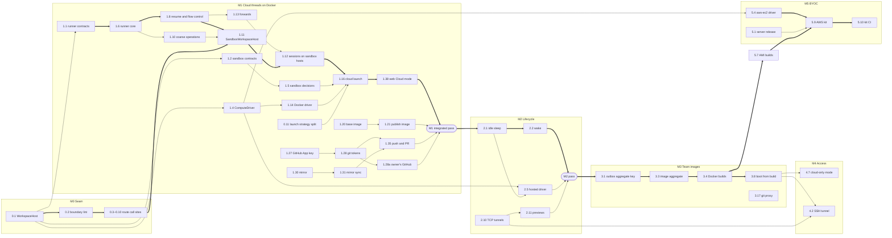

# 10 Delivery plan

Status: proposal, 2026-11-06. Nothing here is built. This page puts the work in docs 01–09 in
order: which pull requests, in which milestone, what runs in parallel, how each milestone is proved,
how it rolls out, and what maintainers must decide first. It follows the decisions, milestones and
words in the [plan](./README.md). Contract and client rows come from
[08 Clients and contracts](./08-clients-and-contracts.md) §9, which owns their detail.

## 1. Summary

Build the seam first, then the smallest real cloud. M0 routes every machine access through
`LocalWorkspaceHost` and changes nothing. M1 is the big one: the runner, the sandbox record, the
Docker compute driver, the base image, credentials, the mirror and the client surfaces, all on a
Docker host the team already has. Only Docker ships before sleep exists, because an idle Docker
machine costs only the box. M2 adds sleep, wake, previews, usage and the first hosted vendor. M3
adds team images and the other providers, M4 adds SSH, moving threads and cloud-only mode, and M5
puts the team server and sandboxes in the customer's own cloud. Inside M1, three tracks run side by
side once M0's interfaces are fixed: the runner protocol, the driver and lifecycle, and the image.
They meet at cloud launch.

Sizes assume an engineer-week is one engineer who knows this codebase, driving coding agents, with
review and verification included. They exclude waiting on vendors or terms. Treat them as ±50%.

| Milestone | Goal | Exit criteria a user can check | Size | Unblocks |
| --------- | ---- | ------------------------------ | ---- | -------- |
| M0 Seam | Every thread-scoped process, PTY, file, watch, port, disk check and host fact goes through `WorkspaceHost`. | Nothing changes. Local and worktree threads behave as on `main`; the perf checks and git metrics show no regression. | S, 3–4 weeks | Every M1 track. A possible upstream offer. |
| M1 Cloud threads on Docker | A cloud thread runs its agent, terminals and git in a Docker sandbox. | An admin enables Docker. Anyone starts a cloud thread from web, desktop, mobile, MCP or `t3 thread`; a Claude or Codex turn streams, a terminal opens, a side chat shares the machine, the diff shows, and **Commit, push & create PR** opens a GitHub PR, as the App's bot when an admin added its key or as the thread owner with their own GitHub. | XL, 18–24 weeks | Dogfooding. The hosted driver and sleep. |
| M2 Lifecycle and a hosted driver | Sandboxes cost nothing while idle, and a team needs no Docker host. | An idle machine sleeps and wakes on send. Diffs and files read while asleep. Previews open. Settings shows caps and hours. The hosted vendor works. Scheduled tasks start cloud threads. | L, 12–16 weeks | Conductor refugees. Team image builds on the vendor. |
| M3 Team images | Admins own the machine. | An admin builds, activates and rolls back a team image, and an image thread's build waits for **Activate**. GitLab and other hosts push. OpenCode, Grok and Kiro run in cloud. | L, 10–12 weeks | AMI builds for M5. |
| M4 Access and trust | Members reach the machine; the server runs no agents. | **Open in editor** opens VS Code over SSH. **Continue in cloud** and **Continue locally** keep history and changes. Cloud-only mode refuses local threads. | M, 8–10 weeks | The BYOC security story. |
| M5 BYOC | Everything runs in the customer's account. | `terraform apply` in a fresh AWS account gives a team server whose cloud threads run on EC2, in under two hours. GCP follows. | L, 9–12 weeks | Design partners. |

## 2. Pull request plan

One row is one pull request, following [AGENTS.md](../../../AGENTS.md#pull-requests): conventional
title, plain language, the model and harness in the body. "Owner" names the doc and section the
work comes from. Rows that two docs both listed are merged and name both. "Parallel" says whether
the row can be built while its siblings are; "critical" marks the critical path.

### M0 Seam: no behavior change

Every row is a refactor or a declaration nothing reads yet. A row that changes behavior on a local
thread is a bug in that row. New code goes in `apps/server/src/workspaceHost/` (decision 14).

| # | Title | Owner | Needs | Parallel |
| - | ----- | ----- | ----- | -------- |
| 0.1 | `refactor(server): add WorkspaceHost, WorkspaceHosts and LocalWorkspaceHost` | [02](./02-workspace-host.md) §2, §6 PR 1 | — | Critical. Fixes the interfaces M1 builds on. |
| 0.2 | `chore(lint): keep workspace access behind WorkspaceHost` (`t3code/workspace-host-boundary`, reasoned disables on every current violation) | 02 §6 "The lint rule" | 0.1 | Critical |
| 0.3 | `refactor(server): route git and checkpoint capture through WorkspaceHost` (with the op-count test; includes VCS detection's disk checks and `GitManager`'s path canonicalization) | 02 §6 PR 3 | 0.2 | Yes, with 0.4–0.10 |
| 0.4 | `refactor(server): route workspace files and known workspaces through WorkspaceHost` | 02 §6 PR 4 | 0.2 | Yes |
| 0.5 | `refactor(server): route terminal PTYs and the process table through WorkspaceHost` | 02 §6 PR 5 | 0.2 | Yes |
| 0.6 | `refactor(server): resolve ACP (Replay), Codex and Claude sessions through WorkspaceHost` (Replay (dev) is an ACP agent, so the ACP runtime's session spawn moves; its client files and terminals don't) | 02 §4, §6 PR 6 | 0.2 | Yes; Replay first |
| 0.7 | `refactor(server): take provider base environment from the workspace host` | 02 §6 PR 7; [06](./06-credentials-and-security.md) §11 | 0.2 | Yes |
| 0.8 | `refactor(server): route restore, rollback, PR discovery and cleanup disk checks through WorkspaceHost` (restore safety at admission too) | 02 §6 PR 7b; [07](./07-access-and-data.md) §10 #1 | 0.2 | Yes |
| 0.9 | `refactor(server): read host facts from host.info in thread-scoped code` (the rest of about 110 `HostProcess` reads, and their lint disables) | 02 §2 "Rules the host must follow" | 0.3–0.8 | Last |
| 0.10 | `refactor(server): run port discovery per workspace host` | 02 §6 PR 8 | 0.2 | Yes; may slip to M1 |
| 0.11 | `refactor(contracts): split OrchestrationV2RunWorkspacePreparation from the launch strategy` (no new literal) | 08 §2, §9; README decision 7 | — | Yes; before 1.16 |

0.12 and 0.13 are gone. Settings gate Cloud, since capabilities are fixed at startup (08 §2), and an
unused `cloudAvailability` export would fail knip, so it lands with its first consumer in 1.37.

OpenCode, Pi, Antigravity, Muse and Cursor keep their lint disables after M0, and so do the ACP
runtime's client files and terminals (02 §6).

### M1 Cloud threads on Docker

Three tracks start once 0.1 merges: runner (R), lifecycle and driver (L), image (I). Credentials
(C), data (D) and surfaces (S) join as their inputs land. Server code goes in
`apps/server/src/sandbox/` (decision 14).

| # | Title | Owner | Needs | Parallel |
| - | ----- | ----- | ----- | -------- |
| 1.1 | `feat(contracts): add the runner protocol under @t3tools/contracts/runner` | [03](./03-runner.md) §4, §11 #1; 02 §5 op schemas | 0.1 | R, critical |
| 1.2 | `feat(contracts): add the sandbox record, thread sandboxId and sandbox commands` | [04](./04-sandbox-lifecycle.md) §10 #1; 08 §9; README decision 7 | 0.1 | L |
| 1.3 | `feat(server): project sandboxes and record sandbox usage intervals` | 04 §10 #2 | 1.2 | L |
| 1.4 | `feat(server): add the ComputeDriver service, driver instances, fake driver and contract suite` (with `deleteImage`) | 04 §6, §10 #5; README decision 8 | 1.2, 1.36 | L, with 1.3 |
| 1.5 | `feat(server): decide sandbox commands and run driver effects by generation` (each effect replay safe and bounded at 60 s in the effect worker; was 1.5a) | 04 §10 #3, #4; README decision 6 | 1.3, 1.4 | L |
| 1.6 | `feat(server): add the runner with process, PTY, file and watch handlers` | 03 §11 #2 | 1.1 | R, critical |
| 1.7 | `feat(server): accept runners on /runner/v1/connect with per-boot sandbox tokens` (`sandbox.runner.attached`, `sandbox.runner.lost`) | 03 §7, §11 #3; 06 §7 | 1.1, 1.5, 1.6 | R |
| 1.8 | `feat(server): resume runner streams and bound them with flow control` | 03 §11 #4 | 1.6, 1.7 | R, critical |
| 1.9 | `build(server): pack the runner bundle, serve it by runnerBuildId, add t3 runner prefetch` (history worker built unsplit; a dev bundle built from source carries the Replay agent) | 03 §11 #5 | 1.6, 1.7 | R |
| 1.10 | `feat(server): run search, process table, port listing and checkpoint capture in the runner` (search refresh; baseline, capture and file summary as one call) | 03 §11 #6; 02 §5; 07 §10 #7, #11 | 1.6 | R, with 1.8 |
| 1.11 | `feat(server): add SandboxWorkspaceHost and sandbox root registration` (and the loopback test host) | 02 §6 PR 9; §2, §3, §7 | M0, 1.8, 1.10 | Critical |
| 1.12 | `feat(server): run ACP (Replay), Codex and Claude sessions on sandbox hosts` (history calls and `resolveSettings` through the worker; a Codex home per session) | 02 §6 PR 10; §4 | 1.9, 1.11, 1.13 | Critical |
| 1.13 | `feat(server): forward MCP, the Codex token broker and git credentials over the runner` (MCP as a proxy that checks each bearer) | 03 §8, §11 #7; 06 §5, §7 | 1.8 | R |
| 1.14 | `feat(server): add the Docker compute driver with isolation detection` (limits, network block, no socket) | 04 §7, §10 #6; 06 §8, §9 | 1.4 | L |
| 1.15 | `feat(server): give Docker runners a Unix socket route and a DOCKER_HOST runner URL` | 03 §3.2, §11 #8 | 1.7, 1.14 | L |
| 1.16 | `feat(server): launch cloud threads from the cloud launch input and release them on runner hello` (runs keep `worktree`; recovery re-arm; retry and delegation read `sandboxId`) | 04 §1, §10 #7; 08 §2, §9 | 0.11, 1.5, 1.7, 1.12, 1.14 | Critical |
| 1.17 | `feat(server): share a cloud thread's sandbox with its side chats and forks` (only forks adopt; command ids name the owner) | 04 §10 #8; 07 §10 #5 | 1.16 | Yes |
| 1.18 | `feat(server): queue cloud threads at the team cap and start rate` (a process-wide admission lock; defaults from server config; no member cap, D5) | 04 §4, §10 #9 | 1.17 (both edit `dispatchWithReceipt`) | Yes |
| 1.19 | `feat(server): reconcile sandboxes, stop Docker sandboxes on settle or archive, destroy them with their threads` | 04 §5, §10 #10; 07 §10 #10, #11 | 1.5, 1.14 | Yes |
| 1.20 | `build(sandbox-image): add the Ubuntu base image with pinned Claude and Codex` | [05](./05-team-images.md) §9 1.1 | — | I, from day one |
| 1.21 | `ci: publish the base sandbox image to the GHCR of the repo running the workflow` (on release tags; decision 15, D6) | 05 §9 1.2 | 1.9, 1.20 | I |
| 1.22 | `ci: fail a release whose pinned provider CLIs are unsupported` | 05 §9 1.3 | 1.20 | I |
| 1.23 | `feat(server): pull the base image matching the exact server version, with a sandbox.baseImage override, shown as Pair base` | 05 §9 1.4; D6 | 1.14, 1.21 | I |
| 1.24 | `feat(server): run cloud setup scripts with sandbox paths` | 05 §5, §9 1.5 | 1.11, 1.16 | Yes |
| 1.25 | `feat(server): build sandbox process environments from an allowlist and cloud env` (team, project, reserved names) | 06 §3, §6 | 1.3, 1.11, 1.36 | C |
| 1.26 | `feat(server): give cloud threads their account's headless credential` (setup token, API key, managed Codex; "Local only") | 06 §3 | 1.12, 1.13, 1.25 | C |
| 1.27 | `feat(server): store the team's GitHub App private key under Source Control` (optional; adds the App ID and key settings, which don't exist yet) | 06 §5 | — | C, from day one |
| 1.28 | `feat(server): push from sandboxes with one-hour GitHub App tokens` (helper, `gh` shim, committer) | 06 §5 | 1.13, 1.20, 1.25, 1.27 | C |
| 1.28a | `feat(server,web): push cloud threads with the owner's own GitHub when no App key is set` (member token store and RPC, **Use a token instead** on the member's row in Settings → Team, the credential order in the git-credential path, "Connect GitHub to push") | 06 §5; 08 §2, §4; D1 | 1.28 | C |
| 1.29 | `feat(server): revoke sandbox credentials on stop and destroy and audit git tokens` (with the fork warning) | 06 §2, §7 | 1.19, 1.28 | C |
| 1.30 | `feat(server): keep a bare checkpoint mirror per project` | 07 §1, §10 #2 | 0.1 | D, from M0 |
| 1.31 | `feat(server): pull checkpoint bundles into the mirror at capture` | 07 §1, §10 #3 | 1.10, 1.11, 1.30 | D |
| 1.32 | `feat(server): read cloud thread diffs from the mirror` | 07 §1, §10 #4 | 1.30 (lands before 1.31) | D |
| 1.33 | `feat(server): read stopped cloud threads from the mirror and refuse their writes` (terminals show exited; live terminals and files ride 1.10 and 1.11) | 07 §1, §10 #6, #7, #11 | 1.11, 1.31, 1.32 | D |
| 1.34 | `feat(server): stage attachments into the sandbox` | 07 §6, §10 #8; 02 §1 | 1.12 | D |
| 1.35 | `feat(server): push and open GitHub PRs from cloud threads` | 07 §3, §10 #9 | 1.28, 1.28a, 1.31 | D |
| 1.36 | `feat(contracts,server): add ServerSettings.sandbox driver instances and the project sandboxAllowed and defaultsToCloud overrides` | 08 §2, §9 | 1.2 | S; before 1.4 |
| 1.37 | `feat(client-runtime): present machine status and gate cloud commands with permission atoms` (with `cloudAvailability`, was 0.13) | 08 §8, §9 | 1.2, 1.36 | S |
| 1.38 | `feat(web): offer Cloud in the mode picker, drafts and sidebar` | 08 §4, §9; [01](./01-product.md) §3 | 1.16, 1.37 | S, critical |
| 1.39 | `feat(web): show the machine in the header, banners, thread menu and palette` (`chat.newCloud`) | 08 §4, §9 | 1.37, 1.38 | S |
| 1.40 | `feat(server,web): add Settings → Cloud with the Docker driver, cloud env, and a Test button` (caps read-only) | 08 §4, §9; 01 §6, J1 | 1.14, 1.16, 1.18, 1.23, 1.25, 1.30, 1.36 | S |
| 1.41 | `feat(mobile): start cloud threads, show machine status and add a read-only machines screen` (and D1's token row and push notice) | 08 §5, §9 | 1.28a, 1.37, 1.38, 1.40 | S |
| 1.42 | `feat(server): launch cloud threads from MCP tools and t3 thread start --cloud` (evals) | 08 §6, §9 | 1.16, 1.37 | S |
| 1.43 | `feat(server): notify the prompter and owner when a machine fails` | 01 §5; 08 §9 | 1.16 | S |
| 1.44 | `perf(server): measure runner latency and check the startup budget` | 03 §9, §11 #9 | 1.8, 1.9 | Yes |
| 1.45 | `docs: add the cloud threads guide` | 05 §9 1.6; §5 here | 1.38 | Last |

Prerequisites the docs found, all in this list. The base sandbox image is a Pair release artifact
(1.21, decision 15). The GitHub App private key is an optional admin step; without it, members push
with their own GitHub (1.27, 1.28a; D1). Windows team servers are out of M1 (02 open question 2).

### M2 Lifecycle and a hosted driver

| # | Title | Owner | Needs | Parallel |
| - | ----- | ----- | ----- | -------- |
| 2.1 | `feat(server): sleep idle sandboxes from the scheduler` (viewer lease from presence, deadlines, cap pressure) | 04 §2, §10 #11; 08 §9 | M1 | Critical |
| 2.2 | `feat(server): wake sandboxes from threads, terminals, MCP, the CLI and restores` | 04 §2, §10 #12; 07 §10 #15 | 2.1 | Critical |
| 2.3 | `feat(server): recycle sandboxes before a vendor's session limit` | 04 §3, §10 #13 | 2.1 | Yes |
| 2.4 | `feat(server): honor retryAfterMs from compute drivers` | 04 §10 #16 | M1 | Yes |
| 2.5 | `feat(server): add the Vercel Sandbox compute driver` (or E2B; with the hosted security review) | 04 §7, §10 #14; 06 §11 | 1.4, vendor decision; ships after 2.1 | Yes, from M1 |
| 2.6 | `feat(server): pick hosted runner URLs and rotate sandbox tokens daily` | 03 §11 #11 | 1.7 | Yes |
| 2.7 | `feat(server): snapshot the working tree into the mirror before sleep` | 07 §10 #12 | 2.1 | Yes |
| 2.8 | `feat(server,web,mobile): read files and search while asleep, and show asleep terminals` (`stoppedBy`) | 07 §10 #13, #14; 08 §9 | 2.7 | Yes |
| 2.9 | `fix(server): keep status and PR discovery from waking sandboxes` | 07 §10 #16 | 2.7 | Yes |
| 2.10 | `feat(server): tunnel TCP to sandbox ports over the runner` | 03 §11 #10 | M1 | Yes |
| 2.11 | `feat(server): preview cloud threads through per-sandbox browser contexts` (spike first; "Stopped while asleep") | 07 §5, §10 #17, #18; 08 §9 | 2.10 | Yes |
| 2.12 | `feat(server): apply worktree cleanup rules to sandbox disks` (04's defaults) | 07 §9, §10 #19 | 2.1 | Yes |
| 2.13 | `feat(server): rebuild a lost sandbox disk from the mirror` | 07 §9, §10 #20 | 2.7 | Yes |
| 2.14 | `feat(server): fork a cloud thread to a new machine` | 07 §2, §10 #21 | 2.13 | Yes |
| 2.15 | `feat(server): proxy API-key model calls through the team server` (opt-in) | 06 §4 | 1.13 | Yes |
| 2.16 | `feat(server): add member cloud env and mask injected secrets` (and secret-request TTL) | 06 §6, §11; 08 §9 | 1.25 | Yes |
| 2.17 | `feat(web,mobile): edit caps, add an optional member cap, and show sandbox hours in Settings → Cloud` (`TeamUsageResult.sandboxRows`) | 04 §4, §10 #15; 08 §9 | 2.1 | Yes |
| 2.18 | `feat(server): launch cloud threads from scheduled tasks and webhooks` (`discardOnSettle`) | 01 J7; 08 §6, §9 | 2.2 | Yes |
| 2.19 | `feat(server): mirror provider session files` (if accepted) | 04 open question 2 | 2.7 | Yes |
| 2.20 | `feat(contracts,web,mobile): choose a machine size at launch` | 08 §9 | 2.5 | Yes |
| 2.21 | `docs: cover sleep, previews, usage and the hosted driver` | §5 here | 2.5 | Last |

### M3 Team images

| # | Title | Owner | Needs | Parallel |
| - | ----- | ----- | ----- | -------- |
| 3.1 | `feat(server): key outbox effects by aggregate` (outbox table rebuild with an aggregate kind and id, a `team-image` receipt and stream kind, a commit path that writes its effects, its lock; thread effects unchanged; bounds for build effects) | 05 §3, §9 3.1; README decision 9 | M2 | Critical |
| 3.2 | `feat(contracts): add team image recipes, builds and RPC methods` | 05 §9 3.2; 08 §9 | M2 | Yes, with 3.1 |
| 3.3 | `feat(server): add the team-image aggregate with one build at a time` | 05 §3, §9 3.3 | 3.1, 3.2 | Critical |
| 3.4 | `feat(server): build team images on Docker by snapshot` (`docker commit`) | 05 §9 3.4; 04 §10 #17 | 3.3 | Critical |
| 3.5 | `feat(server): fail builds that leak a secret and redact build logs` | 05 §6, §9 3.5 | 3.4 | Yes |
| 3.6 | `feat(server): build team images on the hosted driver` | 05 §9 3.6; 04 §10 #17 | 3.4, 2.5 | Yes |
| 3.7 | `feat(server): activate, roll back and garbage-collect builds` (`deleteImage`) | 05 §4, §9 3.7 | 3.4 | Yes |
| 3.8 | `feat(server): boot cloud threads from the active build` | 05 §5, §9 3.8 | 3.7 | Critical |
| 3.9 | `feat(web): add the Team image page` | 05 §8, §9 3.9; 08 §9 | 3.7 | Yes |
| 3.10 | `feat(server): let image threads edit and build with their authors' authority` (MCP toolkit, evals) | 05 §7, §9 3.10; 08 §9 | 3.7 | Yes |
| 3.11 | `feat(server): let cloud threads propose install script changes` | 05 §9 3.11 | 3.10 | Yes |
| 3.12 | `feat(mobile): show the active build and push build results` | 05 §9 3.12; 08 §9; 01 §5 | 3.9 | Yes |
| 3.13 | `build(sandbox-image): add OpenCode, Grok and Kiro` (and the rebuild hint) | 05 §9 3.13 | 1.20 | Yes |
| 3.14 | `feat(server): run ACP agents on sandbox hosts with API keys` (Grok, Kiro) | 02 §4; 06 §3 | 3.13 | Yes |
| 3.15 | `feat(server): run OpenCode on sandbox hosts` (per-host ledger) | 02 §4; 06 §3 | 2.10, 3.13 | Yes |
| 3.16 | `feat(server,web,mobile): stage attachments, check rollback and mark new providers cloud-ready` | 07 §10 #22; 08 §9 | 3.14, 3.15 | Yes |
| 3.17 | `feat(server): push other git hosts through the server's git proxy` | 06 §5 | 1.13 | Yes, from M2 |
| 3.18 | `feat(server): enforce egress allowlists on Docker` | 06 §8 | 1.14 | Yes |

### M4 Access and trust

| # | Title | Owner | Needs | Parallel |
| - | ----- | ----- | ----- | -------- |
| 4.1 | `feat(server,web): register member SSH keys in Settings → Cloud → Access` (and SSH device credentials) | 07 §7, §10 #23; 08 §9 | M3 | Yes |
| 4.2 | `feat(server): tunnel SSH to sandboxes through the team server` (`t3 ssh proxy`, `setup`, authorized keys) | 07 §10 #24; 03 §11 #12 | 4.1, 2.10 | Critical |
| 4.3 | `feat(web,desktop): open a cloud machine in VS Code, Cursor, Zed or JetBrains` (`sandbox` open target) | 07 §10 #25; 08 §9 | 4.2 | Yes |
| 4.4 | `feat(server,web): continue a local thread in cloud` (every entry point; MCP `t3_thread_move`) | 07 §8, §10 #26; 08 §9 | M3 | Yes |
| 4.5 | `feat(server,web): continue a cloud thread locally on the team server` | 07 §10 #27; 08 §9 | 4.4 | Yes |
| 4.6 | `feat(desktop): continue a cloud thread on a member's own machine` | 07 §10 #28; 08 §9 | 4.5 | Yes |
| 4.7 | `feat(server): add cloud-only server mode` (every row of 06 §10) | 06 §10, §11; 08 §9 | M3 | Critical |
| 4.8 | `feat(server): serve sandbox forwards from an /mcp-only listener` | 03 §8, §11 #12 | 4.7 | Yes |
| 4.9 | `feat(contracts): add limits.cloud and cloudOnly to managed policy` | 01 J10; 08 §9 | 4.7 | Yes |
| 4.10 | `feat(server): proxy every API-key account in cloud-only mode` | 06 §4 | 2.15, 4.7 | Yes |

### M5 BYOC

| # | Title | Owner | Needs | Parallel |
| - | ----- | ----- | ----- | -------- |
| 5.1 | `ci: publish versioned Pair team server releases` (decision 15) | [09](./09-byoc.md) open question 4 | — | Yes, from M3 |
| 5.2 | `feat(secrets): add an AWS Secrets Manager secret provider` | 09 §9 #1 | — | Yes, any time |
| 5.3 | `feat(secrets): add a GCP Secret Manager secret provider` | 09 §9 #2 | — | Yes, any time |
| 5.4 | `feat(server): add the aws-ec2 compute driver` | 09 §3, §9 #3; 04 §10 #18 | 1.4 | Critical |
| 5.5 | `feat(contracts): add aws-ec2 driver settings` | 09 §9 #4; 08 §9 | 5.4 | Critical |
| 5.6 | `feat(server,web): check the EC2 and runner network paths and show driver health` | 09 §9 #5; 08 §9 | 5.4 | Yes |
| 5.7 | `feat(server): build team images as AMIs` (provision on stock Ubuntu, first build at setup) | 09 §9 #6; 05 §9 M5, open question 4 | 3.4, 5.4 | Critical |
| 5.8 | `feat(server): trust private CAs and egress proxies in the runner` | 03 §11 #13 | 2.6 | Yes |
| 5.9 | `feat(infra): add the AWS deployment kit` | 09 §6, §9 #7 | 5.1, 5.5, 5.7 | Critical |
| 5.10 | `ci: apply the AWS kit and run a cloud thread in a test account` (a terminal command and one cheapest-model turn; Replay exists only on dev servers) | 09 §9 #8 | 5.9 | Critical |
| 5.11 | `feat(server): add the gce compute driver` | 09 §9 #9; 04 §10 #18 | 5.4 | Yes |
| 5.12 | `feat(infra): add the GCP deployment kit and its CI job` | 09 §9 #10 | 5.11 | Yes |
| 5.13 | `feat(server): export compute driver metrics` | 09 §9 #11 | 5.4 | Yes |
| 5.14 | `perf(server): measure mirror sync and rebuild over a WAN link` | 07 §10 #29 | 5.10 | Yes |
| 5.15 | `feat(server): proxy Claude to Bedrock with the server's role` | 09 §8, §9 #13 | 2.15 | Yes |
| 5.16 | `docs: run the E2B driver against an Embed node` (only if M2 chose E2B) | 04 §10 #19; 09 §3 | 2.5 | Yes |
| 5.17 | `feat(contracts): restrict drivers with limits.cloud.allowedDrivers` | 08 §9 | 4.9 | Yes |
| 5.18 | `docs: run cloud threads in your own AWS or GCP account` | 09 §9 #12 | 5.10, 5.12 | Last |

## 3. Dependency graph

Thick arrows are the critical path. Everything else can run beside it. M4 and M5 both build on M3
and can overlap; M5 does not need M4's code, only the customer's wish for cloud-only mode.

What can overlap:

- **Inside M0,** 0.3–0.8 and 0.10 are independent once the lint rule lands. The contract row
  0.11 touches no workspace code and can land any time.
- **M0 and M1.** M1's contracts (1.1, 1.2 after 0.11, then 1.36), the driver interface (1.4), the base image (1.20), the
  GitHub App key (1.27) and the mirror store (1.30) need only 0.1's fixed interfaces. They can be
  built while M0's routing PRs land. Nothing that calls `WorkspaceHosts.register` merges before M0
  is done.
- **Inside M1,** the runner track (1.1–1.13) and the driver track (1.2–1.5, 1.14–1.19) meet only at
  1.16. Client row 1.37 can start once 1.2 and 1.36 land. The image track
  (1.20–1.23) meets at the integrated pass.
- **M1 into M2.** The hosted driver (2.5) needs only the driver interface and contract suite (1.4),
  so it can start as soon as the maintainers pick a vendor. It must not ship before sleep (2.1).
- **M2 into M3.** The git proxy (3.17) needs only the forwards (1.13). The team server release
  (5.1) and the secret providers (5.2, 5.3) can land any time.

## 4. Verification per milestone

Every milestone follows [AGENTS.md](../../../AGENTS.md#verifying) and
[testing](../../internals/testing.md): tests at the lowest layer that fails on `main`, no sleeps,
no polling, no wall-clock deltas, `it.effect` on a `TestClock` and `it.live` only for subprocess or
network fixtures. Server tests drain `OrchestrationEffectWorkerV2` or await a persisted event or a
`Deferred`. Each PR runs `vp run check:changed` before it is pushed. Turns use the free Replay
(dev) provider, an ACP agent ([dev-replay-agent.ts](../../../apps/server/scripts/dev-replay-agent.ts))
on the `acpRegistry` driver.
A real provider is used only where the change depends on its behavior, on its cheapest model.

The shared fixtures, built once and reused:

| Fixture | Built in | Used for |
| ------- | -------- | -------- |
| `layerFromContext`, `layerRecording` hosts | 0.1 | M0 op counts; every existing test keeps its fakes |
| `layerLoopback` host, frame delay on `TestClock` | 1.11 | Runner encoding, cancellation and the latency model, with no network or container |
| In-process runner over an in-memory socket pair, with fault injection | 1.6, 1.8 | Resume, leases, boot ids, revocation, mid-chunk drops |
| `FakeComputeDriver` and fake runner hub | 1.4 | Every sandbox decision; the test decides when the backend answers |
| `computeDriverContract(makeDriver)` | 1.4 | Docker in CI on Linux; vendors and EC2 nightly with credentials |

### M0

- **Tests.** `forPath` routing and fail-closed, the lint rule's cases, and op counts for checkpoint
  capture and local status equal on `main` and after the refactor, in the existing `GitVcsDriver`
  and `GitManager` cases (02 §7). Otherwise the existing suites pass unchanged, and that is the
  proof.
- **Performance.** No regression. Op counts are the correctness check. Before and after 0.3 and
  0.6, run ten Replay turns on a dev server and compare `t3_git_command_duration` and
  `t3_git_commands_total` from [Metrics.ts](../../../apps/server/src/observability/Metrics.ts);
  attach the comparison to the PR. `vp run test:perf:v2-wire` stays unchanged, since nothing changes
  on the wire ([performance regressions](../../internals/performance-regressions.md)).
- **Integrated pass.** One [test-t3-app](../../../.agents/skills/test-t3-app/SKILL.md) run after
  the last row: a Replay turn, a terminal, a diff and a restore on a local and a worktree thread.
- **Evidence.** Op-count diffs and the metrics table. No captures, because nothing is visible.

### M1

- **Tests.** Codec round trips; runner handlers through `RpcTest.makeClient`; resume and lease
  expiry with `TestClock.adjust`; fault injection (03 §10). The existing checkpoint capture, diff
  and restore cases run once more against the loopback host, as one parameterized describe (02 §7).
  Sandbox decisions with the fake driver: launch released by hello, one wake from two side chats,
  hand-over on owner delete, a shared sandbox counted once, recovery re-arming a waiting run, a
  hung driver call failing into the retry path at its bound (04 §9). A cloud thread's shell and run
  record decode on the previous release's schemas (08 §2). Mirror tests on a bare repo (07 §10). Credential scope: a forward refuses another
  sandbox's thread, and the git helper answers only the thread's remote (06). One `it.live` test
  starts `node src/bin.ts runner` against a test server; the Docker contract suite runs in CI.
- **Performance.** The latency budget from [03 §9](./03-runner.md#9-performance) on Docker on the
  same machine: provider stdout adds at most 1 ms at p50 and 5 ms at p99, keystroke to echo 2 ms,
  PTY throughput 50 MB/s, server memory under 8 MiB per sandbox, and 500 ms from "started" to
  runner attached with the bundle present. 1.44 runs the benchmark and fails when a Docker figure
  regresses. Product targets from [01 §9](./01-product.md#9-success-metrics): time to first token
  within 300 ms of a worktree thread at p50, and Send to runner connected under 5 s at p50. Two
  measurements decide follow-ups: `vcs.localStatus` joins the coarse list only if it adds more than
  300 ms at 75 ms RTT on the loopback host (02 §5), and the mirror sync moves after commit if its
  p95 exceeds one second (07 open question 1).
- **Integrated pass.** test-t3-app on web and desktop with Docker on the dev machine: enable the
  driver, start a cloud thread, run a Replay turn, open a terminal, start a side chat, read the diff,
  push to a test repo and open a PR, once with the App key and once with only a member's token. [test-t3-mobile](../../../.agents/skills/test-t3-mobile/SKILL.md)
  starts a cloud thread and reads its status. Then one real Claude turn on Haiku with a setup token
  and one managed Codex turn on its cheapest model, because the credential paths depend on those
  CLIs. This needs the GitHub App and test org, listed under
  [open follow-ups](../decisions.md#open-follow-ups), plus a test member's fine-grained token.
- **Evidence.** Before and after captures of the composer, the thread header and Settings → Cloud
  on web, desktop and mobile. A short video of a thread going from "Starting machine" to its first
  token, because it is timing. The benchmark table on 1.44. A short runtime transcript on
  server-only PRs (driver, runner route, reconciler).

### M2

- **Tests.** `idleDecision` and `planReconciliation` stay table tests; lifecycle deadlines, idle
  sleep and recycling run on `TestClock`. Wake storms: forty subscriptions send no wake. Restore
  waits through `waking` to `ready` by draining the worker (07 §10 #15). Asleep reads from the
  snapshot tree. The hosted driver passes the contract suite nightly.
- **Performance.** From 01 §9: from asleep, time to first token under 20 s at p50 and 45 s at p95 on
  the hosted vendor; a new hosted cloud thread under 30 s at p50 before setup; 30 concurrent cloud
  threads with no rise in p95 event latency for other threads. The model proxy turns on by default
  only when its time to first token is within 10% of direct (06 open questions). The preview
  spike proves `<-loopback>` through Playwright's context proxy before 2.11 is built.
- **Integrated pass.** test-t3-app on the hosted driver: sleep, wake on send, read a diff and a file
  while asleep, open a preview. test-t3-mobile wakes a thread and reads usage.
- **Evidence.** Videos of sleep and wake, and of a preview loading. Captures of Settings → Cloud
  usage. The hosted driver's security review (06 §11) in the description of 2.5.

### M3

- **Tests.** Existing thread effect tests pass unchanged on the aggregate-keyed outbox, and a
  non-thread effect claims and runs (05 §9 3.1). Decider tests per build transition and refusal; effect-worker drain tests through a
  build; a leaked `~/.npmrc` fails the build; garbage collection keeps active, referenced and newest
  builds; image-tool permission tests, including a teammate's **Steer now** and a queued run (05
  §9). The `mcp-tool-use` [evals](../../../evals/README.md) run for the new toolkit, and
  `agentContextBudget.json` stays within budget.
- **Performance.** Activate applies a rollback in under 10 s (01 J8 says "at once").
- **Integrated pass.** test-t3-app builds, activates and rolls back on Docker; test-t3-mobile
  receives the build push.
- **Evidence.** Captures of the Team image page, a real build transcript, and the eval output.

### M4

- **Tests.** A removed member's SSH key is refused and tunnels close on sleep (07 §10 #24); moves
  carry branch, uncommitted files and checkpoint refs; cloud-only mode refuses each row of 06 §10.
- **Integrated pass.** Open a machine in VS Code over SSH, continue a thread locally and back, and
  turn cloud-only mode on and off. JetBrains Gateway's use of `ProxyCommand` is checked here (07 §7).
- **Evidence.** A video of open-in-editor and of a move. Captures of the cloud-only setting and the
  amended invite text.

### M5

- **Tests.** The `aws-ec2` and `gce` drivers pass the contract suite. The IAM policy passes the
  policy simulator (09 §4). The kit's CI job applies Terraform in a test account and runs a cloud
  thread (a terminal command, one cheapest-model turn) through sleep, wake and destroy (5.10).
- **Performance.** A new team deploys the kit in under two hours (01 §9); 5.14 records WAN sync and
  rebuild times.
- **Evidence.** The CI log of the apply, and a transcript of the cloud thread on EC2.

## 5. Rollout

### Off until an admin configures a driver

Decision 7 is the switch. With no compute driver configured, nothing changes on the wire or in the
UI, on solo or team servers. There is no separate feature flag: a second switch would be one more
state to test, and the driver setting already gates every surface. Within cloud, two settings
narrow it: the per-project allow-list (01 §6) and the opt-in model proxy (06 §4). Pushing needs no
admin step: without the App key, each thread pushes with its owner's own GitHub (D1). New clients
show Cloud only when `ServerSettings.sandbox` lists a driver. Older clients never offer it and see cloud
threads as worktree threads, because runs keep `worktree` and projects use the sibling
`defaultsToCloud` (08 §2). M0 and the early M1 PRs merge to `main` with no driver able to be configured until 1.40 lands, so partial work is
invisible.

### Dogfooding on Pair's own team server

| Stage | Who | Driver | Exit |
| ----- | --- | ------ | ---- |
| M1 alpha | The engineers building it | Docker on the dev machine, through `vp run dev` with seeded data | The M1 integrated pass |
| M1 dogfood | Pair's team | Docker on a second Linux host through `DOCKER_HOST`, rootless or gVisor | 30% of new threads are cloud threads in two weeks, under 2% fail to start (01 §9) |
| M2 dogfood | Pair's team | The hosted vendor, with a team cap and the default idle timeout | Idle awake share under 25% (01 §9); a month's bill read against the cost model |
| M2 outside | Three outside teams | Their choice | Running cloud weekly |

The team server for dogfooding must be always on. A desktop-hosted server stops cloud turns when
its laptop closes (decision 1), and Settings says so.

### Conductor Cloud users

If the reported dates hold, Conductor Cloud shuts down before M1 ships (01 §1). Migration notes go
out in two steps:

- **At M1:** a short section in the cloud guide for teams that can run Docker: install a team
  server on an always-on machine, invite the team, have members connect GitHub (or add the App key), paste the Conductor
  install script into each project's setup script (moving `dnf` to `apt-get`, 05 §2), and add
  headless provider credentials on the web. No transcript import.
- **At M2:** a migration page built on 01 J11's mapping table, since M2 is the first milestone a
  refugee would call a replacement. **At M3** it points the install script at the team image.

### Docs to update when each milestone lands

Per the [documentation rules](../../../AGENTS.md#documentation): user docs for tasks, internals
only for constraints the code cannot show, no feature catalogs.

| Milestone | `docs/user` | `docs/internals` | `docs/product` | `docs/operations` |
| --------- | ----------- | ---------------- | -------------- | ----------------- |
| M0 | None | One page for the seam: the reserved `/t3-sandbox/` root fails closed, thread-scoped code reads `host.info`, and the host owns the base environment | None | None |
| M1 | New cloud guide (enable Docker, isolation advice, setup scripts in cloud, what agents can read); [source-control](../../user/source-control.md) for the App key; [team](../../user/team.md) for bringing a GitHub token; [outside-agents](../../user/outside-agents.md) for cloud launches | [overview](../../internals/overview.md): runner hello marks ready, the mirror is fetched and never checked out | [pair-features](../pair-features.md) entry; [decisions](../decisions.md) amendments from 01 §5 marked M1; drop the concurrency-cap follow-up | Publishing the sandbox image in [release](../../operations/release.md) |
| M2 | Cloud guide: sleep, previews, the hosted driver, the model proxy; [usage](../../user/usage.md) for sandbox hours; [remote-access](../../user/remote-access.md) for Tailscale-only servers | None unless a trap appears | pair-features; decisions for M2 notifications | None |
| M3 | Cloud guide: team images, the admin agent, other git hosts | None | pair-features | None |
| M4 | Cloud guide: SSH, moving threads, cloud-only mode; [managed-policy](../../user/managed-policy.md) for `limits.cloud`; [team](../../user/team.md) for the new trust text | None | decisions: "Membership is the trust boundary" | None |
| M5 | A BYOC guide; [install](../../user/install.md) links it | None | pair-features | Team server release steps |

## 6. Risk register

Likelihood and impact are H, M or L. "Retired" is the milestone after which the risk no longer
needs watching, or "open" when it stays a property of the product.

| Risk | L | I | Owner | Mitigation | Retired |
| ---- | - | - | ----- | ---------- | ------- |
| Upstream merges conflict with the seam and new code (Pair is a fork). | H | M | 02 §8; decision 14 | New code in `sandbox` and `workspaceHost` folders; mechanical upstream edits; merge upstream just before M0 and land M0 quickly; offer the seam upstream. | Open; lowest after M0 |
| M0 changes local behavior or speed. | M | H | 02 §6 | One concern per PR, op-count tests, metrics comparison, the boundary lint. | M0 |
| Provider stdio and git over the runner add visible latency. | M | H | 02 §5; 03 §9 | Exec frames of one round trip, coarse operations from M1, mirror diffs, budgets in 1.44, loopback host with injected delay. | M1 (Docker), M2 (hosted) |
| A socket blip fires an adapter timeout. | L | M | 03 §5 | 120 s lease and resumed streams; replay tests through a 60 s drop. | M1 |
| A server restart ends every cloud turn. | H | M | 03 §5 | Deliberate; restart recovery and `RestartContinuation` take over, as for local agents. | Open |
| Cloud turns stop when the team server sleeps (always-on requirement). | H | M | Decision 1; 01 J5 | Settings warns on a desktop-hosted server; docs recommend a background service on an always-on host. | Open |
| Plain runc Docker is not a security boundary. | H | H | 06 §9 | Isolation detection and a warning; recommend rootless or gVisor; separate `DOCKER_HOST`; dropped capabilities, no socket. | M2 for hosted teams; open on Docker |
| Idle machines run up a bill. | M | H | 04 §2, §8 | Only Docker before sleep; caps and start rate from M1; idle sleep, cap pressure and reconciliation every 10 min in M2; hours in Settings. | M2 |
| Leaked sandboxes keep billing after a crash. | M | M | 04 §5 | Tagged names, the reconciler at startup and every 10 minutes, idempotent effects. | M1 |
| The hosted vendor changes price, limits or terms, or fails. | M | M | 04 §8; 09 §2 | Small driver interface and contract suite; E2B and boat as alternates; build only on open components. | Open |
| Provider terms forbid subscription tokens in sandboxes. | M | H | 06 §3 | Setup tokens only on a team's own server; API keys for any hosted tier; the model proxy never carries subscriptions; revisit when primary terms are found. | Open |
| A hijacked agent reads its provider credential. | H | M | 06 §1 | Only its thread's account, in memory; brokered Codex tokens; the model proxy for API keys; Settings states the residual. | Open |
| Side chats and forks read each other's credentials through `/proc`. | M | M | 06 §2 | Warn on fork; per-thread users only if asked. | Open |
| A stolen sandbox token yields future credentials of that boot. | L | H | 03 §6 | Per-boot tokens in tmpfs, one socket per sandbox, revocation on sleep and destroy. | Open |
| Runner protocol handlers on the server become an attack surface. | M | H | 06 §1 | Server checks every frame against its own sandbox; fuzz the handlers. | M1 |
| The mirror parses objects from an agent-controlled machine. | M | M | 07 §1; 06 §10 | Server pulls; `index-pack --strict` on import; bare repo, never checked out, no diff or filter drivers. | M1 |
| Hosted sandboxes cannot reach a Tailscale-only server. | H | M | Decision 4; 03 §3.2 | Settings says so before offering a vendor; T3 Connect route; BYOC with a subnet router. | Open |
| T3 Connect routes sandbox bytes through a third party. | M | M | 09 §1 | The BYOC kit keeps runners on the VPC route. | M5 |
| Conductor refugees choose another product before M2. | H | M | 01 §1 | Ship M1 on Docker quickly; publish migration notes; stress BYOC and open source. | M2 |
| Recovery retires runs waiting on a booting sandbox. | M | M | 04 §1 | Re-arm case and test in 1.16. | M1 |
| An admin agent plants a backdoor in the image. | L | H | 05 §7 | Authority from the run's human authors; agent builds wait for **Activate** with a diff. | Open |
| A build secret lands in an image. | M | H | 05 §6 | Environment only, leak check, log redaction, editor warning. | M3 |
| GitHub installation tokens cannot be revoked early. | M | L | 06 §5 | One-hour expiry is the bound; no `workflows` permission; branch protection. | Open |
| An agent reads its owner's own GitHub token, which lasts longer and reaches more repos than an installation token. | M | H | 06 §5; D1 | Only the owner's threads, only the project remote and its fork; Settings warns; the App key stays the recommended setup; the M3 git proxy swaps in a placeholder and refuses branch deletions and tag pushes. | M3 |
| BYOC wakes fail on zone capacity, or boot slowly from lazy snapshots. | M | M | 09 §3 | Zone fallback through snapshot relaunch; Fast Snapshot Restore as an opt-in. | M5 |
| No team server release exists for the kit to install. | H | H | Decision 15; 09 §6 | 5.1 starts in M3. | M5 |
| M1 is too big to finish while refugees are still looking. | M | H | This doc | Three parallel tracks; non-goals held firmly; Docker-only M1. | M1 |

## 7. Decisions maintainers must make

Engineering calls are left to the owning docs. These need a maintainer.

Decided for M1, inferring from Conductor Cloud, then Claude Code and Codex cloud:

- **D1.** Without the App key, cloud threads push with their owner's own GitHub, connected or a
  pasted token (1.28a). Precedent: Claude Code's `/web-setup`.
- **D2.** Claude setup tokens are allowed in sandboxes. Precedent: Conductor's `claude setup-token`.
- **D3.** The runner runs as root, agents as `t3` with passwordless `sudo`. Precedent: Conductor
  machines give `sudo`; Claude Code setup scripts run as root.
- **D4.** New threads stay local by default (a worktree on a team server, as today); Cloud is an
  explicit pick, or a project's `defaultsToCloud`. Precedent: Claude desktop's Local or Cloud selector.
- **D5.** No member cap by default; team cap `floor(vCPUs / 4)` on Docker and 20 hosted; 10 starts
  a minute. Precedent: none of the three publish a per-user cap.
- **D6.** Pair publishes the base image to the GHCR of the repo running the workflow, with a
  `sandbox.baseImage` override. Precedent: Conductor and Anthropic maintain their images.

Still open, the earliest first:

| # | Decision | Options | Recommendation (owner) | Needed by |
| - | -------- | ------- | ---------------------- | --------- |
| 1 | Offer the seam upstream? | Ideas discussion and PRs 0.1, 0.2, 0.3, 0.5; or keep it in Pair | Offer it after M0 lands, with neutral names and the metrics (02 §8) | 0.1, for naming |
| 2 | The M2 hosted vendor | **Vercel Sandbox:** 8 vCPU and 16 GB self-serve, Active CPU pricing about $620 a month for the 04 §8 model, Firecracker, credential brokering, low company risk, no BYOC path. **E2B:** 8 GiB ceiling, idle billed as busy, about $740; its default pause keeps memory, which decision 10 forbids, so the driver must use the filesystem-only pause; build secrets undocumented (05 open question 5); E2B Embed makes a cheap single-node BYOC tier a configuration, not a driver (09 §3) | Vercel, unless early BYOC outweighs machine size (04 §8) | Start of M2 (2.5) |
| 3 | Idle and retention defaults | Idle 20 min hosted and 60 on Docker; settled threads sleep at once; archived destroyed after 7 days, asleep after 30; approvals hold a machine 2 hours; other numbers | 04 §2's numbers, which 07 §9 applies | M2 (2.1, 2.12) |
| 4 | Model proxy default | Opt-in; on by default after measurement; always on in cloud-only | Opt-in in M2, default on within 10% of direct, always on in cloud-only (06 open questions) | M2 (2.15) |
| 5 | Should members see the cost estimate? | Hours only; hours and dollars | Hours only for members; admins see the estimate (01 open question 1) | M2 (2.17) |
| 6 | Mirror provider session files | Yes in M2; never | Yes, so replacements resume natively (04 open question 2) | M2 (2.19) |
| 7 | Recipe format and scope | Pair recipe; Dev Container; Dockerfile; per team or per project; database or repo | A Pair recipe per team, in the database, with a later image base for Dockerfile teams (05 §2, open questions 1, 2) | M3 (3.2) |
| 8 | Who hears that an agent build is ready | The run's admins; every admin | The admins who wrote the run (01 open question 2) | M3 (3.10) |
| 9 | Previews in cloud-only mode (R19) | The server browser loads agent-served pages through the proxy; previews off in cloud-only mode | 07's server-browser design ships in M2; decide at M4 whether cloud-only mode allows it | M4 (4.7) |
| 10 | What else stays on a cloud-only server | A project checkout for PR views and provider logins; nothing | Keep the checkout as data no agent writes (07 §1) | M4 (4.7) |
| 11 | A Viewer role on cloud-only servers | Build now; when asked | When a team asks (01 open question 3) | M4 |
| 12 | SSH into machines | On by default; off by default | On, with one admin switch (07 §7) | M4 (4.2) |
| 13 | Packaging | A free self-hosted; B managed control plane; C support and deployment help | Ship A, offer C informally to the first BYOC teams, defer B (01 §8; 09 open question 5) | M5 |
| 14 | Team server release form | A tarball in the CLI archive format on the fork's GitHub releases; a container image | The tarball, by exact version, with checksums (09 open question 4) | M5 (5.1), decide in M3 |
| 15 | Bedrock behind the model proxy | Yes for Claude; no | Yes, signed by the server's role (09 open question 2) | M5 (5.15) |
| 16 | One cloud account per team in the kit | Dedicated by default; shared | Dedicated by default, shared documented (09 open question 3) | M5 (5.9) |

## 8. What we are not building

From 01 §10, 02, 04, 05, 06, 07 and 09:

- A full T3 server inside each sandbox, or a thread split across two event stores (decision 2).
- Cursor and Muse in cloud; they run inside the server process (decision 2). Antigravity, Pi, fx
  and ACP registry agents stay "not supported in cloud yet".
- Starting an unrelated thread in an existing sandbox (decision 6).
- Pooling or rotating teammates' subscriptions; proxying subscription tokens.
- Sleep that keeps memory: E2B's default pause, EC2 hibernation, GCE suspend (decision 10).
- Live migration of a running turn, and carrying native provider sessions between machines.
- One-way file sync to a laptop, public preview URLs, and per-sandbox DNS or certificates.
- Windows and macOS sandboxes, GPU sandboxes, and Pair-run or resold compute.
- Windows team servers with cloud threads in M1.
- Private threads, per-project permissions, several teams on one server, SSO and billing.
- A runner-versus-server compatibility matrix; the runner never comes from npm (decision 5).
- Dev Container features or Compose as the recipe format; several images per team; scheduled
  rebuilds; Chrome in the base image before previews need it.
- Transcript import from Conductor.
- `cloud` in persisted fields older clients decode strictly, or in the committed project file,
  before upstream T3 Code reads it (README decision 7; 08 §2).
- Kubernetes before a customer asks, and the managed control plane before offering A has users.
- Disk quota machinery on Docker hosts; per-thread Unix users unless a team asks.
- An exportable member audit log and compliance certification claims in M5.

## 9. Conflicts found

None between the docs. The code checks in [implementation](./implementation/README.md) changed
some PR rows here; that page lists each change and why.
