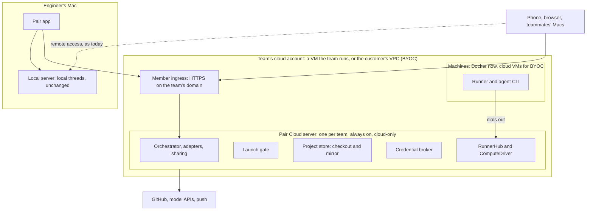

# Pair Cloud: plan

Status: M0 and M1 landed on `feat/pair` (57 PRs; see [progress](./implementation/progress.md)).
The rest is a proposal, rewritten 2026-11-08 for local-first Pair Cloud. The research behind the
first draft is in [Conductor Cloud and Pair's path to parity](../conductor-cloud.md).

Engineers work locally in the Pair Mac app. Its bundled local server runs their threads on their
own machine, as it does today. When they want to share work, they start a cloud session on their
team's Pair Cloud server: one always-on, cloud-only Pair server per team. Pair Cloud clones the
repo and checks out the branch on a machine (a Docker container now, a VM in the
customer's own Google Cloud project or AWS account later), runs the agent there, and every teammate can open the session
and prompt it. The Pair app on desktop, web and phone connects to both servers and sends each
launch to the right one. The two servers never sync.

## Documents

| Doc                                                             | Question it answers                                                                                              |
| --------------------------------------------------------------- | ---------------------------------------------------------------------------------------------------------------- |
| [01 Product](./01-product.md)                                   | Who is this for, what can they do at each milestone, and how does it compare?                                    |
| [02 Workspace host](./02-workspace-host.md)                     | How does the server stop assuming a thread's files and processes are local?                                      |
| [03 Runner](./03-runner.md)                                     | What runs inside a machine, and what does it say to Pair Cloud?                                                  |
| [04 Sandbox lifecycle](./04-sandbox-lifecycle.md)               | How are machines launched, slept, woken, capped and recovered, and on which drivers?                             |
| [05 Team images](./05-team-images.md)                           | How does a team define and build the machine its cloud sessions boot from?                                       |
| [06 Credentials and security](./06-credentials-and-security.md) | How do provider and git credentials reach a machine, and what can a machine reach?                               |
| [07 Access and data](./07-access-and-data.md)                   | How do projects, checkpoints, diffs, terminals and moving sessions work?                                         |
| [08 Clients and contracts](./08-clients-and-contracts.md)       | What changes on the wire, how clients route between servers, and what web, desktop, mobile, MCP and the CLI get? |
| [09 BYOC](./09-byoc.md)                                         | How does a customer run Pair Cloud and its machines in their own cloud?                                          |
| [10 Delivery plan](./10-delivery-plan.md)                       | In what order do we build it, in which pull requests, and how do we know it works?                               |
| [11 Private threads](./11-private-threads.md)                   | Who can open a cloud thread, how does its owner share it, and where is that enforced? (Proposal, not built)      |

## Decisions everything else builds on

1. **Two servers, one job each.** A member's local server, inside the Pair Mac app, runs local
   work exactly as today. The team's Pair Cloud server is the control plane for cloud sessions:
   the orchestrator, event store, projections, auth, members, provider accounts, MCP, scheduled
   tasks, push and presence for everything that runs in a machine. Pair Cloud is cloud-only: every
   agent runs in a machine, never in the server's own checkout or environment, and only a
   cloud-only server offers Cloud. A Docker machine may still share the server's host, so decision
   8's isolation advice matters there. Clients connect to
   both servers and route each launch; the servers never sync threads or state. Because provider
   adapters stay on the server (decision 2), Pair Cloud must stay on, and a laptop never hosts
   cloud sessions. Rejected: a mixed-mode server, the local server orchestrating machines, syncing
   threads between servers, and a multi-tenant control plane that Pair hosts.
2. **A thin runner; adapters stay on the server.** The machine runs a small process that exposes
   processes with stdio, PTYs, files, file watches and TCP ports. Provider adapters, checkpointing
   and git logic keep running on Pair Cloud and reach the machine through the workspace host.
   Rejected: a full Pair server inside each machine, linked as a peer. That splits one thread's
   state across two event stores, and a sleeping machine would take its thread's history offline.
   **Coarse operations** are a fixed, typed list that runs existing server code inside the runner,
   never a second implementation. The search index, port listing, the terminal process table and
   checkpoint capture are on the list from M1; anything else joins only after a measurement.
   Adapters that run inside the server process (Cursor through `@cursor/sdk`, and Muse) can't move
   behind this seam and are "not supported in cloud".
3. **`WorkspaceHost` is the one seam.** Every process, PTY, file, watch, port and disk check (such
   as `realPath` or `exists` on a thread's path) that belongs to a thread's machine goes through
   that thread's workspace host. So do reads of the host's platform, home directory and
   environment. The host also decides the base environment of every process it starts, so the
   server's own `process.env` never leaks into a machine. A thread finds its host from its checkout
   path ([02](./02-workspace-host.md)). `LocalWorkspaceHost` is today's behavior, bit for bit, on
   every local server. On Pair Cloud it serves only server-scoped work and the read-only project
   checkout.
4. **The runner dials out.** One authenticated WebSocket from the runner to Pair Cloud,
   multiplexed into channels. The machine needs no inbound port, so it works in a private VPC or
   behind NAT, but Pair Cloud must be reachable from the machines' network. M2 mounts `/runner/*`
   only when a configured driver needs it, and from M5 it gets a listener that only the machines'
   network reaches. The server mints a sandbox token that reaches only that machine's
   channel. Calls back to the server go through named forwards on the same socket: MCP, the Codex
   token broker and the git credential helper. (Hooks already travel over the provider's stdio.)
   The runner protocol's schemas live in `packages/contracts`.
5. **Same build, served by Pair Cloud.** The runner is a slim entry point of the server's own
   build, identified by a build hash. Pair Cloud serves that bundle to its machines, and images
   cache it by hash. After an upgrade, fetching it at boot is the normal path. It never comes from
   npm, because the `t3` package there is upstream T3 Code. There is still no runner-versus-server
   compatibility matrix.
6. **A sandbox is an event-sourced record.** It lives on its owning thread's event stream, with
   its own projection. It has an id, a project, an owning member, a driver, an image build and a
   state: `provisioning`, `ready`, `sleeping`, `waking`, `failed` or `destroyed`. Each transition
   is a command, then events, then an outbox effect that calls the compute driver. A driver call
   returns "accepted". The sandbox becomes `ready` when its runner says hello, which arrives as its
   own command, so no effect waits on a boot. Each sandbox effect also gets a time bound in the
   effect worker, so a stuck driver call can't block its thread's queue. Runner connection status
   lives in memory; only "attached" and "lost" are events. Idle sleep, deadlines and recycles come
   from a worker on the existing scheduler that dispatches guarded commands, not from delayed
   outbox effects. Side chats and forks of a cloud thread share its machine, as they share a
   worktree locally: they reference the sandbox, lifecycle commands go to the owning thread's
   stream, and the sandbox is destroyed only when no thread uses it. Starting an unrelated thread
   in an existing machine is out of scope.
7. **Cloud is a third way to start a thread, added without breaking old clients.** A thread is a
   cloud thread when it has a `sandboxId`. `cloud` is a new value only in the thread launch input.
   It never goes into the persisted fields that older clients decode strictly: run records still
   say `worktree`, projects get a sibling `defaultsToCloud` flag, and the committed project file
   never offers it ([08](./08-clients-and-contracts.md) lists each hazard). Solo stays T3 Code:
   only a cloud-only Pair Cloud server offers Cloud, and a desktop or solo server never does. In the
   Mac app, Cloud on a local project resolves to the Pair Cloud project with the same origin repo
   (decision 17), and the launch goes to Pair Cloud. On Pair Cloud, every launch path (the UI, MCP,
   `t3 thread`, scheduled tasks, webhooks, `delegate_task`) is a cloud launch through one gate, and
   the server, not the client, picks driver and size. The UI says "Cloud" for the mode and
   "machine" for a sandbox. Code, folders, routes and git refs say `sandbox`, because `cloud`
   already names T3 Connect code such as `apps/server/src/cloud/`.
8. **Compute drivers are pluggable, in this order.**
   - **M1, Docker (landed):** Pair Cloud's driver, on its own machine or another host through
     `DOCKER_HOST`. Plain runc is not a security boundary, so Settings recommends rootless Docker
     or gVisor and says so when neither is in use.
   - **M5, the customer's cloud:** a plain-VM driver on GCE, then EC2 (Google Cloud first, set 2026-11-10). It refuses to run on a
     server that isn't cloud-only.
   - **Later, by demand:** a hosted sandbox vendor (Vercel Sandbox, then E2B, are the analyzed
     options) and Kubernetes.

   Laptops no longer offer the Docker driver. A server can hold several configured driver
   instances, with one server-wide default. The driver interface stays small: create from an
   image, start, stop with the disk kept, snapshot, destroy, status, list and delete an image. An
   optional `buildImage` covers backends that can't snapshot a running machine. Drivers declare
   capabilities (persistent disk, snapshots, egress rules, maximum lifetime, image build strategy).
   Caps on running machines are policy, enforced by the server before it calls a driver.

9. **The team image is Pair's Cloud Computer.** An admin-owned recipe, in Pair's own format,
   produces numbered builds with an active build, history, rollback and logs. A build an admin
   starts activates when it succeeds; a build an agent starts waits for an admin to activate it.
   An agent's authority to edit or build comes from the humans who wrote the current run, checked
   on every call, never from whose thread it is. Each project's setup script still runs on every
   new cloud session, with its paths (such as `T3CODE_PROJECT_ROOT`) pointing into the machine. A
   build belongs to no thread, but outbox rows are keyed by thread today. So M4 makes one change to
   orchestration: outbox rows gain an aggregate key (a table rebuild, since `thread_id` is
   required), receipts and event streams gain a `team-image` kind, and thread effects behave as
   before.
10. **Credentials arrive in memory, never on disk.** A turn runs on the thread's provider account,
    whoever prompts it, as today. By default that is the thread owner's own Claude or Codex
    subscription; a company account in Settings → Providers is the option. Members connect their
    provider accounts and GitHub on Pair Cloud, separately from their Mac, whose own Claude login
    can't serve a machine. Credentials reach a process from an allowlisted environment when it
    starts. Pair writes no credential to a machine's disk or image, and sleep never keeps memory. A
    stopped disk or snapshot still holds code, transcripts and whatever scripts wrote, so it is
    treated as sensitive: encrypted, and deleted when the sandbox is destroyed. Git answers only for
    the thread's project remote, with the first of: a one-hour GitHub App token for that repo, or
    the thread owner's own GitHub credential, either their connected account or a token they bring.
    With neither, the thread can't push. Pushing works only with GitHub until a server-side git
    proxy exists (Later). Pull requests open as the member through their GitHub connection, or with
    the server's account and a "Requested by" line; a PR the agent opens with `gh` in the machine is
    authored by the App, or by the owner when the App isn't installed. A model proxy for company API keys is a later opt-in; subscription tokens
    are never proxied.
11. **Checkpoints are mirrored to Pair Cloud.** The server pulls each turn's checkpoint refs from
    the machine as a git bundle over the runner into one bare repo per project. Diffs of cloud
    threads always read the mirror, so they work while the machine sleeps. A snapshot of the
    working tree taken before sleep backs read-only browsing. Restoring a checkpoint wakes the
    machine. The mirror is part of the Pair Cloud project (decision 16), and from M3 it is where
    seeds land.
12. **Every surface.** Contracts change once in `packages/contracts`, and web, desktop, mobile, the
    MCP tools, the `t3 thread` CLI and scheduled tasks all get cloud sessions. Routing between
    servers lives in `packages/client-runtime`, so web, desktop and mobile share it. The phone keeps
    its connection to a member's Mac and also pairs with Pair Cloud, so anyone can start a cloud
    session from it. Claude and Codex come first. Every other provider adapter gets an explicit
    decision, and "not supported in cloud yet" is an acceptable one.
13. **Reverse states.** A sleeping machine can be woken, a failed one can be retried or discarded,
    and an agent's build can be activated or rolled back. Moving a session from a member's Mac to
    Pair Cloud, and back, comes in M3 (decision 19).
14. **Fork hygiene.** Pair is a fork of T3 Code. New code goes in new `sandbox` folders, and edits
    to upstream files stay small and mechanical so upstream merges stay cheap. The `WorkspaceHost`
    seam is a pure refactor that could be offered upstream.
15. **Pair needs release artifacts.** Pair publishes a base sandbox image (M1, landed) and, from
    M2, versioned Pair Cloud server releases that include the runner tree, because teams install
    and upgrade Pair Cloud rather than run it from a checkout. The BYOC kit (M5) installs the same
    release.
16. **A Pair Cloud project is a read-only checkout plus a mirror.** Pair Cloud clones it with the
    GitHub App token after checking that the member can access the repo, over https from
    github.com only, with hardened git config. No agent works in it: it serves reads and is the base
    machines start from. Members' local projects match it by origin key.
17. **Clients route, guided by capability flags.** A Cloud-target resolver in
    `packages/client-runtime` finds, for each local project, the Pair Cloud project with the same
    origin. Servers advertise member-safe capability flags, and clients show an option only when the
    server reports it. That is also the version-skew rule between a self-hosted Pair Cloud and the
    auto-updating Mac app. Members never see driver configuration. Sidebar grouping by repository
    already ships, so a project shows once across both servers. A cloud-only server is never an Auto
    balance or machine-picker candidate for local modes; it is reached only through Cloud.
18. **Pair Cloud is the only copy of shared sessions.** Its data volume gets hourly snapshots, so up
    to an hour of session history is at risk; code also lives on machines, in the mirror and on
    GitHub. The reconciler has a restore mode, so restoring an older snapshot never destroys live
    machines. The server drains before upgrades. One server serves the whole team, so M2 proves a
    capacity target, 30 concurrent machines, with a load test.
19. **Moving sessions is designed in now and built in M3.** M2's cloud sessions start from a pushed
    branch: Pair Cloud refuses a branch that isn't on origin instead of quietly starting from the
    base, and the client warns about local commits that aren't pushed. M3 adds one seed path (a bundle and a snapshot commit, uploaded over HTTP into the
    mirror) and a context export with cross-environment provenance, used in both directions. M2
    keeps them additive: one place picks where a machine's code comes from, the mirror holds each
    thread's branch, new contract fields are optional, and clients offer only what the server's
    flags report.

## Milestones

Every document assigns its work to these. Each milestone ends with an end-to-end gate: the desktop
app on a member's Mac, through Pair Cloud on a real cloud VM, to a real machine. The next
milestone's PRs merge only after the gate passes
([10 §4](./10-delivery-plan.md#milestone-gates)). G1 runs M1's gate before any M2 PR merges.

| Milestone                               | What a user can do when it lands                                                                                                                                                                                                                                                                                                                                                                                                  |
| --------------------------------------- | --------------------------------------------------------------------------------------------------------------------------------------------------------------------------------------------------------------------------------------------------------------------------------------------------------------------------------------------------------------------------------------------------------------------------------- |
| M0 Seam (landed)                        | Nothing new. Every machine access goes through `LocalWorkspaceHost`, including platform reads and disk checks, with no behavior or performance change.                                                                                                                                                                                                                                                                            |
| M1 Cloud threads on Docker (landed)     | Built on a team server: the Docker driver, the runner, the sandbox lifecycle, the mirror, credentials, and Claude and Codex in machines. This machinery carries over into Pair Cloud unchanged.                                                                                                                                                                                                                                   |
| M2 Pair Cloud on Docker (first release) | A team installs one always-on Pair Cloud server with Docker machines. Members keep working locally in the Mac app, connect it to Pair Cloud, and start a cloud session from a pushed branch on a local project. Teammates join and prompt from web, desktop and mobile, and the phone keeps driving local work through the Mac. Machines sleep when idle and wake on demand. Scheduled tasks on Pair Cloud launch cloud sessions. |
| M3 Continue in cloud                    | Move a local session (unpushed commits, uncommitted files, the conversation) to Pair Cloud, bring a cloud session back to a member's Mac, and let local agents start or delegate cloud sessions through a member-scoped link.                                                                                                                                                                                                     |
| M4 Team images                          | Admins build, version and roll back the machine image, and an admin agent can help.                                                                                                                                                                                                                                                                                                                                               |
| M5 BYOC                                 | The GCE driver and a GCP deployment kit run Pair Cloud and its machines in the customer's own account. AWS follows with the EC2 driver and its kit.                                                                                                                                                                                                                                                                               |
| M7 Cloud browser                        | A cloud session's Browser tab works on every client, backed by Chrome on its machine. Specified in [m7-cloud-browser.md](./implementation/m7-cloud-browser.md); not built.                                                                                                                                                                                                                                                        |
| Later, by demand                        | A hosted vendor driver, SSH and open in editor, the model proxy for company API keys, other git hosts, egress allowlists, OpenCode, Grok and Kiro in cloud. [10 §2](./10-delivery-plan.md#2-pull-request-plan) lists them all.                                                                                                                                                                                                    |

## Decided

### For M1

Settled on 2026-11-06 by following Conductor Cloud, and Claude Code or Codex cloud where Conductor
is silent:

| #   | Decision                                                                                                                                                                                                                                                                                  | Precedent                                                                  |
| --- | ----------------------------------------------------------------------------------------------------------------------------------------------------------------------------------------------------------------------------------------------------------------------------------------- | -------------------------------------------------------------------------- |
| D1  | Cloud threads push without the App key: the thread owner's connected GitHub or their own token ("Use a token instead" in Settings → Team). An installation token wins when the App key is set. No server-login fallback.                                                                  | Claude Code's `/web-setup` and GitHub proxy; Conductor offers no own token |
| D2  | Claude setup tokens are allowed in machines, with a warning that the agent can read them.                                                                                                                                                                                                 | Conductor's copyable `claude setup-token`                                  |
| D3  | The runner runs as root; agents run as `t3` with passwordless `sudo`.                                                                                                                                                                                                                     | Conductor gives users `sudo`; Claude Code's setup scripts run as root      |
| D4  | New threads in the Mac app stay local by default. Cloud is an explicit pick. Amended 2026-11-08: `defaultsToCloud` has no reader once only cloud-only servers offer Cloud, so M2 stops offering it, and defaulting a local project to Cloud is Later.                                     | Claude's Local or Cloud selector and `--cloud`; Codex's per-thread picker  |
| D5  | No member cap by default. The team cap (Docker `floor(vCPUs / 4)`) and 10 starts a minute stay as capacity and spend guards. Amended 2026-11-08: from M2 an admin can set the team cap in the driver's settings, beside its size, since 30 machines would otherwise need a 120-vCPU host. | None of the three publish a per-user cap                                   |
| D6  | Pair's release CI publishes `t3-sandbox:<version>` to the GHCR of the repo that runs it, so forks publish their own. `sandbox.baseImage` overrides it.                                                                                                                                    | Conductor and Anthropic each maintain their base image                     |

### For local-first Pair Cloud

Settled on 2026-11-08 by the maintainers:

| #   | Decision                                                                                                                                                          |
| --- | ----------------------------------------------------------------------------------------------------------------------------------------------------------------- |
| D7  | The first release starts cloud sessions from a branch already pushed to GitHub. Continue in cloud is M3.                                                          |
| D8  | A cloud session runs on its owner's own Claude or Codex subscription by default, with company accounts as an option.                                              |
| D9  | GitHub and pull requests work as M1 ships them (D1, decision 10).                                                                                                 |
| D10 | BYOC members reach Pair Cloud over VPN or Tailscale by default, or an optional public listener that serves only client routes. T3 Connect is off for BYOC.        |
| D11 | Hourly snapshots and the reconciler's restore mode. Continuous replication waits for a customer who asks.                                                         |
| D12 | Laptops and other servers that aren't cloud-only no longer offer Cloud.                                                                                           |
| D13 | Machine images (GCE custom images, then AMIs) are built in the customer's account when the driver is set up. Pair CI runs `provision.sh` on every release.        |
| D14 | Local agents reach Pair Cloud through one member-scoped link, from the laptop to Pair Cloud only (M3).                                                            |
| D15 | Pair Cloud invites the team, at today's trust level, not the whole engineering org.                                                                               |
| D16 | One Pair app build receives notifications from any Pair Cloud server.                                                                                             |
| D17 | The phone keeps its connection to the member's Mac and also pairs with Pair Cloud. Anyone can start a cloud session from it in M2.                                |
| D18 | Each Pair Cloud server targets 30 concurrent machines, proven by a load test before M2 ships.                                                                     |
| D19 | M2 Pair Cloud on Docker, M3 continue in cloud, M4 team images, M5 BYOC. A non-owner who brings a session back (M3) gets a copy, and the cloud session stays live. |

Questions still open are in [10 §7](./10-delivery-plan.md#7-decisions-maintainers-must-make).

## What the 2026-11-08 rewrite changed

The first draft's deep-dive changes are folded into the decisions above. This table lists what the
local-first requirement changed.

| Before                                                                                    | Now                                                                                             |
| ----------------------------------------------------------------------------------------- | ----------------------------------------------------------------------------------------------- |
| Members share a team server. Agents run on its machine, and Cloud is one more mode there. | Members work locally in the Mac app; Pair Cloud runs only cloud sessions.                       |
| Any server, a laptop included, could enable Docker and offer Cloud.                       | Only a cloud-only Pair Cloud server offers Cloud.                                               |
| Cloud-only server mode in M4.                                                             | Cloud-only from M2, the first release.                                                          |
| Moving threads between local and cloud on one server (M4).                                | Moving sessions between a member's Mac and Pair Cloud through a seed and a context export (M3). |
| M2 is lifecycle plus a hosted vendor driver.                                              | Lifecycle is in M2; hosted vendors come later, by demand.                                       |
| Team images in M3, then BYOC.                                                             | Team images in M4, then BYOC in M5.                                                             |
| The model proxy in M2.                                                                    | A later opt-in for company API keys.                                                            |
| A delegated task may name its own sandbox driver and size.                                | The server picks them at one launch gate.                                                       |

## Words

- **Local server:** the server bundled in a member's Pair Mac app. Unchanged by this plan.
- **Pair Cloud server**, or **Pair Cloud:** the team's one always-on, cloud-only Pair server that
  runs cloud sessions and their machines. "Team server" in older text means the shared-shell model
  M1 was built on.
- **Cloud session**, or **cloud thread:** a thread on Pair Cloud with a `sandboxId`.
- **Sandbox:** the VM or container a cloud thread runs in. The UI calls it a machine.
- **Runner:** the process inside a machine that connects back to Pair Cloud, started as
  `t3 runner` from the bundle the server serves.
- **Workspace host:** the server-side service through which a thread reaches its machine, local or
  sandbox.
- **Coarse operation:** one of a fixed list of runner calls that run existing server code inside
  the machine instead of many primitive calls.
- **Compute driver:** the server-side adapter for one machine backend (Docker, EC2, a vendor).
- **Team image:** the admin's recipe for the machine cloud sessions boot from. A **build** is one
  numbered version of it.
- **Sandbox token:** the credential the runner uses, scoped to one machine.
- **Pair Cloud project:** Pair Cloud's record of a repo: a read-only checkout plus the mirror.
- **Mirror:** the bare git repo per project on Pair Cloud that holds cloud threads' checkpoints and
  branches.
- **Seed:** the bundle and snapshot commit a local server uploads to move a session to Pair Cloud
  (M3).
- **Context export:** the conversation one server hands to the other when a session moves (M3).

"Environment" already means one running T3 server, and "workspace" names existing code, so neither
names anything new here.
