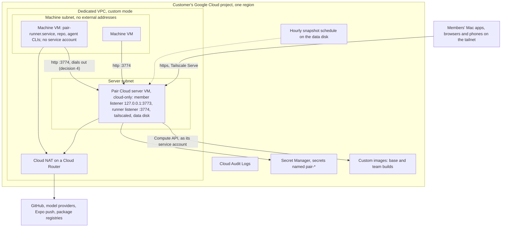

# M5 BYOC: implementation specs

Status: implementation plan, 2026-11-10. Nothing here is built. Read [README](./README.md) first
for the shared names and traps, and [M4](./m4-team-images.md) for the build pipeline this milestone
captures images through. The design is [09](../09-byoc.md), with
[04 §6–§7](../04-sandbox-lifecycle.md) for the driver interface, [03 §3.2](../03-runner.md) for
the runner's route, [05 §1, §3](../05-team-images.md) for machine images and
[08 §9](../08-clients-and-contracts.md) for the contracts; the PR list is
[10 §2](../10-delivery-plan.md#m5-byoc), and [m2-m5](./m2-m5.md#m5-byoc) has each row's scope as
first sharpened. 09 and those rows were written AWS-first; this page reorders them (below).

Each PR follows one template: what it makes true, Needs and Unblocks, Files, Types and services,
Commands and events, Migrations, Tests, Verify, Reviewer checks. Line numbers are from `feat/pair`
at `cc7833040` (2026-11-10, release `0.1.7-pair.6`); re-read every symbol before editing, since
G4 step 1's fixes land on top of this commit. Where a spec says **proposed**, it fills a gap the
design docs left open; a reviewer can overrule it in that PR, and the spec names what else would
change.

M5's PRs merge after [G3](../10-delivery-plan.md#g3-end-of-m3) passed (it has). G4 closes M4 and
M5 together: step 1 is M4's and runs on Docker; steps 2–6 are M5's and run twice, once on Google
Cloud and once on AWS. The [last section](#m5-integrated-pass) turns them into numbered steps.

## The maintainer's answer of 2026-11-10

BYOC covers Google Cloud and AWS, and **Google Cloud launches first.**

- The GCE compute driver (5.11), the GCP deployment kit (5.12) and the GCP Secret Manager provider
  (5.3) move to the front waves and are the critical path. The AWS rows (5.4 driver, 5.9 kit, 5.2
  Secrets Manager, 5.7's AMIs, 5.10 CI) come after. Row numbers do not change.
- Every row 09 and m2-m5 wrote AWS-first is specced so the GCP path lands first and AWS is the
  second implementation of the same seam. [The table below](#how-each-aws-first-row-lands) says,
  per row, whether AWS needs a PR of its own or only a second case.
- G4's steps 2–6 run in two parts: Part 1 on the maintainer's project `vm-provider`, zone
  `asia-south1-a`; Part 2 on AWS.

Decisions this milestone records (not reopened here):

- **D10.** Members reach BYOC Pair Cloud over a VPN or Tailscale. A public listener is an opt-in
  and serves client routes only. T3 Connect is off.
- **D11.** Hourly snapshots of the server's data disk, and the reconciler's restore mode (2.38).
- **D13.** Machine images are built in the customer's account. Pair publishes none. Pair CI runs
  `provision.sh` on a stock Ubuntu VM on every release.
- **#13.** One dedicated cloud project or account per team by default; a shared one is documented.
- **#7.** github.com only. **#12** (Bedrock, 5.15) is Later, not M5.
- The maintainer is away, so every open question takes its proposal. They are listed once, under
  [Open maintainer questions](#open-maintainer-questions).

Engineering calls made here:

- **A row with a Google Cloud PR and an AWS PR keeps one number.** They are written `5.5 (GCP)`
  and `5.5 (AWS)`. This applies to 5.5, 5.7 and 5.18. No row is added.
- **Settings before drivers.** `ComputeDriverFactory<K>` takes
  `Extract<SandboxDriverInstance, { kind: K }>` (ComputeDriverRegistry.ts 47–49), so a driver
  cannot compile before its settings member exists. 5.5 lands before 5.11 and 5.4, the reverse of
  10 §2's "5.5 needs 5.4". M1 hit the same thing (1.36 before 1.4).
- **One guest contract for every VM driver.** A Pair VM image is stock Ubuntu 24.04 plus
  `provision.sh`, `pair-bootstrap` and a systemd unit that reads the bootstrap from the cloud's
  instance metadata ([Shared names](#shared-names)). GCE delivers it as instance metadata, EC2 as
  user data. The driver never runs anything over SSH and machines have no inbound port.
- **The provision tree travels in instance metadata.** `infra/sandbox-image` is 10 KB gzipped
  (measured at `cc7833040`), far under GCE's 256 KB per metadata value. The base image build boots
  stock Ubuntu with the tree and a startup script, with no download from the server and no
  credential. The release carries the tree beside `runner/` (5.7).
- **The driver owns its base image, as Docker owns its pull.** `health.baseImage` reports
  `{ pulling }` while the image builds, a create meanwhile fails with the existing "image is not
  ready" error, and the Test button's `image` step waits on the same state. No new flow, no
  team-image build for the base (09 §6 called the base "the first build of the empty recipe";
  see [Where the code and the design differ](#where-the-code-and-the-design-differ-code-wins-on-facts)).
- **No second `/mcp` listener (5.19).** 03 §8 proposes an in-process listener that mounts only
  `/mcp` as the forwards' target. The forwards already ride the runner socket and never listen
  (RunnerForwards.ts 269–285, a `node:http` server fed forwarded connections); the one network hop
  is the MCP proxy's request to the server's own listener on the same host
  (McpSessionRegistry.ts 90–92), and the proxy passes only a thread token of the session that
  opened the forward (RunnerForwards.ts 59–63). 5.19 moves `/runner/*` and leaves that hop alone.
  **Proposed.** If overruled, 5.19 also serves `McpHttpServer.layer` on a Unix socket under the
  state directory and `RunnerForwards.proxy` dials it.
- **No SDKs.** GCE is JSON over `HttpClient` with a token from the metadata server, as
  `DockerEngineApi.ts` is a typed client over `HttpClient`. The single executable cannot import an
  external package at run time (2.36's note on undici), and a bundled cloud SDK would be most of
  the archive. AWS signs with `aws4fetch` (**proposed**, 5.4).

## Build order

Waves respect every Needs below. About four workers run at once; rows in one wave that touch the
same file land one after the other, in the order listed. **Critical** rows run on Opus at high
effort, **small** rows on Sonnet at high effort.

| Wave | PRs                                                                                                                                               |
| ---- | ------------------------------------------------------------------------------------------------------------------------------------------------- |
| 1    | 5.5 (GCP) gce driver settings (critical) first; then 5.19 internal runner listener (critical), 5.8 CA and proxy (small), 5.20 policy keys (small) |
| 2    | 5.13 driver metrics (small), then 5.11 gce driver (critical); 5.3 GCP Secret Manager (small); 5.17 `allowedDrivers` (small)                       |
| 3    | 5.7 (GCP) machine images (critical), then 5.6 driver health (small)                                                                               |
| 4    | 5.12 GCP kit and its CI job (critical)                                                                                                            |
| 5    | 5.14 network measurements (small), 5.18 (GCP) the BYOC guide (small); then [Part 1](#part-1-google-cloud) of the pass                             |
| 6    | 5.2 AWS Secrets Manager (small), 5.5 (AWS) aws-ec2 settings (small), then 5.4 aws-ec2 driver (critical)                                           |
| 7    | 5.7 (AWS) AMIs (critical)                                                                                                                         |
| 8    | 5.9 AWS kit (critical)                                                                                                                            |
| 9    | 5.10 AWS kit CI (critical), 5.18 (AWS) the guide's AWS section (small), 5.14's second run; then [Part 2](#part-2-aws) of the pass                 |

Same-file order inside a wave:

- Wave 1: 5.5 (GCP) lands first. It widens `RunnerEndpoint.planFor` (5.19 then adds the listener
  to the same file), adds the gce struct to `settings.ts` (5.8 then adds three keys to both driver
  structs) and the driver form to `CloudSettings.tsx` (5.20 then adds the policy rows). 5.19 and
  5.20 both edit `cli/config.ts` and `config.ts`: 5.19 first.
- Wave 2: 5.13 wraps drivers in `ComputeDriverRegistry.ts`; 5.11 adds its factory in `server.ts`
  and touches `SandboxOverview.ts`. 5.13 is small and lands first. 5.17 edits `managedPolicy.ts`
  after 5.20 and `CloudSettings.tsx` after 5.5 (GCP); it shares no file with 5.11.
- Wave 3: 5.7 (GCP) and 5.6 both edit `GceComputeDriver.ts` and `SandboxOverview.ts`; 5.7 first.
- Wave 6: 5.5 (AWS) before 5.4, for the same reason as wave 1.

The critical path to Part 1 is 5.5 (GCP) → 5.19 → 5.11 → 5.7 (GCP) → 5.12 → the pass, and to
Part 2 it is 5.5 (AWS) → 5.4 → 5.7 (AWS) → 5.9 → 5.10 → the pass. Each part also needs a
prerelease that contains its rows.

"No account" says whether the row can be built, tested and merged with no cloud project or
account. "Proves out in" says where its behaviour is first seen for real.

| PR         | Needs (final)                                                       | Size     | No account                              | Proves out in         |
| ---------- | ------------------------------------------------------------------- | -------- | --------------------------------------- | --------------------- |
| 5.5 (GCP)  | 1.36, 2.25                                                          | critical | Yes                                     | 5.12                  |
| 5.19       | 2.22, 2.33, 5.5 (GCP)                                               | critical | Yes                                     | 5.12                  |
| 5.8        | M1, 5.5 (GCP)                                                       | small    | Yes                                     | A customer's proxy    |
| 5.20       | 2.22; 5.19 (file order)                                             | small    | Yes                                     | 5.12                  |
| 5.13       | 1.4, 1.19                                                           | small    | Yes                                     | Part 1                |
| 5.11       | 1.4, 2.1, 2.4, 2.22, 5.5 (GCP), 5.8, 5.19                           | critical | Yes, against the fake API               | Part 1, step 0        |
| 5.3        | —                                                                   | small    | Yes, against a local HTTP fixture       | Part 1, step 3        |
| 5.17       | 5.20, 5.5 (GCP)                                                     | small    | Yes                                     | 5.12                  |
| 5.7 (GCP)  | 4.14, 4.16, 4.17, 5.11, 2.36                                        | critical | Yes: fake API, and a KVM guest in CI    | Part 1, steps 2 and 5 |
| 5.6        | 5.11, 5.7 (GCP), 1.40                                               | small    | Yes                                     | Part 1, step 2        |
| 5.12       | 2.36, 2.37, 2.38, 5.3, 5.5 (GCP), 5.7 (GCP), 5.11, 5.17, 5.19, 5.20 | critical | Plan only (`terraform test` with mocks) | Its CI job; Part 1    |
| 5.14       | 5.12                                                                | small    | No                                      | Part 1                |
| 5.18 (GCP) | 5.12                                                                | small    | Written yes; checked no                 | Part 1                |
| 5.2        | 5.3 (the dialog's kind picker)                                      | small    | Yes, against a local HTTP fixture       | Part 2                |
| 5.5 (AWS)  | 5.5 (GCP), 5.8                                                      | small    | Yes                                     | 5.9                   |
| 5.4        | 5.5 (AWS), 5.11 (shared helpers), 5.6, 5.13                         | critical | Yes, against the fake API               | Part 2                |
| 5.7 (AWS)  | 5.4, 5.7 (GCP)                                                      | critical | Yes, against the fake API               | Part 2                |
| 5.9        | 5.2, 5.4, 5.7 (AWS), 5.12 (shared bootstrap)                        | critical | Plan only                               | 5.10; Part 2          |
| 5.10       | 5.9                                                                 | critical | No                                      | Itself                |
| 5.18 (AWS) | 5.10, 5.18 (GCP)                                                    | small    | Written yes; checked no                 | Part 2                |

No emulator is used. Google publishes none for Compute Engine, and LocalStack would add a
container to CI to cover less of our own error mapping than an in-process fake does. Each driver
gets a fake at its API-client seam (`GceApiTesting.ts`, `AwsEc2ApiTesting.ts`), the pattern
`ComputeDriverTesting.ts` already sets, and `computeDriverContract` runs against driver plus fake
on every CI run. The same suite runs against the real cloud from a VM inside the VPC, behind an
environment flag, as Docker's does behind `T3_TEST_DOCKER=1`.

## What the code changed in 10 §2

Drafting each PR against the code changed the plan in these ways. The [track notes](#track-notes)
give the evidence.

- **Order.**
  - Google Cloud first, AWS second (the maintainer's answer). The shared helpers 10 §2 had 5.11
    take from 5.4 now go the other way: 5.11 writes them, and 5.4 moves them into `vmDriver.ts`
    when the second user arrives.
  - 5.5 before the drivers (above). 5.19 before 5.11, because a VM cannot mount the server's Unix
    socket and the kit keeps the member listener on loopback, so the runner listener is the only
    route a machine has. 5.8 before 5.11, which writes 5.8's bootstrap fields into metadata.
  - 5.17 needs 5.5 (GCP) as well as 5.20: `allowedDrivers` lists driver kinds, and only `docker`
    exists before 5.5.
  - 5.12 carries the GCP kit's CI job, as 10 §2 said; 5.10 stays the AWS kit's.
- **Smaller than the rows said.**
  - **No migrations in M5.** The sandbox record is `payload_json` (migration 088); the driver's
    handle is the opaque `driverRef`; a base image's state lives in the cloud, found by name. The
    highest migration is `096_TeamImageProposals`; the next free number is 097 and no M5 row takes
    it.
  - **5.7 adds no build flow.** `ComputeDriver.snapshot` and `deleteImage` exist
    (ComputeDriver.ts 184–195) and M4 calls them (TeamImageEffectsLive.ts 507–515, 564). A team
    image build on a VM driver is the driver's own `snapshot`, which 5.11 and 5.4 implement because
    the interface requires it. What is left for 5.7 is the base image, the guest files, the release
    carrying the provision tree, and the CI job.
  - **5.19 is one listener.** The runner-only Unix listener already serves `RunnerRoute.layer`
    alone (RunnerEndpoint.ts 118–135); the TCP listener is the same call with a host and a port.
  - **The launch gate already refuses machines off cloud-only** for every driver
    (SandboxDecisions.ts 754–778, ThreadLaunchService.ts 1277, 1779–1780). The VM driver's own
    refusal covers what the gate does not reach: `health` and the Test button, which call the cloud
    API with no launch.
  - **5.13 is cloud-neutral.** The registry wraps every driver it builds, so Docker gets the same
    metrics and neither VM driver carries metrics code.
- **Larger than the rows said.**
  - **5.5 is contracts, server and web.** Widening the union breaks `RunnerEndpoint.planFor`
    (takes `DockerSandboxDriver`, RunnerEndpoint.ts 95–97), `SandboxBootstrapSource.forGeneration`
    (line 71), and `CloudSettings.tsx`, which reads `driver.dockerHost` on every driver (404) and
    has only a Docker form (575–660).
  - **5.3 and 5.2 need a web change.** The secret provider dialog is 1Password-only: its draft is
    `{ name, account }` and it always writes kind `one_password`
    (SecretProviderDialog.logic.ts 42–45, 111–117). 5.3 adds the kind picker; 5.2 adds a case.
  - **5.11's names.** `sandboxBackendName` returns `pair-<8>-sbx_<20 hex>-g<n>`
    (ComputeDriver.ts 202–206). GCE instance names take no underscore, GCE label keys take no dot
    (`sandboxTags` writes `pair.install`, 215–220), and the build pipeline names an image
    `t3-team-image:<n>` (TeamImageEffectsLive.ts 509), which no cloud accepts. Callers also pass a
    backend name where a `driverRef` is unknown (ComputeDriverCheck.ts 206,
    TeamImageEffectsLive.ts 508, 528). The driver maps all three in and out and accepts either form
    of a reference.
  - **5.11's contract suite.** `computeDriverContract`'s stand-in runner listens on a Unix socket
    only (computeDriverContract.ts 41–80). A real VM cannot reach it, so the suite gains a TCP
    listener option, and the real-cloud run needs a guest that posts the stand-in hello.
  - **5.7's release work.** 09 §6 says the release must carry `provision.sh` and the files it
    reads. It does not: the archive has `runner/` only (build-cli-archive.ts 536–555), and
    `codex.env` is generated at build time (apps/server/scripts/sandbox-image.ts 66–107).
  - **5.20 reads the policy at config time.** `cloudOnly` is resolved in `resolveServerConfig`
    (cli/config.ts 357–365), before any layer exists, so the policy file is read there too.
- **Found outside M5.** `SandboxOverview.unreachableMessage` and its timeout text name Docker for
  every driver (SandboxOverview.ts 50–61, 119), and `ComputeDriverError`'s image message says
  "still downloading" (ComputeDriver.ts 66–68). 5.11 and 5.7 (GCP) reword them per kind.
  `ComputeDriverCheck`'s orphan (a check machine left by a crash trips restore mode, noted by 4.14)
  is unchanged and costs more on a VM driver; it still needs its own fix PR.

### Where the code and the design differ (code wins on facts)

- **09 §6: "the base AMI is the first build of the empty recipe."** The build pipeline launches
  its machine with `image: { type: "base" }` (TeamImageEffectsLive.ts 173) and runs its program
  through the runner, and stock Ubuntu has no runner, no `t3` user and no `pair-bootstrap`. The
  base cannot be a team build. The driver builds it (5.7), and a team build starts from it, as on
  Docker.
- **09 §9: "the build program's provision step for VM drivers is there from the start."** It is
  not: `teamImageBuildProgram.ts` has phases preflight, clone, install, env, verify, clean and
  manifest (155–199) and no provision. None is needed, for the reason above.
- **05 §3 step 5: `t3 runner prefetch` bakes the bundle.** M4 skipped it on Docker, where the
  bundle is bind-mounted. On a VM the build machine's own boot downloaded the bundle to
  `/opt/pair-runner/<build>` (pair-bootstrap.sh 51–69), so `snapshot` captures it with the disk and
  sessions from a team build skip the download. A base image has none; its first boot downloads
  about 9 MB from the runner listener.
- **09 §4: "IAM conditions on labels are weaker" on GCP (inferred).** The kit does not use label
  conditions. In a dedicated project the project is the boundary. In a shared project the binding
  is conditioned on the resource name prefix `pair-<install8>-`, which every instance, disk and
  image the driver creates carries (to validate in 5.12).
- **09 §5: runners dial `wss://…:8443` on an internal load balancer.** The server has no TLS
  listener, and a load balancer needs a name, a certificate the machines trust, and DNS. The kits
  default to the runner listener on the server's private address over plain HTTP
  (`ingress = "tailscale"`), and offer 09's load balancer as `ingress = "load-balancer"`
  (**proposed**; see the questions).
- **09 §4, the GCP table: `compute.instances.setLabels`, `compute.disks.use`,
  `compute.subnetworks.use`.** The role 5.12 writes is longer, because of operations polling,
  guest attributes and images. It leaves out `iam.serviceAccounts.actAs` and
  `compute.subnetworks.useExternalIp` on purpose: without them the server cannot give a machine an
  identity or a public address.
- **09 open question 1: turn the metadata endpoint off after the runner's hello.** Not built
  (**proposed**; see the questions). The driver interface has no hook after attach, and GCE's
  metadata server cannot be turned off.
- **04 §7: "`memoryOnStop` is true and left off."** Nothing reads the field. The VM drivers set it
  `false`, since they never suspend or hibernate.
- **08 §9 5.3 and `SandboxDriverIsolation`.** The isolation a client shows is a closed literal
  (contracts sandbox.ts 147), and `SANDBOX_ISOLATION_LABELS` is keyed by it. A fifth value fails
  every older client's decode of `sandbox.overview`, the trap `SandboxDriverCheckStep` documents at 205. VM drivers send `"unknown"` there and a new optional `vm: true`.
- **10 §4: "EC2 and GCE nightly with credentials."** The suite needs a host the VMs can reach, so
  a GitHub runner cannot run it. It runs on a VM inside the VPC, at the gate and whenever the
  driver changes. There is no nightly job in M5 (**proposed**).

### How each AWS-first row lands

| Row  | 09 and m2-m5 wrote                            | Lands first, on Google Cloud                                                                             | AWS after                                                                                              |
| ---- | --------------------------------------------- | -------------------------------------------------------------------------------------------------------- | ------------------------------------------------------------------------------------------------------ |
| 5.5  | aws-ec2 settings, after the driver            | **5.5 (GCP)**: `gce` joins the union; the server and web seams that assume Docker are widened once       | **Its own PR**, 5.5 (AWS): a second union member and a second form. No seam changes                    |
| 5.6  | Check the EC2 API, KMS and the runner route   | 5.6: `ComputeDriverHealth.checks`, the gce checks, the Overview rows, the boot log on a failed Test      | **A second case** inside 5.4: the EC2 driver fills the same `checks`                                   |
| 5.7  | AMIs at driver setup; team builds as AMIs; CI | **5.7 (GCP)**: the guest files, the release's provision tree, the gce base image builder, the KVM CI job | **Its own PR**, 5.7 (AWS): the same builder against EC2 (`CreateImage`), user data instead of metadata |
| 5.8  | CA and proxy, from "a kit variable"           | 5.8: `SandboxBootstrap.network`, written by Docker; 5.11 writes it to metadata                           | **A second case** inside 5.4 (user data)                                                               |
| 5.10 | CI applies the AWS kit                        | 5.12 carries the GCP kit's job and writes the smoke script and the workflow                              | 5.10 **is the AWS PR**: a second job in the same workflow, the same script                             |
| 5.13 | Driver metrics                                | 5.13: in the registry, for every driver                                                                  | **Nothing**                                                                                            |
| 5.14 | Measure on the AWS kit's network              | 5.14: the measurement script and its first run, on the GCP kit                                           | **A second run**, recorded in progress.md; a PR only if a cap changes                                  |
| 5.17 | `allowedDrivers`                              | 5.17: a list of `ComputeDriverKind`                                                                      | **Nothing**: 5.5 (AWS) adds the literal                                                                |
| 5.18 | "Run Pair Cloud in your own AWS account"      | **5.18 (GCP)**: the guide, with the Google Cloud path, ingress, restore, upgrades and teardown           | **Its own PR**, 5.18 (AWS): the guide's AWS section                                                    |
| 5.19 | Internal listeners                            | 5.19: cloud-neutral                                                                                      | **Nothing**                                                                                            |
| 5.20 | `limits.cloud` and `cloudOnly`                | 5.20: cloud-neutral                                                                                      | **Nothing**                                                                                            |

### Open maintainer questions

The maintainer is away; every answer below is the **proposed** one this page builds on, and a
reviewer can overrule it in the named row.

- **Team images on GCE (5.11, 5.7).** A build is a Compute Engine custom image made from the
  stopped build VM's boot disk (`images.insert` with `sourceDisk`), the analogue of an AMI. It is
  named `pair-<install8>-team-image-<n>`, sits in family `pair-<install8>-team-image`, is stored in
  the kit's region, carries the driver's labels and the customer's key when one is set, and is
  deleted with `images.delete`. Sessions boot from the image's self link, never the family, so
  activating an older build is a rollback. Not a machine image (it captures instance configuration
  the driver sets anyway) and not a bare snapshot (no family, and an image is what `sourceImage`
  takes).
- **The base image on a VM driver (5.7).** Built by the driver in the customer's account the first
  time it is needed and whenever the provision tree changes: stock Ubuntu 24.04 from Canonical's
  public image, the tree in metadata, power off, capture. About 10 minutes (to measure). The two
  newest base images are kept.
- **Member ingress in the kits (5.12, 5.9).** `ingress = "tailscale"` is the default: `tailscaled`
  on the server VM and `T3CODE_TAILSCALE_SERVE=true`, so members reach
  `https://<name>.<tailnet>.ts.net` with Tailscale's certificate and no load balancer, domain or
  DNS. `ingress = "load-balancer"` is 09's design for VPN teams: an internal HTTPS load balancer
  with the team's own name and certificate. `public_listener` is D10's opt-in. 09 §5 has a subnet
  router instead of `tailscaled` on the server; the server is the one machine no agent runs on, and
  the tailnet key never reaches a machine either way.
- **Runner traffic inside the VPC (5.12, 5.9).** Plain HTTP to the server's private address on
  the runner port in `tailscale` mode; TLS on the load balancer's runner listener in
  `load-balancer` mode. A VPC delivers a packet only to its destination interface, so one machine
  cannot read another's traffic (to confirm for each cloud in the kit's README). A team that wants
  TLS on that hop uses `load-balancer` mode.
- **A shared project or account (5.12, 5.9).** Dedicated by default (#13). `shared_project = true`
  conditions the server's role on the name prefix `pair-<install8>-` on Google Cloud and on the
  `pair.install` tag on AWS. Part 1 runs in shared mode, because `vm-provider` also holds
  `pair-cloud-pass`.
- **Instance metadata after boot (5.11, 5.4).** Left as it is. The bootstrap's secret is single
  use, lasts 15 minutes and is spent before any agent process starts; machines have no service
  account or instance profile, so the endpoint yields no credential. 09 open question 1
  recommended turning it off on EC2; that needs a driver hook after attach and a new effect type,
  and has no GCE equivalent. If overruled: add `ComputeDriver.attached(driverRef)` and call
  `ModifyInstanceMetadataOptions` in 5.4.
- **Machine sizes (5.5).** `e2-standard-2`, `-4` and `-8` for small, default and large on GCE;
  `t3.large`, `t3.xlarge` and `t3.2xlarge` on EC2. Each is a settings key. A 50 GB balanced disk.
- **Caps and sleep (5.11, 5.4).** 20 machines at once and a 20-minute idle sleep, as 04 §7 says
  for EC2. `sleepOnSettle` is false: a stop and a start cost about a minute, so a settled thread's
  machine waits for the idle deadline.
- **Zone capacity (5.11, 5.4).** A create tries the configured zones in order. A wake that finds
  no capacity is retried by the outbox for about three minutes, then moves the disk to the next zone
  by snapshot (R25).
- **`limits.cloud.cloudOnly` (5.20).** Only `true` is valid, and it forces cloud-only whatever the
  flag or `service.env` says. A desktop app under such a policy refuses to start.
- **A driver kind the policy does not allow (5.17).** It is not built: its row reads "Not allowed
  by `<organization>`", its machines keep their disks, and nothing new starts on it.
- **Proxy and CA settings (5.8).** Three optional keys on every driver kind, shown under
  **Advanced** in the driver form. The proxy URL is plain settings text, hidden from members with
  the rest of the driver; the guide says not to put a password in it.
- **Secret references (5.3, 5.2).** `gcpsm://<secret>[@<version>][#<field>]` and
  `awssm://<name>[#<field>]`. Credentials come from the server VM's own identity only.
- **The kit hands the server its driver settings through managed policy (5.12).** The policy's
  `settings.sandbox` entry, unlocked, so an admin can still edit it in Settings → Cloud. If
  `managedSettings.ts` refuses that path, the bootstrap writes `settings.json` once instead.
- **The provision CI job (5.7).** A KVM guest on GitHub's `ubuntu-24.04` runner, booted from
  Canonical's cloud image with a NoCloud seed, amd64 only. It needs no cloud account.
- **The kit's CI needs a test project and a test account (5.12, 5.10).** Until the maintainer adds
  them as repository variables, both apply jobs are skipped and the kits are proved only by the
  pass.
- **The real-cloud contract run (5.11, 5.4).** At the gate and by hand, from a VM in the VPC. No
  nightly job.
- **AWS API calls (5.4, 5.2).** `aws4fetch` and the EC2 Query API, read with a small XML reader.
  `@aws-sdk/client-ec2` instead only if it adds under 5 MB to the server archive.
- **Docs.** One guide, `docs/user/byoc.md`, "Run Pair Cloud in your own cloud account".
- Still open from G1: the evals key. No M5 row adds model-facing text, so no eval is owed.

## Shared names

The names below cross PRs. Each is defined by the PR in brackets; later PRs use it as written.

- **Contracts.**
  - `ComputeDriverKind` gains `"gce"` (5.5 GCP) and `"aws-ec2"` (5.5 AWS). `GceSandboxDriver`,
    `AwsEc2SandboxDriver`, both members of `SandboxDriverInstance`. `SANDBOX_VM_DRIVER_KINDS`.
  - `sandboxDriverNetworkFields` (`caBundle`, `httpsProxy`, `noProxy`), spread into every driver
    struct (5.8).
  - `SandboxDriverHealth.vm` (5.11) and `.checks` (`SandboxDriverHealthCheck { id, ok, message }`,
    5.6). `SandboxDriverCheckResult.bootLog` (5.6).
  - `ManagedPolicyCloudLimits { cloudOnly, allowedDrivers }` under `limits.cloud`, in
    `ManagedPolicyLimits` and the summary (5.20, then 5.17).
- **Server configuration (5.19).** `--runner-host` and `--runner-port`, `T3CODE_RUNNER_HOST` and
  `T3CODE_RUNNER_PORT`, `ServerConfig.runnerListener { host, port }`.
- **The guest contract (5.11 defines it, 5.7 implements the guest side).**
  - Instance metadata on GCE, user data on EC2: `pair-bootstrap` is the text Docker writes to
    `/etc/pair-runner/bootstrap.env` (DockerComputeDriver.ts 620–632), one `NAME='value'` per
    line, with `PAIR_RUNNER_URL`, `PAIR_SANDBOX_ID`, `PAIR_RUNNER_BUILD`, `PAIR_RUNNER_ENROLL` and
    5.8's `PAIR_EXTRA_CA_B64`, `PAIR_HTTPS_PROXY`, `PAIR_NO_PROXY`. `pair-generation` is the
    generation, alone, so the driver can tell a replay without parsing.
  - Base builds only: `pair-provision` (the provision tree, gzipped and base64), `pair-role`
    (`base`) and `pair-version` (the server's version, for `provision.sh`'s `PAIR_VERSION`; kept
    out of the tree so a release with an unchanged tree reuses its base). The builder reports
    through the guest attribute `pair/provision`: `ok`, or `failed:<step>`. It also writes
    `pair-provision-result=<result>` to the serial console, for a cloud whose stopped machine
    loses its guest attributes.
  - In the image: `/usr/local/bin/pair-bootstrap`, `/usr/local/bin/pair-vm-boot`,
    `pair-runner.service`, `/etc/pair-image.json`.
- **Cloud names (5.11; 5.4 uses the same functions).**
  - `cloudSafeName(name)`: lower case, `_` and `:` and `.` to `-`. An instance is
    `pair-<install8>-sbx-<20 hex>-g<n>`.
  - Labels on GCE: `pair-install`, `pair-sandbox`, `pair-generation`, `pair-driver`
    (`toCloudLabels`, `fromCloudLabels`), and `pair-capacity-since` while a wake waits for
    capacity. Tags on EC2 keep the dots.
  - Images: `pair-<install8>-base-<tree12>` in family `pair-<install8>-base`;
    `pair-<install8>-team-image-<n>` in family `pair-<install8>-team-image`, labelled
    `pair-team-image-build` and `pair-team-image-machine` as Docker's are (DockerComputeDriver.ts
    71–72). The base builder is `pair-<install8>-basebuild-<tree12>`; a zone move's snapshot is
    `<instance>-move`.
- **Files.** `apps/server/src/sandbox/compute/`: `GceApi.ts`, `GceMetadata.ts`,
  `GceComputeDriver.ts`, `GceApiTesting.ts` (5.11); `VmBaseImage.ts` (5.7 GCP);
  `ComputeDriverMetrics.ts` (5.13); `vmDriver.ts`, `AwsEc2Api.ts`, `AwsEc2ComputeDriver.ts`,
  `AwsEc2ApiTesting.ts` (5.4). `apps/server/src/sandbox/image/SandboxProvisionTree.ts` (5.7 GCP).
  `infra/sandbox-image/vm/` (5.7 GCP). `infra/sandbox/gcp/` (5.12), `infra/sandbox/aws/` (5.9),
  `infra/sandbox/shared/server-init.sh` (5.12). `apps/server/scripts/byoc-smoke.ts` and
  `.github/workflows/byoc-kit.yml` (5.12). `packages/secret-provider-gcp` (5.3),
  `packages/secret-provider-aws` (5.2). `docs/user/byoc.md` (5.18).
- **Metrics (5.13).** `t3_compute_driver_calls_total`, `t3_compute_driver_call_duration`,
  `t3_sandbox_machines`, `t3_sandbox_boot_duration`, `t3_sandbox_orphans_total`.
- **Kit variables (5.12; 5.9 uses the same names where they apply).** `name`, `pair_version`,
  `release_base_url`, `ingress`, `tailscale_auth_key_secret`, `domain`, `certificate`,
  `public_listener`, `public_source_ranges`, `public_paths`, `shared_project`, `customer_key`,
  `restore_snapshot`, `allow_data_destroy`.

## Track notes

### Google Cloud reference architecture

09 §4 draws AWS in full and Google Cloud as a table of equivalents. This is the Google Cloud
picture the GCP rows build, in `ingress = "tailscale"` mode. 09 §4's AWS picture still describes
5.9, with the same two changes: the runner listener, and Tailscale on the server as the default.



| Piece      | Choice                                                                                                                                                                                                                                                                                          | Why                                                                                                                                                                           |
| ---------- | ----------------------------------------------------------------------------------------------------------------------------------------------------------------------------------------------------------------------------------------------------------------------------------------------- | ----------------------------------------------------------------------------------------------------------------------------------------------------------------------------- |
| Project    | Dedicated by default (#13). Shared: `shared_project = true`                                                                                                                                                                                                                                     | The project is the IAM boundary and the bill                                                                                                                                  |
| VPC        | Custom mode, one server subnet and one machine subnet (a /20) in the region; a subnet spans the region's zones                                                                                                                                                                                  | Separate ranges, so firewall rules can tell server from machines                                                                                                              |
| Firewall   | Google Cloud has no subnet ACLs. Rules that apply to **every instance in the VPC**: deny egress to RFC 1918 and link-local ranges except the server's address on the runner port, and no ingress. Higher-priority rules **targeted at the server's service account** open what the server needs | The default is the machine's policy, so a machine launched without a tag is still locked down. Machines have no service account and cannot gain one (the role has no `actAs`) |
| Server     | One VM, no external address, shielded, OS Login for admins, `automatic_restart`. A separate balanced data disk holds T3 home, with `prevent_destroy`                                                                                                                                            | SQLite, one writer. A Google Cloud VM restarts on host failure; a managed group of one would add stateful-disk machinery for the same result                                  |
| Backups    | A snapshot schedule on the data disk, hourly, kept 7 days                                                                                                                                                                                                                                       | D11                                                                                                                                                                           |
| Members    | `tailscale`: `tailscaled` on the server, Tailscale Serve to `127.0.0.1:3773`. `load-balancer`: an internal Application Load Balancer with the team's certificate, members on 443, runners on 8443                                                                                               | D10. The member listener never leaves loopback in `tailscale` mode                                                                                                            |
| Machines   | Instances from the active team build's image, else the base image; no service account, no external address, `block-project-ssh-keys`, no startup script, shielded, `automaticRestart: false`                                                                                                    | A machine needs no cloud permission. A restarted machine could not enroll again: its secret is spent                                                                          |
| Images     | Custom images in the project (5.7, 5.11)                                                                                                                                                                                                                                                        | D13                                                                                                                                                                           |
| Secrets    | Secret Manager through 5.3; the server's service account reads secrets whose name starts `pair-`                                                                                                                                                                                                | The GitHub App key, the tailnet key and company API keys stay out of `settings.json` and Terraform state                                                                      |
| Egress     | Cloud NAT. A domain allowlist is the customer's own firewall or proxy (5.8)                                                                                                                                                                                                                     | Firewall rules filter by address                                                                                                                                              |
| Encryption | Google's default keys; `customer_key = true` makes a Cloud KMS key and sets it on disks, snapshots and images                                                                                                                                                                                   | 09 §8                                                                                                                                                                         |
| Audit      | Cloud Audit Logs (Admin Activity is always on), joined to Pair's sandbox events by the `pair-sandbox` label                                                                                                                                                                                     | Every driver call is the server's service account                                                                                                                             |

What the server's custom role holds (5.12 writes it; validate it there with the Policy
Troubleshooter and the CI apply):

- `compute.instances.{create,get,list,start,stop,delete,setMetadata,setLabels,setTags,getGuestAttributes,getSerialPortOutput}`
- `compute.disks.{create,get,delete,use,setLabels,createSnapshot}`
- `compute.images.{create,get,getFromFamily,list,delete,useReadOnly,setLabels}`
- `compute.snapshots.{create,get,delete,useReadOnly,setLabels}` (the zone move)
- `compute.subnetworks.{get,use}`, `compute.zoneOperations.get`, `compute.globalOperations.get`,
  `compute.zones.get`, `compute.machineTypes.get`
- On the secrets: `secretmanager.versions.access`, conditioned on the `pair-` name prefix.

What it must not hold: `iam.serviceAccounts.actAs` (no machine gets an identity),
`compute.subnetworks.useExternalIp` (no machine gets a public address),
`compute.instances.setServiceAccount`, `compute.firewalls.*`, `compute.networks.*` and anything in
`iam.*` or `resourcemanager.*` that changes policy.

### Server seams (5.5, 5.19, 5.8, 5.20, 5.17, 5.13, 5.6)

#### PR list and order

- 5.5 (GCP) is the only row that touches every seam that assumes Docker. It changes no behaviour
  for a Docker driver; its rule is that every existing sandbox test passes unedited.
- 5.19, 5.8 and 5.20 are independent after it. 5.13 is independent of all of them.
- 5.6 waits for 5.11 because its first real checks are the gce driver's.

#### Where the code and the design differ (code wins on facts)

- **The member view is an allowlist** (`memberDriverView`, serverSettings.ts 170–176): `kind`,
  `id`, `label`, `size`, `runningCap`. A new kind needs no redaction code, only every other key
  optional, so the member's copy still decodes.
- **`/runner/*` on the member listener is conditional already** (`RunnerRoute.layerWhen`,
  server.ts 938–942; `dialsOverTcp`, RunnerEndpoint.ts 171–182). 5.19 adds one more condition, not
  a new mechanism.
- **A managed server binds loopback or private addresses only** (cli/config.ts 494–509;
  `acceptsPrivateNetworkConnection`, startupAccess.ts 66–72). The runner listener reuses that
  guard, so it never answers a public peer even if a firewall rule is wrong.
- **The runner's environment is every process's environment.** `imageEnvironmentFrom`
  (RunnerConfig.ts 70–81) passes everything but `PAIR_*` to agents. So a proxy and a CA exported by
  `pair-bootstrap` reach `git`, `curl`, `apt` and the provider CLIs with no further work, and
  `PAIR_*` names never do.
- **Node reads `NODE_EXTRA_CA_CERTS` once, at start.** Nothing in the runner's code can add a CA
  later, so 5.8's CA work is in `pair-bootstrap`, before `t3 runner` starts.
- **Policy files reject unknown keys** (managedPolicyFile.ts 53–56), so a policy with
  `limits.cloud` stops an older server from starting. Intended; the policy doc names the release.

#### Smaller proposals

- The runner listener refuses a wildcard host. An admin names the address machines reach.
- The runner listener is not a client door, so `limits.clients` does not close it.
- `limits.cloud` has no Windows or macOS template: cloud-only servers are Linux.
- The Test button shows the last 20 lines of a VM's serial console when its runner never
  connects, to admins only.

### The gce driver and machine images (5.11, 5.7 GCP, 5.3)

#### PR list and order

- 5.11 is the largest row in M5. Its API client and fake (`GceApi.ts`, `GceApiTesting.ts`) need
  nothing from the rest; the worker may land them as the first commit of the PR. Proposed: no
  split.
- 5.11 ships with a base image the admin names (`baseImage` in the driver's settings) or none, in
  which case health says how to get one. 5.7 (GCP) makes the driver build it. Between the two
  rows the driver passes its suite against the fake and cannot boot a real machine.
- 5.3 shares nothing with either and can land any time before 5.12.

#### Where the code and the design differ (code wins on facts)

- **Effects are bounded at 60 seconds** (`EFFECT_TIMEOUTS`, EffectWorker.ts 701–708) and a
  Compute Engine stop can take longer. A driver call waits up to 50 seconds for its operation,
  then fails `unavailable`, retryable, with `retryAfterMs: 5000`; `SandboxEffects.call` skips its
  own retry when a hint is present (SandboxEffects.ts 413–419) and the outbox replays the effect
  (2.4), which finds the operation further along. Every operation is therefore written to be
  replayed: look first, act only if the state is not already there.
- **The contract suite expects `stopped` right after `stop` returns** (computeDriverContract.ts
  178–179), so `stop` returns only when the instance is `TERMINATED`, and `STOPPING` maps to
  `running`.
- **A replayed create must return the same `driverRef`** (ComputeDriver.ts 164). The reference is
  the instance name, not a zone path, so it also survives a move to another zone.
- **`list` must not return what the reconciler cannot own.** The reconciler lists by
  `pair.install` alone (SandboxReconciler.ts 323) and treats an unrecorded backend as a reason for
  restore mode once it is five minutes old (53, 92, 348–362). The base builder carries the install label for IAM and
  cleanup, so `list` returns only instances that also carry `pair-sandbox`, as Docker's does.
- **A team build's capture is 20 minutes** (EffectWorker.ts 711). An image from a 50 GB disk fits
  (to measure in Part 1).
- **`TeamImageCurrentBase` compares digests** (SandboxOverview.ts 78–103, 4.22). The gce driver
  reports the base image's numeric id as `digest` and the Pair version it was built from as
  `version`, read from the image's description, since a label value takes no dot.

#### Smaller proposals

- The driver reads its project and zone from the metadata server when settings leave them out, so
  the kit's policy can name neither.
- A machine's disk is deleted with it (`autoDelete`).
- The driver never sets a startup script on a session machine. Only the base builder has one.
- `privateNetworkBlock` is `{ applied: false, reason: "Set by your VPC's firewall rules." }`:
  the driver does not manage firewalls and does not claim to.

### The kits (5.12, 5.9, 5.10, 5.14, 5.18)

#### PR list and order

- 5.12 writes what both kits share: `infra/sandbox/shared/server-init.sh` (the server's
  bootstrap), `byoc-smoke.ts` and the workflow. 5.9 reuses them and adds only AWS resources.
- 5.14 and 5.18 (GCP) need an applied kit and land in the wave before Part 1.

#### Where the code and the design differ (code wins on facts)

- **A service answers on loopback unless told otherwise.** `t3 service install` writes
  `T3CODE_LAN=false` when neither `T3CODE_LAN` nor `T3CODE_HOST` is in `service.env`
  (cli/service.ts 103–104). The bootstrap writes `T3CODE_HOST` itself: `127.0.0.1` in `tailscale`
  mode, the private address in `load-balancer` mode.
- **The install id can be chosen.** `ServerEnvironment` reads `<stateDir>/environment-id` and
  generates one only when the file is missing (ServerEnvironment.ts 100–110, 162; config.ts 176).
  The kit writes a Terraform `random_uuid` there before the first start, so the name prefix the
  shared-project condition needs is known at plan time.
- **Replay is dev only** (README P5), so the smoke test runs one real turn on the cheapest model
  with a CI key, and skips the turn when the key is absent.
- **There is no terminal command in the CLI.** `t3 thread` has `list`, `start`, `send` and `show`
  (cli/thread.ts 815–1053). The smoke script speaks the RPC the CLI speaks
  (`cli/liveServer.ts`), and its "terminal command" is the Test button's git step plus a turn
  that runs `uname -a`.
- **Restore is a kit variable.** `restore_snapshot` makes the data disk from a snapshot and adds
  `T3CODE_RESTORE_MODE=true` to `service.env` (2.38); clearing it later changes nothing on disk.

#### Smaller proposals

- Terraform 1.9 or later, so `terraform test` with mocked providers checks the plan in CI with no
  credentials.
- The kit never takes a secret as a variable. It takes the names of secrets the admin created.
- An upgrade is `pair_version` changed and applied: the bootstrap runs `t3 drain`, then
  `t3 update <version> --yes` (2.37), when the admin runs `pair-server-init` on the server after
  the apply, or on its next boot.

## PR specs

### 5.5 (GCP) `feat(contracts,server,web): add gce driver settings`

**Critical.** An admin on a cloud-only server can add a Google Cloud driver in Settings → Cloud,
and its settings decode, save, stream and redact like Docker's. Nothing creates a machine with it
yet (5.11). Every place that assumed the only driver is Docker now takes any driver kind.

- **Needs:** 1.36, 2.25. **Unblocks:** 5.19, 5.8, 5.11, 5.17, 5.5 (AWS).
- **Files:**
  - `packages/contracts/src/sandbox.ts` 70: `ComputeDriverKind = Schema.Literals(["docker",
    "gce"])`. Add `SANDBOX_VM_DRIVER_KINDS: ReadonlySet<ComputeDriverKind>` (`gce`), which clients
    and `RunnerEndpoint` read. `ComputeDriverKind` is used only in server types today
    (ComputeDriver.ts 162, ComputeDriverRegistry.ts 47–53), so no older client decodes it.
  - `packages/contracts/src/settings.ts`, after `DockerSandboxDriver` (1203–1214):
    ```ts
    // Also a Compute Engine label value, so the charset is the label's.
    const GceDriverId = ComputeDriverId.check(
      Schema.isPattern(/^[a-z]([-a-z0-9]{0,61}[a-z0-9])?$/),
    );
    export const GceSandboxDriver = Schema.Struct({
      kind: Schema.Literal("gce"),
      id: GceDriverId,
      label: TrimmedNonEmptyString,
      size: Schema.optionalKey(SandboxSize),
      runningCap: Schema.optionalKey(PositiveInt),
      // Every key below is optional, so the member view (2.25) decodes.
      /** Absent: the server VM's own project. */
      project: Schema.optionalKey(TrimmedNonEmptyString),
      /** Tried in order; absent: the server VM's zone. */
      zones: Schema.optionalKey(Schema.NonEmptyArray(TrimmedNonEmptyString)),
      /** `regions/<region>/subnetworks/<name>` or a self link. */
      subnetwork: Schema.optionalKey(TrimmedNonEmptyString),
      networkTags: Schema.optionalKey(Schema.Array(TrimmedNonEmptyString)),
      machineTypes: Schema.optionalKey(
        Schema.Struct({
          small: Schema.optionalKey(TrimmedNonEmptyString),
          default: Schema.optionalKey(TrimmedNonEmptyString),
          large: Schema.optionalKey(TrimmedNonEmptyString),
        }),
      ),
      diskGb: Schema.optionalKey(PositiveInt),
      /** A Cloud KMS key name for disks, snapshots and images. */
      kmsKey: Schema.optionalKey(TrimmedNonEmptyString),
      /** An image or family to boot instead of the one the driver builds (5.7). */
      baseImage: Schema.optionalKey(TrimmedNonEmptyString),
      runnerUrl: Schema.optionalKey(TrimmedNonEmptyString),
    });
    ```
    `SandboxDriverInstance = Schema.Union([DockerSandboxDriver, GceSandboxDriver])` (1216). There
    is no credential key: the driver uses the server VM's service account only. The settings patch
    (1791–1812) takes the union as it is. Re-read `Schema.isPattern`'s name in
    `.repos/effect`; `OnePasswordAccount` (secret-provider-onepassword definition.ts 12–19) shows
    a checked string in this codebase.
  - `apps/server/src/serverSettings.ts` 170–176: `memberDriverView` needs no new key. Confirm it
    still type-checks as a `SandboxDriverInstance` with a union `kind`; if not, switch on `kind`
    and build each member from the same five keys.
  - `apps/server/src/sandbox/runnerHub/RunnerEndpoint.ts`: `planFor` (95–97, 151–168) and
    `routeFor` (137–149) take `SandboxDriverInstance`. A Docker driver behaves exactly as today. A
    kind in `SANDBOX_VM_DRIVER_KINDS` returns `{ serverUrl: driver.runnerUrl }` when it is set and
    fails `runner-url-required` otherwise (5.19 adds the listener's address before that failure).
    `RunnerRouteError`'s `runner-url-required` text (47–48) names "a remote Docker host"; reword
    it to "Machines on `<driverId>` cannot reach this server's disk. Set a runner URL for it, or
    start the server with a runner listener." `dialsOverTcp` (171–182) also returns true for a VM
    kind with a `runnerUrl`.
  - `apps/server/src/sandbox/lifecycle/SandboxBootstrapSource.ts` 71: compiles unchanged once
    `planFor` is widened. (As built: `chooseRunnerRoute` takes `dockerHost: null` for a VM kind;
    `ComputeDriverRegistry.build` looks its factory up through a function generic in the kind,
    since indexing the factories by a union `kind` no longer type-checks; and the
    `SandboxBootstrapSource.test.ts` stub narrows on `kind` before reading `dockerHost`.)
  - `apps/web/src/components/settings/CloudSettings.logic.ts`: `nextDriverId(drivers, kind)`
    (42–47) yields `docker`, `docker-2`, `gce`, `gce-2`; `gceDriverFormError({ label, project,
    zones, subnetwork, runnerUrl, runningCap })` (a zone is `[a-z]+-[a-z0-9]+-[a-z]`; a project is
    6–30 characters of `[a-z0-9-]`; the runner URL as Docker's).
  - `apps/web/src/components/settings/CloudSettings.tsx`: **Add Docker driver** (323, 388) becomes
    **Add driver** with two choices, **Docker** and **Google Cloud**. A `GceDriverFormRow` beside
    `DockerDriverFormRow` (575 on): Name, Project, Zones (comma separated), Subnetwork, Machine
    size, Machines at once, and Runner URL under **Advanced**, with the placeholder "Uses this
    server's runner listener". It saves `{ ...initial, ...edited }`, so keys the form does not show
    (`kmsKey`, `networkTags`, `machineTypes`, 5.8's) survive an edit. The driver row (402–411)
    switches on `kind`: "Google Cloud · `<project>` · `<zone>`", and the empty parts are left out
    for a member, who has neither. The `plainDocker` warning (223–237) is unchanged.
  - `docs/user/cloud.md`, **Turn on Cloud** (18–48): one sentence that a Pair Cloud server in a
    cloud account can use that cloud's machines, linking the BYOC guide once 5.18 lands. No more.
- **Types and services:** above. No new service.
- **Commands and events:** none.
- **Migrations:** none.
- **Tests:**
  - `packages/contracts/src/settings.test.ts`: a gce driver round-trips; an id with an underscore
    or a capital is refused on a write; an unknown kind is still dropped from
    `ForwardCompatibleArray`, not failed.
  - `apps/server/src/serverSettings.test.ts`, the existing member-view case: a gce driver with
    every key set reaches a member as `kind`, `id`, `label`, `size`, `runningCap` only, and
    reaches an admin whole. Assert on the absence of `project`, `zones`, `subnetwork`, `kmsKey`,
    `baseImage`, `networkTags` and `runnerUrl` by name.
  - `RunnerEndpoint.test.ts`, as rows of the existing table: gce with a runner URL, gce without
    (`runner-url-required`), and `dialsOverTcp` for both.
  - `CloudSettings.logic.test.ts`: rows for `gceDriverFormError` and `nextDriverId`.
  - No browser test for the form (static controls); captures in Verify.
- **Verify:** `vp test run` on the four files; `vp run typecheck` in `packages/contracts`,
  `apps/server` and `apps/web`; a `test-t3-app` capture of the form and the two rows on a
  cloud-only dev server (the primary agent, once).
- **Reviewer checks:** no credential field anywhere in the struct; the member view is still an
  allowlist and was not turned into a denylist; an edit of a gce driver keeps unshown keys; a
  Docker-only server's settings, stream and page are byte-for-byte what they were. Surfaces:
  contracts, server, web. Mobile has no driver form and shows drivers only through health, so
  nothing changes there; an older client drops the kind and shows no row for it. Providers and
  MCP: not applicable. Reverse state: removing the driver is the existing row menu, and it works
  for any kind.

### 5.19 `feat(server): serve /runner/* from an internal-only listener`

**Critical.** A server started with a runner listener serves `/runner/*` there and nowhere else.
Machines that cannot mount the server's disk dial that address by default. The member listener
answers 404 for every runner route, whatever drivers are configured. This retires R12 for any
server that sets the two variables, and it is what lets the kit keep the member listener on
loopback.

- **Needs:** 2.22, 2.33, 5.5 (GCP). **Unblocks:** 5.11, 5.12.
- **Files:**
  - `apps/server/src/cli/config.ts`: flags `--runner-host` and `--runner-port` beside `hostFlag`
    and `portFlag` (35–44), env `T3CODE_RUNNER_HOST` and `T3CODE_RUNNER_PORT` beside `host` and
    `port` (156–157), carried through `CliServerFlags` like `restoreMode` (240, 278, 339). In
    `resolveServerConfig`, refuse with a `CliError.UserError` when: only one of the two is set;
    the host is a wildcard (`isWildcardHost`, startupAccess.ts 37–38), "Name the address your
    machines reach for --runner-host, not every interface."; the port equals the member port.
  - `apps/server/src/config.ts`: `ServerConfig.runnerListener?: { readonly host: string; readonly
    port: number } | undefined`, beside `restoreMode` (114); absent from the defaults (254–266).
  - `apps/server/src/sandbox/runnerHub/RunnerEndpoint.ts`:
    - `listenTcp(host, port)`, the twin of `listen` (118–135): `HttpRouter.serve(RunnerRoute.layer,
      …)` on `NodeHttpServer.layer(() => server, { host, port, websocket: { perMessageDeflate:
      true } })`, where `server` destroys any connection that fails
      `acceptsPrivateNetworkConnection` (as server.ts 394–400 does). Runner routes only.
    - When `config.runnerListener` is set, the layer opens it while it builds, not on first use, so
      a port that is taken fails the server's start with "The runner listener could not bind
      `<host>:<port>`."
    - `planFor`, for a driver with no `runnerUrl` that cannot use the Unix socket (a VM kind, or a
      remote Docker host): `{ serverUrl: "http://<host>:<port>" }` when the listener is set
      (bracket an IPv6 host with `formatHostForUrl`, startupAccess.ts 40–41), else
      `runner-url-required` as 5.5 left it. A local Linux Docker driver keeps the Unix socket.
    - `runnerListenerUrl: Option<string>` on the service, for 5.6's route check.
  - `dialsOverTcp` (171–182) answers false whenever the listener is set, before it reads any
    driver, and its doc comment becomes "Whether the member listener must serve `/runner/*`".
    `server.ts` 938–942 then needs no change, and no `RunnerEndpoint` stub changes (2.33's note).
  - The startup log line that names the member listener also names the runner listener. Re-read
    `serverRuntimeStartup.ts` for where it is written.
  - `docs/user/pair-cloud.md`: a short section, **Keep machines off the member listener**: the two
    variables, that the address must be one your machines reach and your members need not, and
    that a remote Docker host then needs no runner URL.
  - [03 §3.2](../03-runner.md) and [06 §11](../06-credentials-and-security.md): change "M5 work"
    to what landed, in the sentences that say the internal listener is not built.
  - As built: the listener's websocket has `perMessageDeflate: false`, as the Unix socket's (03
    3.1: runner frames are not compressed). `chooseRunnerRoute` takes `runnerListener: { url,
    port } | null`, the bound address, so port 0 works in tests; Docker Desktop on a macOS server
    dials `host.docker.internal:<runner port>` while it is set, since the live port then refuses
    runners. The member listener's line is Effect's own "Listening on", so the runner listener
    logs its own `runner listener listening { url }` when it binds. A bind failure is
    `RunnerListenerError`. The two `RunnerEndpoint` stubs gained `runnerListenerUrl:
    Option.none()`. The guard admits IPv4 peers only, so an IPv6 `--runner-host` refuses every
    machine.
- **Types and services:** `ServerConfig.runnerListener`, `RunnerEndpoint.runnerListenerUrl`.
- **Commands and events:** none. **Migrations:** none.
- **Tests:**
  - `apps/server/src/cli/config.test.ts` (extend the flag table): both set; one set; a wildcard
    host; the member port. Each refusal by its message.
  - `RunnerEndpoint.test.ts`: `planFor` rows with the listener set (a gce driver, a remote Docker
    host, a local Docker driver, an explicit `runnerUrl` winning). One `it.live` case that opens
    the listener on `127.0.0.1` with port 0 through a layer option: `GET /runner/v1/connect`
    without an upgrade answers 400 (the route is there), and `GET /api/auth/session`, `GET /mcp`,
    `GET /` and a WebSocket upgrade on `/ws` answer 404.
  - `RunnerEndpoint.test.ts`, the `dialsOverTcp` rows: with the listener set and a Docker driver
    whose `runnerUrl` points at the member listener, it is false. `RunnerRoute.test.ts` already
    proves that a false `mounted` answers 404 on connect and on the bundle; do not repeat it.
  - The public-peer refusal is `acceptsPrivateNetworkConnection`'s own test
    (startupAccess.test.ts); do not repeat it.
- **Verify:** `vp test run` on the two files; a runtime transcript from a dev server started
  with `--cloud-only --runner-host 127.0.0.1 --runner-port <free>`: `curl -i` on both listeners
  for `/runner/v1/connect` and `/api/auth/session`.
- **Reviewer checks:** the runner listener serves `RunnerRoute.layer` and nothing else (no static
  files, no `/api`, no `/ws`, no `/mcp`, no OAuth); it never binds a wildcard; with it set the
  member listener cannot serve a runner route even if a driver has a `runnerUrl` pointing there;
  the 404 on the member side is given before the request is read (RunnerRoute.ts 73, 109); no
  credential is logged. Surfaces: server only. Connection modes: a local Docker driver is
  unchanged; a remote Docker host and every VM driver gain a default route. Reverse state:
  removing the two variables restores 2.33's behaviour.

### 5.8 `feat(server): trust private CAs and egress proxies in the runner`

**Small.** A machine behind a corporate proxy or a private certificate authority reaches the
server and the internet. The admin sets a CA bundle, a proxy and a no-proxy list on the driver;
each machine gets them at boot, trusts the CA system-wide, and the runner opens its WebSocket
through the proxy with HTTP `CONNECT`.

- **Needs:** M1, 5.5 (GCP) (file order). **Unblocks:** 5.11, 5.4 (they write the fields).
- **Files:**
  - `packages/contracts/src/settings.ts`: `sandboxDriverNetworkFields = { caBundle:
    Schema.optionalKey(Schema.String.check(Schema.isMaxLength(64_000))), httpsProxy:
    Schema.optionalKey(TrimmedNonEmptyString), noProxy: Schema.optionalKey(TrimmedNonEmptyString)
    }`, spread into `DockerSandboxDriver` and `GceSandboxDriver`. None is in the member view's
    allowlist.
  - `apps/server/src/sandbox/compute/ComputeDriver.ts`: `SandboxBootstrap` (100–109) gains
    `readonly network?: { readonly caPem?: string; readonly httpsProxy?: string; readonly
    noProxy?: string }`.
  - `apps/server/src/sandbox/lifecycle/SandboxBootstrapSource.ts` 58–77: copy the three settings
    into `network`, omitting it when none is set. A proxy URL must be `http://` or `https://`
    with no line break, and a CA must parse as one or more `-----BEGIN CERTIFICATE-----` blocks;
    otherwise the boot fails with `SandboxBootstrapUnavailableError` and a cause that names the
    field, never its value.
  - `apps/server/src/sandbox/compute/DockerComputeDriver.ts`, `boot` (608–647): add
    `PAIR_EXTRA_CA_B64` (the PEM, base64), `PAIR_HTTPS_PROXY` and `PAIR_NO_PROXY` to `values`
    (620–626) when present. The existing `/[\0\n\r]/` refusal (627–629) covers them.
  - `infra/sandbox-image/pair-bootstrap.sh`, after the env file is read (12–17) and before the
    first `fetch` (58): when `PAIR_EXTRA_CA_B64` is set, decode it to
    `/usr/local/share/ca-certificates/pair-extra.crt`, run `update-ca-certificates`, and export
    `NODE_EXTRA_CA_CERTS` as that path; when `PAIR_HTTPS_PROXY` is set, export `HTTPS_PROXY` and
    `https_proxy`, `NO_PROXY` and `no_proxy`, and `NODE_USE_ENV_PROXY=1`. Then unset the three
    `PAIR_*` names. `curl` in `fetch` (38–48) then honours both with no flag.
  - `apps/server/src/sandbox/runner/RunnerSocketServer.ts`: `proxyFor(url, env)`, pure: the proxy
    URL for `wss:` and `ws:` targets from `HTTPS_PROXY` or `https_proxy`, `None` for a `ws+unix:`
    URL, a loopback host (`isLoopbackHost`, 100–104) or a host `NO_PROXY` matches (exact, a
    leading-dot suffix, `*`, an optional `:port`). `makeWebSocketConstructor` (124–149) passes
    `agent: new HttpsProxyAgent(proxy)` to `NodeWS.WebSocket` when there is one.
  - `https-proxy-agent` in the catalog (`pnpm-workspace.yaml`) and `apps/server/package.json`. It
    must be bundled into `runner.mjs`; check `apps/server/scripts/cli.ts build-runner`'s externals.
  - `apps/web/src/components/settings/CloudSettings.tsx`: under **Advanced** in both driver forms,
    **HTTPS proxy**, **No proxy** and **CA certificate (PEM)**, with the help line "Machines use
    these to reach this server and the internet. Do not put a password in the proxy address."
  - `.github/scripts/sandbox-image-smoke.sh`: one more run of the image with a bootstrap file
    that carries a throwaway CA made with `openssl` and a local TLS endpoint signed by it; `curl`
    and `node -e 'fetch(…)'` inside the container both succeed. The runner cannot enroll there, so
    the run asserts those two lines and ignores the exit code.
  - `docs/user/cloud.md`, **Turn on Cloud**: three sentences on the Advanced fields.
- **Types and services:** above.
- **Commands and events:** none. **Migrations:** none.
- **Tests:**
  - `RunnerSocketServer.test.ts`: a table for `proxyFor` (no proxy; a proxy; each `NO_PROXY` form;
    a Unix socket; loopback). One `it.live` case with a `node:http` server that answers `CONNECT`
    by piping to the test's runner server: the runner dials through it and the proxy records
    `CONNECT <host>:<port>`; with the host in `NO_PROXY` it records nothing.
  - `DockerComputeDriver.test.ts`, the existing bootstrap case: the three values are written, and
    a proxy URL with a line break is refused as `invalid-request`.
  - `SandboxBootstrapSource.test.ts`: a driver with all three set, one with none, a bad proxy URL
    and a bad PEM (refused, the error names the field).
  - `settings.test.ts`: a `caBundle` over 64,000 characters is refused.
- **Verify:** `vp test run` on the four files; `vp run sandbox-image:build`, then the smoke script
  against `t3-sandbox:dev`; the transcript of the CA run.
- **Reviewer checks:** the three values never reach a member (the allowlist) or a log line; the
  CA is added to the trust store and replaces nothing; `PAIR_*` names are unset before `t3 runner`
  starts, so `imageEnvironmentFrom` (RunnerConfig.ts 70–81) cannot leak them to agents;
  `NODE_EXTRA_CA_CERTS` is exported before the runner starts; a TLS-inspecting proxy that refuses
  the upgrade surfaces as the runner's dial error, not a hang. Surfaces: contracts, server, the
  base image, web. Providers: the CLIs inherit the proxy and the CA from the runner's environment,
  with no per-provider change. Reverse state: clearing the fields restores direct dialing on the
  next boot.

### 5.20 `feat(contracts,server,web,mobile): add limits.cloud.cloudOnly to managed policy`

**Small.** An administrator's policy file can require cloud-only mode. A server under such a
policy starts cloud-only whatever its flags and `service.env` say, so nobody with shell access to
the server can turn it into a place where agents run beside the cloud credentials. Settings →
Cloud says who requires it.

- **Needs:** 2.22; 5.19 lands first in `cli/config.ts`. **Unblocks:** 5.17, 5.12.
- **Files:**
  - `packages/contracts/src/managedPolicy.ts`: `ManagedPolicyCloudLimits = Schema.Struct({
    cloudOnly: Schema.optionalKey(Schema.Literal(true)) })`; `cloud:
    Schema.optionalKey(ManagedPolicyCloudLimits)` in `ManagedPolicyLimits` (73–88) and in
    `ManagedPolicySummaryLimits` (90–116). Only `true` decodes: this limit forces a mode on, where
    the boolean limits beside it only switch a capability off, and a `false` would read as
    "local work is required".
  - `apps/server/src/policy/ManagedPolicy.ts`: export `loadDocument`, the read `make` does today
    (177–195: the dev path on a source build, else `readManagedPolicy`), returning `{ path,
    document }`; `make` calls it. `summarizeLimits` (128–165) copies `cloud`.
  - `apps/server/src/cli/config.ts` 357–365: `cloudOnly` is true when the flag or the env says so
    **or** `document.limits?.cloud?.cloudOnly === true`. The desktop refusal (361–365) then names
    the organization: "`<organization>`'s policy requires cloud-only mode, which the desktop app
    cannot run." A policy file that fails to load fails here with the error it already fails
    with later.
  - `apps/server/src/cli/service.ts` 223: `t3 service install`'s preflight reads `T3CODE_CLOUD_ONLY`
    on its own; re-read it and give it the same policy answer, so the install does not warn about
    Docker or provider CLIs on a server the policy makes cloud-only.
  - `apps/web/src/components/settings/CloudSettings.tsx`: a read-only **Policy** row (08 §4's
    table) when the summary has `limits.cloud`: "Cloud-only mode is required by `<organization>`."
    Read it through `useManagedPolicy` (`apps/web/src/state/managedPolicy`).
  - `apps/mobile/src/features/settings/SettingsMachinesRouteScreen.tsx`: the same line.
  - `docs/user/managed-policy.md`, under **Limits** (156 on): a `### Cloud` section with
    `limits.cloud.cloudOnly`, the release that first reads it, and that an older server refuses
    the file.
- **Types and services:** above.
- **Commands and events:** none. **Migrations:** none.
- **Tests:**
  - `packages/shared/src/managedPolicyFile.test.ts` (extend): `limits.cloud.cloudOnly: true`
    decodes; `false` and an unknown key under `cloud` are refused.
  - `apps/server/src/cli/config.test.ts`: the policy alone makes `cloudOnly` true;
    `T3CODE_CLOUD_ONLY=false` with the policy is still true; desktop mode with the policy is
    refused by the message above; no policy leaves the flag in charge.
  - `apps/server/src/policy/ManagedPolicy.test.ts`: the summary carries `cloud.cloudOnly`.
- **Verify:** `vp test run` on the three files; a transcript of a source server started with
  `T3CODE_DEV_MANAGED_POLICY_PATH` pointing at a policy with the key and no `--cloud-only`: its
  environment reports `cloudLaunch`.
- **Reviewer checks:** the policy can only add cloud-only, never remove it; a release build never
  reads the dev path (ManagedPolicy.ts 177–183); the summary carries no value beyond the flag; a
  server that cannot read its policy does not start. Surfaces: contracts, server (config, the
  service preflight), web, mobile, the policy doc. Entry points: `t3 serve`, `t3 service install`
  and the desktop app all resolve through `resolveServerConfig`; say in the PR which you ran.
  Reverse state: removing the key and restarting returns the choice to the flag.

### 5.13 `feat(server): export compute driver metrics`

**Small.** An operator sees, in the metrics the server already exports over OTLP, how many
machines are in each state, how long driver calls and boots take, which driver calls fail and
why, and how many orphans the reconciler found. It covers every driver, Docker included.

- **Needs:** 1.4, 1.19. **Unblocks:** nothing; 5.11 and 5.4 get it without code.
- **Files:**
  - `apps/server/src/observability/Metrics.ts`, after the runner metrics (123–146):
    - `computeDriverCallsTotal`, counter `t3_compute_driver_calls_total`, by `driver_kind`,
      `operation`, `outcome` (`ok`, `error`), and on errors `reason` and `backend_status`.
    - `computeDriverCallDuration`, timer `t3_compute_driver_call_duration`, by `driver_kind` and
      `operation`.
    - `sandboxMachines`, gauge `t3_sandbox_machines`, by `state` (`ready`, `sleeping`, `failed`,
      `waiting`).
    - `sandboxBootDuration`, timer `t3_sandbox_boot_duration`, by `driver_kind` and `boot`
      (`create`, `wake`).
    - `sandboxOrphansTotal`, counter `t3_sandbox_orphans_total`, by `driver_kind` and `action`
      (`destroyed`, `stopped`).
      No sandbox id, driver id, project or host is ever a label.
  - New `apps/server/src/sandbox/compute/ComputeDriverMetrics.ts`: `instrument(driver)` returns
    the same service with each operation and `health` piped through the two call metrics.
    `reason` and `backendStatus` come from `ComputeDriverError` (ComputeDriver.ts 44–49).
  - `apps/server/src/sandbox/compute/ComputeDriverRegistry.ts`, `build` (77–87): store
    `instrument(driver)` in the entry.
  - `apps/server/src/sandbox/lifecycle/SandboxReconciler.ts`: increment `sandboxOrphansTotal`
    where an unrecorded backend is destroyed (286) or, in restore mode, stopped (206, 260).
  - `apps/server/src/sandbox/lifecycle/SandboxLifecycleWorker.ts`: set `sandboxMachines` from
    `ProjectionStoreV2.countSandboxStates` once per sweep (`makeSweep`, read at 456).
  - `apps/server/src/sandbox/runnerHub/RunnerHubFacts.ts`: when it dispatches `attached` for a
    record in `provisioning` or `waking`, record `sandboxBootDuration` as now minus the record's
    `updatedAt`, with the driver's kind from the registry it already imports (15).
  - `docs/operations/observability.md` lists metric names (395 on): add the five.
- **Types and services:** `ComputeDriverMetrics.instrument`.
- **Commands and events:** none. **Migrations:** none.
- **Tests:**
  - `ComputeDriverRegistry.test.ts`: a driver from the registry whose `create` fails with
    `capacity` and `backendStatus: 503` moves the counter with those labels; a success moves the
    `ok` counter. Read values the way `RunnerWireMetrics.test.ts` does.
  - `SandboxReconciler.test.ts`, the existing orphan and restore-mode cases: one more assertion
    each on the counter.
  - No test for the gauge or the boot timer: they are one call each on a tested path.
- **Verify:** `vp test run` on the two files; a dev server with `T3CODE_OTLP_METRICS_URL` set
  (observability.md 193) and one cloud thread on Docker: the five names appear in the export.
- **Reviewer checks:** label values are closed sets or small integers; instrumenting changes no
  error and no timing a caller depends on; the wrapper adds no span that duplicates the driver's
  own `Effect.fn` spans. Surfaces: server only.

### 5.11 `feat(server): add the gce compute driver`

**Critical.** A cloud-only Pair Cloud server running on a Compute Engine VM creates, stops, starts,
destroys, lists and images machines as Compute Engine instances in its project, through the
`ComputeDriver` interface, with the VM's own service account. A machine is one instance with one
boot disk, no service account and no external address, and it gets its bootstrap from instance
metadata. The driver passes the contract suite against an in-process fake of the API on every CI
run, and against a real project behind `T3_TEST_GCE=1`.

- **Needs:** 1.4, 2.1, 2.4, 2.22, 5.5 (GCP), 5.8, 5.19; 5.13 lands first (file order).
  **Unblocks:** 5.7 (GCP), 5.6, 5.12, 5.4 (helpers).
- **Files:**
  - New `apps/server/src/sandbox/compute/GceMetadata.ts`: `GceMetadata` as a plain interface
    (`accessToken`, `projectId`, `zone`), and `makeGceMetadata(client)` reading
    `http://metadata.google.internal/computeMetadata/v1/…` with `Metadata-Flavor: Google`. The
    token is cached in a `Ref` until 60 seconds before it expires and is held as `Redacted`.
  - New `apps/server/src/sandbox/compute/GceApi.ts`, shaped as `DockerEngineApi.ts` (a typed
    client over `HttpClient`, 3): `makeGceApi(client, metadata, project)` with
    `instances.{insert,get,list,start,stop,delete,setMetadata,getGuestAttributes,getSerialPortOutput}`,
    `disks.{get,createSnapshot,insert,delete}`, `snapshots.{get,delete}`,
    `images.{get,getFromFamily,list,insert,delete}`, and `waitZoneOperation`,
    `waitGlobalOperation` (the API's own `wait` call, which long-polls). `insert` calls pass a
    `requestId` derived from the resource name, so a resent request is the same request.
    `mapGceError(operation, response | operationError)` builds `ComputeDriverError`:

    | Compute Engine says                                         | `reason`          | `retryable` | Also                                                                                                                              |
    | ----------------------------------------------------------- | ----------------- | ----------- | --------------------------------------------------------------------------------------------------------------------------------- |
    | 404                                                         | `not-found`       | false       |                                                                                                                                   |
    | 409 `alreadyExists`                                         | `conflict`        | false       | The caller reads the resource and decides                                                                                         |
    | `ZONE_RESOURCE_POOL_EXHAUSTED` (and `_WITH_DETAILS`), 503   | `capacity`        | true        | `retryAfterMs: 60_000`                                                                                                            |
    | `QUOTA_EXCEEDED`, 403 `quotaExceeded`                       | `quota`           | false       | `setupHint`: "Google Cloud refused: a Compute Engine quota in this region is used up. Raise it, or lower Machines at once."       |
    | 429, 403 `rateLimitExceeded`                                | `rate-limited`    | true        | `retryAfterMs` from `Retry-After`, else 5,000                                                                                     |
    | 401, any other 403                                          | `auth`            | false       | `setupHint`: "This server's service account lacks a Compute Engine permission. Apply the kit again, then check Settings → Cloud." |
    | 400                                                         | `invalid-request` | false       |                                                                                                                                   |
    | 5xx, a network error, an operation still running after 50 s | `unavailable`     | true        | `retryAfterMs: 5_000` for the last                                                                                                |

    `backendStatus` is the HTTP status. No response text goes into the error (ComputeDriver.ts 28).

  - New `apps/server/src/sandbox/compute/GceComputeDriver.ts`:
    - `make(config: GceSandboxDriver)`, the registry factory, and `makeWithApi(config, installId,
      api, server: { cloudOnly, region, zones })`, which tests call, as `DockerComputeDriver` has
      `make` and `makeWithEngine` (333, 1005–1021).
    - **Off cloud-only, nothing runs.** When `ServerConfig.cloudOnly` is false, `make` returns a
      driver whose every operation and `health` fail with `reason: "unsupported"`, not retryable,
      and `setupHint`: "The Google Cloud driver runs only on a Pair Cloud server (started with
      --cloud-only). On any other server, agents could use this machine's Google Cloud access."
      It never calls the metadata server.
    - Pure helpers, exported for 5.4 to move later: `cloudSafeName`, `toCloudLabels`,
      `fromCloudLabels`, `vmBootstrapText(bootstrap)` (the `NAME='value'` lines of
      DockerComputeDriver.ts 620–632, with 5.8's three and the same `/[\0\n\r]/` refusal),
      `teamImageName(installId, snapshotName)`.
    - `capabilities`: `persistentDisk: true`, `memoryOnStop: false`, `snapshot: false` (as
      Docker's), `imageBuild: "snapshot"`, `maxSessionMs: null`, `diskRetentionDays: null`,
      `isolation: "vm"`, `egressRules: "none"`, `regions: [region]`, `nestedDocker: true`,
      `sizes` 2 vCPU and 8 GB, 4 and 16, 8 and 32, `defaultRunningCap: 20`, `sleepOnSettle:
      false`, `defaultIdleSleepMs: 20 * 60_000`.
    - `create`: resolve the image (`{ type: "build" }`: the `imageRef`, refused as `not-found` if
      `images.get` finds nothing; `{ type: "base" }`: `config.baseImage`, else the newest image in
      family `pair-<install8>-base`, else fail with `image: { ref, state: "missing", hint }`).
      Then for each zone in order: `instances.get(cloudSafeName(input.name))`. Found with this
      generation's `pair-generation` label: return it. Not found: `instances.insert` and wait. On
      `capacity`, try the next zone; after the last, fail `capacity`. The body:
      - `name`, `machineType` for `input.size`, `labels: toCloudLabels(input.tags)`, `tags.items:
        config.networkTags`;
      - one boot disk, `autoDelete: true`, `initializeParams` with the image, `diskSizeGb`
        (default 50), `pd-balanced`, the labels, and `diskEncryptionKey` when `kmsKey` is set;
      - one interface on `config.subnetwork` with **no `accessConfigs`**;
      - **`serviceAccounts: []`**;
      - metadata `pair-bootstrap`, `pair-generation`, `block-project-ssh-keys: TRUE`,
        `enable-oslogin: FALSE`, `serial-port-enable: FALSE`, and no `startup-script`;
      - `shieldedInstanceConfig` with vTPM and integrity monitoring;
      - `scheduling: { automaticRestart: false, onHostMaintenance: "MIGRATE" }`;
      - `canIpForward: false`, `deletionProtection: false`.
        It returns `{ driverRef: <instance name>, baseImage }`.
    - `start(driverRef, bootstrap)`: find the instance. Running with this generation in metadata:
      return (a replay must not restart a healthy runner, as DockerComputeDriver.ts 615–619).
      Running with an older one: stop first. Then `setMetadata` (with the fingerprint from the
      read) for the two bootstrap keys, `instances.start`, wait, and remove the
      `pair-capacity-since` label if it is there.
    - A start that fails `capacity` writes the label `pair-capacity-since=<epoch seconds>` if it
      is absent, and fails with `retryAfterMs: 60_000`, so the outbox tries again (2.4). A start
      that fails `capacity` when that label is at least 3 minutes old (the outbox's fourth
      attempt) moves the instance to the next configured zone instead: snapshot the disk as
      `<instance>-move`, delete the instance, insert it in the next zone from the snapshot with
      the same name, labels and metadata, delete the snapshot. Each step looks before it acts, and
      an instance that is missing while its `-move` snapshot exists resumes at the insert. With
      one zone configured there is nowhere to move, and the start keeps failing `capacity`.
      Whether an instance name is unique per project or per zone is not relied on: this order is
      safe either way.
    - `stop`: `instances.stop`, wait until `TERMINATED`. Already stopped succeeds.
    - `destroy`: `instances.delete`, wait; the disk goes with it. Also delete a leftover `-move`
      snapshot. Missing succeeds.
    - `status`: `PROVISIONING` and `STAGING` are `starting`; `RUNNING` and `STOPPING` are
      `running`; `TERMINATED` and `SUSPENDED` are `stopped`; `REPAIRING` is `failed`; a 404 in
      every zone is `missing`. `createdAt` is `creationTimestamp`.
    - `list(tags)`: per configured zone, `instances.list` filtered on each given tag's label and
      on the presence of `pair-sandbox`, every page. `sandboxId` comes from
      `parseSandboxTags(fromCloudLabels(labels))` (ComputeDriver.ts 227–248).
    - `snapshot(driverRef, name)`: the image is `teamImageName(installId, name)`
      (`t3-team-image:14` becomes `pair-<install8>-team-image-14`). `images.get` first: one with
      `pair-team-image-build` and `pair-team-image-machine` matching is returned, waiting if it
      is still `PENDING`; one with other labels is `conflict`. Else stop the instance, then
      `images.insert` with `sourceDisk`, `family`, `storageLocations: [region]`, the labels, and
      `imageEncryptionKey` when `kmsKey` is set; wait. Return `{ imageRef: <self link>,
      sizeBytes: archiveSizeBytes }`.
    - `deleteImage(imageRef)`: `images.get`; missing succeeds; an image without this install's
      `pair-install` label is refused as `invalid-request`; else `images.delete` and wait.
    - `health`: one `instances.list` with `maxResults=1` (it proves the token, the API and the
      project), and the base image as `BaseImageInfo`, `{ missing, hint }` or, from 5.7,
      `{ pulling }`. `isolation: "vm"`. `privateNetworkBlock: { applied: false, reason: "Set by
      your VPC's firewall rules." }`.
    - Every reference a caller passes goes through `cloudSafeName`, so a backend name works where
      a `driverRef` is expected (ComputeDriverCheck.ts 206, TeamImageEffectsLive.ts 508, 528).
    - The zone of an instance is found by asking each configured zone, and remembered in a
      `Map` for the driver's life.
  - New `apps/server/src/sandbox/compute/GceApiTesting.ts`: an in-memory `GceApi` with instances,
    disks, snapshots and images as state, operations that finish at once or when a test steps
    them, per-call error injection (`failNext("instances.insert", error)`), and an `onBoot(instance)`
    hook. It enforces what the real API enforces and the driver relies on: names
    (`[a-z]([-a-z0-9]{0,61}[a-z0-9])?`), label keys and values, `start` only from `TERMINATED`,
    `setMetadata` only with the current fingerprint, an image only from a stopped instance's disk.
  - `apps/server/src/sandbox/compute/computeDriverContract.ts`: `makeStandInRunnerServer`
    (41–80) takes `{ listen: "unix" } | { listen: { host, port }, url }`; with the second,
    `serverUrl` is `url`. `computeDriverContract(name, makeDriver, options?)` passes it through.
    Docker's call is unchanged.
  - New `apps/server/src/sandbox/compute/GceComputeDriver.contract.test.ts`: the suite against
    `makeWithApi` and the fake, whose `onBoot` parses `pair-bootstrap` from the instance's
    metadata and posts the stand-in hello (`STAND_IN_RUNNER_HELLO_PATH`, ComputeDriverTesting.ts 39) with the marker it keeps per disk. With `T3_TEST_GCE=1` it runs against the real API
    instead, with `T3_TEST_GCE_SUBNETWORK`, `T3_TEST_GCE_ZONE` and `T3_TEST_RUNNER_URL` (an
    address of the test host the new VMs reach), booting Canonical's
    `ubuntu-os-cloud/ubuntu-2404-lts-amd64` with
    `testdata/stand-in-runner/gce-startup.sh` as a test-only `startup-script` (a `makeWithApi`
    option, `guest`): it reads the two metadata keys, keeps the marker under
    `/t3-sandbox/<id>/contract-marker` and posts the hello with `curl`.
  - `apps/server/src/server.ts` 800: `ComputeDriverRegistry.layer({ docker:
    DockerComputeDriver.make, gce: GceComputeDriver.make })`.
  - `packages/contracts/src/sandbox.ts`: `SandboxDriverHealth` (150–158) gains `vm:
    Schema.optionalKey(Schema.Boolean)`. `SandboxDriverIsolation` (147) does not change.
  - `apps/server/src/sandbox/lifecycle/SandboxOverview.ts`: `isolationOf` (36–47) still answers
    `"unknown"` for `vm`, and the report adds `vm: true`. `unreachableMessage` (50–61) returns the
    error's `setupHint` when it has one; its Docker sentences apply to `kind === "docker"` only,
    and other kinds get "This driver's cloud API is not reachable from this server." The timeout
    text (119) becomes "The driver did not answer in time."
  - `packages/client-runtime/src/state/sandbox.ts` 72: `sandboxIsolationLabel(health)`, "Virtual
    machine" when `health.vm`, else `SANDBOX_ISOLATION_LABELS[health.isolation]`; web
    (CloudSettings.tsx 345) and mobile (SettingsMachinesRouteScreen.tsx 116) call it.
- **Types and services:** above. The driver is a value the registry builds, not a layer.
- **Commands and events:** none. Sandbox effects are unchanged.
- **Migrations:** none.
- **Tests:** in `GceComputeDriver.test.ts`, against the fake, besides the contract suite:
  - The create body: no `accessConfigs`, `serviceAccounts: []`, no `startup-script`, the four
    labels, the bootstrap text equal to `vmBootstrapText`, the key when `kmsKey` is set.
  - Refusals: a server that is not cloud-only (every operation and `health`, with the hint, and
    no metadata call); a bootstrap value with a line break; `deleteImage` on an image without the
    install label; `snapshot` onto a name another machine made; a build image that is gone
    (`not-found`); no base image (`image.state: "missing"`).
  - Each row of the error table, by `reason`, `retryable` and `retryAfterMs`.
  - Replays: `create` twice (one instance, one `driverRef`); `create` after a crash between
    insert and wait; `start` twice with one generation (no restart) and with the next (one
    restart); `stop` and `destroy` twice; `snapshot` twice, and once while the image is pending.
  - Zones: a create that finds no capacity in the first zone lands in the second; a start that
    finds none fails `capacity` with `retryAfterMs` and writes the label; once the label is 3
    minutes old the instance
    moves and keeps its name and its disk's marker; a crash after the delete resumes at the
    insert.
  - `list` leaves out an instance with the install label and no `pair-sandbox`.
  - A slow stop: the operation is not done at 50 seconds (`TestClock`), the call fails
    `unavailable` with `retryAfterMs: 5000`, and the replay returns once it is.
  - `SandboxOverview.test.ts`: a `vm` driver reports `isolation: "unknown"` and `vm: true`; an
    `unsupported` failure shows its hint.
- **Verify:** `vp test run src/sandbox/compute/`; `vp run typecheck` in `apps/server`,
  `packages/contracts`, `packages/client-runtime`, `apps/web` and `apps/mobile`. The real run is
  [Part 1's step 0](#part-1-google-cloud); the PR says it is owed.
- **Reviewer checks:**
  - No key, token or service-account file is read from settings or the environment; the only
    credential source is the metadata server, and the token is `Redacted` and never logged.
  - The create body can give a machine neither an identity nor a public address, and no code
    path adds one.
  - Instance metadata holds the bootstrap and nothing else of ours; the enrollment secret is
    never in a label, a name, a description, a log line or an error.
  - Every delete (`instances`, `images`, `snapshots`) is preceded by a read that checks the
    `pair-install` label is this install's, so a wrong reference cannot remove someone else's
    resource in a shared project.
  - `list` cannot return the base builder, so the reconciler cannot see it.
  - Off cloud-only the driver makes no network call at all.
  - No operation waits past 50 seconds, and each is safe to run twice.
  - Surfaces: server, contracts (one optional key), client-runtime, web and mobile (one label).
    Providers and MCP: nothing driver-shaped. Reverse states: create and destroy, stop and start,
    snapshot and deleteImage, and the zone move cleans up its own snapshot.

### 5.3 `feat(secrets): add a GCP Secret Manager secret provider`

**Small.** A Pair server on Google Cloud reads secrets from Secret Manager with its VM's service
account. An admin adds the provider once, then writes `gcpsm://…` wherever a setting takes a
secret reference: the GitHub App's private key, company API keys, build secrets, webhook secrets.
The value is read when it is needed and never stored.

- **Needs:** nothing. **Unblocks:** 5.2 (the dialog's kind picker), 5.12 (the kit's secrets).
- **Files:**
  - New `packages/secret-provider-gcp/`, laid out as `packages/secret-provider-onepassword/`
    (`package.json` with the same two exports, `tsconfig.json`, `src/shared/definition.ts`,
    `src/server/driver.ts`, a test beside each).
    - `definition`: kind `gcp_secret_manager`, label "Google Secret Manager", config
      `GcpSecretManagerConfig = Struct({ project: optionalKey(<6–30 of [a-z0-9-]>) })` (absent:
      the VM's project). A reference is `gcpsm://<secret>`, with an optional `@<version>` (a
      number or `latest`, the default) and an optional `#<field>` (a top-level string field of a
      JSON secret); `<secret>` is 1–255 of `[A-Za-z0-9_-]`. `referencePlaceholder:
      "gcpsm://secret-name"`, `invalidReferenceMessage: "Use a reference like
      gcpsm://secret-name, gcpsm://secret-name@3 or gcpsm://secret-name#field."`
    - `driver`, through `defineSecretProviderDriver` (secret-provider-core driver.ts 30–48): one
      token from the metadata server per `read` call, then for each reference
      `GET https://secretmanager.googleapis.com/v1/projects/<p>/secrets/<s>/versions/<v>:access`,
      at most 8 at once, each bounded at 10 seconds. A reference that cannot be read is
      `undefined` in its place, with one `logWarning` carrying the stage and the HTTP status.
      The two base URLs are `Context.Reference`s with the real defaults, so a test points them at
      a local server; `SecretProviderDriverServices` (driver.ts 11–14) offers no `HttpClient`, so
      the driver provides `FetchHttpClient.layer` to itself.
  - `packages/secret-provider-definitions/src/registry.ts` and its `package.json`: add the
    definition after 1Password's.
  - `apps/server/src/secrets/secretProviderDefinitions.ts` 5: add the driver, in the registry's
    order; `apps/server/package.json`.
  - `scripts/release-smoke.ts`: the new `package.json` in the manifest list (45).
  - `apps/web/src/components/settings/SecretProviderDialog.logic.ts`: `ClassifiedSecretProvider`
    (18–20) gains `{ kind: "gcp_secret_manager"; project: string | null }`; the draft (42–45)
    gains `kind` and `project`; `secretProviderFromDraft` (74–118) switches on `kind`. An edit
    cannot change the kind.
  - `apps/web/src/components/settings/SecretProviderDialog.tsx`: a **Kind** select when adding
    (1Password, Google Secret Manager), the title "Add a secret provider" (70), and the kind's own
    field: **Project**, optional, with "Leave empty to use this server's project. The server
    reads secrets as its VM's service account."
  - `apps/web/src/components/settings/SecretsSettings.tsx`: an entry in `SECRET_PROVIDER_KINDS`
    (33) with a generic cloud icon, and the empty state (118) reads "Add a secret provider, then
    pick it as the source of a variable."
  - `apps/web/package.json`.
  - `docs/user/pair-cloud.md`, after **Connect GitHub**: a short section, **Keep secrets in your
    cloud's secret manager**: add the provider under Settings → Secrets, grant the server's
    service account access to the secret, and paste a `gcpsm://` reference where the App's key
    goes. No user page covers secret providers today (`rg "op://" docs/user` finds nothing), so
    this is the first.
- **Types and services:** above.
- **Commands and events:** none. **Migrations:** none.
- **Tests:**
  - `definition.test.ts`: a table of references that are and are not accepted (a leading `-`, a
    slash, an empty field, a version that is neither a number nor `latest`, 1,025 characters).
  - `driver.test.ts`, `it.live` against a local `NodeHttpServer` that plays both endpoints: a
    plain secret; a version; a field of a JSON secret; a field that is missing or not a string
    (`undefined`); a 403 (`undefined`, the others still read); the metadata server down (all
    `undefined`); values come back in input order; the request carries the bearer and the log
    line does not.
  - `secretProviderDefinitions.test.ts`: the list matches the registry.
  - `SecretProviderDialog.logic.test.ts`: rows for the new kind (a draft to a config and back, a
    bad project, an edit keeps its kind).
- **Verify:** `vp test run` in the new package and on the two other files; `vp run typecheck` in
  the package, `apps/server` and `apps/web`; a capture of the dialog. A real read is Part 1's
  step 3.
- **Reviewer checks:** no secret value, token or full response is logged or put in an error; the
  driver takes no credential from settings; a reference cannot name another project or carry a
  path (`..`, `/`, a query); a secret that fails to read fails closed as `undefined`, never as an
  empty string; the server refuses a config for a kind it has not loaded, as today
  (serverSettings.ts 283–296). Surfaces: server, web. Mobile has no secret provider UI.
  Clients older than this row show the provider as unsupported and can still remove it
  (SecretProviderDialog.logic.ts 22–29).

### 5.17 `feat(contracts,server,web): restrict drivers with limits.cloud.allowedDrivers`

**Small.** An administrator's policy can name the driver kinds a server may use. A kind left out
cannot be added, an instance of it that already exists is not built, and Settings → Cloud says
the organization does not allow it. The kit uses it so a BYOC server runs machines only in the
customer's cloud.

- **Needs:** 5.20, 5.5 (GCP). **Unblocks:** 5.12.
- **Files:**
  - `packages/contracts/src/managedPolicy.ts`: `ManagedPolicyCloudLimits` gains `allowedDrivers:
    Schema.optionalKey(Schema.NonEmptyArray(ComputeDriverKind))`, in the limits and the summary. A
    policy that names a kind this build does not know fails to decode, so the server does not
    start; that is the rule for every unknown restriction (managedPolicy.ts 118–122).
  - New `apps/server/src/policy/managedCloud.ts`, small and pure, beside `managedLimits.ts`:
    `allowsDriverKind(policy, kind)` and `refuseDriverKind(policy, kind)`, which builds a
    `ManagedPolicyRefusedError` (managedLimits.ts 31–46) with action "the `<kind>` cloud driver".
  - `apps/server/src/sandbox/compute/ComputeDriverRegistry.ts`, `build` (77–87): skip a config
    whose kind is not allowed, exactly as it skips a kind with no factory (79). `get` then fails
    `ComputeDriverNotConfiguredError`, which launches, wakes and the check already handle. The
    registry reads `ManagedPolicy` once; `ComputeDriverTesting.layerRegistry` provides
    `ManagedPolicy.layerTest()`.
  - `apps/server/src/serverSettings.ts`: a settings write that adds or changes a driver of a
    kind that is not allowed is refused with that error, where reserved sandbox env names are
    refused today (find `use-reserved-sandbox-env`). Removing one is always allowed.
  - `apps/web/src/components/settings/CloudSettings.tsx`: **Add driver** offers only allowed
    kinds; a driver of another kind shows "Not allowed by `<organization>`" in place of its
    health, with **Remove** still there; the **Policy** row from 5.20 adds "Machines run only on:
    `<kinds>`."
- **Types and services:** `managedCloud.allowsDriverKind`, `refuseDriverKind`.
- **Commands and events:** none. **Migrations:** none.
- **Tests:**
  - `managedPolicyFile.test.ts`: `allowedDrivers: ["gce"]` decodes; `[]` and `["nope"]` do not.
  - `ComputeDriverRegistry.test.ts`: with `["gce"]`, a Docker config is not built and `get`
    fails; with no policy everything is built.
  - `serverSettings.test.ts`: adding a Docker driver under `["gce"]` is refused by the
    organization's name; removing one succeeds; editing a gce driver succeeds.
  - `ManagedPolicy.test.ts`: the summary carries `cloud.allowedDrivers`.
- **Verify:** `vp test run` on the four files; a capture of the page under a dev policy.
- **Reviewer checks:** the check is on the server at build and at write, not only in the page;
  a machine on a now-forbidden driver is not destroyed: its next start fails as `driver-removed`
  (SandboxEffects.ts 138), as for a driver an admin removed, its disk stays in the cloud, and
  removing the limit brings it back; the summary carries kinds only. Surfaces: contracts, server, web; mobile shows health
  rows only, and a driver that is not built has none. Agents: an MCP or scheduled launch on a
  forbidden driver fails as "not configured" through the same registry path.

### 5.7 (GCP) `feat(server,infra): build machine images in the customer's Google Cloud project`

**Critical.** A gce driver with no base image builds one in the customer's project, from
Canonical's stock Ubuntu 24.04 and this release's `provision.sh`, and boots machines from it.
Pair publishes no image (D13). A team image build on the driver is then a custom image captured
from a machine that booted from that base. Every release proves `provision.sh` on a stock Ubuntu
VM in CI, with no cloud account.

- **Needs:** 4.14, 4.16, 4.17, 5.11, 2.36. **Unblocks:** 5.6, 5.12, 5.7 (AWS).
- **Files:**
  - New `infra/sandbox-image/vm/`, the guest side of the [guest contract](#shared-names):
    - `pair-vm-boot.sh`, run as root before the runner on every boot. It finds its cloud from
      `/sys/class/dmi/id/product_name` (`Google Compute Engine`; 5.7 (AWS) adds EC2), reads
      `pair-generation`, and when it differs from `/etc/pair-runner/generation` writes
      `pair-bootstrap` to `/etc/pair-runner/bootstrap.env` (mode 0600, directory 0700) and the
      new generation beside it. It prints no value. A boot with no bootstrap in metadata exits
      non-zero, so the runner does not start.
    - `pair-runner.service`: `ExecStartPre=/usr/local/bin/pair-vm-boot`,
      `ExecStart=/usr/local/bin/pair-bootstrap`, `RuntimeDirectory=pair-runner` with mode 0711
      (the tmpfs Docker mounts, DockerComputeDriver.ts 176–177), `Restart=no` (a restart cannot
      enroll again), `KillMode=control-group`, `After=network-online.target`.
    - `install-vm.sh`, run once after `provision.sh` on a VM: installs `pair-bootstrap`
      (`infra/sandbox-image/pair-bootstrap.sh`), `pair-vm-boot` and the unit, enables it, turns
      off `unattended-upgrades` and the `apt-daily` timers (they hold the dpkg lock agents need;
      05 §1 marks this inferred, so the CI job below is its check), and runs `cloud-init clean`
      so each machine made from the image gets its own host keys and machine id.
    - `base-build.sh`, the base builder's `startup-script`: read `pair-provision`, unpack it to a
      temp directory, run `provision.sh` with `PAIR_VERSION` from `pair-version`, then `vm/install-vm.sh`, write the
      guest attribute `pair/provision` (`ok`, or `failed:<step>` from a `trap`), and power off.
      It needs no network path to the server and no credential.
    - `ci.env`: the pinned Ubuntu cloud image URL and its SHA-256, for the CI job.
  - `apps/server/scripts/sandbox-image.ts`: move `codexEnv` (66–93) to
    `apps/server/src/sandbox/image/SandboxProvisionTree.ts` and import it back, since server code
    cannot import a script. `writeContext` (100–107) is otherwise unchanged; the Docker build
    ignores `vm/`.
  - New `apps/server/src/sandbox/image/SandboxProvisionTree.ts`: service
    `SandboxProvisionTree { current: Effect<{ tarGzBase64, sha256, pairVersion, baseBuildScript },
    SandboxProvisionTreeUnavailableError> }`. Released: the `sandbox-image/` directory beside the
    server, found as `RunnerBundle` finds `runner/` (RunnerBundle.ts 140–147, 228). From source:
    `infra/sandbox-image` plus the generated `codex.env`. The tar is made once per process with
    sorted names and zeroed times, so `sha256` is stable for one tree. Over 200 KB it fails:
    Compute Engine takes 256 KB per metadata value.
  - `scripts/build-cli-archive.ts`: `--sandbox-image-dir`, copied to `sandbox-image/` as
    `--runner-dir` is copied to `runner/` (500, 536–555, 641–644). `scripts/smoke-cli-archive.ts`:
    `--expect-sandbox-image` checks `provision.sh`, `versions.env`, `codex.env` and
    `vm/pair-runner.service` (as 103–113 checks the runner).
  - `.github/workflows/sandbox-image.yml`:
    - `archive` (312–436) runs `sandbox-image.ts context "$RUNNER_TEMP/sandbox-image"` and passes
      both new flags.
    - New job `vm-provision`, on pull requests that touch `infra/sandbox-image/**` and on every
      release: on `ubuntu-24.04`, install `qemu-system-x86` and `cloud-image-utils`, fetch the
      image in `ci.env` and check its hash, grow it by 20 GB, and boot it under KVM with a NoCloud
      seed whose user data runs `base-build.sh` with the tree from a second seed file standing in
      for the metadata server (the script takes its two reads from `PAIR_METADATA_DIR` when that
      is set, and only then). The job fails unless the guest powers off inside 25 minutes with
      `ok`. It then boots the image once more with a bootstrap that points at a closed port and
      asserts from the serial log that `pair-vm-boot` wrote the env file and `pair-bootstrap`
      reached its first `fetch`. amd64 only.
    - `release` (438 on) also needs `vm-provision`.
  - New `apps/server/src/sandbox/compute/VmBaseImage.ts`: the base image's state machine, written
    against a seven-method interface (`findImage`, `listImages`, `deleteImage`, `findBuilder`,
    `launchBuilder`, `captureImage`, `deleteBuilder`) so 5.7 (AWS) reuses it. `step` does at most one cloud write per call:
    1. The image `pair-<install8>-base-<tree12>` exists and is ready: `Ready`.
    2. No builder: `launchBuilder` (stock Ubuntu, `base-build.sh`, `pair-provision`, `pair-role`,
       the install label and **no** `pair-sandbox` label, the driver's subnetwork, no service
       account, no external address). `Building`.
    3. The builder runs: `Building`; older than 30 minutes: delete it, `Failed("timeout")`.
    4. The builder stopped with `ok`: `captureImage` (family `pair-<install8>-base`, the labels,
       the Pair version and the tree's hash in the description, the key when set). `Building`.
    5. The image is ready and a builder remains: `deleteBuilder`. `Ready`.
    6. The builder stopped with `failed:<step>`: delete it, `Failed(step)`.
       After `Ready` it deletes this install's base images other than the current one and the
       newest other ready one, one per step; `Ready.settled` is false until none is left. A
       stopped builder with no report is `Failed("no-report")`.
  - `apps/server/src/sandbox/compute/GceComputeDriver.ts`: `make` requires
    `SandboxProvisionTree`. When `config.baseImage` is unset, a scoped fiber runs `step` every 30
    seconds until `Ready` or `Failed`, and again when `health` is called after `Failed`, as
    Docker forks its pull when the driver is built and retries from `health`
    (DockerComputeDriver.ts 909, 885–905). `health.baseImage` is the image, `{ pulling: <image
    name> }` while `Building`, or `{ missing, hint }` after `Failed`, with the hint "The base
    image build failed at `<step>`. Read the builder's serial output in the Google Cloud
    console, then choose Refresh." `create` with `{ type: "base" }` while `Building` fails with
    `image: { ref, state: "building" }`, retryable.
  - `apps/server/src/sandbox/compute/ComputeDriver.ts` 51–57, 66–68: `image.state` gains
    `"building"`, whose message is "The machine image is still being built. Retry in a few
    minutes." Docker's `pulling` text is unchanged.
  - `apps/server/src/sandbox/lifecycle/SandboxOverview.ts`, `baseImageMessage` (63–68): for a VM
    kind, `{ pulling }` reads "Building the base image. This takes about 10 minutes."
  - `apps/server/src/sandbox/compute/ComputeDriverCheck.ts` 150–152: the `image` step's text for
    a VM kind: "The base image is still being built. Test again in a few minutes."
  - `apps/server/src/server.ts`: `SandboxProvisionTree.layer` beside `RunnerBundle.layer` (876).
  - `docs/operations/release.md`: the release carries `sandbox-image/`, and `vm-provision` gates
    it.
- **Types and services:** `SandboxProvisionTree`; `VmBaseImage.step` and its state.
- **Commands and events:** none. A team image build needs nothing new: `launch` creates from the
  base (TeamImageEffectsLive.ts 169–176), `capture` calls `driver.snapshot` (507–515), and
  collection calls `deleteImage` (564), all through 5.11.
- **Migrations:** none.
- **Tests:**
  - `VmBaseImage.test.ts`, against a stub of the seven methods on a `TestClock`: each numbered
    step; a crash and a restart at every step ends in one image and no builder; a changed tree
    makes a second image and removes the third-newest; a builder at 31 minutes is reaped; a
    failure names its step and a later `health` starts again.
  - `GceComputeDriver.test.ts`: the builder's body (no `pair-sandbox` label, no service account,
    no external address, the tree under `pair-provision`); `health` in each state; a create
    while building is refused as retryable; `list` never shows the builder.
  - `SandboxProvisionTree.test.ts`: the released and the source tree give one hash for one
    content; a missing tree and a tree over the limit are refused by reason.
  - `TeamImageEffectsLive.test.ts`: no new case. The capture path is unchanged and 5.11's
    `snapshot` cases cover the driver.
  - The guest scripts are tested by `vm-provision`, not by unit tests.
- **Verify:** `vp test run` on the three files; a dry run of the workflow
  (`workflow_dispatch`), whose `vm-provision` job must pass and whose archive must carry
  `sandbox-image/`; record the job's time. The real base build and a real team build are Part
  1's steps 2 and 5.
- **Reviewer checks:**
  - The builder can reach nothing of ours: no bootstrap, no enrollment secret, no service
    account. The provision tree is public release content.
  - `base-build.sh` reads from a local directory only when `PAIR_METADATA_DIR` is set, and
    nothing in a real image sets it.
  - `pair-vm-boot` never echoes the bootstrap, and the unit's journal shows no value (the
    serial console is what 5.6 shows an admin).
  - A base image is found by name and by label; a same-named image without this install's label
    is a `conflict`, never adopted.
  - Every builder is reaped: on success, on failure, on timeout and after a server restart.
  - The release fails if `provision.sh` fails on a stock VM.
  - Surfaces: server, infra, CI, the release. Clients see only the existing image messages.
    Reverse states: the builder is deleted, old bases are collected, and a team build's image
    goes through `deleteImage`.

### 5.6 `feat(server,contracts,web,mobile): check the driver's cloud and runner paths and show health`

**Small.** Settings → Cloud tells an admin what is wrong with a cloud driver before a session
fails on it: the API is unreachable, a permission is missing, the subnetwork or the key is not
there, the base image is building, or the runner address does not answer. When the Test button's
machine never connects, the admin sees the end of its boot log.

- **Needs:** 5.11, 5.7 (GCP), 1.40. **Unblocks:** 5.12 (its README points here), 5.4 (the same
  `checks`).
- **Files:**
  - `packages/contracts/src/sandbox.ts`: `SandboxDriverHealthCheck = Struct({ id:
    TrimmedNonEmptyString, ok: Boolean, message: optionalKey(String) })` and `checks:
    Schema.optionalKey(Schema.Array(SandboxDriverHealthCheck))` on `SandboxDriverHealth`
    (150–158). `id` is open text, so a check added later cannot break an older client (the trap
    at 205). `SandboxDriverCheckResult` (216–225) gains `bootLog:
    Schema.optionalKey(Schema.String)`.
  - `apps/server/src/sandbox/compute/ComputeDriver.ts`: `ComputeDriverHealth` (128–138) gains
    `readonly checks?: ReadonlyArray<{ id: string; ok: boolean; message?: string }>`, and the
    service an optional `bootLog?: (driverRef: string) => Effect<string, ComputeDriverError>`.
  - `apps/server/src/sandbox/compute/GceComputeDriver.ts`, in `health`, concurrently, each bounded
    at 5 seconds (the page allows 10, SandboxOverview.ts 29):
    - `api`: the `instances.list` call 5.11 already makes.
    - `permissions`: `projects.testIamPermissions` on the role's list; the message names what is
      missing ("Missing: compute.images.create"). Permission names are not secret, and no project
      id is in the message.
    - `subnetwork`: `subnetworks.get`; "The subnetwork in this driver's settings was not found."
    - `key`: only when `kmsKey` is set, a `cryptoKeys.get`.
    - `image`: 5.7's state, in words.
    - `runner-route`: an unauthenticated `GET <serverUrl>/runner/v1/connect` from the server,
      where `serverUrl` is `RunnerEndpoint.planFor(config)`'s. 400 passes (RunnerRoute.ts 76–78:
      the route is mounted and refuses a plain GET before any credential). Anything else: "The
      runner address does not answer from this server. Check the runner listener and the runner
      URL." This proves the listener and the name; the machine's side is the Test button.
      `bootLog` is `instances.getSerialPortOutput`, its last 20 lines.
  - `apps/server/src/sandbox/lifecycle/SandboxOverview.ts`: copy `checks` into the report. The
    row's `message` (116–129) becomes the first failing check's when there is one.
  - `apps/server/src/sandbox/compute/ComputeDriverCheck.ts`: when the `runner` step fails
    (183–185) and the driver has `bootLog`, attach it to the result. For a VM kind the step's
    text is "The machine started but its runner did not connect. Check the firewall rule from
    the machine subnet to the runner port, and that any proxy passes WebSocket upgrades."
  - `packages/client-runtime/src/state/sandbox.ts`: `SANDBOX_HEALTH_CHECK_LABELS` by id (API,
    Permissions, Subnetwork, Encryption key, Base image, Runner address), falling back to the id.
  - `apps/web/src/components/settings/CloudSettings.tsx`: under a driver's Overview row
    (around 345), its checks as a list, failed ones first with their message. After a failed
    Test, the boot log in a collapsed mono block.
  - `apps/mobile/src/features/settings/SettingsMachinesRouteScreen.tsx` 116: the first failing
    check's label and message under the driver's row.
  - `docs/user/cloud.md`, **Turn on Cloud**: two sentences on reading the checks.
- **Types and services:** above.
- **Commands and events:** none. **Migrations:** none.
- **Tests:**
  - `GceComputeDriver.test.ts`: each check passing and failing against the fake, including a
    missing permission named in the message and a runner route that answers 404; a slow check
    times out by itself and the others still report.
  - `SandboxOverview.test.ts`: the report carries `checks` and the row's message is the first
    failure's.
  - `ComputeDriverCheck.test.ts`: a runner that never connects on a driver with `bootLog`
    returns the log; on Docker the result has none.
  - `packages/contracts/src/rpc.test.ts` or `sandbox.test.ts`, wherever `SandboxOverview` is
    decoded today: an overview with an unknown check id decodes.
- **Verify:** `vp test run` on the four files; `test-t3-app` captures of a healthy and a failing
  driver row, with the fake driver's health scripted on a dev server.
- **Reviewer checks:** `sandbox.overview` is readable by members (contracts sandbox.ts 170), so
  no check message carries a project id, a host, an address, a key name or a subnetwork name;
  the boot log is returned only by `sandbox.checkDriver`, which needs settings write; the boot
  log cannot contain the bootstrap (5.7's rule); the runner-route probe sends no credential;
  health still returns inside the page's 10 seconds when the cloud is down. Surfaces: contracts,
  server, client-runtime, web, mobile. Docker reports no checks and its rows do not change.

### 5.12 `feat(infra): add the GCP deployment kit and its CI job`

**Critical.** `terraform apply` in a Google Cloud project gives a team a cloud-only Pair Cloud
server on its own VM, with its data disk, hourly snapshots, a private network, a locked policy
and a configured gce driver, reached over Tailscale or the team's own load balancer. `terraform
destroy` removes it. A CI job applies the kit in a test project, runs a cloud session through
sleep and wake, restores from a snapshot and destroys everything.

- **Needs:** 2.36, 2.37, 2.38, 5.3, 5.5 (GCP), 5.7 (GCP), 5.11, 5.17, 5.19, 5.20.
  **Unblocks:** 5.14, 5.18 (GCP), Part 1, 5.9 (the shared pieces).
- **Files:**
  - New `infra/sandbox/gcp/`, a Terraform module (Terraform 1.9 or later, the `google` provider
    pinned to one minor): `versions.tf`, `variables.tf`, `network.tf`, `iam.tf`, `server.tf`,
    `ingress.tf`, `outputs.tf`, `README.md`, `examples/tailscale/`, `examples/load-balancer/`,
    `tests/*.tftest.hcl`.
    - `network.tf`: the VPC and two subnets, or an existing network by name; Cloud Router and
      Cloud NAT; the firewall rules of the
      [reference architecture](#google-cloud-reference-architecture), with the VPC-wide deny
      rules at a lower priority number than any allow that is not the server's.
    - `iam.tf`: the server's service account; the custom role with exactly the list above; its
      binding, conditioned on `resource.name` containing `/pair-<install8>-` when
      `shared_project` is true; `secretmanager.versions.access` on the `pair-` prefix; logging and
      monitoring writer; with `customer_key`, the key, and the Compute Engine service agent as
      its encrypter and decrypter.
    - `server.tf`: `random_uuid.install`; the server VM (no external address, shielded, OS
      Login, the startup script below); the data disk with `prevent_destroy` unless
      `allow_data_destroy`, made from `restore_snapshot` when it is set; the hourly snapshot
      schedule, kept 7 days.
    - `ingress.tf`: nothing for `tailscale`. For `load-balancer`: the proxy-only subnet, an
      internal Application Load Balancer with `certificate`, a member listener on 443 and a
      runner listener on 8443 that forwards only `/runner/*`, and a private DNS record for
      `domain`. With `public_listener`: an external Application Load Balancer whose URL map
      forwards client paths (`public_paths = "client"`) or only `/api/hooks/*`
      (`"webhooks-only"`, R16), answers `/runner/*` with 404, and admits `public_source_ranges`.
    - `outputs.tf`: the server's URL, its instance name, the install id, the service account,
      and the `gcloud compute ssh --tunnel-through-iap` line that mints the first pairing link.
    - `tests/`: `terraform test` files with `mock_provider "google"`. They assert, on the plan:
      no instance or template has an `access_config` unless `public_listener` is on (and then
      only the load balancer does); the machine firewall rules exist and outrank every allow; the
      role has none of the forbidden permissions; the data disk has `prevent_destroy`; `shared_project`
      adds the condition; `ingress = "tailscale"` creates no load balancer.
  - New `infra/sandbox/shared/server-init.sh`, installed as `/usr/local/sbin/pair-server-init`
    and run at every boot. It is idempotent, and 5.9 uses it unchanged, taking cloud-specific
    values as arguments:
    1. Create the user `pair`; format the data disk if it is blank; mount it; make T3 home there.
    2. Write `<stateDir>/environment-id` from the install id if the file does not exist
       (config.ts 176).
    3. Install the pinned release if `t3 --version` differs: `install.sh` with `T3CODE_VERSION`
       and `T3CODE_RELEASE_BASE_URL` on a first install; `t3 drain`, then `t3 update <version>
       --yes` on an upgrade (2.37).
    4. Write `/etc/t3code/policy.json`: `organization`; `limits.connect: false`,
       `limits.telemetry: false`, `limits.cloud: { cloudOnly: true, allowedDrivers: ["gce"] }`;
       and `settings.sandbox`, unlocked, with the gce driver (the subnetwork, the zones, the key,
       5.8's fields from the kit's variables) as `defaultDriverId`, plus `settings.secretProviders`
       with the Secret Manager provider. Re-read `managedSettings.ts` 24–29 and 244–310 for what a
       policy may manage; if `sandbox` is refused, write `settings.json` once instead and say so
       in the PR.
    5. Write `service.env`, mode 0600: `T3CODE_CLOUD_ONLY=true`, `T3CODE_PORT=3773`,
       `T3CODE_HOST` (`127.0.0.1` for `tailscale`, the private address for `load-balancer`),
       `T3CODE_RUNNER_HOST` (the private address), `T3CODE_RUNNER_PORT=3774`,
       `T3CODE_PUBLIC_URL`, `T3CODE_RELEASE_BASE_URL`, `T3CODE_TELEMETRY_ENABLED=false`,
       `T3CODE_TAILSCALE_SERVE=true` for `tailscale`, `T3CODE_RESTORE_MODE=true` when restoring,
       and the OTLP endpoints when given.
    6. For `tailscale`: install `tailscaled` from Tailscale's apt repository, read the auth key
       from the secret named by `tailscale_auth_key_secret` with the VM's service account, and
       `tailscale up --auth-key=file:<tmpfs path> --hostname <name>`. The key is never written
       to the data disk or to instance metadata.
    7. `t3 service install`, or `t3 service restart` when anything above changed.
  - New `apps/server/scripts/byoc-smoke.ts`, run on the server VM by CI and by the pass. It
    speaks the RPC the CLI speaks (`cli/liveServer.ts`) with an owner token it mints locally:
    wait for the driver's health to be all-ok; `sandbox.checkDriver`; add the test repository as
    a Pair Cloud project; start a cloud thread whose prompt is "Run `uname -a` and reply with
    its output" on the cheapest model when a provider key is given, else stop after the
    machine is ready; dispatch `sandbox.sleep` and wait for `sleeping`; `sandbox.wake` and wait
    for `ready`; discard the thread and wait for the machine to be gone. It prints one JSON line
    per step with its duration and exits non-zero at the first failure. Re-read the command
    names in `packages/contracts/src/orchestrationV2.ts`.
  - New `.github/workflows/byoc-kit.yml`:
    - `validate`, on pull requests that touch `infra/sandbox/**`: `terraform fmt -check`,
      `terraform validate` and `terraform test` for each kit. No credentials.
    - `apply-gcp`, on `workflow_dispatch` and on release tags, only when the repository variable
      `PAIR_BYOC_GCP_PROJECT` is set: authenticate with workload identity federation, apply
      `examples/load-balancer` with a self-signed certificate and a unique `name`, run
      `byoc-smoke.ts` over IAP SSH, then prove restore (snapshot the data disk, start one more
      session, apply again with `restore_snapshot`, and check that the newer machine is stopped
      and listed, not destroyed), then `terraform destroy` with `allow_data_destroy` in an
      `always()` step, then fail if any resource labelled with the install id is left.
      It also runs three probes from a machine through a thread: the server's member port
      refuses, another machine's address refuses, and
      `metadata.google.internal/…/service-accounts/` lists none.
  - `infra/sandbox/gcp/README.md`: what the kit makes, the variables, the two ingress modes, the
    APIs and roles the applier needs, quotas, the first pairing link, upgrade, restore and
    destroy, and what a shared project changes. It is the kit's reference; the user guide is
    5.18.
- **Types and services:** none in the server.
- **Commands and events:** none. **Migrations:** none.
- **Tests:** the `terraform test` files above. `byoc-smoke.ts` has no unit test: it is a smoke
  run, and its steps are RPCs that have their own.
- **Verify:** `terraform fmt -check`, `terraform validate` and `terraform test` in the module;
  `vp run typecheck` in `apps/server` for the script; one `apply-gcp` run by dispatch when the
  variable exists, else Part 1 is the first apply and the PR says so.
- **Reviewer checks:**
  - No variable takes a secret value, and no secret is in state, in instance metadata, in the
    startup script or in `policy.json`. The tailnet key and the App key are read from Secret
    Manager on the VM.
  - The server's role lacks `iam.serviceAccounts.actAs`, `compute.subnetworks.useExternalIp`,
    every `compute.firewalls.*` and every policy-changing permission.
  - A machine with no tag still gets the deny rules; the only thing a machine reaches inside the
    VPC is the server's runner port.
  - The member listener is on loopback in `tailscale` mode and behind the internal load balancer
    otherwise; the public listener, when on, cannot route `/runner/*` and is off by default.
  - `prevent_destroy` on the data disk; a module upgrade never replaces it.
  - The policy sets `connect: false`, `telemetry: false`, `cloudOnly` and `allowedDrivers`, and
    it is root-owned and not writable by `pair`.
  - Destroy leaves nothing: the CI's last step checks by label.
  - Surfaces: infra and CI only. Connection modes: Tailscale, VPN through the internal load
    balancer, and the optional public listener. Reverse states: apply and destroy; restore mode
    in and out; upgrade through drain.

### 5.14 `perf(server): measure mirror sync, seeds and rebuild on the kit's network`

**Small.** The numbers that say whether the mirror's design holds between a server VM and
machine VMs across zones are measured and recorded: a mirror sync after a turn, a staged seed's
checkout, and a disk rebuilt from the mirror. If the bundle cap is wrong for a real network, it
changes; nothing else does.

- **Needs:** 5.12 (an applied kit). **Unblocks:** nothing.
- **Files:**
  - `apps/server/scripts/byoc-smoke.ts`: a `--measure` mode. On the test repository and on one
    large public repository (**proposed**: `microsoft/vscode`, about 1 GB of history), five runs
    each of: a turn that commits a 1 MB and a 100 MB change, timing the mirror sync (the
    `MirrorSync` span); **Continue in cloud** from a staged seed of the same sizes, timing the
    checkout (3.21's span); and a machine destroyed and rebuilt from the mirror (2.13's span).
    The server and the machine are put in different zones of the region for half the runs. It
    prints a table of medians and p95s.
  - `apps/server/src/sandbox/mirror/MirrorSync.ts` 28 and `CheckpointMirror.ts` 17: change
    `DEFAULT_MAX_BUNDLE_BYTES` and `MAX_BUNDLE_BYTES` (both 512 MiB) only if a 512 MiB bundle's
    p95 passes the 10-minute bound of `checkpoint.capture` (EffectWorker.ts 698). The two stay
    equal.
  - [07 §10](../07-access-and-data.md) row 25: "the AWS kit's network" becomes "each kit's
    network", with the measured table linked from progress.md.
- **Types and services, Commands and events, Migrations:** none.
- **Tests:** none of its own. If the cap changes, the existing cap cases in `MirrorSync.test.ts`
  and `CheckpointMirror.test.ts` change with it.
- **Verify:** the table from the GCP kit, in the PR body and in the row's note in progress.md.
  The same script runs on the AWS kit after 5.10, and its table is added to the note; a second
  PR only if the cap must differ.
- **Reviewer checks:** no new mechanism, no per-driver cap; the measurement uses spans that
  already exist rather than wall-clock deltas in code; the large repository is cloned by the
  machine, never stored in this repository.

### 5.18 (GCP) `docs: run Pair Cloud in your own cloud account`

**Small.** An admin with a Google Cloud project follows one page from nothing to a paired Mac app
and a first cloud session, and knows how to upgrade, restore and remove what the kit made.

- **Needs:** 5.12. **Unblocks:** 5.18 (AWS), Part 1 (it is the script the pass follows).
- **Files:**
  - New `docs/user/byoc.md`, "Run Pair Cloud in your own cloud account", in the product's voice
    and by task ([documentation rules](../../../../AGENTS.md#documentation)):
    - **What you get and what leaves your account**: 09 §1's table for offering B, as five lines.
    - **Before you start**: a project (your own is the default; a shared one is possible), the
      APIs, the roles for whoever applies, quotas, Terraform, and either a tailnet or a domain
      with a certificate.
    - **Create it**: the `examples/tailscale` variables, `terraform apply`, the pairing link.
    - **Reach it**: Tailscale; your own VPN and name (`ingress = "load-balancer"`); the public
      listener and what it does not serve; why T3 Connect is off; what a phone needs.
    - **Turn on machines**: the driver is already there; **Test**; reading the checks; the first
      base image takes about ten minutes.
    - **Connect GitHub and keep secrets in Secret Manager**: links to `pair-cloud.md`.
    - **Team images**: one paragraph and a link to **Build a team image**.
    - **Upgrade**, **Back up and restore** (hourly snapshots, `restore_snapshot`, **Leave restore
      mode**), **Remove it** (`terraform destroy`, and what to delete by hand: images,
      snapshots, the secrets, the tailnet node).
    - **Offboarding**: removing a member from Pair Cloud is a step in your own offboarding (09
      open question 6). **Limits**: github.com only (09 open question 5); every upgrade
      interrupts running agents.
      No description of buttons, no Terraform internals; the kit's README is the reference.
  - `docs/user/install.md`: one link to it. `docs/user/pair-cloud.md`: one sentence at the top,
    "To run this in your own Google Cloud project with a machine per session, see …".
    `docs/user/managed-policy.md`: 5.20 and 5.17 already wrote the `### Cloud` section; link it.
  - `docs/product/pair-features.md`: the M5 entry.
- **Types and services, Commands and events, Migrations, Tests:** none.
- **Verify:** every command in the page was run in Part 1, or the PR lists the ones that were
  not; links resolve (`vp run check:changed`).
- **Reviewer checks:** nothing here contradicts the kit's README; no pairing link, project id of
  ours, or key appears in an example; the page says plainly what crosses the account boundary
  (model traffic, GitHub, push notifications) and that agents can read what is in their machine.

### 5.2 `feat(secrets): add an AWS Secrets Manager secret provider`

**Small.** The second implementation of 5.3's seam: a Pair server on EC2 reads `awssm://`
references from Secrets Manager with its instance role.

- **Needs:** 5.3. **Unblocks:** 5.9.
- **Files:** as 5.3, with these differences.
  - New `packages/secret-provider-aws/`. Kind `aws_secrets_manager`, label "AWS Secrets Manager",
    config `{ region: optionalKey(<an AWS region name>) }` (absent: the instance's region). A
    reference is `awssm://<name>` with an optional `#<field>`; `<name>` is 1–512 of
    `[A-Za-z0-9/_+=.@-]` (09 §4's `awssm://pair/github-app#private_key`).
  - The driver gets credentials from the instance metadata service, version 2 only (a `PUT` for
    the session token, then the role's credentials), and calls `GetSecretValue` for each
    reference, signed with `aws4fetch` (added to the catalog; **proposed**). No access key is
    read from settings or the environment.
  - The registry, the server's driver list, the two `package.json`s, `release-smoke.ts`.
  - `SecretProviderDialog`: a third kind, with **Region**. `SecretsSettings.tsx`: its entry.
  - `docs/user/pair-cloud.md`: the section 5.3 wrote names both.
- **Types and services, Commands and events, Migrations:** as 5.3; none.
- **Tests:** as 5.3's four files: the reference table (a name with a `#`, a leading `-`, a
  space, 513 characters); the driver against a local server that plays the metadata service and
  Secrets Manager (a plain secret, a field, a missing field, `AccessDeniedException`,
  `ResourceNotFoundException`, no metadata service, order kept, a `SecretBinary` answer read as
  `undefined`); the request is signed and the signature and the key are not logged.
- **Verify:** as 5.3. A real read is Part 2.
- **Reviewer checks:** as 5.3, and: IMDSv2 only, never v1; no fallback to environment or
  profile credentials, which on a server would be someone's personal keys.

### 5.5 (AWS) `feat(contracts,web): add aws-ec2 driver settings`

**Small.** The second member of the union 5.5 (GCP) widened.

- **Needs:** 5.5 (GCP), 5.8. **Unblocks:** 5.4.
- **Files:**
  - `packages/contracts/src/sandbox.ts`: `"aws-ec2"` joins `ComputeDriverKind` and
    `SANDBOX_VM_DRIVER_KINDS`.
  - `packages/contracts/src/settings.ts`: `AwsEc2SandboxDriver`: `kind`, `id`, `label`, `size`,
    `runningCap`, then all optional: `region`, `subnets` (non-empty, tried in order, one per
    zone), `securityGroup`, `launchTemplate`, `instanceTypes` (`small`, `default`, `large`),
    `diskGb`, `kmsKey`, `baseImage`, `runnerUrl`, and `sandboxDriverNetworkFields`. No credential
    key (09 §9 row 3).
  - `apps/web/src/components/settings/CloudSettings.tsx` and `.logic.ts`: **AWS** in **Add
    driver**, an `AwsEc2DriverFormRow` (Name, Region, Subnets, Security group, Launch template,
    Machine size, Machines at once, and the Advanced fields), `awsEc2DriverFormError`,
    `nextDriverId` for `aws-ec2`, and the row text "AWS · `<region>`".
  - [08 §9](../08-clients-and-contracts.md) row 5.1: the order of the two kinds.
- **Types and services, Commands and events, Migrations:** none.
- **Tests:** the rows 5.5 (GCP) added, once more for this kind: the round trip, the member view
  (assert `region`, `subnets`, `securityGroup`, `launchTemplate` and `kmsKey` are absent), the
  runner route, the form's errors.
- **Verify:** as 5.5 (GCP).
- **Reviewer checks:** no seam changed: `RunnerEndpoint`, `memberDriverView` and
  `SandboxBootstrapSource` are not edited by this PR. If one must be, 5.5 (GCP) left a Docker or
  gce assumption behind; say which.

### 5.4 `feat(server): add the aws-ec2 compute driver`

**Critical.** The second VM driver. A cloud-only Pair Cloud server on EC2 runs each machine as
one EC2 instance in a private subnet, from an AMI, with its instance role's permissions scoped to
the `pair.install` tag. It is 5.11 again against another API, and the spec lists what differs.

- **Needs:** 5.5 (AWS), 5.11, 5.6, 5.13. **Unblocks:** 5.7 (AWS), 5.9.
- **Files:**
  - New `apps/server/src/sandbox/compute/vmDriver.ts`: move `cloudSafeName`, `vmBootstrapText`,
    `teamImageName`, the capability constants and the slow-operation rule out of
    `GceComputeDriver.ts`, with no change in behaviour; both drivers import them.
  - New `apps/server/src/sandbox/compute/AwsEc2Api.ts`: the EC2 Query API over `HttpClient`,
    signed with `aws4fetch` from instance-role credentials (IMDSv2), responses read with a small
    XML reader (**proposed**: `fast-xml-parser`, already common; check the catalog first). The
    actions: `RunInstances`, `DescribeInstances`, `DescribeInstanceStatus`, `StartInstances`,
    `StopInstances`, `TerminateInstances`, `CreateImage`, `DescribeImages`, `DeregisterImage`,
    `CreateSnapshot`, `DescribeSnapshots`, `DeleteSnapshot`, `CreateTags`,
    `GetConsoleOutput`. `mapEc2Error` follows 5.11's table with EC2's codes:
    `InsufficientInstanceCapacity` and `Unsupported` are `capacity`; `InstanceLimitExceeded` and
    `VcpuLimitExceeded` are `quota`; `RequestLimitExceeded` is `rate-limited`;
    `UnauthorizedOperation` and `AuthFailure` are `auth`; `InvalidInstanceID.NotFound` and
    `InvalidAMIID.NotFound` are `not-found`; `IdempotentParameterMismatch` is `conflict`.
  - New `apps/server/src/sandbox/compute/AwsEc2ComputeDriver.ts`, as `GceComputeDriver.ts`:
    - The same refusal off cloud-only, with "The AWS driver runs only on a Pair Cloud server…".
    - `create`: `RunInstances` with a `ClientToken` (a hash of the name), the launch template
      (which sets IMDSv2 required, hop limit 1 and **no instance profile**; the driver also sets
      `MetadataOptions` itself and never sends `IamInstanceProfile`), the subnet for the zone
      being tried, the security group, `TagSpecifications` for the instance and its volume with
      `sandboxTags` as they are (EC2 tag keys take dots) plus `Name`, an encrypted gp3 root
      volume with `DeleteOnTermination`, and user data that carries the guest contract's two
      values in a form cloud-init does not act on (**proposed**: a `#cloud-config` document whose
      only key is `pair:`), which `pair-vm-boot` reads through IMDSv2 on every boot.
      `driverRef` is the instance id. Because the id, unlike a GCE name, cannot be derived, a
      reference that is not an `i-…` id is resolved by the `Name` tag and the install tag.
    - `start`: user data can be replaced only while an instance is stopped, so `start` calls
      `ModifyInstanceAttribute` with the new generation's user data, then `StartInstances`. The
      bootstrap is never put in a tag: anyone who can describe instances reads tags. Add
      `ec2:ModifyInstanceAttribute` to 09 §4's policy under the tag condition.
    - `stop`, `destroy`, `status` (`pending`, `running`, `stopping`, `stopped`,
      `shutting-down`, `terminated`), `list` (`DescribeInstances` filtered by `tag:` and
      `tag-key=pair.sandbox`), as 5.11.
    - `snapshot`: `CreateImage` named by `teamImageName`, tagged on create (image and
      snapshots), replayed by name and tags; `deleteImage`: `DeregisterImage`, then
      `DeleteSnapshot` for each snapshot the image named (09 §4: deregistering leaves them), each
      checked for the install tag first.
    - Zone fallback on wake, as 5.11: `CreateImage` of the stopped instance, `RunInstances` in
      the next subnet, terminate the old, deregister. Here `driverRef` changes with the instance,
      so the move keeps the `Name` tag and `status`, `stop`, `start` and `destroy` accept the old
      id by resolving it through `Name` when the id is gone.
    - `health.checks` (5.6's seam): `api`, `permissions` (`DryRun` calls for the four actions
      that matter: run, stop, create image, terminate), `subnets`, `security-group`,
      `launch-template` (IMDSv2 and no profile, read back), `key`, `image`, `runner-route`.
      `bootLog` is `GetConsoleOutput`.
    - `capabilities` as 5.11's, with `regions: [region]` and EC2's sizes.
  - New `AwsEc2ApiTesting.ts`, the fake, with the same enforcement idea as 5.11's (state rules,
    `ClientToken` replay, tags on create).
  - `AwsEc2ComputeDriver.contract.test.ts`: the suite against the fake; `T3_TEST_EC2=1` runs it
    for real from an instance in the VPC, with a stand-in user data script.
  - `apps/server/src/server.ts` 800: the third factory.
  - [09 §4](../09-byoc.md): the IAM policy gains `ec2:ModifyInstanceAttribute` and
    `ec2:GetConsoleOutput`; run it through the IAM policy simulator and record the result in the
    PR (10 §4).
- **Types and services:** above. **Commands and events:** none. **Migrations:** none.
- **Tests:** 5.11's list, against this fake, plus: the launch never carries
  `IamInstanceProfile`; `MetadataOptions` is always `HttpTokens=required`, hop limit 1; a tag on
  create failing fails the create (no untagged instance is left: the driver terminates what it
  cannot tag); `deleteImage` removes the image's snapshots and nothing else; a moved instance is
  found by its old id.
- **Verify:** as 5.11; the real run is Part 2's step 0.
- **Reviewer checks:** 5.11's, and: no code path passes a role to an instance; the bootstrap is
  in user data only, never in a tag; every mutating call that 09 §4's policy scopes by tag is
  made only on resources this driver tagged; the policy simulator's output is attached.

### 5.7 (AWS) `feat(server,infra): build machine images as AMIs in the customer's account`

**Critical.** The base image and team builds on EC2, through 5.7 (GCP)'s builder.

- **Needs:** 5.4, 5.7 (GCP). **Unblocks:** 5.9.
- **Files:**
  - `infra/sandbox-image/vm/pair-vm-boot.sh` and `base-build.sh`: the EC2 case. Detect
    `Amazon EC2` from DMI; read user data and the builder's inputs through IMDSv2. EC2 has no
    guest attributes, so the builder reports by writing one line to the serial console, `pair-provision: ok` or `pair-provision:
    failed:<step>`, which the driver reads with `GetConsoleOutput` after the instance stops.
  - The provision tree in user data: EC2 allows 16 KB before base64, and the tree is about 10 KB
    gzipped. `SandboxProvisionTree` exposes the size; over 12 KB the EC2 builder fails with a
    clear reason. **Proposed** for when it grows: the kit's S3 bucket and a presigned URL in user
    data; not built now.
  - `apps/server/src/sandbox/compute/AwsEc2ComputeDriver.ts`: implement `VmBaseImage`'s five
    methods (`DescribeImages` by name and tag; the builder from Canonical's Ubuntu 24.04 AMI,
    owner `099720109477`, found with `DescribeImages` by name pattern and newest date;
    `CreateImage`; terminate). Base AMIs are `pair-<install8>-base-<tree12>`.
  - `.github/workflows/sandbox-image.yml`: nothing new. `vm-provision` already proves
    `provision.sh` on stock Ubuntu; the cloud differs only in how the script gets its inputs.
- **Types and services, Commands and events, Migrations:** none new.
- **Tests:** `AwsEc2ComputeDriver.test.ts`: the builder's launch (no profile, the tree in user
  data, no `pair.sandbox` tag); each `VmBaseImage` step through this driver; the console line
  parsed for `ok`, for a failure and for a missing line (a timeout, not a success); the tree too
  large.
- **Verify:** `vp test run`; the real build is Part 2's step 2.
- **Reviewer checks:** as 5.7 (GCP), and: a missing result line is never read as success; the
  stock AMI is taken only from Canonical's owner id; base AMIs and their snapshots carry the
  install tag, and the server's backups do not (09 §4).

### 5.9 `feat(infra): add the AWS deployment kit`

**Critical.** `terraform apply` in an AWS account gives what 5.12 gives on Google Cloud.

- **Needs:** 5.2, 5.4, 5.7 (AWS), 5.12. **Unblocks:** 5.10, Part 2.
- **Files:**
  - New `infra/sandbox/aws/`, laid out as `infra/sandbox/gcp/`, building 09 §4's architecture
    with the two changes this page makes: the server's runner listener (5.19), and `ingress =
    "tailscale"` as the default beside `"load-balancer"`.
    - Network: a dedicated VPC or an existing one by id; two server and two machine subnets;
      public subnets with a NAT gateway; the machine subnets' NACLs (09 §4); a machine security
      group with no inbound rule; a server security group that admits the machine security group
      on the runner port only and, in `load-balancer` mode, the load balancer on the member
      port; the VPC endpoints for EC2, KMS, Secrets Manager and S3 are a variable, off by
      default.
    - IAM: the server's instance role with 09 §4's policy as amended by 5.4, and the DLM role.
    - Server: an Auto Scaling group of one with the data volume reattached at boot by
      `server-init.sh`, IMDSv2 with hop limit 1, the hourly DLM policy on the data volume
      (untagged with `pair.install`), a customer KMS key.
    - Machines: the launch template (IMDSv2 required, hop limit 1, no profile).
    - Ingress: `tailscale` as 5.12; `load-balancer`: an internal ALB with an ACM certificate and
      a private hosted zone, members on 443, runners on 8443; `public_listener`: an
      internet-facing ALB whose rules forward client paths or `/api/hooks/*` and answer
      `/runner/*` with a fixed 404.
    - `tests/*.tftest.hcl` with `mock_provider "aws"`: the same assertions as 5.12's, plus: no
      `iam:PassRole` anywhere in the server's policy; the NACL denies the VPC's range and admits
      the runner port; the launch template has no `iam_instance_profile`.
  - `infra/sandbox/shared/server-init.sh`: an `aws` case for the three cloud-specific steps
    (finding and attaching the data volume, reading the tailnet key from Secrets Manager, the
    private address). `allowedDrivers` is `["aws-ec2"]`.
  - `infra/sandbox/aws/README.md`, as 5.12's.
- **Types and services, Commands and events, Migrations:** none.
- **Tests:** the `terraform test` files. **Verify:** `validate` in `byoc-kit.yml`; the first
  apply is 5.10's job, else Part 2.
- **Reviewer checks:** 5.12's, with AWS's names: no `iam:PassRole`; the server's role cannot
  delete the data volume's snapshots (09 §4); the launch template and the driver both refuse an
  instance profile; the NACLs are a second layer under the security groups, not the only one;
  R8's four things (IMDSv2, no profile, security groups, private subnets) each have a plan
  assertion.

### 5.10 `ci: apply the AWS kit and run a cloud session in a test account`

**Critical.** The AWS kit is applied, exercised and destroyed by CI, as 5.12's job does for
Google Cloud.

- **Needs:** 5.9. **Unblocks:** Part 2; 5.14's second run.
- **Files:**
  - `.github/workflows/byoc-kit.yml`: job `apply-aws`, on dispatch and on release tags, only when
    the repository variable `PAIR_BYOC_AWS_ROLE` is set: assume it with GitHub's OIDC provider,
    apply `examples/load-balancer` with a unique `name`, run `byoc-smoke.ts` on the server
    through SSM Run Command, prove restore from the newest DLM snapshot with
    `restore_snapshot`, destroy in an `always()` step, and fail if anything tagged with the
    install id is left (instances, volumes, snapshots, AMIs).
  - `apps/server/scripts/byoc-smoke.ts`: nothing cloud-specific should be needed. If something
    is, it is a flag, not a fork.
- **Types and services, Commands and events, Migrations, Tests:** none.
- **Verify:** one green dispatch run; its log is M5's evidence for AWS (10 §4).
- **Reviewer checks:** the role CI assumes is scoped to the test account and cannot touch any
  other; the job cannot leave an account spending money (the last step, a job timeout, and a
  budget alarm named in the README); no step prints the pairing link or a key.

### 5.18 (AWS) `docs: add AWS to the BYOC guide`

**Small.** `docs/user/byoc.md` gains the AWS path beside Google Cloud's: what to have (an
account, the applier's permissions, quotas), the variables, what differs (the load balancer's
certificate, DLM, AMIs), and what to delete by hand. The shared sections are not repeated; each
step that differs has the two clouds side by side.

- **Needs:** 5.10, 5.18 (GCP). **Unblocks:** Part 2.
- **Files:** `docs/user/byoc.md`; `docs/product/pair-features.md`.
- **Verify and Reviewer checks:** as 5.18 (GCP).

## M5 integrated pass

[G4](../10-delivery-plan.md#g4-after-m4-and-m5)'s steps 2–6, run twice by the primary agent with
the maintainer for the marked steps: Part 1 on Google Cloud after wave 5, Part 2 on AWS after
wave 9. Step 1 is M4's and is in [M4's pass](./m4-team-images.md#m4-integrated-pass). Both parts
follow `docs/user/byoc.md` as written, and [test-t3-app](../../../../.agents/skills/test-t3-app/SKILL.md)
for the client steps. Pair Cloud runs from a release, installed by the kit; the Mac is the
maintainer's. Each run is recorded in progress.md with its video, the times it measured and the
cost it incurred. A step that fails gets a fix PR with a failing test first, and only that step
is run again.

Costs below are estimates from list prices and were not checked against a pricing calculator;
the run records the real figure from the billing report.

### Part 1: Google Cloud

What the maintainer provides:

| What                 | Exactly                                                                                                                                                                                                                                                                                                           |
| -------------------- | ----------------------------------------------------------------------------------------------------------------------------------------------------------------------------------------------------------------------------------------------------------------------------------------------------------------- |
| Project              | `vm-provider`, region `asia-south1`, zone `asia-south1-a`. It also holds `pair-cloud-pass`, so the kit runs with `shared_project = true`. A new empty project would test the default path as well; say if one can be made                                                                                         |
| Their own access     | `gcloud auth application-default login` on the Mac as a principal with Owner on the project, or these roles: Compute Admin, Service Account Admin, Role Administrator, Project IAM Admin, Secret Manager Admin, Service Usage Admin, IAP-secured Tunnel User, and Cloud KMS Admin only if `customer_key` is tried |
| APIs to enable       | `compute`, `iam`, `cloudresourcemanager`, `secretmanager`, `iap`, `logging`, `monitoring` (`…googleapis.com`); `cloudkms` only with `customer_key`                                                                                                                                                                |
| Quota, in the region | 32 vCPUs (the server 4, four machines 16, the base builder 4, headroom), 500 GB of balanced persistent disk, and one in-use external address for Cloud NAT                                                                                                                                                        |
| Tailnet              | A Tailscale tailnet with MagicDNS and HTTPS certificates on, the Mac in it (and the phone, for the optional phone check), and one auth key: reusable off, ephemeral off, tagged (for example `tag:pair-cloud`), stored by the maintainer as the Secret Manager secret `pair-tailscale-authkey`                    |
| GitHub               | The GitHub App from G1–G3 (its App ID, and its private key stored as the secret `pair-github-app-key`), installed on `rutvikchandla3/pair-cloud-test`                                                                                                                                                             |
| Provider             | A Claude credential for one Haiku turn                                                                                                                                                                                                                                                                            |
| Tools on the Mac     | Terraform 1.9 or later, `gcloud`, the Pair desktop app                                                                                                                                                                                                                                                            |
| Cost                 | About $0.60 an hour while the pass runs (the server and two machines on `e2-standard-4`, Cloud NAT, disks); about $0.25 an hour with machines asleep; about $0.07 an hour with the server stopped. A pass of four hours is a few dollars                                                                          |
| Teardown             | Step 7: `terraform destroy -var allow_data_destroy=true`, then delete what Terraform does not own: images and snapshots labelled `pair-install=<id>`, the two secrets, the tailnet node and its key                                                                                                               |

0. **Before.**
   - **The release (lead).** A prerelease cut from `feat/pair` after wave 5, published by the
     release workflow with `vm-provision` green and `sandbox-image/` in both archives.
   - **The real contract suite (lead).** On `pair-cloud-pass`, from a checkout of the release's
     commit, with the VM's service account granted the kit's role for the run:
     `T3_TEST_GCE=1 T3_TEST_GCE_ZONE=asia-south1-a T3_TEST_GCE_SUBNETWORK=<its subnetwork>
     T3_TEST_RUNNER_URL=http://<its private address>:<port> vp test run
     src/sandbox/compute/GceComputeDriver.contract.test.ts`. Passes when all seven cases pass and
     `gcloud compute instances list --filter="labels.pair-install:*"` is empty afterwards.
     Record each case's time: this is the first real measure of create, stop and start.
   - **Quotas and APIs (maintainer).** As the table.
1. **Apply the kit (maintainer's credentials).** From `infra/sandbox/gcp/examples/tailscale` at
   the release tag, `terraform apply` with `project`, `region`, `zones`, `pair_version`,
   `release_base_url`, `tailscale_auth_key_secret` and `shared_project = true`. Passes when:
   - from `terraform apply` to a working pairing link is under two hours (01 §9); record the
     time, and how much of it is the base image;
   - on the server (through IAP SSH), `t3 service status` shows the release, `t3 policy show`
     shows the kit's policy, and the environment reports `cloudLaunch`;
   - Settings → Cloud shows the gce driver from the policy, the **Policy** row, every health
     check green once the base image is built, and **Test** passes (capture);
   - `gcloud compute images list` shows `pair-<id8>-base-…` and no builder instance remains;
   - the negatives hold: the server has no external address; a machine has none and no service
     account; from a machine, `curl` to the server's port 3773 and to another machine fails,
     and to port 3774 `/api/auth/session` answers 404; from the Mac off the tailnet nothing
     answers; `https://<name>.<tailnet>.ts.net/runner/v1/connect` answers 404.
2. **Connect (Mac).** Mint a pairing link with the kit's output command and add the environment
   in the desktop app, over Tailscale, with no public listener. Add the Secret Manager provider's
   reference `gcpsm://pair-github-app-key` as the App's key and add `pair-cloud-test` as a Pair
   Cloud project. Passes when the app lists the project and the clone succeeded, which proves
   5.3 on a real secret.
3. **A session on a GCE machine (Mac, Credentials).** Start a cloud thread: a Haiku turn, a
   terminal, **Commit, push & create PR**, **Sleep now**, **Wake machine**. Passes when:
   - `gcloud compute instances describe` shows the machine in the machine subnet with no
     `accessConfigs`, no service account, and the four labels;
   - in its terminal, `sudo apt-get install -y docker.io && sudo docker run --rm hello-world`
     works (Docker inside the machine, 09 §3);
   - the PR opens on the test repository;
   - asleep, the instance is `TERMINATED` and files and Changes still read; awake, it is the
     same instance with the same disk (a marker file) and the terminal works. Record stop and
     wake times;
   - left alone, it sleeps at the 20-minute idle deadline.
4. **A team image as a GCE image (Mac).** In **Team image**, add `sudo apt-get install -y
   postgresql-client` and **Save and build**; then a second build; then **Activate** the first.
   Passes when:
   - `gcloud compute images describe pair-<id8>-team-image-1` shows the family, the two build
     labels and the install label;
   - a new session's disk has that image as its `sourceImage`, `psql --version` answers, and its
     boot log shows no runner bundle download;
   - the rollback shows on the page within 10 seconds and the next session boots from build 1;
   - with **Keep** set to 1, the collected build's image is gone from the project.
     Record the build time and the image's size, against the capture's 20-minute bound.
5. **Restore (lead, through IAP SSH and Terraform).** Take a snapshot of the data disk (or wait
   for the hourly one), start one more session after it, then stop the server and apply with
   `restore_snapshot = <that snapshot>`. Passes when the server starts in restore mode, the
   newer machine is stopped and listed under **Restore mode**, no instance was deleted
   (`gcloud compute instances list` before and after), and **Leave restore mode** returns the
   page to normal.
6. **After.** Run `byoc-smoke.ts --measure` for 5.14 and record its table. Dispatch `apply-gcp`
   once if the test project exists. Then tear down as the table says and confirm
   `gcloud compute instances list`, `images list` and `snapshots list` show nothing labelled
   with the install id. Record the bill.

### Part 2: AWS

What the maintainer provides:

| What             | Exactly                                                                                                                                                                                                                                                                        |
| ---------------- | ------------------------------------------------------------------------------------------------------------------------------------------------------------------------------------------------------------------------------------------------------------------------------ |
| Account          | A dedicated AWS account (a member account of an Organization is ideal), one region (**proposed**: `ap-south-1`, beside the Google Cloud run). Nothing else should live in it                                                                                                   |
| Their own access | An SSO profile or role with `AdministratorAccess` in that account for the apply, used through AWS CLI v2 on the Mac                                                                                                                                                            |
| Services         | Nothing to enable. EBS encryption by default turned on in the region is recommended (09 §4)                                                                                                                                                                                    |
| Quota            | Running On-Demand Standard instances: 32 vCPUs. One Elastic IP (the NAT gateway). The defaults for VPCs, AMIs and snapshots are enough                                                                                                                                         |
| Tailnet          | The same tailnet; a second auth key, stored as the Secrets Manager secret `pair/tailscale-authkey`                                                                                                                                                                             |
| GitHub, provider | As Part 1; the App's key stored as `pair/github-app`                                                                                                                                                                                                                           |
| Tools on the Mac | Terraform, AWS CLI v2 with the Session Manager plugin                                                                                                                                                                                                                          |
| Cost             | About $0.75 an hour while the pass runs (the server and two machines on `t3.xlarge`, a NAT gateway, gp3 volumes, a KMS key); the internal load balancer adds about $0.03 an hour if that mode is tried. A pass of four hours is a few dollars                                  |
| Teardown         | `terraform destroy -var allow_data_destroy=true`; then deregister AMIs and delete snapshots tagged `pair.install=<id>`, delete the two secrets without a recovery window, schedule the KMS key's deletion (seven days is the minimum), and remove the tailnet node and its key |

0. **Before.** A prerelease after wave 9. The real contract suite from an instance in the kit's
   VPC with `T3_TEST_EC2=1`, as Part 1's step 0. The IAM policy simulator's result for 09 §4's
   policy, attached to 5.4, is checked once more against the applied role.
1. **Apply the kit.** `infra/sandbox/aws/examples/tailscale`. Passes as Part 1's step 2, with
   AWS's names: the base AMI exists; the server's role cannot pass a role (`aws iam
   simulate-principal-policy` for `iam:PassRole` is denied); a machine has no instance profile
   and IMDSv2 is required with hop limit 1 (`aws ec2 describe-instances`); the NACL and the
   security groups stop a machine reaching the server's member port and another machine.
2. **Connect (Mac).** As Part 1, with `awssm://pair/github-app#private_key`, which proves 5.2.
3. **A session on an EC2 machine (Mac, Credentials).** As Part 1's step 4. The machine is an
   instance in a private subnet; sleep is `stopped` and wake is the same volume.
4. **A team image as an AMI (Mac).** As Part 1's step 5. The AMI and its snapshot carry the
   install tag and the customer's key; a collected build's AMI and snapshot are both gone.
5. **Restore.** From the newest DLM snapshot, with `restore_snapshot`. As Part 1's step 6.
6. **After.** `--measure` once more for 5.14; dispatch `apply-aws` if the test account exists;
   tear down; confirm nothing tagged with the install id is left; record the bill.

G4 closes, and M4 and M5 with it, when step 1 and both parts have passed. If the AWS account is
not available when Part 1 passes, record Part 1 as passed and G4 as open on Part 2; the Google
Cloud rows are then released on their own, since nothing in them waits for AWS.
