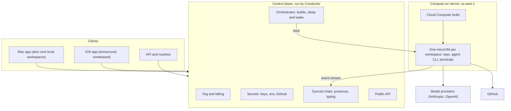
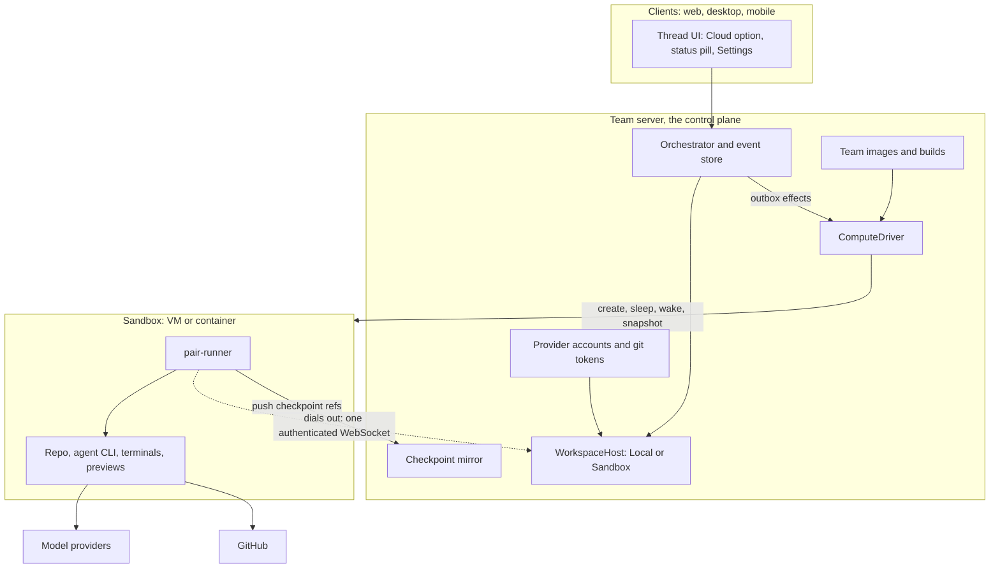

# Conductor Cloud and Pair's path to parity

This page explains how Conductor Cloud works and how Pair could match it, including bring-your-own-cloud
(BYOC). A third-party review says Conductor Cloud launched on 2026-07-30. Meta has acquired Conductor,
and secondary reports say sign-ups closed on 2026-11-04, the product goes read-only on 2026-11-13 and
shuts down on 2026-11-20; no official Conductor source confirms those dates. If they hold, the shutdown
is the market window. The signals that started this work are in [market signals](./market-signals.md).

Research date: 2026-11-06. Statements marked (inferred) are our reading, not something Conductor
documents. Sources are listed at the end.

## How Conductor Cloud works

| Piece                    | What Conductor does                                                                                                                                                                                                                                                                                                                                                                                                                                                                      |
| ------------------------ | ---------------------------------------------------------------------------------------------------------------------------------------------------------------------------------------------------------------------------------------------------------------------------------------------------------------------------------------------------------------------------------------------------------------------------------------------------------------------------------------- |
| Compute                  | One Vercel Sandbox (a Firecracker microVM) per workspace: 8 vCPU, 16 GB RAM, 32 GB ephemeral NVMe. Amazon Linux 2023 with Node 24, npm, pnpm, Python 3, git, gh, jq, ripgrep, Git LFS, tmux, Vim and Chrome. Users have sudo and dnf. us-east-1 only. Conductor says it built this closely with Vercel, and it hosts all of it.                                                                                                                                                           |
| Team image               | Called the Cloud Computer. One per organization. It is a template, not a running machine: every workspace boots its own VM from it.                                                                                                                                                                                                                                                                                                                                                      |
| Build                    | One org-wide recipe produces a reusable machine image. See question 3 below.                                                                                                                                                                                                                                                                                                                                                                                                             |
| Per-repo setup script    | Runs on every new workspace. Saving it needs no build. Cloud ignores the local `.conductor/settings.toml` and `conductor.json` setup scripts.                                                                                                                                                                                                                                                                                                                                            |
| Admin agent              | An agent in an Admin workspace can inspect and test repos, edit the install and setup scripts, and run builds. It cannot add or remove repos, change env vars or secrets, manage members or credentials, or activate older builds.                                                                                                                                                                                                                                                       |
| Lifecycle                | Sleeps after 20 minutes with no agent or terminal activity; a focused Conductor window counts as activity. Hard stop at 23h50m even if active, just under Vercel's 24-hour session cap on Pro and Enterprise (inferred cause). Files and chat survive sleep. Running processes and in-flight turns do not. Opening the workspace wakes it, and there is a Restart if Unresponsive action.                                                                                                                |
| Access                   | Open via SSH (an editor's Remote SSH). One-way sync from cloud to Mac, per member. Forward ports: no `CONDUCTOR_PORT`, bind to 0.0.0.0, port 22 is reserved. Each workspace has a cloud terminal and a local terminal. Cloud terminals are read-only while the VM sleeps.                                                                                                                                                                                                                 |
| Credentials              | Each member adds a personal subscription token or API key per agent. Settings offers a copyable `claude setup-token` command and can import from local Conductor. Each org chooses API key or subscription for Claude Code, Codex and Cursor. Admins add shared org keys in Settings → Organization → Agents, and a shared key takes precedence over a member's personal key for the same agent. Git and GitHub auth is managed by Conductor. How tokens are stored is not documented. |
| Environment variables    | Org Cloud Computer vars apply everywhere. Repo and personal cloud vars override org vars of the same name. Reserved: `HOME`, `PATH`, `PORT`, `NODE_PATH`, the basic `CONDUCTOR_*` names, `CONDUCTOR_INTERNAL_*` and `CONDUCTOR_GIT_AUTH_*`. The docs say not to put GitHub tokens in env vars.                                                                                                                                                                                          |
| Provided variables       | `CONDUCTOR_WORKSPACE_NAME`, `CONDUCTOR_WORKSPACE_PATH`, `CONDUCTOR_ROOT_PATH`, `CONDUCTOR_BASE_DIR`, `CONDUCTOR_IS_LOCAL=0`, `CONDUCTOR_API_URL`, and `CONDUCTOR_API_TOKEN` (workspace-scoped, on newer machine-launched workspaces), `CONDUCTOR_API_KEY` (your own key if set, and it wins over the workspace token), and `CONDUCTOR_SESSION_ID` (agent processes only).                                                                                                                                                                        |
| Data                     | Chat messages from cloud workspaces are stored on Conductor's servers, which Conductor says it must do. In a local workspace, messages go straight to the model provider and stay on the device.                                                                                                                                                                                                                                                                                         |
| Git hosts                | GitHub only.                                                                                                                                                                                                                                                                                                                                                                                                                                                                             |
| Plans and pricing        | Cloud is on Pro, Team and Enterprise. Team is invite-only and adds multiplayer, central billing and admin roles. Enterprise adds automated user provisioning, an SLA and security controls. There was no extra cloud fee at the time, and usage-based compute pricing was planned. A third-party review claimed Pro was $50 a month (unverified).                                                                                                                                             |
| Bring your own cloud     | The FAQ answers "Not yet". A self-hosted offering is in development and is an Enterprise conversation only. Conductor never shipped it.                                                                                                                                                                                                                                                                                                                                                  |

## Questions the team asked

### 1. What is a workspace?

Conductor's unit of work: one repo, one branch, its checkout, and one or more chats (sessions) that
share those files. Locally it is a git worktree. In cloud it is a VM holding the checkout. The closest
Pair concept is a thread in New worktree mode. Conductor's several chats in one workspace map to
several Pair threads.

### 2. Is it one 8 vCPU VM per org?

No. The Cloud Computer is the template, and every workspace gets its own 8 vCPU VM booted from it.
Twenty workspaces are twenty VMs. That parallelism is what took one team from about 5 to 90+ PRs a day
(Pulkit Gupta, see [market signals](./market-signals.md)).

### 3. What is a build?

One run of the org recipe that produces a reusable machine image.

- Inputs: repos (up to 50), env vars and secrets, and one install script.
- Steps: clone the repos, add the env, then run the install script once from the sandbox home as Bash
  with `set -euo pipefail`. Any failure fails the build.
- Output: a numbered version in History. A successful build becomes Active automatically, and any
  earlier successful build can be re-activated instantly.
- Effect: new workspaces boot from the active build. Existing workspaces keep theirs.

The docs say "build", not "snapshot". Booting many VMs from one recorded version implies a VM snapshot
(inferred).

There are two layers. The build is org-wide, slow and rare: system packages, runtimes and caches. The
per-repo setup script runs on every new workspace: dependency install, generated files and seed data.
The analogy is a Docker image build or a Codespaces prebuild. One trap: the install script must append
PATH changes to `~/.profile`, or later shells won't see them.

### 4. In a shared chat, whose credential runs Alice's message and Bob's?

Undocumented. What is documented:

- Each member has a personal credential per agent.
- An org shared key is usable by everyone. It exists for central billing and for members with no
  subscription of their own.
- "Override" means the shared key wins over a personal key for the same agent.

It is likely per session, not per message, because a Claude Code process authenticates when it starts
(inferred).

Pair already has a rule: a thread runs on one provider account, its creator's by default. Only that
account's owner can pick it, and a teammate who prompts the thread uses the thread's account. See
[Team](../user/team.md#your-own-provider-account).

### 5. What do Conductor's servers do besides store chats?

- Orgs, members, roles and Stripe billing.
- The GitHub App and git auth.
- Cloud Computer builds, with history and rollback.
- VM lifecycle: create, sleep, wake, restart and the lifetime limit.
- Credential and secret storage.
- Multiplayer: a Home view filtered by teammate or project, presence dots, typing, live transcript,
  follow, reassign, and ⌘⇧C links.
- The public API, routine webhooks, SQL search and workspace tokens.
- The file-sync source, and the SSH and port-forward endpoints. The mechanism is undocumented.

### 6. What is the API for?

A REST API at `https://api.conductor.build/v0`, authenticated with a bearer API key. It is in beta.

| Endpoint                        | What it does                                                                         |
| ------------------------------- | ------------------------------------------------------------------------------------ |
| `GET /projects`                 | List projects.                                                                       |
| `POST /workspaces`              | Create a workspace. Also read, rename, archive, unarchive, sleep and list sessions.  |
| `POST /sessions`                | Start a session.                                                                     |
| `POST/GET /sessions/{id}/messages` | Send a message, or read the transcript.                                           |
| `GET /sessions/{id}/status`     | `idle`, `working` or `errored`.                                                      |
| `POST /sessions/{id}/cancel`    | Cancel the running turn.                                                             |
| Attachments                     | In preview. Files up to 100 MB each, up to 10 per message.                           |
| `POST /sql`                     | Read-only SQL over transcripts.                                                      |

Routines are saved prompts. A JSON POST to a routine's webhook runs the prompt in a fresh workspace and
returns 202. The URL is the only credential, and there is a rotate-secret action. Conductor names
Slackbots, custom UIs, internal tools and driving workspaces from OpenClaw as uses. Agents can also fan
out to other agents through the workspace token.

Pair's equivalents: the `/mcp` endpoint (about 35 tools, OAuth), the `t3 thread` CLI, member API
tokens, and scheduled tasks, which already support webhook triggers. See
[Agents and automation](../user/outside-agents.md).

## Conductor's system design

### Lifecycle of a turn

1. The Mac app, the API or a routine creates a workspace. The orchestrator boots a microVM from the
   active build, checks out the branch and runs the repo setup script.
2. A Conductor process in the VM starts the real agent CLI (Claude Code, Codex, Cursor or OpenCode)
   with the right credential (inferred; the process is not documented).
3. Agent output streams to the control plane, which stores it and fans it out live to every viewer.
   This is why cloud chats must be stored.
4. Model calls likely go directly from the VM to the provider (inferred). Git uses Conductor-managed
   credentials. SSH, file sync and port forwards go through Conductor.
5. After 20 idle minutes the VM sleeps. Opening the workspace wakes it.

## Sandbox vendors

These are the candidates for Pair's compute drivers.

| Vendor         | Isolation                       | Sizes and price                                                                                                                                                                                                                                                                                              | Lifetime and persistence                                                                                                                                                                                  | BYOC                                                                                                                                                                   | Notes                                                                                                                                                                                                                                                         |
| -------------- | ------------------------------- | ------------------------------------------------------------------------------------------------------------------------------------------------------------------------------------------------------------------------------------------------------------------------------------------------------------ | --------------------------------------------------------------------------------------------------------------------------------------------------------------------------------------------------------- | ---------------------------------------------------------------------------------------------------------------------------------------------------------------------- | ------------------------------------------------------------------------------------------------------------------------------------------------------------------------------------------------------------------------------------------------------------- |
| Vercel Sandbox | Firecracker microVMs            | Active CPU pricing. Example: 1 vCPU and 2 GB costs about $1.05 a day idle and $4.09 a day busy in iad1.                                                                                                                                                                                                      | A session lasts up to 45 minutes on Hobby and 24 hours on Pro and Enterprise. Persistent sandboxes save on stop. Snapshots expire 30 days after last use by default.                                       | No. It is Vercel's cloud.                                                                                                                                              | What Conductor used. The default image is an Ubuntu-based universal image with Node LTS, Python and coding agents; custom OCI images go through Vercel Container Registry. A firewall brokers credentials by injecting auth headers into matching outbound requests, so secrets never enter the VM. Secure Compute adds static IPs and VPC peering. Drives are in private beta. |
| boat.dev       | Full Ubuntu VMs, Docker inside  | Small 2 vCPU / 4 GB at $0.018 an hour. Default 4 / 8 at $0.036. Large 8 / 16 at $0.072. Xlarge 16 / 32 at $0.200 ($100 plan and up). Per-second billing, nothing while stopped. Plans are $20, $100, $500 and $2000 per seat per month, with the price returned as VM time, allowing 100, 300, 1000 and 2000 concurrent sandboxes. | Stop saves a snapshot and resume restores it. You can fork from saved snapshots (templates). Auto-stop defaults to 1 hour, is configurable up to 30 days, or can be off. Stopped disks are kept for at least 14 days. | Not mentioned in the docs, nor is self-hosting. Machines run only in Germany, Finland and France, which adds a transatlantic round trip for a US team server. | YC company, by ASCII. SSH and SCP, a dedicated IP, and a virtual desktop with a browser. REST API plus TypeScript (`@boatdev/sdk`) and Python SDKs, with API keys. `noEnv: true` keeps account secrets out of user sandboxes. Its built-in `boat prompt` runs Claude Code or Codex; Pair should use its own runner instead. Vendor risk: a young startup. |
| E2B | Firecracker sandboxes | 1–8 vCPU and 1–8 GiB of RAM, so no 16 GB machine without an Enterprise deal. | Up to 1 hour per session on Hobby and 24 hours on Pro. | Sells managed BYOC deployments into a customer's AWS or GCP (Enterprise). For self-hosting, the open-source runtime (Apache-2.0) now offers only Embed, a single node installed with Docker Compose, Terraform or a Kubernetes manifest. | Pausing saves memory as well as disk, so a Pair driver would need a disk-only sleep. |
| Daytona | Not covered. | Not covered. | Not covered. | Was open source (AGPL) and self-hostable. An August 2026 competitor blog says it went closed-source in June 2026 (unverified). | Verify the license before planning on it. |

## Pair architecture for parity

Pair's team server already is most of Conductor's control plane. Keep it as the control plane and move
only execution. Add a third thread workspace mode, `cloud`, beside today's `local` and `worktree`
(`ThreadEnvMode` in [environment.ts](../../packages/contracts/src/environment.ts)).

### Parity table

| Conductor feature                                                      | Pair today                                                                                                                                                      | Needed                                                                                                   |
| ---------------------------------------------------------------------- | --------------------------------------------------------------------------------------------------------------------------------------------------------------- | -------------------------------------------------------------------------------------------------------- |
| Multiplayer: shared chats, presence, follow, reassign, links, Home     | Members and roles, attribution, Follow, Assign, presence, share links and the Team shelf.                                                                       | Done.                                                                                                    |
| iOS app                                                                | T3 Code's mobile app with the team features.                                                                                                                    | Done. Push needs the team's own build.                                                                   |
| API, workspace token, agent-to-agent                                   | `/mcp`, the `t3 thread` CLI and member API tokens. Agents can launch, message and wait on other threads.                                                        | Done. Add a sandbox-scoped token for the runner.                                                         |
| Routines: webhook to new workspace                                     | Scheduled tasks with webhook triggers and a workspace strategy.                                                                                                 | Done.                                                                                                    |
| Bring your own subscriptions, org shared keys                          | Shared provider instances managed by admins, plus members' own accounts. A thread runs on one account.                                                          | Done. Keep Pair's explicit-account rule rather than Conductor's shared-key override.                      |
| GitHub integration                                                     | Members connect their own GitHub, and pull requests open as them.                                                                                               | Git credentials inside sandboxes.                                                                        |
| One VM per workspace                                                   | Missing.                                                                                                                                                        | A compute driver and a runner.                                                                           |
| Cloud Computer builds                                                  | Project setup scripts exist ([`ProjectSetupScriptRunner`](../../apps/server/src/project/ProjectSetupScriptRunner.ts)).                                          | Team image builds with versions and rollback.                                                            |
| Sleep, wake and lifetime                                               | Missing.                                                                                                                                                        | Sandbox lifecycle.                                                                                       |
| SSH, ports and terminals                                               | Terminals and previews exist on the server.                                                                                                                     | Route them through the runner. SSH later. Skip the one-way file sync (yagni).                            |
| BYOC                                                                   | Not built.                                                                                                                                             | Conductor never shipped it, so this is Pair's differentiator.                                            |

### Components

1. **Team server (exists, the control plane).** Orchestration and the event store, auth, members,
   provider accounts, GitHub, MCP, the CLI and tokens, scheduled tasks, push and presence. Its role
   does not change.

2. **`WorkspaceHost` (new, in `apps/server`).** A per-thread service for process spawn with stdio
   streams, PTY, file system and port access. `LocalWorkspaceHost` is today's behavior.
   `SandboxWorkspaceHost` forwards to the runner. The code reality: about 51 non-test server files
   spawn processes or PTYs. Most use Effect's injectable `ChildProcessSpawner`, so a remote spawner can
   be provided per thread. About 23 files import `node:child_process` directly, including the Claude
   adapter's `spawnClaudeProcessGroup` in
   [ClaudeAdapterV2.ts](../../apps/server/src/orchestration-v2/Adapters/ClaudeAdapterV2.ts), and must
   move behind the seam. Terminals ([NodePtyAdapter.ts](../../apps/server/src/terminal/NodePtyAdapter.ts)),
   [WorkspaceFileSystem.ts](../../apps/server/src/workspace/WorkspaceFileSystem.ts),
   [VcsProcess.ts](../../apps/server/src/vcs/VcsProcess.ts) and preview port scanning
   ([PortScanner.ts](../../apps/server/src/preview/PortScanner.ts)) route through it too. There is
   precedent: [DeviceHost.ts](../../apps/server/src/device/DeviceHost.ts) already abstracts local, SSH
   and EAS device hosts, and EAS is billed and session-limited. See [Devices](../internals/devices.md).

3. **`pair-runner` (new, inside each VM).** A small Node process baked into the image. It dials out
   to the team server over one authenticated WebSocket, so the VM needs no inbound ports and works in a
   private VPC or behind NAT. This is the same idea as [T3 Connect](../internals/t3-connect.md). It
   multiplexes spawn and stdio, PTY, file system operations, and TCP tunnels for previews and SSH. It
   uses a sandbox-scoped token the server mints, and that token can reach only its own sandbox channel.

4. **`ComputeDriver` (new, pluggable).** Create from an image, start, stop, snapshot, destroy, status,
   and list (for orphan cleanup after a crash, as the EAS device host does). Drivers, in order: Docker
   on the same machine, then one hosted vendor (boat or E2B), later Kubernetes or the customer's cloud.
   The driver enforces caps on running sandboxes per team and per member. That is the concurrency cap
   already listed as a follow-up in [decisions](./decisions.md).

5. **Team image (Pair's Cloud Computer).** An admin-owned recipe of repos, env and secret references,
   and an install script. A build runs in a sandbox through the driver and snapshots it into an image
   version, with an active version, history, rollback and logs. Project setup scripts still run for
   each new cloud thread. The admin agent is an ordinary thread with MCP tools to edit the install
   script and start builds. It never touches secrets.

6. **Sandbox lifecycle in orchestration.** Sandbox state (provisioning, ready, sleeping, waking,
   failed) is event-sourced, so clients show an honest status. Provision, wake and sleep are outbox
   effects whose results return as commands, which matches the existing orchestrator, event sink and
   effect worker pattern in [Orchestrator.ts](../../apps/server/src/orchestration-v2/Orchestrator.ts).
   Idle policy: sleep after N minutes with no running turn, terminal activity or viewer. Wake on open,
   prompt, API call or scheduled task. A prompt sent to a sleeping thread queues until the sandbox is
   awake. For vendor lifetime caps, snapshot and restart between turns before the limit.

7. **Credentials.** Never baked into images. At provider spawn the server injects the thread
   account's credential: for example `CLAUDE_CODE_OAUTH_TOKEN` from `claude setup-token`, which is
   inference-only, or Codex's auth file written into a per-process temp dir. Teammates who prompt a
   thread bill the thread's account. For git, a credential helper in the runner asks the server for a
   short-lived token for the acting member (or a GitHub App installation token), so no long-lived git
   token rests in the VM. Caveat: anything the agent process can read, the agent can leak. Offer
   egress allowlists where the driver supports them. Vercel's credential brokering is the stronger
   pattern.

8. **Checkpoints and diffs while asleep.** Checkpoint refs (hidden git refs) live in the sandbox
   repo. After each turn the runner pushes them to a bare mirror on the team server, so diffs, review
   and restore previews work without waking the VM. Restore wakes it.

9. **Clients (web, desktop, mobile).** A Cloud option when starting a thread, and a status pill
   (waking, sleeping). Settings → Team → Cloud holds driver config, caps, image builds and logs.
   Contract changes go through `packages/contracts`, so every client follows.

10. **Usage.** Sandbox minutes per member and per thread, next to tokens in Settings → Team.

Providers: start with Claude and Codex. Each other adapter (Cursor, OpenCode, Antigravity, Kiro and
the rest) needs its CLI in the image and a credential decision. "Not supported in cloud yet" is an
acceptable answer per adapter.

### BYOC: deployment tiers

| Tier                 | Control plane                  | Compute                                                    | Who it's for                                                                                         |
| -------------------- | ------------------------------ | ---------------------------------------------------------- | ---------------------------------------------------------------------------------------------------- |
| 0 (today)            | One box                        | Local worktrees on that box.                               | Teams of 8–10 on one server.                                                                         |
| 1                    | One box                        | Per-thread containers from a Docker driver.                | Teams that want isolation and caps with no new vendor.                                               |
| 2                    | Team server anywhere           | Hosted sandboxes (boat, E2B or Vercel) in the vendor's cloud. | Teams that want the fastest path to a Conductor-like experience.                                  |
| 3, full BYOC         | Team server                    | Sandboxes in the customer's own account: a Kubernetes or Firecracker driver, or E2B BYOC. | Teams whose code and credentials must stay in their own cloud.                    |
| Optional: managed    | Pair hosts the team server     | Any tier above.                                            | Customers who want Conductor-style SaaS. This is a business decision on the same architecture.       |

Because the runner dials out, only the team server must be reachable.

### Slices

1. The `WorkspaceHost` seam, local only, with no behavior change.
2. The runner, the Docker driver, the `cloud` thread mode, credential injection and the checkpoint
   mirror, end to end on one machine.
3. The first hosted driver (boat or E2B) with sleep, wake and lifetime handling.
4. Team image builds UI and the admin agent.
5. SSH and open-in-editor, sandbox usage, and BYOC drivers.

### Risks and open questions

- **The seam refactor touches about 50 files.** Slice 1 must be a no-op for local users.
- **Stdio and terminal traffic over a WebSocket.** Provider protocols are small but chatty. Reuse the
  terminal output protocol and measure latency; performance is a T3 Code non-negotiable.
- **Provider terms.** Sharing or pooling one person's subscription across a team may break them. Pooling
  is already a non-goal in [market signals](./market-signals.md).
- **Vendor risk.** boat and E2B are startups, and Conductor itself just vanished. The driver interface
  is the hedge.
- **Idle cost.** Sleep policy defaults need real numbers.
- **Runner token scope.** What a sandbox can reach on the team server must stay narrow.
- **Which hosted vendor first.** boat has a 30-day lifetime, low prices and persistent VMs, but no BYOC.
  E2B has a BYOC path and open-source infra.

## Sources

Conductor:

- [Conductor Cloud](https://www.conductor.build/docs/cloud)
- [Cloud FAQ](https://www.conductor.build/docs/cloud/faq)
- [Cloud Computer](https://www.conductor.build/docs/cloud/cloud-computer)
- [Working with cloud workspaces](https://www.conductor.build/docs/cloud/working-with-cloud-workspaces)
- [Getting started](https://www.conductor.build/docs/cloud/getting-started)
- [Collaboration](https://www.conductor.build/docs/cloud/collaboration)
- [Environment variables](https://www.conductor.build/docs/cloud/environment-variables)
- [API](https://www.conductor.build/docs/api)
- [Changelog 0.78.0, introducing Conductor Cloud](https://www.conductor.build/changelog/0.78.0-introducing-conductor-cloud)
- [Charlie Holtz on X](https://x.com/charlieholtz/status/2082974209438044211)

Third-party reports on the launch and the shutdown (the dates are unconfirmed by Conductor):

- [Conductor review, cloudroom.dev](https://www.cloudroom.dev/blog/conductor-review)
- [Meta acquires Conductor, mlq.ai](https://mlq.ai/news/meta-acquires-conductor-will-shut-down-its-cloud-coding-service-this-month/)
- [Conductor Cloud read-only Nov 13, tech-insider.org](https://tech-insider.org/conductor-cloud-read-only-nov-13-meta-msl-migration-2026/)

Sandbox vendors and agent auth:

- [Vercel Sandbox](https://vercel.com/docs/vercel-sandbox)
- [Vercel Sandbox vs CodeSandbox](https://vercel.com/kb/guide/vercel-sandbox-vs-codesandbox)
- [boat.dev docs](https://docs.boat.dev)
- [boat.dev pricing](https://docs.boat.dev/pricing.md)
- [boat.dev limits](https://docs.boat.dev/limits.md)
- [boat.dev security](https://docs.boat.dev/security.md)
- [E2B pricing](https://e2b.dev/pricing)
- [boat.dev platform guide](https://docs.boat.dev/platform-guide)
- [boat on Y Combinator](https://www.ycombinator.com/companies/boat)
- [Self-hosted agent sandboxes, helix.ml](https://helix.ml/blog/self-hosted-agent-sandboxes)
- [E2B runtime README](https://github.com/e2b-dev/runtime) and [Embed](https://github.com/e2b-dev/runtime/tree/main/embed)
- [E2B vs Daytona, morphllm.com](https://www.morphllm.com/comparisons/e2b-vs-daytona)
- [Claude Code authentication](https://code.claude.com/docs/en/authentication.md)
